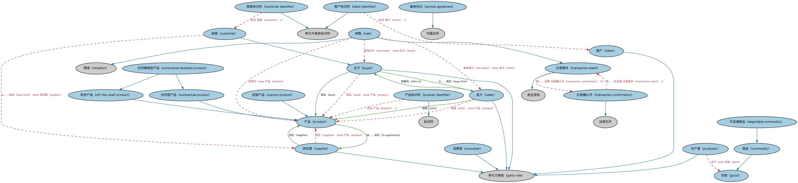

# 产品与服务本体（Products and Services Ontology）结构与公理说明

本文档对应 `ProductsAndServices.rdf` / `ProductsAndServices.ttl`，说明该本体的类、继承关系、属性和公理约定。结构图见 `ProductsAndServices-structure.png`（`ProductsAndServices-structure.svg` 为可缩放版本）。

## 1. 本体概述

定义产品（product）与服务（service）的通用概念：提供方、客户、产品特征与服务协议。

**在体系中的位置**：FND 产品与服务模块的基础本体，是 FBC 金融产品与服务的直接上游。

**上下游关系**：上游依赖参与方与协议本体；下游被 FBC 金融产品与服务本体特化到金融领域。

**与相近概念的差别**：产品≠服务——产品是可交付的标的（可以是一项安排），服务是持续提供的行为；本本体是领域无关的，金融特性在 FBC 层加入。

## 2. 类（Class）

| 类（Class） | 定义（Definition） |
|---|---|
| 买方（buyer） | 依销售合同以货币或其他对价购买某物的参与方。 |
| 客户（client） | 向另一参与方购买专业服务、或与其存在购买服务之正式关系的参与方。 |
| 客户标识符（client identifier） | 在某组织情境内唯一标识客户的字符序列。 |
| 商品（commodity） | 商业中使用的、可与同类型其他商品互换的物质资源。 |
| 消费者（consumer） | 使用经济货物或服务的参与方，通常用于个人、家庭或住户目的。 |
| 合同型产品（contractual product） | 以协议形式存在的产品。 |
| 合同模板型产品（contractual template product） | 通过为模板中定义的参数指定取值而定稿的合同型产品。 |
| 定制产品（custom product） | 按订单生产、依客户规格委托制作的产品。 |
| 顾客（customer） | 接收或消费产品（货物或服务）、并能在不同产品和供应商之间选择的参与方。 |
| 顾客标识符（customer identifier） | 在某组织情境内唯一标识顾客的字符序列。 |
| 货物（good） | 可确立所有权、且其所有权可通过交易在参与方之间转移的有形生产物品。 |
| 可流通商品（negotiable commodity） | 可在某市场买入或卖出的商品。 |
| 现货产品（off-the-shelf product） | 可直接从库存现货获得、或可快速按订单配置的产品，非专门设计或定制。 |
| 生产者（producer） | 某种产品或其他货物的种植者、制造者、加工者或生产商。 |
| 产品（product） | 商业化分销的货物：(1) 有形财产，(2) 加工、制造或生产过程的产出或结果，或 (3) 服务。 |
| 产品标识符（product identifier） | 在某情境中唯一标识产品的字符序列。 |
| 销售（sale） | 以货物或服务换取货币的交换。 |
| 卖方（seller） | 向实际或潜在买方作出、要约或订立销售合同的参与方。 |
| 服务协议（service agreement） | 客户与服务提供方之间的书面合同，服务提供方据此以时间、劳务和/或专业知识的形式提供某项服务。 |
| 供应商（supplier） | 提供某参与方所需货物或服务的参与方，尤指长期供应者。 |
| 交易确认书（transaction confirmation） | 卖方或服务提供方出具的、复述交易相关细节的书面通信。 |
| 交易事件（transaction event） | 交易的事件成分。 |

### 2.1 继承关系（Inheritance）

- 买方（buyer） ⊑ 参与方角色（party role）
- 客户（client） ⊑ 参与方角色（party role）
- 客户标识符（client identifier） ⊑ 参与方角色标识符
- 商品（commodity） ⊑ 货物（good）
- 消费者（consumer） ⊑ 参与方角色（party role）
- 合同型产品（contractual product） ⊑ 产品（product）
- 合同模板型产品（contractual template product） ⊑ 合同型产品（contractual product）
- 合同模板型产品（contractual template product） ⊑ 现货产品（off-the-shelf product）
- 定制产品（custom product） ⊑ 产品（product）
- 顾客（customer） ⊑ 买方（buyer）
- 顾客标识符（customer identifier） ⊑ 参与方角色标识符
- 可流通商品（negotiable commodity） ⊑ 商品（commodity）
- 现货产品（off-the-shelf product） ⊑ 产品（product）
- 生产者（producer） ⊑ 参与方角色（party role）
- 产品标识符（product identifier） ⊑ 标识符
- 销售（sale） ⊑ 交易事件（transaction event）
- 销售（sale） ⊑ 情境（situation）
- 卖方（seller） ⊑ 参与方角色（party role）
- 服务协议（service agreement） ⊑ 书面合同
- 供应商（supplier） ⊑ 参与方角色（party role）
- 交易确认书（transaction confirmation） ⊑ 法律文件
- 交易事件（transaction event） ⊑ 发生类别

## 3. 对象属性（Object Property）

| 属性（Property） | 中文（English） | 定义（Definition） | 说明 |
|---|---|---|---|
| fibo-fnd-pas-pas:buys | 购买（buys） | 将处于购买者角色的参与方关联到其已购买或计划购买的事物。 | 定义域（domain）：买方（buyer）；值域（range）：产品（product） |
| fibo-fnd-pas-pas:buysFrom | 从……购买（buys from） | 将处于购买者角色的参与方关联到其已购买或计划购买的对方参与方。 | 定义域（domain）：买方（buyer）；值域（range）：卖方（seller）；子属性（subPropertyOf）：受…影响（is affected by） |
| fibo-fnd-pas-pas:hasBuyer | 具有买方（has buyer） | 标识销售交易情境中的购买方。 | 值域（range）：买方（buyer）；子属性（subPropertyOf）：具有参与方角色（has party role） |
| fibo-fnd-pas-pas:hasSeller | 具有卖方（has seller） | 标识销售交易情境中的卖方。 | 值域（range）：卖方（seller）；子属性（subPropertyOf）：具有行为者（has actor） |
| fibo-fnd-pas-pas:isProvisionedBy | 由……配置提供（is provisioned by） | 标识配置提供服务或设施的服务提供方。 | 值域（range）：服务提供方；逆属性（inverseOf）：配置提供（provisions）；子属性（subPropertyOf）：由……提供 |
| fibo-fnd-pas-pas:isSuppliedBy | 由……供应（is supplied by） | 标识使产品可获得的参与方（供应商、卖方、分销商等）。 | 定义域（domain）：产品（product）；值域（range）：供应商（supplier）；逆属性（inverseOf）：供应（supplies）；子属性（subPropertyOf）：由……提供 |
| fibo-fnd-pas-pas:provisions | 配置提供（provisions） | 定制、提供或装备交付服务所需的事物。 | 定义域（domain）：服务提供方；子属性（subPropertyOf）：提供 |
| fibo-fnd-pas-pas:sells | 销售（sells） | 将处于经纪人、交易商、卖方或经销商角色的参与方关联到其提供出售的事物。 | 定义域（domain）：卖方（seller）；值域（range）：产品（product） |
| fibo-fnd-pas-pas:sellsTo | 销售给（sells to） | 将处于经纪人、交易商、卖方或经销商角色的参与方关联到买方或潜在买方。 | 定义域（domain）：卖方（seller）；值域（range）：买方（buyer）；逆属性（inverseOf）：从……购买（buys from）；子属性（subPropertyOf）：对…采取行动（acts on） |
| fibo-fnd-pas-pas:supplies | 供应（supplies） | 将处于装备商、供应商、分销商等角色的参与方关联到其提供的事物。 | 定义域（domain）：供应商（supplier）；值域（range）：产品（product）；子属性（subPropertyOf）：提供 |

## 5. 公理约定（Axioms）

- 买方（buyer）：购买（buys） some 产品（product）
- 客户（client）：由…扮演（is played by） some（是…的参与方（is a party to） some 服务协议（service agreement））
- 客户标识符（client identifier）：标识 客户（client） =1
- 定制产品（custom product） 与 现货产品（off-the-shelf product） 互斥（disjointWith）
- 顾客（customer）：从……购买（buys from） some 供应商（supplier）
- 顾客标识符（customer identifier）：标识 顾客（customer） =1
- 货物（good） 与 货币金额 互斥（disjointWith）
- 货物（good） 与 房地产 互斥（disjointWith）
- 生产者（producer）：生产 some 货物（good）
- 产品（product）：restriction
- 产品标识符（product identifier）：标识 产品（product） =1
- 销售（sale）：具有价格 some 货币数量
- 销售（sale）：具有买方（has buyer） some 买方（buyer）
- 销售（sale）：具有卖方（has seller） some 卖方（seller）
- 销售（sale）：适用于 some 产品（product）
- 卖方（seller）：销售（sells） some 产品（product）
- 服务协议（service agreement）：具有合同当事方 服务提供方 =1
- 服务协议（service agreement）：管辖 some 服务
- 供应商（supplier）：供应（supplies） some 产品（product）
- 交易确认书（transaction confirmation）：是……的证据 交易事件（transaction event） =1
- 交易事件（transaction event）：由……证明 交易确认书（transaction confirmation） ≥0

## 6. 依赖（owl:imports，17 个）

本本体通过 `owl:imports` 引入以下本体，各项的中文名称与简介如下：

| 导入本体 | 中文名称 | 简介 |
|---|---|---|
| `FND/Accounting/CurrencyAmount.rdf` | 货币金额本体（Currency Amount Ontology） | 定义「金额＋币种」的货币金额（currency amount）表示，是 FIBO 中表达价格、债务金额、付款额等一切带币种数值的基础构件。 |
| `FND/Agreements/Contracts.rdf` | 合同本体（Contracts Ontology） | 在协议之上定义具有法律约束力的合同（contract）：合同当事方、合同条款、义务与权利，是金融工具与交易合同建模的基石。 |
| `FND/DatesAndTimes/Occurrences.rdf` | 事件与发生本体（Occurrences Ontology） | 定义「发生」（occurrence）、事件与触发条件，用于表达企业行动、信用事件等「发生了什么」。 |
| `FND/Law/LegalCapacity.rdf` | 法律能力本体（Legal Capacity Ontology） | 定义法律能力、缔约能力、签章权等概念，刻画主体从事法律行为的资格。 |
| `FND/Parties/Parties.rdf` | 参与方本体（Parties Ontology） | 定义参与方（party）、独立主体（autonomous agent）与「角色扮演」（party in role），是 FIBO 全库使用最广的基础本体之一。 |
| `FND/Places/RealProperty.rdf` | 不动产本体（Real Property Ontology） | 定义不动产（real property）及其与地点、所有权的关系，支撑抵押贷款与房地产金融。 |
| `FND/Relations/Relations.rdf` | 关系本体（Relations Ontology） | FIBO 最底层的基础本体，定义参考（reference）、分类（classify）等通用关系与抽象概念，全库普遍依赖。 |
| `FND/Utilities/AnnotationVocabulary.rdf` | FIBO 标注词汇表（FIBO Annotation Vocabulary） | 定义 FIBO 专用的标注属性（如释义来源、成熟度等级），用于本体自身的元数据标注。 |
| `https://www.omg.org/spec/Commons/AnnotationVocabulary/` | OMG 通用标注词汇表（OMG Commons Annotation Vocabulary） | OMG 通用本体库（Commons）中的标注词汇表，提供概念映射等标注属性，FIBO 用它标注术语与外部标准的对应关系。 |
| `https://www.omg.org/spec/Commons/ContextualDesignators/` | OMG 通用语境指称本体（OMG Commons Contextual Designators） | Commons 库中的语境指称本体，定义「在某个语境下指代某物的名称/符号」，是地址、账户号码等语境相关标识的基础。 |
| `https://www.omg.org/spec/Commons/Documents/` | OMG 通用文档本体（OMG Commons Documents） | Commons 库中的文档本体，定义文档及其组成部分的通用概念。 |
| `https://www.omg.org/spec/Commons/Identifiers/` | OMG 通用标识符本体（OMG Commons Identifiers） | Commons 库中的标识符本体，定义标识符及其编码方案的通用概念。 |
| `https://www.omg.org/spec/Commons/Organizations/` | OMG 通用组织本体（OMG Commons Organizations） | Commons 库中的组织本体，定义组织、组织成员与组织结构的通用概念。 |
| `https://www.omg.org/spec/Commons/PartiesAndSituations/` | OMG 通用参与方与情境本体（OMG Commons Parties and Situations） | Commons 库中的参与方本体，定义独立主体、参与方及其角色扮演的通用概念，是 FIBO 参与方模型的上游。 |
| `https://www.omg.org/spec/Commons/RegulatoryAgencies/` | OMG 通用监管机构本体（OMG Commons Regulatory Agencies） | Commons 库中的监管机构本体，定义监管机构及其监管职权的通用概念。 |
| `https://www.omg.org/spec/Commons/RolesAndCompositions/` | OMG 通用角色与构成本体（OMG Commons Roles and Compositions） | Commons 库中的角色本体，定义角色及整体—部分构成关系的通用概念。 |
| `https://www.omg.org/spec/Commons/SitesAndFacilities/` | OMG 通用场所与设施本体（OMG Commons Sites and Facilities） | Commons 库中的场所与设施本体，定义物理场所、设施及其位置的通用概念。 |

## 7. 文件

- 官方 RDF/XML：`ProductsAndServices.rdf`
- 中文 Turtle：`ProductsAndServices.ttl`
- 结构图：`ProductsAndServices-structure.png` / `ProductsAndServices-structure.svg`