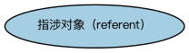

# 关系本体（Relations Ontology）结构与公理说明

本文档对应 `Relations.rdf` / `Relations.ttl`，说明该本体的类、继承关系、属性和公理约定。结构图见 `Relations-structure.png`（`Relations-structure.svg` 为可缩放版本）。

## 1. 本体概述

FIBO 最底层的基础本体：定义参考（reference）、分类（classify）、包含等通用关系与抽象概念，几乎不依赖任何其他 FIBO 本体。

**在体系中的位置**：全库的「地基」——所有域的所有本体最终都追溯到它，这保证了概念体系的统一。

**上下游关系**：上游仅依赖 OMG Commons 基础本体；下游被 FND 全部模块进而被全库引用。

**与相近概念的差别**：它不定义业务概念，只定义「概念之间如何关联」的元概念；与标注词汇表的差别——标注词汇表管「本体自身的元数据」，关系本体管「业务概念之间的关系」。

## 2. 类（Class）

| 类（Class） | 定义（Definition） |
|---|---|
| 指涉对象（referent） | 另一概念所代表、例证、象征或以其他方式提及的事物。 |

### 2.1 继承关系（Inheritance）

## 3. 对象属性（Object Property）

| 属性（Property） | 中文（English） | 定义（Definition） | 说明 |
|---|---|---|---|
| fibo-fnd-rel-rel:causes | 导致（causes） | 事件或事件集或因素（因）与另一事件、现象、情形或结果（果）之间的关系，果被理解为因的推论。 | — |
| fibo-fnd-rel-rel:confers | 授予（confers） | 凭借某种权力授予或赋予。 | — |
| fibo-fnd-rel-rel:controls | 控制（controls） | 对……行使权力或影响力。 | — |
| fibo-fnd-rel-rel:embodies | 体现（embodies） | 是……的表达，赋予……以具体形式。 | — |
| fibo-fnd-rel-rel:evaluates | 评估（evaluates） | 评定某人或某事物的性质、质量或能力。 | 子属性（subPropertyOf）：适用于 |
| fibo-fnd-rel-rel:exchanges | 交换（exchanges） | 以某物换取他物。 | — |
| fibo-fnd-rel-rel:exemplifies | 例证（exemplifies） | 是……的具体实现或实例。 | — |
| fibo-fnd-rel-rel:generates | 生成（generates） | 通过应用一个或多个数学或逻辑步骤或规则产生。 | — |
| fibo-fnd-rel-rel:hasDesignation | 具有指称（hasDesignation） | 标识某事物的指称。 | — |
| fibo-fnd-rel-rel:holds | 持有（holds） | 参与方与其占有、或对其实施某种所有权或控制、或可自主支配的事物之间的关系。 | — |
| fibo-fnd-rel-rel:involves | 涉及（involves） | （情形或事件）将（某事物）作为必要部分或结果包含。 | — |
| fibo-fnd-rel-rel:isCausedBy | 由……导致（is caused by） | 事件（果）与另一事件（因）之间的关系，前者被理解为后者的推论。 | 逆属性（inverseOf）：导致（causes） |
| fibo-fnd-rel-rel:isConferredBy | 由……授予（is conferred by） | 权利或义务与赋予该权利或义务的载体（如协议或合同）之间的关系。 | 逆属性（inverseOf）：授予（confers） |
| fibo-fnd-rel-rel:isControlledBy | 受……控制（is controlled by） | 被……影响、管理或指挥。 | 逆属性（inverseOf）：控制（controls） |
| fibo-fnd-rel-rel:isEvaluatedBy | 由……评估（is evaluated by） | 由……查明或确定。 | 逆属性（inverseOf）：评估（evaluates） |
| fibo-fnd-rel-rel:isExemplifiedBy | 由……例证（is exemplified by） | 由……使之具体化或实现。 | 逆属性（inverseOf）：例证（exemplifies） |
| fibo-fnd-rel-rel:isGeneratedBy | 由……生成（is generated by） | 标识通过某方程、逻辑或规则产生某事物的参与方或事物。 | 逆属性（inverseOf）：生成（generates） |
| fibo-fnd-rel-rel:isHeldBy | 由……持有（is held by） | 标识占有并至少部分控制某事物的参与方，无论所有权归属。 | 逆属性（inverseOf）：持有（holds） |
| fibo-fnd-rel-rel:isIssuedBy | 由……发行（is issued by） | 标识负责流通、分发或发布某事物的功能实体或参与方。 | 子属性（subPropertyOf）：由……提供 |
| fibo-fnd-rel-rel:isMandatedBy | 由……授权要求（is mandated by） | 将责任、能力或行为关联到要求它的事物。 | 子属性（subPropertyOf）：由……授予（is conferred by） |
| fibo-fnd-rel-rel:isProducedBy | 由……生产（is produced by） | 标识通过某生产过程制造、生产或以其他方式创造某事物的生产者。 | 逆属性（inverseOf）：生产（produces） |
| fibo-fnd-rel-rel:issues | 发行（issues） | 正式使某事物可得。 | 逆属性（inverseOf）：由……发行（is issued by）；子属性（subPropertyOf）：提供 |
| fibo-fnd-rel-rel:mandates | 授权要求（mandates） | 将某事物关联到要求它的承诺、合同、法律、义务、要求、规章或类似概念。 | 逆属性（inverseOf）：由……授权要求（is mandated by）；子属性（subPropertyOf）：授予（confers） |
| fibo-fnd-rel-rel:produces | 生产（produces） | 通过加工、制造或生产过程创造。 | — |

## 4. 数据属性（Datatype Property）

| 属性（Property） | 中文（English） | 定义（Definition） |
|---|---|---|
| fibo-fnd-rel-rel:hasAlias | 具有别名（has alias） | 标识某事物为人所知的替代名称。 |
| fibo-fnd-rel-rel:hasCommonName | 具有通用名（has common name） | 标识某事物常被称呼的名称，不涉及任何正式用法或结构。 |
| fibo-fnd-rel-rel:hasFormalName | 具有正式名称（has formal name） | 标识某事物在官方目的或情境中为人所知的名称，或其结构使之称谓始终一致。 |
| fibo-fnd-rel-rel:hasLegalName | 具有法定名称（has legal name） | 指明在法律通信中指称参与方所用的名称。 |
| fibo-fnd-rel-rel:hasTag | 具有标签（hasTag） | 关联与某事物指称对应的唯一字母数字组合。 |
| fibo-fnd-rel-rel:wasFormerlyKnownAs | 曾用名（was formerly known as） | 标识某事物过去为人所知的名称。 |

## 6. 依赖（owl:imports，9 个）

本本体通过 `owl:imports` 引入以下本体，各项的中文名称与简介如下：

| 导入本体 | 中文名称 | 简介 |
|---|---|---|
| `FND/Utilities/AnnotationVocabulary.rdf` | FIBO 标注词汇表（FIBO Annotation Vocabulary） | 定义 FIBO 专用的标注属性（如释义来源、成熟度等级），用于本体自身的元数据标注。 |
| `https://www.omg.org/spec/Commons/AnnotationVocabulary/` | OMG 通用标注词汇表（OMG Commons Annotation Vocabulary） | OMG 通用本体库（Commons）中的标注词汇表，提供概念映射等标注属性，FIBO 用它标注术语与外部标准的对应关系。 |
| `https://www.omg.org/spec/Commons/ContextualDesignators/` | OMG 通用语境指称本体（OMG Commons Contextual Designators） | Commons 库中的语境指称本体，定义「在某个语境下指代某物的名称/符号」，是地址、账户号码等语境相关标识的基础。 |
| `https://www.omg.org/spec/Commons/Designators/` | OMG 通用指称符本体（OMG Commons Designators） | Commons 库中的指称符本体，定义名称、标识符等「指代某物的符号」的通用概念。 |
| `https://www.omg.org/spec/Commons/Documents/` | OMG 通用文档本体（OMG Commons Documents） | Commons 库中的文档本体，定义文档及其组成部分的通用概念。 |
| `https://www.omg.org/spec/Commons/Organizations/` | OMG 通用组织本体（OMG Commons Organizations） | Commons 库中的组织本体，定义组织、组织成员与组织结构的通用概念。 |
| `https://www.omg.org/spec/Commons/RegulatoryAgencies/` | OMG 通用监管机构本体（OMG Commons Regulatory Agencies） | Commons 库中的监管机构本体，定义监管机构及其监管职权的通用概念。 |
| `https://www.omg.org/spec/Commons/RolesAndCompositions/` | OMG 通用角色与构成本体（OMG Commons Roles and Compositions） | Commons 库中的角色本体，定义角色及整体—部分构成关系的通用概念。 |
| `https://www.omg.org/spec/Commons/TextDatatype/` | OMG 通用文本数据类型（OMG Commons Text Datatype） | Commons 库中的文本数据类型定义，提供带语言标记的文本等基础数据类型。 |

## 7. 文件

- 官方 RDF/XML：`Relations.rdf`
- 中文 Turtle：`Relations.ttl`
- 结构图：`Relations-structure.png` / `Relations-structure.svg`