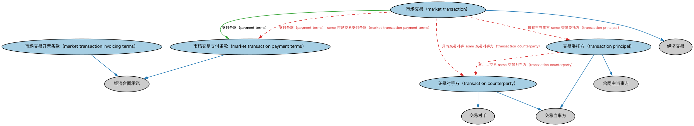

# 市场交易本体（Market Transactions Ontology）结构与公理说明

本文档对应 `MarketTransactions.rdf` / `MarketTransactions.ttl`，说明该本体的类、继承关系、属性和公理约定。结构图见 `MarketTransactions-structure.png`（`MarketTransactions-structure.svg` 为可缩放版本）。

## 1. 本体概述

定义各类市场上一般市场交易的概念，为证券市场交易提供概念基础。

## 2. 类（Class）

| 类（Class） | 定义（Definition） |
|---|---|
| 市场交易（market transaction） | 定义以某种对价换取某种可转让物品供应的交易；市场交易有委托方和对手方，不是对称的。 |
| 市场交易开票条款（market transaction invoicing terms） | 市场交易的开票条款。 |
| 市场交易支付条款（market transaction payment terms） | 市场交易的支付条款。 |
| 交易对手方（transaction counterparty） | 交易中的对手方。 |
| 交易委托方（transaction principal） | 交易中的委托方。 |

### 2.1 继承关系（Inheritance）

- 市场交易（market transaction） ⊑ 经济交易
- 市场交易开票条款（market transaction invoicing terms） ⊑ 经济合同承诺
- 市场交易支付条款（market transaction payment terms） ⊑ 经济合同承诺
- 交易对手方（transaction counterparty） ⊑ 交易对手
- 交易对手方（transaction counterparty） ⊑ 交易当事方
- 交易委托方（transaction principal） ⊑ 合同主当事方
- 交易委托方（transaction principal） ⊑ 交易当事方

## 3. 对象属性（Object Property）

| 属性（Property） | 中文（English） | 定义（Definition） | 说明 |
|---|---|---|---|
| fibo-fnd-txn-mkt:consideration | 对价（consideration） | 交易中作为交换提供的对价。 | 定义域（domain）：市场交易（market transaction）；值域（range）：经济资源；子属性（subPropertyOf）：标的 |
| fibo-fnd-txn-mkt:paymentTerms | 支付条款（payment terms） | 关于付款方式的条款。 | 定义域（domain）：市场交易（market transaction）；值域（range）：市场交易支付条款（market transaction payment terms）；子属性（subPropertyOf）：在……项下交易 |

## 5. 公理约定（Axioms）

- 市场交易（market transaction）：具有交易对手 some 交易对手方（transaction counterparty）
- 市场交易（market transaction）：具有主当事方 some 交易委托方（transaction principal）
- 市场交易（market transaction）：对价（consideration） some 经济资源
- 市场交易（market transaction）：支付条款（payment terms） some 市场交易支付条款（market transaction payment terms）
- 市场交易支付条款（market transaction payment terms）：管辖 some 支付
- 交易委托方（transaction principal）：与……交易 some 交易对手方（transaction counterparty）

## 6. 依赖（owl:imports，6 个）

本本体通过 `owl:imports` 引入以下本体，各项的中文名称与简介如下：

| 导入本体 | 中文名称 | 简介 |
|---|---|---|
| `FND/Agreements/Contracts.rdf` | 合同本体（Contracts Ontology） | 在协议之上定义具有法律约束力的合同（contract）：合同当事方、合同条款、义务与权利，是金融工具与交易合同建模的基石。 |
| `FND/ProductsAndServices/PaymentsAndSchedules.rdf` | 付款与计划表本体（Payments and Schedules Ontology） | 定义付款、付款计划表（payment schedule）及其日期与金额结构，是贷款还款、债券付息建模的基础。 |
| `FND/TransactionsExt/REATransactions.rdf` | REA 交易本体（REA Transactions Ontology） | 基于资源—事件—代理（REA）会计模型定义交易的经济资源交换结构。 |
| `FND/Utilities/AnnotationVocabulary.rdf` | FIBO 标注词汇表（FIBO Annotation Vocabulary） | 定义 FIBO 专用的标注属性（如释义来源、成熟度等级），用于本体自身的元数据标注。 |
| `https://www.omg.org/spec/Commons/AnnotationVocabulary/` | OMG 通用标注词汇表（OMG Commons Annotation Vocabulary） | OMG 通用本体库（Commons）中的标注词汇表，提供概念映射等标注属性，FIBO 用它标注术语与外部标准的对应关系。 |
| `https://www.omg.org/spec/Commons/RegulatoryAgencies/` | OMG 通用监管机构本体（OMG Commons Regulatory Agencies） | Commons 库中的监管机构本体，定义监管机构及其监管职权的通用概念。 |

## 7. 文件

- 官方 RDF/XML：`MarketTransactions.rdf`
- 中文 Turtle：`MarketTransactions.ttl`
- 结构图：`MarketTransactions-structure.png` / `MarketTransactions-structure.svg`