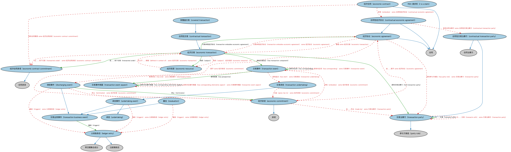

# REA 交易本体（REA Transactions Ontology）结构与公理说明

本文档对应 `REATransactions.rdf` / `REATransactions.ttl`，说明该本体的类、继承关系、属性和公理约定。结构图见 `REATransactions-structure.png`（`REATransactions-structure.svg` 为可缩放版本）。

## 1. 本体概述

基于 REA（资源—事件—代理，Resource-Event-Agent）会计模型定义交易：经济资源的交换由事件驱动、在代理之间发生。

**在体系中的位置**：FND 交易扩展模块的三个本体之一，提供会计视角的交易模型。

**上下游关系**：上游依赖参与方与关系本体；下游为需要从会计本质刻画交易的场景提供框架。

**与相近概念的差别**：REA 模型强调「给予与获取的对偶」（duality）——每笔交易既有付出也有获得；与市场交易本体的差别——REA 是会计理论视角，市场交易是业务操作视角。

本本体中类与类的核心关系如下（完整细节见各类小节）：

- **合同性经济协议（contractual economic agreement）** 继承 **合同（Contract）**
- **合同性经济协议（contractual economic agreement）** 继承 **经济协议（economic agreement）**
- **合同性交易（contractual transaction）** 继承 **经济交易（economic transaction）**
- **合同性交易当事方（contractual transaction party）** 继承 **合同当事方（ContractParty）**
- **合同性交易当事方（contractual transaction party）** 继承 **交易当事方（transaction party）**
- **受覆盖交易（covered transaction）** 继承 **合同性交易（contractual transaction）**
- **清偿事件（discharging event）** 继承 **交易业务事件（transaction business event）**
- **经济协议（economic agreement）** 继承 **合同（Contract）**
- **经济承诺（economic commitment）** 继承 **承诺（Commitment）**
- **经济合同（economic contract）** 继承 **合同（Contract）**
- **经济合同承诺（economic contract commitment）** 继承 **合同承诺（ContractualCommitment）**
- **分类账条目（ledger entry）** 继承 **带日期集合成分（DatedCollectionConstituent）**
- 其余 17 条关系从略。

## 2. 类（Class）

| 类（Class） | 定义（Definition） |
|---|---|
| 合同性经济协议（contractual economic agreement） | 构成交易一部分、以双方之间合同为凭而具有合同地位的经济协议。 |
| 合同性交易（contractual transaction） | 具有某种合同基础的经济交易。 |
| 合同性交易当事方（contractual transaction party） | 具有合同地位之交易的当事方。 |
| 受覆盖交易（covered transaction） | 受某主协议覆盖的交易。 |
| 清偿事件（discharging event） | 使某项义务或承诺得以解除的事件。 |
| 经济协议（economic agreement） | 交易各方之间就经济价值交换达成的协议。 |
| 经济承诺（economic commitment） | 构成某交易标的之承诺，即交易一方向他方作出的承担。 |
| 经济合同（economic contract） | 与两方之间经济交易相关并对其加以治理的合同。 |
| 经济合同承诺（economic contract commitment） | 交易合同所依据的条款。 |
| 经济资源（economic resource） | 任何可购买、出售或交换的事物。 |
| 经济交易（economic transaction） | 两方（经济代理）之间就某些经济价值项目进行的交换。 |
| 分类账条目（ledger entry） | 记录于分类账中的一项条目。 |
| REA 请求权（r e a claim） | 在某给定时点，两方相互权利与义务之间的失衡。 |
| 重估（revaluation） | 对某项价值进行重新评估。 |
| 交易业务事件（transaction business event） | 业务交易各方希望监测或控制的时间中的发生。 |
| 交易事件（transaction event） | 交易的事件成分。 |
| 交易事件侧面（transaction event aspect） | 从交易一方视角所见的交易侧。 |
| 交易当事方（transaction party） | 通过接收和/或让渡某项经济价值或付款而参与某交易的实体。 |
| 交易承担（transaction undertaking） | 以合同方式定义和确立的、交付某些货物、履行某项服务或以现金或实物作出某项付款的承诺。 |
| 承担（undertaking） | 采取行动的某项承担。 |
| 承担事件（undertaking event） | 某时点发生的事情，在该时点一方向他方作出某项承诺。 |

以下按类逐个展开：每个类给出继承关系、相关属性与公理约定；子类在父类之下降一级编号。

### 2.1 经济协议（economic agreement）

定义：交易各方之间就经济价值交换达成的协议。

- 父类：**合同（Contract）**
- 直接子类：**合同性经济协议（contractual economic agreement）**

属性：

| 属性 | 定义 | 说明 |
|---|---|---|
| **授予（confers）** | — | — |
| **具有参与方角色（has party role）** | — | — |
| **管辖（governs）** | — | — |

公理：

- **具有参与方角色（has party role）**至少有一个取值，类型是**交易当事方（transaction party）**。
- **授予（confers）**至少有一个取值，类型是**经济承诺（economic commitment）**。
- **管辖（governs）**至少有一个取值，类型是**经济交易（economic transaction）**。

#### 2.1.1 合同性经济协议（contractual economic agreement）

定义：构成交易一部分、以双方之间合同为凭而具有合同地位的经济协议。

- 父类：**合同（Contract）**、**经济协议（economic agreement）**

属性：

| 属性 | 定义 | 说明 |
|---|---|---|
| **具有合同当事方（hasContractParty）** | — | — |
| **授予（confers）** | — | — |

公理：

- **具有合同当事方（hasContractParty）**至少有一个取值，类型是**合同性交易当事方（contractual transaction party）**。
- **授予（confers）**至少有一个取值，类型是**合同承诺（ContractualCommitment）**。

### 2.2 经济承诺（economic commitment）

定义：构成某交易标的之承诺，即交易一方向他方作出的承担。

- 父类：**承诺（Commitment）**

属性：

| 属性 | 定义 | 说明 |
|---|---|---|
| **由……授予（isConferredBy）** | — | — |
| **由……作出（made by）** | 标识作出某事物的参与方。 | 值域：交易当事方（transaction party） |

公理：

- **由……作出（made by）**至少有一个取值，类型是**交易当事方（transaction party）**。
- **由……授予（isConferredBy）**至少有一个取值，类型是**经济协议（economic agreement）**。

### 2.3 经济合同（economic contract）

定义：与两方之间经济交易相关并对其加以治理的合同。

- 父类：**合同（Contract）**

属性：

| 属性 | 定义 | 说明 |
|---|---|---|
| **具有合同要素（hasContractualElement）** | — | — |
| **体现（embodies）** | — | — |

公理：

- **体现（embodies）**至少有一个取值，类型是**合同性经济协议（contractual economic agreement）**。
- **具有合同要素（hasContractualElement）**至少有一个取值，类型是**经济合同承诺（economic contract commitment）**。

### 2.4 经济合同承诺（economic contract commitment）

定义：交易合同所依据的条款。

- 父类：**合同承诺（ContractualCommitment）**

属性：

| 属性 | 定义 | 说明 |
|---|---|---|
| **列明合同性经济承诺（sets out contractual economic commitment）** | 使交易协议正式化的合同条款中所列明的经济承诺。 | 值域：合同承诺 |

公理：

- **列明合同性经济承诺（sets out contractual economic commitment）**至少有一个取值，类型是**合同承诺（ContractualCommitment）**。

### 2.5 经济资源（economic resource）

定义：任何可购买、出售或交换的事物。

属性：

| 属性 | 定义 | 说明 |
|---|---|---|
| **定义于……情境（defined in context of）** | 标识某事物被定义时所处的情境。 | — |
| **呈现物质形态（takes material form）** | 经济资源所呈现的物质形态，即被确认为经济资源的事物。 | — |

公理：

- **呈现物质形态（takes material form）**至少有一个取值，类型是**owl:Thing（Thing）**。
- **定义于……情境（defined in context of）**至少有一个取值，类型是**经济交易（economic transaction）**。

### 2.6 经济交易（economic transaction）

定义：两方（经济代理）之间就某些经济价值项目进行的交换。

- 直接子类：**合同性交易（contractual transaction）**

属性：

| 属性 | 定义 | 说明 |
|---|---|---|
| **具有交易成分（has transaction component）** | 标识构成交易的成分。 | 值域：交易事件（transaction event） |
| **具有交易当事方（has transaction party）** | 标识参与交易的当事方。 | 值域：交易当事方（transaction party） |
| **标的（subject）** | 某事物所关涉的主题对象。 | 值域：经济资源（economic resource） |
| **在……项下交易（transacted under）** | 标识交易据以进行的协议。 | 值域：经济合同承诺（economic contract commitment） |
| **交易体现经济协议（transaction embodies economic agreement）** | 标识交易所体现的经济协议。 | 值域：经济协议（economic agreement）；逆属性：管辖 |

公理：

- **交易体现经济协议（transaction embodies economic agreement）**至少有一个取值，类型是**经济协议（economic agreement）**。
- **在……项下交易（transacted under）**至少有一个取值，类型是**经济合同承诺（economic contract commitment）**。
- **标的（subject）**至少有 2 个**经济资源（economic resource）**。

#### 2.6.1 合同性交易（contractual transaction）

定义：具有某种合同基础的经济交易。

- 父类：**经济交易（economic transaction）**
- 直接子类：**受覆盖交易（covered transaction）**

##### 2.6.1.1 受覆盖交易（covered transaction）

定义：受某主协议覆盖的交易。

- 父类：**合同性交易（contractual transaction）**

属性：

| 属性 | 定义 | 说明 |
|---|---|---|
| **受……管辖（isGovernedBy）** | — | — |

公理：

- **受……管辖（isGovernedBy）**至少有一个取值，类型是**主协议（MasterAgreement）**。

### 2.7 分类账条目（ledger entry）

定义：记录于分类账中的一项条目。

- 父类：**带日期集合成分（DatedCollectionConstituent）**、**注册簿条目（RegistryEntry）**

属性：

| 属性 | 定义 | 说明 |
|---|---|---|
| **具有过账日期（hasPostingDate）** | — | — |
| **具有交易日期（hasTransactionDate）** | — | — |
| **具有货币数量（hasMonetaryAmount）** | — | — |
| **注册于（isRegisteredIn）** | — | — |

公理：

- **具有交易日期（hasTransactionDate）**恰好有 1 个**交易日期（TransactionDate）**。
- **具有货币数量（hasMonetaryAmount）**恰好有 1 个**货币数量（MonetaryAmount）**。
- **具有过账日期（hasPostingDate）**恰好有 1 个**过账日期（PostingDate）**。
- **注册于（isRegisteredIn）**至少有一个取值，类型是**分类账户（LedgerAccount）**。

### 2.8 REA 请求权（r e a claim）

定义：在某给定时点，两方相互权利与义务之间的失衡。

属性：

| 属性 | 定义 | 说明 |
|---|---|---|
| **是……中的失衡（is imbalance in）** | 一方与另一方之间在义务或权利上的失衡（取决于描述的视角）。 | 值域：法律构造 |

公理：

- **是……中的失衡（is imbalance in）**至少有一个取值，类型是**法律构造（LegalConstruct）**。

### 2.9 交易业务事件（transaction business event）

定义：业务交易各方希望监测或控制的时间中的发生。

- 直接子类：**清偿事件（discharging event）**、**重估（revaluation）**、**承担事件（undertaking event）**

属性：

| 属性 | 定义 | 说明 |
|---|---|---|
| **触发（triggers）** | 引发某事物的发生。 | 值域：分类账条目（ledger entry） |

#### 2.9.1 清偿事件（discharging event）

定义：使某项义务或承诺得以解除的事件。

- 父类：**交易业务事件（transaction business event）**

属性：

| 属性 | 定义 | 说明 |
|---|---|---|
| **终止（terminates）** | 使某事物结束。 | 值域：经济承诺（economic commitment） |
| **触发（triggers）** | 引发某事物的发生。 | 值域：分类账条目（ledger entry） |

公理：

- **终止（terminates）**至少有一个取值，类型是**经济承诺（economic commitment）**。
- **触发（triggers）**至少有一个取值，类型是**分类账条目（ledger entry）**。

#### 2.9.2 重估（revaluation）

定义：对某项价值进行重新评估。

- 父类：**交易业务事件（transaction business event）**

属性：

| 属性 | 定义 | 说明 |
|---|---|---|
| **触发（triggers）** | 引发某事物的发生。 | 值域：分类账条目（ledger entry） |

公理：

- **触发（triggers）**至少有一个取值，类型是**分类账条目（ledger entry）**。

#### 2.9.3 承担事件（undertaking event）

定义：某时点发生的事情，在该时点一方向他方作出某项承诺。

- 父类：**交易业务事件（transaction business event）**、**承担（undertaking）**
- 直接子类：**交易承担（transaction undertaking）**

属性：

| 属性 | 定义 | 说明 |
|---|---|---|
| **触发（triggers）** | 引发某事物的发生。 | 值域：分类账条目（ledger entry） |

公理：

- **触发（triggers）**至少有一个取值，类型是**分类账条目（ledger entry）**。

##### 2.9.3.1 交易承担（transaction undertaking）

定义：以合同方式定义和确立的、交付某些货物、履行某项服务或以现金或实物作出某项付款的承诺。

- 父类：**承担事件（undertaking event）**

属性：

| 属性 | 定义 | 说明 |
|---|---|---|
| **引起（gives rise to）** | 导致某事物的产生。 | 值域：承诺 |

公理：

- **引起（gives rise to）**至少有一个取值，类型是**经济承诺（economic commitment）**。

### 2.10 交易事件（transaction event）

定义：交易的事件成分。

属性：

| 属性 | 定义 | 说明 |
|---|---|---|
| **体现（embodies）** | — | — |
| **具有对应项（has corresponding）** | 标识与某事物相对应的另一事物。 | 值域：交易事件（transaction event） |
| **具有终点（has end）** | 标识与某事物关联的最终或结束时间点。 | 值域：清偿事件（discharging event） |
| **具有视角（has perspective）** | 标识观察某交易所采用的视角。 | 值域：交易事件侧面（transaction event aspect） |
| **具有起点（has start）** | 标识与某事物关联的初始时间点。 | 值域：交易承担（transaction undertaking） |
| **交易事件遵循业务流程（transaction event follows business process）** | 标识交易事件所遵循的业务流程。 | — |

公理：

- **体现（embodies）**至少有一个取值，类型是**经济承诺（economic commitment）**。
- **具有对应项（has corresponding）**至少有一个取值，类型是**交易事件（transaction event）**。
- **具有终点（has end）**至少有一个取值，类型是**清偿事件（discharging event）**。
- **具有起点（has start）**至少有一个取值，类型是**交易承担（transaction undertaking）**。

### 2.11 交易事件侧面（transaction event aspect）

定义：从交易一方视角所见的交易侧。

属性：

| 属性 | 定义 | 说明 |
|---|---|---|
| **具有对应替代侧面（has corresponding alternative aspect）** | 标识某事物对应的替代侧面。 | 值域：交易事件侧面（transaction event aspect） |

公理：

- **具有对应替代侧面（has corresponding alternative aspect）**至少有一个取值，类型是**交易事件侧面（transaction event aspect）**。

### 2.12 交易当事方（transaction party）

定义：通过接收和/或让渡某项经济价值或付款而参与某交易的实体。

- 父类：**参与方角色（party role）**
- 直接子类：**合同性交易当事方（contractual transaction party）**

属性：

| 属性 | 定义 | 说明 |
|---|---|---|
| **与……交易（transacts with）** | 标识交易的对方参与方。 | 值域：交易当事方（transaction party） |

公理：

- **与……交易（transacts with）**至少有一个取值，类型是**交易当事方（transaction party）**。

#### 2.12.1 合同性交易当事方（contractual transaction party）

定义：具有合同地位之交易的当事方。

- 父类：**合同当事方（ContractParty）**、**交易当事方（transaction party）**

属性：

| 属性 | 定义 | 说明 |
|---|---|---|
| **由…扮演（is played by）** | — | — |

公理：

- **由…扮演（is played by）**至少有一个取值，类型是**法律主体（LegalPerson）**。

### 2.13 承担（undertaking）

定义：采取行动的某项承担。

- 直接子类：**承担事件（undertaking event）**

属性：

| 属性 | 定义 | 说明 |
|---|---|---|
| **具有合同当事方（hasContractParty）** | — | — |
| **赋予（bestows）** | 授予或给予。 | 值域：或有权利 |
| **引起（gives rise to）** | 导致某事物的产生。 | 值域：承诺 |
| **作为……的一部分作出（is made as part of）** | 标识某事物作为其组成部分的整体。 | 值域：协议 |
| **承担于（is undertaking to）** | 标识承担所指向的对象。 | 值域：或有义务 |

公理：

- **作为……的一部分作出（is made as part of）**至少有一个取值，类型是**协议（Agreement）**。
- **具有合同当事方（hasContractParty）**至少有一个取值，类型是**合同当事方（ContractParty）**。
- **引起（gives rise to）**至少有一个取值，类型是**承诺（Commitment）**。
- **承担于（is undertaking to）**至少有一个取值，类型是**或有义务（ContingentObligation）**。
- **赋予（bestows）**至少有一个取值，类型是**或有权利（ContingentRight）**。

## 3. 依赖（owl:imports，14 个）

本本体通过 `owl:imports` 引入以下本体，各项的中文名称与简介如下：

| 导入本体 | 中文名称 | 简介 |
|---|---|---|
| `FBC/ProductsAndServices/ClientsAndAccounts.rdf` | 客户与账户本体（Clients and Accounts Ontology） | 定义金融机构的客户、账户及账户持有关系。 |
| `FND/Accounting/CurrencyAmount.rdf` | 货币金额本体（Currency Amount Ontology） | 定义「金额＋币种」的货币金额（currency amount）表示，是 FIBO 中表达价格、债务金额、付款额等一切带币种数值的基础构件。 |
| `FND/Agreements/Agreements.rdf` | 协议本体（Agreements Ontology） | 定义两个或以上参与方之间协议（agreement）的通用概念：协议的当事方、条款、生效与终止，是合同等一切契约性安排的上位模型。 |
| `FND/Agreements/Contracts.rdf` | 合同本体（Contracts Ontology） | 在协议之上定义具有法律约束力的合同（contract）：合同当事方、合同条款、义务与权利，是金融工具与交易合同建模的基石。 |
| `FND/DatesAndTimes/FinancialDates.rdf` | 金融日期本体（Financial Dates Ontology） | 定义金融语境下的日期与期间概念：结算日、付息日、到期日、日计数基准等。 |
| `FND/Law/LegalCapacity.rdf` | 法律能力本体（Legal Capacity Ontology） | 定义法律能力、缔约能力、签章权等概念，刻画主体从事法律行为的资格。 |
| `FND/Relations/Relations.rdf` | 关系本体（Relations Ontology） | FIBO 最底层的基础本体，定义参考（reference）、分类（classify）等通用关系与抽象概念，全库普遍依赖。 |
| `FND/Utilities/AnnotationVocabulary.rdf` | FIBO 标注词汇表（FIBO Annotation Vocabulary） | 定义 FIBO 专用的标注属性（如释义来源、成熟度等级），用于本体自身的元数据标注。 |
| `https://www.omg.org/spec/Commons/AnnotationVocabulary/` | OMG 通用标注词汇表（OMG Commons Annotation Vocabulary） | OMG 通用本体库（Commons）中的标注词汇表，提供概念映射等标注属性，FIBO 用它标注术语与外部标准的对应关系。 |
| `https://www.omg.org/spec/Commons/Organizations/` | OMG 通用组织本体（OMG Commons Organizations） | Commons 库中的组织本体，定义组织、组织成员与组织结构的通用概念。 |
| `https://www.omg.org/spec/Commons/PartiesAndSituations/` | OMG 通用参与方与情境本体（OMG Commons Parties and Situations） | Commons 库中的参与方本体，定义独立主体、参与方及其角色扮演的通用概念，是 FIBO 参与方模型的上游。 |
| `https://www.omg.org/spec/Commons/RegistrationAuthorities/` | OMG 通用登记主管机构本体（OMG Commons Registration Authorities） | Commons 库中的登记主管机构本体，定义负责登记注册的主管机构及其登记行为的通用概念。 |
| `https://www.omg.org/spec/Commons/RegulatoryAgencies/` | OMG 通用监管机构本体（OMG Commons Regulatory Agencies） | Commons 库中的监管机构本体，定义监管机构及其监管职权的通用概念。 |
| `https://www.omg.org/spec/Commons/RolesAndCompositions/` | OMG 通用角色与构成本体（OMG Commons Roles and Compositions） | Commons 库中的角色本体，定义角色及整体—部分构成关系的通用概念。 |

## 4. 文件

- 官方 RDF/XML：`REATransactions.rdf`
- 中文 Turtle：`REATransactions.ttl`
- 结构图：`REATransactions-structure.png` / `REATransactions-structure.svg`