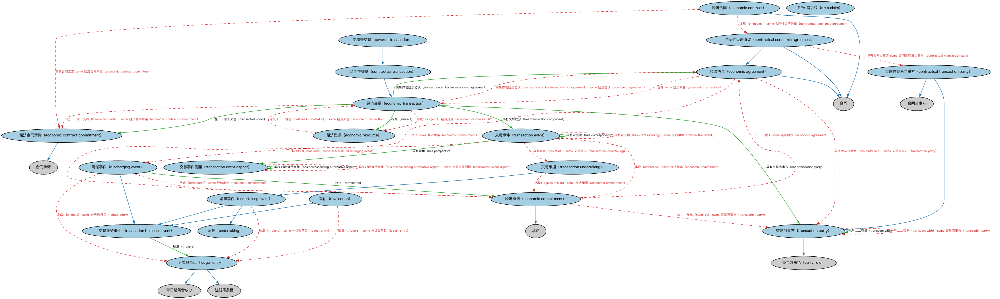

# REA 交易本体（REA Transactions Ontology）结构与公理说明

本文档对应 `REATransactions.rdf` / `REATransactions.ttl`，说明该本体的类、继承关系、属性和公理约定。结构图见 `REATransactions-structure.png`（`REATransactions-structure.svg` 为可缩放版本）。

## 1. 本体概述

基于 REA（资源—事件—代理，Resource-Event-Agent）会计模型定义交易：经济资源的交换由事件驱动、在代理之间发生。

**在体系中的位置**：FND 交易扩展模块的三个本体之一，提供会计视角的交易模型。

**上下游关系**：上游依赖参与方与关系本体；下游为需要从会计本质刻画交易的场景提供框架。

**与相近概念的差别**：REA 模型强调「给予与获取的对偶」（duality）——每笔交易既有付出也有获得；与市场交易本体的差别——REA 是会计理论视角，市场交易是业务操作视角。

## 2. 类（Class）

| 类（Class） | 定义（Definition） |
|---|---|
| 合同性经济协议（contractual economic agreement） | 构成交易一部分、以双方之间合同为凭而具有合同地位的经济协议。 |
| 合同性交易（contractual transaction） | 具有某种合同基础的经济交易。 |
| 合同性交易当事方（contractual transaction party） | 具有合同地位之交易的当事方。 |
| 受覆盖交易（covered transaction） | 受某主协议覆盖的交易。 |
| 清偿事件（discharging event） | 使某项义务或承诺得以解除的事件。 |
| 经济协议（economic agreement） | 交易各方之间就经济价值交换达成的协议。 |
| 经济承诺（economic commitment） | 构成某交易标的之承诺，即交易一方向他方作出的承担。 |
| 经济合同（economic contract） | 与两方之间经济交易相关并对其加以治理的合同。 |
| 经济合同承诺（economic contract commitment） | 交易合同所依据的条款。 |
| 经济资源（economic resource） | 任何可购买、出售或交换的事物。 |
| 经济交易（economic transaction） | 两方（经济代理）之间就某些经济价值项目进行的交换。 |
| 分类账条目（ledger entry） | 记录于分类账中的一项条目。 |
| REA 请求权（r e a claim） | 在某给定时点，两方相互权利与义务之间的失衡。 |
| 重估（revaluation） | 对某项价值进行重新评估。 |
| 交易业务事件（transaction business event） | 业务交易各方希望监测或控制的时间中的发生。 |
| 交易事件（transaction event） | 交易的事件成分。 |
| 交易事件侧面（transaction event aspect） | 从交易一方视角所见的交易侧。 |
| 交易当事方（transaction party） | 通过接收和/或让渡某项经济价值或付款而参与某交易的实体。 |
| 交易承担（transaction undertaking） | 以合同方式定义和确立的、交付某些货物、履行某项服务或以现金或实物作出某项付款的承诺。 |
| 承担（undertaking） | 采取行动的某项承担。 |
| 承担事件（undertaking event） | 某时点发生的事情，在该时点一方向他方作出某项承诺。 |

### 2.1 继承关系（Inheritance）

- 合同性经济协议（contractual economic agreement） ⊑ 合同
- 合同性经济协议（contractual economic agreement） ⊑ 经济协议（economic agreement）
- 合同性交易（contractual transaction） ⊑ 经济交易（economic transaction）
- 合同性交易当事方（contractual transaction party） ⊑ 合同当事方
- 合同性交易当事方（contractual transaction party） ⊑ 交易当事方（transaction party）
- 受覆盖交易（covered transaction） ⊑ 合同性交易（contractual transaction）
- 清偿事件（discharging event） ⊑ 交易业务事件（transaction business event）
- 经济协议（economic agreement） ⊑ 合同
- 经济承诺（economic commitment） ⊑ 承诺
- 经济合同（economic contract） ⊑ 合同
- 经济合同承诺（economic contract commitment） ⊑ 合同承诺
- 分类账条目（ledger entry） ⊑ 带日期集合成分
- 分类账条目（ledger entry） ⊑ 注册簿条目
- 重估（revaluation） ⊑ 交易业务事件（transaction business event）
- 交易当事方（transaction party） ⊑ 参与方角色（party role）
- 交易承担（transaction undertaking） ⊑ 承担事件（undertaking event）
- 承担事件（undertaking event） ⊑ 交易业务事件（transaction business event）
- 承担事件（undertaking event） ⊑ 承担（undertaking）

## 3. 对象属性（Object Property）

| 属性（Property） | 中文（English） | 定义（Definition） | 说明 |
|---|---|---|---|
| fibo-fnd-txn-rea:bestows | 赋予（bestows） | 授予或给予。 | 定义域（domain）：承担（undertaking）；值域（range）：或有权利 |
| fibo-fnd-txn-rea:definedInContextOf | 定义于……情境（defined in context of） | 标识某事物被定义时所处的情境。 | — |
| fibo-fnd-txn-rea:givesRiseTo | 引起（gives rise to） | 导致某事物的产生。 | 定义域（domain）：承担（undertaking）；值域（range）：承诺 |
| fibo-fnd-txn-rea:hasCorresponding | 具有对应项（has corresponding） | 标识与某事物相对应的另一事物。 | 定义域（domain）：交易事件（transaction event）；值域（range）：交易事件（transaction event） |
| fibo-fnd-txn-rea:hasCorrespondingAlternativeAspect | 具有对应替代侧面（has corresponding alternative aspect） | 标识某事物对应的替代侧面。 | 定义域（domain）：交易事件侧面（transaction event aspect）；值域（range）：交易事件侧面（transaction event aspect） |
| fibo-fnd-txn-rea:hasEnd | 具有终点（has end） | 标识与某事物关联的最终或结束时间点。 | 值域（range）：清偿事件（discharging event） |
| fibo-fnd-txn-rea:hasPerspective | 具有视角（has perspective） | 标识观察某交易所采用的视角。 | 定义域（domain）：交易事件（transaction event）；值域（range）：交易事件侧面（transaction event aspect） |
| fibo-fnd-txn-rea:hasStart | 具有起点（has start） | 标识与某事物关联的初始时间点。 | 值域（range）：交易承担（transaction undertaking） |
| fibo-fnd-txn-rea:hasTransactionComponent | 具有交易成分（has transaction component） | 标识构成交易的成分。 | 定义域（domain）：经济交易（economic transaction）；值域（range）：交易事件（transaction event） |
| fibo-fnd-txn-rea:hasTransactionParty | 具有交易当事方（has transaction party） | 标识参与交易的当事方。 | 定义域（domain）：经济交易（economic transaction）；值域（range）：交易当事方（transaction party） |
| fibo-fnd-txn-rea:isImbalanceIn | 是……中的失衡（is imbalance in） | 一方与另一方之间在义务或权利上的失衡（取决于描述的视角）。 | 定义域（domain）：REA 请求权（r e a claim）；值域（range）：法律构造 |
| fibo-fnd-txn-rea:isMadeAsPartOf | 作为……的一部分作出（is made as part of） | 标识某事物作为其组成部分的整体。 | 定义域（domain）：承担（undertaking）；值域（range）：协议 |
| fibo-fnd-txn-rea:isUndertakingTo | 承担于（is undertaking to） | 标识承担所指向的对象。 | 定义域（domain）：承担（undertaking）；值域（range）：或有义务 |
| fibo-fnd-txn-rea:madeBy | 由……作出（made by） | 标识作出某事物的参与方。 | 值域（range）：交易当事方（transaction party） |
| fibo-fnd-txn-rea:setsOutContractualEconomicCommitment | 列明合同性经济承诺（sets out contractual economic commitment） | 使交易协议正式化的合同条款中所列明的经济承诺。 | 定义域（domain）：经济合同承诺（economic contract commitment）；值域（range）：合同承诺 |
| fibo-fnd-txn-rea:subject | 标的（subject） | 某事物所关涉的主题对象。 | 定义域（domain）：经济交易（economic transaction）；值域（range）：经济资源（economic resource） |
| fibo-fnd-txn-rea:takesMaterialForm | 呈现物质形态（takes material form） | 经济资源所呈现的物质形态，即被确认为经济资源的事物。 | 定义域（domain）：经济资源（economic resource） |
| fibo-fnd-txn-rea:terminates | 终止（terminates） | 使某事物结束。 | 定义域（domain）：清偿事件（discharging event）；值域（range）：经济承诺（economic commitment） |
| fibo-fnd-txn-rea:transactedUnder | 在……项下交易（transacted under） | 标识交易据以进行的协议。 | 定义域（domain）：经济交易（economic transaction）；值域（range）：经济合同承诺（economic contract commitment） |
| fibo-fnd-txn-rea:transactionEmbodiesEconomicAgreement | 交易体现经济协议（transaction embodies economic agreement） | 标识交易所体现的经济协议。 | 定义域（domain）：经济交易（economic transaction）；值域（range）：经济协议（economic agreement）；逆属性（inverseOf）：管辖 |
| fibo-fnd-txn-rea:transactionEventFollowsBusinessProcess | 交易事件遵循业务流程（transaction event follows business process） | 标识交易事件所遵循的业务流程。 | 定义域（domain）：交易事件（transaction event） |
| fibo-fnd-txn-rea:transactsWith | 与……交易（transacts with） | 标识交易的对方参与方。 | 定义域（domain）：交易当事方（transaction party）；值域（range）：交易当事方（transaction party） |
| fibo-fnd-txn-rea:triggers | 触发（triggers） | 引发某事物的发生。 | 定义域（domain）：交易业务事件（transaction business event）；值域（range）：分类账条目（ledger entry） |

## 5. 公理约定（Axioms）

- 合同性经济协议（contractual economic agreement）：具有合同当事方 some 合同性交易当事方（contractual transaction party）
- 合同性经济协议（contractual economic agreement）：授予 some 合同承诺
- 合同性交易当事方（contractual transaction party）：由…扮演（is played by） some 法律主体
- 受覆盖交易（covered transaction）：受……管辖 some 主协议
- 清偿事件（discharging event）：终止（terminates） some 经济承诺（economic commitment）
- 清偿事件（discharging event）：触发（triggers） some 分类账条目（ledger entry）
- 经济协议（economic agreement）：授予 some 经济承诺（economic commitment）
- 经济协议（economic agreement）：具有参与方角色（has party role） some 交易当事方（transaction party）
- 经济协议（economic agreement）：管辖 some 经济交易（economic transaction）
- 经济承诺（economic commitment）：由……授予 some 经济协议（economic agreement）
- 经济承诺（economic commitment）：由……作出（made by） some 交易当事方（transaction party）
- 经济合同（economic contract）：具有合同要素 some 经济合同承诺（economic contract commitment）
- 经济合同（economic contract）：体现（embodies） some 合同性经济协议（contractual economic agreement）
- 经济合同承诺（economic contract commitment）：列明合同性经济承诺（sets out contractual economic commitment） some 合同承诺
- 经济资源（economic resource）：定义于……情境（defined in context of） some 经济交易（economic transaction）
- 经济资源（economic resource）：呈现物质形态（takes material form） some owl:Thing
- 经济交易（economic transaction）：标的（subject） 经济资源（economic resource） ≥2
- 经济交易（economic transaction）：在……项下交易（transacted under） some 经济合同承诺（economic contract commitment）
- 经济交易（economic transaction）：交易体现经济协议（transaction embodies economic agreement） some 经济协议（economic agreement）
- 分类账条目（ledger entry）：具有过账日期 过账日期 =1
- 分类账条目（ledger entry）：具有交易日期 交易日期 =1
- 分类账条目（ledger entry）：具有货币数量 货币数量 =1
- 分类账条目（ledger entry）：注册于 some 分类账户
- REA 请求权（r e a claim）：是……中的失衡（is imbalance in） some 法律构造
- 重估（revaluation）：触发（triggers） some 分类账条目（ledger entry）
- 交易事件（transaction event）：体现（embodies） some 经济承诺（economic commitment）
- 交易事件（transaction event）：具有对应项（has corresponding） some 交易事件（transaction event）
- 交易事件（transaction event）：具有终点（has end） some 清偿事件（discharging event）
- 交易事件（transaction event）：具有起点（has start） some 交易承担（transaction undertaking）
- 交易事件侧面（transaction event aspect）：具有对应替代侧面（has corresponding alternative aspect） some 交易事件侧面（transaction event aspect）
- 交易当事方（transaction party）：与……交易（transacts with） some 交易当事方（transaction party）
- 交易承担（transaction undertaking）：引起（gives rise to） some 经济承诺（economic commitment）
- 承担（undertaking）：具有合同当事方 some 合同当事方
- 承担（undertaking）：赋予（bestows） some 或有权利
- 承担（undertaking）：引起（gives rise to） some 承诺
- 承担（undertaking）：作为……的一部分作出（is made as part of） some 协议
- 承担（undertaking）：承担于（is undertaking to） some 或有义务
- 承担事件（undertaking event）：触发（triggers） some 分类账条目（ledger entry）

## 6. 依赖（owl:imports，14 个）

本本体通过 `owl:imports` 引入以下本体，各项的中文名称与简介如下：

| 导入本体 | 中文名称 | 简介 |
|---|---|---|
| `FBC/ProductsAndServices/ClientsAndAccounts.rdf` | 客户与账户本体（Clients and Accounts Ontology） | 定义金融机构的客户、账户及账户持有关系。 |
| `FND/Accounting/CurrencyAmount.rdf` | 货币金额本体（Currency Amount Ontology） | 定义「金额＋币种」的货币金额（currency amount）表示，是 FIBO 中表达价格、债务金额、付款额等一切带币种数值的基础构件。 |
| `FND/Agreements/Agreements.rdf` | 协议本体（Agreements Ontology） | 定义两个或以上参与方之间协议（agreement）的通用概念：协议的当事方、条款、生效与终止，是合同等一切契约性安排的上位模型。 |
| `FND/Agreements/Contracts.rdf` | 合同本体（Contracts Ontology） | 在协议之上定义具有法律约束力的合同（contract）：合同当事方、合同条款、义务与权利，是金融工具与交易合同建模的基石。 |
| `FND/DatesAndTimes/FinancialDates.rdf` | 金融日期本体（Financial Dates Ontology） | 定义金融语境下的日期与期间概念：结算日、付息日、到期日、日计数基准等。 |
| `FND/Law/LegalCapacity.rdf` | 法律能力本体（Legal Capacity Ontology） | 定义法律能力、缔约能力、签章权等概念，刻画主体从事法律行为的资格。 |
| `FND/Relations/Relations.rdf` | 关系本体（Relations Ontology） | FIBO 最底层的基础本体，定义参考（reference）、分类（classify）等通用关系与抽象概念，全库普遍依赖。 |
| `FND/Utilities/AnnotationVocabulary.rdf` | FIBO 标注词汇表（FIBO Annotation Vocabulary） | 定义 FIBO 专用的标注属性（如释义来源、成熟度等级），用于本体自身的元数据标注。 |
| `https://www.omg.org/spec/Commons/AnnotationVocabulary/` | OMG 通用标注词汇表（OMG Commons Annotation Vocabulary） | OMG 通用本体库（Commons）中的标注词汇表，提供概念映射等标注属性，FIBO 用它标注术语与外部标准的对应关系。 |
| `https://www.omg.org/spec/Commons/Organizations/` | OMG 通用组织本体（OMG Commons Organizations） | Commons 库中的组织本体，定义组织、组织成员与组织结构的通用概念。 |
| `https://www.omg.org/spec/Commons/PartiesAndSituations/` | OMG 通用参与方与情境本体（OMG Commons Parties and Situations） | Commons 库中的参与方本体，定义独立主体、参与方及其角色扮演的通用概念，是 FIBO 参与方模型的上游。 |
| `https://www.omg.org/spec/Commons/RegistrationAuthorities/` | OMG 通用登记主管机构本体（OMG Commons Registration Authorities） | Commons 库中的登记主管机构本体，定义负责登记注册的主管机构及其登记行为的通用概念。 |
| `https://www.omg.org/spec/Commons/RegulatoryAgencies/` | OMG 通用监管机构本体（OMG Commons Regulatory Agencies） | Commons 库中的监管机构本体，定义监管机构及其监管职权的通用概念。 |
| `https://www.omg.org/spec/Commons/RolesAndCompositions/` | OMG 通用角色与构成本体（OMG Commons Roles and Compositions） | Commons 库中的角色本体，定义角色及整体—部分构成关系的通用概念。 |

## 7. 文件

- 官方 RDF/XML：`REATransactions.rdf`
- 中文 Turtle：`REATransactions.ttl`
- 结构图：`REATransactions-structure.png` / `REATransactions-structure.svg`