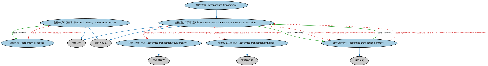

# 证券交易本体（Securities Transactions Ontology）结构与公理说明

本文档对应 `SecuritiesTransactions.rdf` / `SecuritiesTransactions.ttl`，说明该本体的类、继承关系、属性和公理约定。结构图见 `SecuritiesTransactions-structure.png`（`SecuritiesTransactions-structure.svg` 为可缩放版本）。

## 1. 本体概述

定义证券买卖交易：订单、成交（execution）、结算指令及其参与方。

**在体系中的位置**：FND 交易扩展模块中专为证券领域特化的本体。

**上下游关系**：上游继承市场交易本体并引用 SEC 证券、FBC 结算概念；下游服务交易记录与清算建模。

**与相近概念的差别**：交易≠结算——交易是达成买卖，结算是履约交割（见 FBC 结算本体）；与市场交易的差别——增加了证券特有的订单与成交结构。

本本体中类与类的核心关系如下（完整细节见各类小节）：

- **金融一级市场交易（financial primary market transaction）** 继承 **市场交易（MarketTransaction）**
- **金融一级市场交易（financial primary market transaction）** 继承 **合同性交易（ContractualTransaction）**
- **金融证券二级市场交易（financial securities secondary market transaction）** 继承 **市场交易（MarketTransaction）**
- **金融证券二级市场交易（financial securities secondary market transaction）** 继承 **合同性交易（ContractualTransaction）**
- **证券交易合同（securities transaction contract）** 继承 **经济合同（EconomicContract）**
- **证券交易对手方（securities transaction counterparty）** 继承 **交易对手方（TransactionCounterparty）**
- **证券交易主当事方（securities transaction principal）** 继承 **交易委托方（TransactionPrincipal）**
- **预发行交易（when issued transaction）** 继承 **金融证券二级市场交易（financial securities secondary market transaction）**
- **金融证券二级市场交易（financial securities secondary market transaction）** 通过 **体现（embodies）** 关联 **证券交易合同（securities transaction contract）**
- **金融一级市场交易（financial primary market transaction）** 通过 **遵循（follows）** 关联 **结算过程（settlement process）**
- **证券交易合同（securities transaction contract）** 通过 **管辖（governs）** 关联 **金融证券二级市场交易（financial securities secondary market transaction）**

## 2. 类（Class）

| 类（Class） | 定义（Definition） |
|---|---|
| 金融一级市场交易（financial primary market transaction） | 在一级市场上进行的金融交易。 |
| 金融证券二级市场交易（financial securities secondary market transaction） | 以某种可流通证券换取某种对价的交易。 |
| 证券交易合同（securities transaction contract） | 治理二级市场证券交易的合同（书面或默示）。 |
| 证券交易对手方（securities transaction counterparty） | 证券交易中的对手方。 |
| 证券交易主当事方（securities transaction principal） | 证券交易中的主当事方。 |
| 结算过程（settlement process） | 完成交易交收的过程。 |
| 预发行交易（when issued transaction） | 在证券正式交易之前进行的证券买卖。 |

以下按类逐个展开：每个类给出继承关系、相关属性与公理约定；子类在父类之下降一级编号。

### 2.1 金融一级市场交易（financial primary market transaction）

定义：在一级市场上进行的金融交易。

- 父类：**市场交易（MarketTransaction）**、**合同性交易（ContractualTransaction）**

属性：

| 属性 | 定义 | 说明 |
|---|---|---|
| **遵循（follows）** | 按……进行。 | 值域：结算过程（settlement process）；子属性：交易事件遵循业务流程 |

公理：

- **遵循（follows）**至少有一个取值，类型是**结算过程（settlement process）**。

### 2.2 金融证券二级市场交易（financial securities secondary market transaction）

定义：以某种可流通证券换取某种对价的交易。

- 父类：**市场交易（MarketTransaction）**、**合同性交易（ContractualTransaction）**
- 直接子类：**预发行交易（when issued transaction）**

属性：

| 属性 | 定义 | 说明 |
|---|---|---|
| **具有交易对手（hasCounterparty）** | — | — |
| **具有主当事方（hasPrincipalParty）** | — | — |
| **对价（consideration）** | — | — |
| **标的（subject）** | — | — |
| **体现（embodies）** | 是……的表达，赋予……以具体形式。 | 值域：证券交易合同（securities transaction contract）；子属性：交易体现经济协议 |

公理：

- **体现（embodies）**至少有一个取值，类型是**证券交易合同（securities transaction contract）**。
- **具有主当事方（hasPrincipalParty）**至少有一个取值，类型是**证券交易主当事方（securities transaction principal）**。
- **具有交易对手（hasCounterparty）**至少有一个取值，类型是**证券交易对手方（securities transaction counterparty）**。
- **对价（consideration）**至少有一个取值，该取值满足：该属性存在取值约束。
- **标的（subject）**至少有一个取值，类型是**证券（Security）**。

#### 2.2.1 预发行交易（when issued transaction）

定义：在证券正式交易之前进行的证券买卖。

- 父类：**金融证券二级市场交易（financial securities secondary market transaction）**

属性：

| 属性 | 定义 | 说明 |
|---|---|---|
| **预发行发行日偏移（offset for w i issue date）** | 用于由给定预发行（WI）发行日计算实际结算日；若发行日未知，它确定自发行日起算的天数。 | 值域：xsd:integer |

### 2.3 证券交易合同（securities transaction contract）

定义：治理二级市场证券交易的合同（书面或默示）。

- 父类：**经济合同（EconomicContract）**

属性：

| 属性 | 定义 | 说明 |
|---|---|---|
| **管辖（governs）** | 对……拥有并行使权力。 | 值域：金融证券二级市场交易（financial securities secondary market transaction）；逆属性：体现（embodies）；子属性：管辖 |

公理：

- **管辖（governs）**至少有一个取值，类型是**金融证券二级市场交易（financial securities secondary market transaction）**。

### 2.4 证券交易对手方（securities transaction counterparty）

定义：证券交易中的对手方。

- 父类：**交易对手方（TransactionCounterparty）**

### 2.5 证券交易主当事方（securities transaction principal）

定义：证券交易中的主当事方。

- 父类：**交易委托方（TransactionPrincipal）**

### 2.6 结算过程（settlement process）

定义：完成交易交收的过程。

## 3. 依赖（owl:imports，7 个）

本本体通过 `owl:imports` 引入以下本体，各项的中文名称与简介如下：

| 导入本体 | 中文名称 | 简介 |
|---|---|---|
| `FND/Accounting/CurrencyAmount.rdf` | 货币金额本体（Currency Amount Ontology） | 定义「金额＋币种」的货币金额（currency amount）表示，是 FIBO 中表达价格、债务金额、付款额等一切带币种数值的基础构件。 |
| `FND/Agreements/Contracts.rdf` | 合同本体（Contracts Ontology） | 在协议之上定义具有法律约束力的合同（contract）：合同当事方、合同条款、义务与权利，是金融工具与交易合同建模的基石。 |
| `FND/TransactionsExt/MarketTransactions.rdf` | 市场交易本体（Market Transactions Ontology） | 定义市场上发生的交易（market transaction）：买卖双方、价格与数量。 |
| `FND/TransactionsExt/REATransactions.rdf` | REA 交易本体（REA Transactions Ontology） | 基于资源—事件—代理（REA）会计模型定义交易的经济资源交换结构。 |
| `FND/Utilities/AnnotationVocabulary.rdf` | FIBO 标注词汇表（FIBO Annotation Vocabulary） | 定义 FIBO 专用的标注属性（如释义来源、成熟度等级），用于本体自身的元数据标注。 |
| `https://www.omg.org/spec/Commons/AnnotationVocabulary/` | OMG 通用标注词汇表（OMG Commons Annotation Vocabulary） | OMG 通用本体库（Commons）中的标注词汇表，提供概念映射等标注属性，FIBO 用它标注术语与外部标准的对应关系。 |
| `https://www.omg.org/spec/Commons/RegulatoryAgencies/` | OMG 通用监管机构本体（OMG Commons Regulatory Agencies） | Commons 库中的监管机构本体，定义监管机构及其监管职权的通用概念。 |

## 4. 文件

- 官方 RDF/XML：`SecuritiesTransactions.rdf`
- 中文 Turtle：`SecuritiesTransactions.ttl`
- 结构图：`SecuritiesTransactions-structure.png` / `SecuritiesTransactions-structure.svg`