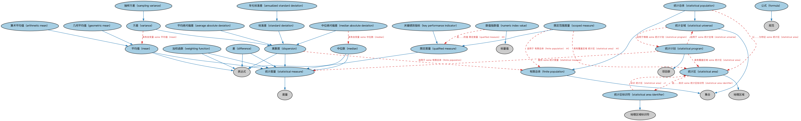

# 分析本体（Analytics Ontology）结构与公理说明

本文档对应 `Analytics.rdf` / `Analytics.ttl`，说明该本体的类、继承关系、属性和公理约定。结构图见 `Analytics-structure.png`（`Analytics-structure.svg` 为可缩放版本）。

## 1. 本体概述

定义分析相关的通用概念：度量（measure）、比率（ratio）、分析工具与模型。

**在体系中的位置**：FND 工具模块的两个本体之一，为指标与模型表达提供支撑。

**上下游关系**：上游依赖关系与度量概念；下游被 IND 指标、MD 债务分析等本体引用。

**与相近概念的差别**：与指标本体的差别——分析本体提供「度量怎么构成」的通用机制，指标本体（IND）定义「度量什么」的业务指标。

本本体中类与类的核心关系如下（完整细节见各类小节）：

- **年化标准差（annualized standard deviation）** 继承 **标准差（standard deviation）**
- **算术平均值（arithmetic mean）** 继承 **平均值（mean）**
- **平均绝对偏差（average absolute deviation）** 继承 **离散度（dispersion）**
- **差（difference）** 继承 **统计度量（statistical measure）**
- **差（difference）** 继承 **表达式（Expression）**
- **离散度（dispersion）** 继承 **统计度量（statistical measure）**
- **离散度（dispersion）** 继承 **表达式（Expression）**
- **有限总体（finite population）** 继承 **集合（Collection）**
- **公式（formula）** 继承 **规范（Specification）**
- **几何平均值（geometric mean）** 继承 **平均值（mean）**
- **关键绩效指标（key performance indicator）** 继承 **限定度量（qualified measure）**
- **平均值（mean）** 继承 **统计度量（statistical measure）**
- 其余 19 条关系从略。

## 2. 类（Class）

| 类（Class） | 定义（Definition） |
|---|---|
| 年化标准差（annualized standard deviation） | 某度量在特定参照期间上的标准差。 |
| 算术平均值（arithmetic mean） | 一组数值之和除以该组数值的个数。 |
| 平均绝对偏差（average absolute deviation） | 各观测值距中心点的绝对偏差的平均值。 |
| 差（difference） | 数量相减所得的差额；一个值减去另一个值后的余数。 |
| 离散度（dispersion） | 观测值呈现的散布或变异程度。 |
| 有限总体（finite population） | 其单位可以被计数的总体。 |
| 公式（formula） | 以字母和符号表达、至少包含一个表达式的规则。 |
| 几何平均值（geometric mean） | 用一组数值的乘积（而非和）表示其中央趋势或典型值的平均值。 |
| 关键绩效指标（key performance indicator） | 表明个人或企业在达成目标方面表现如何的可测目标。 |
| 平均值（mean） | 最常见的中央趋势度量；一组数值的平均。 |
| 中位数（median） | 将数据样本、总体或概率分布的总频数分为两半的变量值。 |
| 中位绝对偏差（median absolute deviation） | 观测值距平均值（可为算术平均值、中位数或众数）的绝对偏差的中位数。 |
| 数值指数值（numeric index value） | 某总量相对于其在某日期之值的数值。 |
| 限定度量（qualified measure） | 受特征、量类或单位约束、从而细化其计算方式的统计度量。 |
| 抽样方差（sampling variance） | 对同一规模、同一设计的不同可能样本所得某特征估计值之间差异程度的度量。 |
| 限定范围度量（scoped measure） | 受其适用统计总体上的过滤器约束的限定度量。 |
| 标准差（standard deviation） | 方差的平方根，度量数据集围绕均值的散布或离散程度。 |
| 统计区（statistical area） | 按某地理区域指定计划定义的、用于汇总和呈现统计数据的物理位置。 |
| 统计区标识符（statistical area identifier） | 按全国一致的地理区域指定计划定义的物理位置的标识符。 |
| 统计度量（statistical measure） | 特定组（研究域）内各统计单位的个体定量变量值的汇总（平均值、众数、总计、指数等）。 |
| 统计总体（statistical population） | 经时间和区域过滤的统计全域。 |
| 统计计划（statistical program） | 对涉及一项或多项研究或调查的课题或情形进行详细调查与分析的计划。 |
| 统计全域（statistical universe） | 代表某问题所关注的全部成员（人、资源、产品、服务、事件或实体）之「全域」的集合。 |
| 方差（variance） | 散布的度量，计算为数据集中每个数与均值之平方偏差的平均。 |
| 加权函数（weighting function） | 确定集合中给定元素相对于整体的相对重要性或影响力的表达式或函数。 |

以下按类逐个展开：每个类给出继承关系、相关属性与公理约定；子类在父类之下降一级编号。

### 2.1 有限总体（finite population）

定义：其单位可以被计数的总体。

- 父类：**集合（Collection）**
- 直接子类：**统计总体（statistical population）**

#### 2.1.1 统计总体（statistical population）

定义：经时间和区域过滤的统计全域。

- 父类：**有限总体（finite population）**、**统计全域（statistical universe）**

属性：

| 属性 | 定义 | 说明 |
|---|---|---|
| **具有总体规模（has population size）** | 标识给定总体中的元素数量。 | 值域：xsd:nonNegativeInteger；子属性：具有集合大小 |
| **以……为特征（isCharacterizedBy）** | — | — |

公理：

- **以……为特征（isCharacterizedBy）**至少有一个取值，类型是**显式日期区间（ExplicitDatePeriod）**。
- **以……为特征（isCharacterizedBy）**至少有一个取值，类型是**统计区（statistical area）**。
- **具有总体规模（has population size）**的所有取值只能是**xsd:nonNegativeInteger（nonNegativeInteger）**。

### 2.2 公式（formula）

定义：以字母和符号表达、至少包含一个表达式的规则。

- 父类：**规范（Specification）**

属性：

| 属性 | 定义 | 说明 |
|---|---|---|
| **具有表达式（hasExpression）** | — | — |

公理：

- **具有表达式（hasExpression）**至少有一个取值，类型是**表达式（Expression）**。

### 2.3 数值指数值（numeric index value）

定义：某总量相对于其在某日期之值的数值。

- 父类：**标量值（ScalarQuantityValue）**

属性：

| 属性 | 定义 | 说明 |
|---|---|---|
| **具有测量日期时间（has measurement date time）** | 标识进行测量的日期与时间。 | 值域：cmns-dt:CombinedDateTime |
| **是……的值（isValueOf）** | — | — |

公理：

- **具有测量日期时间（has measurement date time）**存在取值约束。
- **是……的值（isValueOf）**可以有 0 个或多个**限定度量（qualified measure）**。

### 2.4 统计区（statistical area）

定义：按某地理区域指定计划定义的、用于汇总和呈现统计数据的物理位置。

- 父类：**地理区域（GeographicRegion）**

属性：

| 属性 | 定义 | 说明 |
|---|---|---|
| **由……标识（isIdentifiedBy）** | — | — |

公理：

- **由……标识（isIdentifiedBy）**至少有一个取值，类型是**统计区标识符（statistical area identifier）**。

### 2.5 统计区标识符（statistical area identifier）

定义：按全国一致的地理区域指定计划定义的物理位置的标识符。

- 父类：**地理区域标识符（GeographicRegionIdentifier）**

属性：

| 属性 | 定义 | 说明 |
|---|---|---|
| **标识（identifies）** | — | — |

公理：

- **标识（identifies）**恰好有 1 个**统计区（statistical area）**。

### 2.6 统计度量（statistical measure）

定义：特定组（研究域）内各统计单位的个体定量变量值的汇总（平均值、众数、总计、指数等）。

- 父类：**度量（Measure）**
- 直接子类：**差（difference）**、**离散度（dispersion）**、**平均值（mean）**、**中位数（median）**、**限定度量（qualified measure）**、**加权函数（weighting function）**

属性：

| 属性 | 定义 | 说明 |
|---|---|---|
| **按方法论计算（is calculated via methodology）** | 获得结果所用方法的高层描述。 | — |
| **为估计值（is estimate）** | 表明该度量反映的是估计（近似）值还是非估计值。 | 值域：xsd:boolean |
| **以……为特征（isCharacterizedBy）** | — | — |

公理：

- **为估计值（is estimate）**存在取值约束。
- **以……为特征（isCharacterizedBy）**可以有 0 个或多个**方面（Aspect）**。

#### 2.6.1 差（difference）

定义：数量相减所得的差额；一个值减去另一个值后的余数。

- 父类：**统计度量（statistical measure）**、**表达式（Expression）**

属性：

| 属性 | 定义 | 说明 |
|---|---|---|
| **具有被减数（has minuend）** | 指明被减去某量的量值，即被减损的值。 | 子属性：具有自变量 |
| **具有减数（has subtrahend）** | 指明从某量中减去的量值。 | 子属性：具有自变量 |

公理：

- **具有减数（has subtrahend）**存在取值约束。
- **具有被减数（has minuend）**存在取值约束。

#### 2.6.2 离散度（dispersion）

定义：观测值呈现的散布或变异程度。

- 父类：**统计度量（statistical measure）**、**表达式（Expression）**
- 直接子类：**平均绝对偏差（average absolute deviation）**、**中位绝对偏差（median absolute deviation）**、**标准差（standard deviation）**、**方差（variance）**

属性：

| 属性 | 定义 | 说明 |
|---|---|---|
| **具有集合大小（hasCollectionSize）** | — | — |
| **具有观测值（has observed value）** | 指明分析所基于的值集合。 | 值域：结构化集合；子属性：具有自变量 |
| **适用于（appliesTo）** | — | — |

公理：

- **具有观测值（has observed value）**至少有一个取值，类型是**结构化集合（StructuredCollection）**。
- **具有集合大小（hasCollectionSize）**存在取值约束。
- **适用于（appliesTo）**至少有一个取值，类型是**有限总体（finite population）**。

##### 2.6.2.1 平均绝对偏差（average absolute deviation）

定义：各观测值距中心点的绝对偏差的平均值。

- 父类：**离散度（dispersion）**

属性：

| 属性 | 定义 | 说明 |
|---|---|---|
| **具有自变量（hasArgument）** | — | — |

公理：

- **具有自变量（hasArgument）**至少有一个取值，该取值满足：该属性存在取值约束。

##### 2.6.2.2 中位绝对偏差（median absolute deviation）

定义：观测值距平均值（可为算术平均值、中位数或众数）的绝对偏差的中位数。

- 父类：**离散度（dispersion）**

属性：

| 属性 | 定义 | 说明 |
|---|---|---|
| **具有自变量（hasArgument）** | — | — |

公理：

- **具有自变量（hasArgument）**至少有一个取值，类型是**中位数（median）**。

##### 2.6.2.3 标准差（standard deviation）

定义：方差的平方根，度量数据集围绕均值的散布或离散程度。

- 父类：**离散度（dispersion）**
- 直接子类：**年化标准差（annualized standard deviation）**

属性：

| 属性 | 定义 | 说明 |
|---|---|---|
| **具有自变量（hasArgument）** | — | — |

公理：

- **具有自变量（hasArgument）**至少有一个取值，该取值满足：该属性存在取值约束。

###### 2.6.2.3.1 年化标准差（annualized standard deviation）

定义：某度量在特定参照期间上的标准差。

- 父类：**标准差（standard deviation）**

属性：

| 属性 | 定义 | 说明 |
|---|---|---|
| **具有参照期间（has reference period）** | 指明给定度量所适用的参照（基线）重复区间。 | 值域：重复区间；子属性：具有重复区间 |

公理：

- **具有参照期间（has reference period）**恰好有 1 个**显式重复区间（ExplicitRecurrenceInterval）**。

##### 2.6.2.4 方差（variance）

定义：散布的度量，计算为数据集中每个数与均值之平方偏差的平均。

- 父类：**离散度（dispersion）**
- 直接子类：**抽样方差（sampling variance）**

属性：

| 属性 | 定义 | 说明 |
|---|---|---|
| **具有自变量（hasArgument）** | — | — |

公理：

- **具有自变量（hasArgument）**至少有一个取值，类型是**平均值（mean）**。

###### 2.6.2.4.1 抽样方差（sampling variance）

定义：对同一规模、同一设计的不同可能样本所得某特征估计值之间差异程度的度量。

- 父类：**方差（variance）**

#### 2.6.3 平均值（mean）

定义：最常见的中央趋势度量；一组数值的平均。

- 父类：**统计度量（statistical measure）**、**表达式（Expression）**
- 直接子类：**算术平均值（arithmetic mean）**、**几何平均值（geometric mean）**

属性：

| 属性 | 定义 | 说明 |
|---|---|---|
| **具有观测值（has observed value）** | 指明分析所基于的值集合。 | 值域：结构化集合；子属性：具有自变量 |

公理：

- **具有观测值（has observed value）**至少有一个取值，类型是**结构化集合（StructuredCollection）**。

##### 2.6.3.1 算术平均值（arithmetic mean）

定义：一组数值之和除以该组数值的个数。

- 父类：**平均值（mean）**

##### 2.6.3.2 几何平均值（geometric mean）

定义：用一组数值的乘积（而非和）表示其中央趋势或典型值的平均值。

- 父类：**平均值（mean）**

#### 2.6.4 中位数（median）

定义：将数据样本、总体或概率分布的总频数分为两半的变量值。

- 父类：**统计度量（statistical measure）**、**表达式（Expression）**

属性：

| 属性 | 定义 | 说明 |
|---|---|---|
| **具有观测值（has observed value）** | 指明分析所基于的值集合。 | 值域：结构化集合；子属性：具有自变量 |

公理：

- **具有观测值（has observed value）**至少有一个取值，类型是**结构化集合（StructuredCollection）**。

#### 2.6.5 限定度量（qualified measure）

定义：受特征、量类或单位约束、从而细化其计算方式的统计度量。

- 父类：**统计度量（statistical measure）**
- 直接子类：**关键绩效指标（key performance indicator）**、**限定范围度量（scoped measure）**

属性：

| 属性 | 定义 | 说明 |
|---|---|---|
| **具有基准日期（hasAnchorDate）** | — | — |
| **按方法论计算（is calculated via methodology）** | 获得结果所用方法的高层描述。 | — |

公理：

- **具有基准日期（hasAnchorDate）**可以有 0 个或多个**基准日期（AnchorDate）**。
- **按方法论计算（is calculated via methodology）**存在取值约束。

##### 2.6.5.1 关键绩效指标（key performance indicator）

定义：表明个人或企业在达成目标方面表现如何的可测目标。

- 父类：**限定度量（qualified measure）**

属性：

| 属性 | 定义 | 说明 |
|---|---|---|
| **具有观测值（has observed value）** | 指明分析所基于的值集合。 | 值域：结构化集合；子属性：具有自变量 |
| **具有目标值（has target value）** | 指明代表某事物随时间的计划或预计目标的值集合。 | 值域：带日期结构化集合；子属性：具有自变量 |

公理：

- **具有目标值（has target value）**至少有一个取值，类型是**带日期结构化集合（DatedStructuredCollection）**。
- **具有观测值（has observed value）**至少有一个取值，类型是**带日期结构化集合（DatedStructuredCollection）**。

##### 2.6.5.2 限定范围度量（scoped measure）

定义：受其适用统计总体上的过滤器约束的限定度量。

- 父类：**限定度量（qualified measure）**

属性：

| 属性 | 定义 | 说明 |
|---|---|---|
| **具有周期性（has periodicity）** | 指明统计度量所反映的重复区间（月度、季度、年度）。 | 值域：重复区间；子属性：具有重复区间 |
| **适用于（appliesTo）** | — | — |
| **具有覆盖区域（hasCoverageArea）** | — | — |

公理：

- **具有周期性（has periodicity）**的所有取值只能是**重复区间（RecurrenceInterval）**。
- **具有覆盖区域（hasCoverageArea）**可以有 0 个或多个**统计区（statistical area）**。
- **适用于（appliesTo）**可以有 0 个或多个**有限总体（finite population）**。

#### 2.6.6 加权函数（weighting function）

定义：确定集合中给定元素相对于整体的相对重要性或影响力的表达式或函数。

- 父类：**统计度量（statistical measure）**、**表达式（Expression）**

### 2.7 统计计划（statistical program）

定义：对涉及一项或多项研究或调查的课题或情形进行详细调查与分析的计划。

- 父类：**项目群（Program）**

属性：

| 属性 | 定义 | 说明 |
|---|---|---|
| **适用于（appliesTo）** | — | — |
| **具有覆盖区域（hasCoverageArea）** | — | — |
| **提供（provides）** | — | — |

公理：

- **具有覆盖区域（hasCoverageArea）**至少有一个取值，类型是**统计区（statistical area）**。
- **提供（provides）**至少有一个取值，类型是**统计度量（statistical measure）**。
- **适用于（appliesTo）**至少有一个取值，类型是**统计全域（statistical universe）**。

### 2.8 统计全域（statistical universe）

定义：代表某问题所关注的全部成员（人、资源、产品、服务、事件或实体）之「全域」的集合。

- 父类：**集合（Collection）**
- 直接子类：**统计总体（statistical population）**

属性：

| 属性 | 定义 | 说明 |
|---|---|---|
| **具有全域规模（has universe size）** | 标识给定全域中的元素数量。 | 值域：xsd:nonNegativeInteger；子属性：具有集合大小 |
| **适用于情境（isApplicableIn）** | — | — |

公理：

- **具有全域规模（has universe size）**的所有取值只能是**xsd:nonNegativeInteger（nonNegativeInteger）**。
- **适用于情境（isApplicableIn）**至少有一个取值，类型是**统计计划（statistical program）**。

## 3. 其他属性

以下属性未绑定到本体的具体类（定义域在外部本体或未声明）：

对象属性（Object Property）：

| 属性 | 定义 | 说明 |
|---|---|---|
| **具有固定比较日期（has fixed comparative date）** | 指明限定范围度量据以比较的特定日期，如上一次衰退结束之时。 | 值域：显式日期；子属性：具有显式日期 |
| **具有公式（has formula）** | 指明以符号简洁表达信息的方式，如数学或化学公式。 | 值域：公式（formula）；子属性：以……为特征 |
| **具有相对比较日期（has relative comparative date）** | 指明限定范围度量的值据以比较的日期（如前一个月、前三个月等）。 | 值域：相对日期；子属性：具有日期 |
| **具有相对比较期间（has relative comparative period）** | 指明限定范围度量据以比较的期间（通常为前期）。 | 值域：日期区间；子属性：具有日期区间 |
| **具有发布日期（has release date）** | 指明某事物发布的日期。 | 值域：日期；子属性：具有日期 |

数据属性（Datatype Property）：

| 属性 | 定义 |
|---|---|
| **具有测量期间月数（has measurement period in months）** | 标识度量适用的覆盖期间，以月为单位。 |
| **具有条目数（has number of entries）** | 标识某文件、表格或其他资源（如报告、表格）中的元素数量。 |
| **具有发布日期时间（has release date and time）** | 指明某事物发布的日期与时间。 |
| **具有权重（has weight）** | 标识为增大或减小某项重要性而赋予的数量。 |

## 4. 依赖（owl:imports，14 个）

本本体通过 `owl:imports` 引入以下本体，各项的中文名称与简介如下：

| 导入本体 | 中文名称 | 简介 |
|---|---|---|
| `FND/Arrangements/Arrangements.rdf` | 安排本体（Arrangements Ontology） | 定义「安排」（arrangement）这一抽象概念：把若干事物按某种结构组织起来的方式，是分类方案、标识方案、生命周期等概念的上位基础。 |
| `FND/DatesAndTimes/FinancialDates.rdf` | 金融日期本体（Financial Dates Ontology） | 定义金融语境下的日期与期间概念：结算日、付息日、到期日、日计数基准等。 |
| `FND/GoalsAndObjectives/Objectives.rdf` | 目标本体（Objectives Ontology） | 定义目标（objective）及其与组织、计划的关系，用于表达机构的经营目标与投资目标。 |
| `FND/Utilities/AnnotationVocabulary.rdf` | FIBO 标注词汇表（FIBO Annotation Vocabulary） | 定义 FIBO 专用的标注属性（如释义来源、成熟度等级），用于本体自身的元数据标注。 |
| `https://www.omg.org/spec/Commons/AnnotationVocabulary/` | OMG 通用标注词汇表（OMG Commons Annotation Vocabulary） | OMG 通用本体库（Commons）中的标注词汇表，提供概念映射等标注属性，FIBO 用它标注术语与外部标准的对应关系。 |
| `https://www.omg.org/spec/Commons/Classifiers/` | OMG 通用分类器本体（OMG Commons Classifiers） | OMG 通用本体库（Commons）中的分类器本体，定义分类方案、类别与归类关系的通用概念，FIBO 的分类建模建立在其上。 |
| `https://www.omg.org/spec/Commons/Collections/` | OMG 通用集合本体（OMG Commons Collections） | Commons 库中的集合本体，定义集合、成员等通用概念。 |
| `https://www.omg.org/spec/Commons/ContextualDesignators/` | OMG 通用语境指称本体（OMG Commons Contextual Designators） | Commons 库中的语境指称本体，定义「在某个语境下指代某物的名称/符号」，是地址、账户号码等语境相关标识的基础。 |
| `https://www.omg.org/spec/Commons/DatesAndTimes/` | OMG 通用日期与时间本体（OMG Commons Dates and Times） | Commons 库中的日期时间本体，定义日期、期间、时间点等通用时间概念。 |
| `https://www.omg.org/spec/Commons/Documents/` | OMG 通用文档本体（OMG Commons Documents） | Commons 库中的文档本体，定义文档及其组成部分的通用概念。 |
| `https://www.omg.org/spec/Commons/Identifiers/` | OMG 通用标识符本体（OMG Commons Identifiers） | Commons 库中的标识符本体，定义标识符及其编码方案的通用概念。 |
| `https://www.omg.org/spec/Commons/Locations/` | OMG 通用位置本体（OMG Commons Locations） | Commons 库中的位置本体，定义地理位置、地点的通用概念。 |
| `https://www.omg.org/spec/Commons/Organizations/` | OMG 通用组织本体（OMG Commons Organizations） | Commons 库中的组织本体，定义组织、组织成员与组织结构的通用概念。 |
| `https://www.omg.org/spec/Commons/QuantitiesAndUnits/` | OMG 通用量与单位本体（OMG Commons Quantities and Units） | Commons 库中的量与单位本体，定义数量、度量单位、量纲的通用概念，支撑金额、比率等数值表达。 |

## 5. 文件

- 官方 RDF/XML：`Analytics.rdf`
- 中文 Turtle：`Analytics.ttl`
- 结构图：`Analytics-structure.png` / `Analytics-structure.svg`