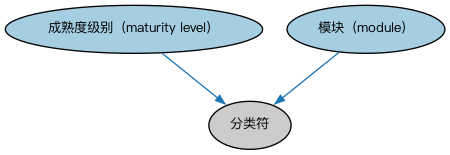

# FIBO 标注词汇表（FIBO Annotation Vocabulary）本体结构与公理说明

本文档对应 `AnnotationVocabulary.rdf` / `AnnotationVocabulary.ttl`，说明该本体的类、继承关系、属性和公理约定。结构图见 `AnnotationVocabulary-structure.png`（`AnnotationVocabulary-structure.svg` 为可缩放版本）。

## 1. 本体概述

本词汇表提供一组用于描述 FIBO 本体元素的元数据标注，扩展了 Commons 标注词汇表、Dublin Core 和 SKOS 中的属性，并针对 FIBO 规范开发流程做了定制。

## 2. 类（Class）

| 类（Class） | 定义（Definition） |
|---|---|
| 成熟度级别（maturity level） | 用于指示工件在开发生命周期中所处状态的分类器。 |
| 模块（module） | 基于模型驱动架构方法论的原则对某物进行模块化划分的类别。 |

### 2.1 继承关系（Inheritance）

- 成熟度级别（maturity level） ⊑ 分类符
- 模块（module） ⊑ 分类符

## 6. 依赖（owl:imports，2 个）

本本体通过 `owl:imports` 引入以下本体，各项的中文名称与简介如下：

| 导入本体 | 中文名称 | 简介 |
|---|---|---|
| `https://www.omg.org/spec/Commons/AnnotationVocabulary/` | OMG 通用标注词汇表（OMG Commons Annotation Vocabulary） | OMG 通用本体库（Commons）中的标注词汇表，提供概念映射等标注属性，FIBO 用它标注术语与外部标准的对应关系。 |
| `https://www.omg.org/spec/Commons/Classifiers/` | OMG 通用分类器本体（OMG Commons Classifiers） | OMG 通用本体库（Commons）中的分类器本体，定义分类方案、类别与归类关系的通用概念，FIBO 的分类建模建立在其上。 |

## 7. 文件

- 官方 RDF/XML：`AnnotationVocabulary.rdf`
- 中文 Turtle：`AnnotationVocabulary.ttl`
- 结构图：`AnnotationVocabulary-structure.png` / `AnnotationVocabulary-structure.svg`