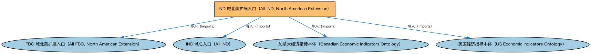

# IND 域北美扩展入口（All IND, North American Extension）聚合说明

本文档对应 `AllIND-NorthAmerica.rdf` / `AllIND-NorthAmerica.ttl`。

## 1. 本文件是什么

聚合 IND 域中北美地区的扩展本体（美国、加拿大经济指标个体）。

从机制上说，这是一个聚合入口（load-all）文件：它本身不定义任何新的类或属性，只通过 `owl:imports` 把一组本体打包在一起。应用只要导入这一个文件，推理机就会把它列出的所有本体一次性加载进来，免去逐个声明的麻烦。因此它的价值不在「内容」，而在「组合」——组合方式本身就表达了发布方的意图（例如按域打包、按区域扩展打包、按是否含参考数据打包）。

## 2. 聚合的本地本体（4 个）

以下本体均可在本目录结构中找到同名 `.rdf` 文件及配套中文文档：

| 导入本体 | 中文名称 | 简介 |
|---|---|---|
| `FBC/AllFBC-NorthAmerica.rdf` | FBC 域北美扩展入口（All FBC, North American Extension） | 聚合 FBC 域中北美法域的扩展本体（美国与加拿大的金融服务实体、监管机构及受控词汇等）。 |
| `IND/AllIND.rdf` | IND 域总入口（All IND） | 聚合指标与指数（Indices and Indicators，IND）域的全部生产本体：指标、利率、外汇、市场指数与经济指标等，一次导入即获得 IND 域完整模型。 |
| `IND/EconomicIndicators/NorthAmericanIndicators/CAEconomicIndicators.rdf` | 加拿大经济指标本体（Canadian Economic Indicators Ontology） | 收录加拿大官方发布的经济指标个体。 |
| `IND/EconomicIndicators/NorthAmericanIndicators/USEconomicIndicators.rdf` | 美国经济指标本体（US Economic Indicators Ontology） | 收录美国官方发布的经济指标个体（如非农就业、CPI、GDP 系列）。 |

## 3. 文件

- 官方 RDF/XML：`AllIND-NorthAmerica.rdf`
- 中文 Turtle：`AllIND-NorthAmerica.ttl`
- 结构图：`AllIND-NorthAmerica-structure.png` / `AllIND-NorthAmerica-structure.svg`