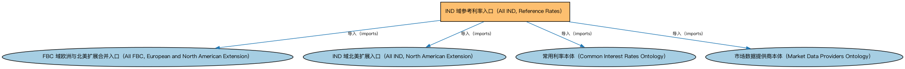

# IND 域参考利率入口（All IND, Reference Rates）聚合说明

本文档对应 `AllIND-ReferenceRates.rdf` / `AllIND-ReferenceRates.ttl`。

## 1. 本文件是什么

聚合市场常用参考利率的个体本体（各期限基准及发布机构），供需要利率主数据的场景加载。

从机制上说，这是一个聚合入口（load-all）文件：它本身不定义任何新的类或属性，只通过 `owl:imports` 把一组本体打包在一起。应用只要导入这一个文件，推理机就会把它列出的所有本体一次性加载进来，免去逐个声明的麻烦。因此它的价值不在「内容」，而在「组合」——组合方式本身就表达了发布方的意图（例如按域打包、按区域扩展打包、按是否含参考数据打包）。

## 2. 聚合的本地本体（4 个）

以下本体均可在本目录结构中找到同名 `.rdf` 文件及配套中文文档：

| 导入本体 | 中文名称 | 简介 |
|---|---|---|
| `FBC/AllFBC-EuropeAndNorthAmerica.rdf` | FBC 域欧洲与北美扩展合并入口（All FBC, European and North American Extension） | 同时引入 FBC 域的欧洲扩展与北美扩展，便于业务横跨两大法域的应用一次加载全部区域性内容。 |
| `IND/AllIND-NorthAmerica.rdf` | IND 域北美扩展入口（All IND, North American Extension） | 聚合 IND 域中北美地区的扩展本体（美国、加拿大经济指标个体）。 |
| `IND/InterestRates/CommonInterestRates.rdf` | 常用利率本体（Common Interest Rates Ontology） | 收录市场常用参考利率个体（如各期限基准、政策利率）。 |
| `IND/InterestRates/MarketDataProviders.rdf` | 市场数据提供商本体（Market Data Providers Ontology） | 定义市场数据提供商（交易所、资讯商等）及其发布的数据。 |

## 3. 文件

- 官方 RDF/XML：`AllIND-ReferenceRates.rdf`
- 中文 Turtle：`AllIND-ReferenceRates.ttl`
- 结构图：`AllIND-ReferenceRates-structure.png` / `AllIND-ReferenceRates-structure.svg`