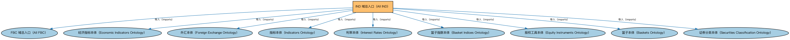

# IND 域总入口（All IND）聚合说明

本文档对应 `AllIND.rdf` / `AllIND.ttl`。

## 1. 本文件是什么

聚合指标与指数（Indices and Indicators，IND）域的全部生产本体：指标、利率、外汇、市场指数与经济指标等，一次导入即获得 IND 域完整模型。

从机制上说，这是一个聚合入口（load-all）文件：它本身不定义任何新的类或属性，只通过 `owl:imports` 把一组本体打包在一起。应用只要导入这一个文件，推理机就会把它列出的所有本体一次性加载进来，免去逐个声明的麻烦。因此它的价值不在「内容」，而在「组合」——组合方式本身就表达了发布方的意图（例如按域打包、按区域扩展打包、按是否含参考数据打包）。

## 2. 聚合的本地本体（9 个）

以下本体均可在本目录结构中找到同名 `.rdf` 文件及配套中文文档：

| 导入本体 | 中文名称 | 简介 |
|---|---|---|
| `FBC/AllFBC.rdf` | FBC 域总入口（All FBC） | 聚合金融商业与贸易（Financial Business and Commerce，FBC）域的全部生产本体：金融工具、金融市场、金融服务机构、监管机构、金融产品与服务、债务与担保等，一次导入即获得 FBC 域完整模型。 |
| `IND/EconomicIndicators/EconomicIndicators.rdf` | 经济指标本体（Economic Indicators Ontology） | 定义宏观经济指标（GDP、CPI、失业率等）的通用结构：发布机构、发布频率与数值。 |
| `IND/ForeignExchange/ForeignExchange.rdf` | 外汇本体（Foreign Exchange Ontology） | 定义外汇、汇率（exchange rate）与货币对的概念。 |
| `IND/Indicators/Indicators.rdf` | 指标本体（Indicators Ontology） | 定义「指标」（indicator）的通用概念：对某现象的可度量表示，是经济指标、利率等的上位模型。 |
| `IND/InterestRates/InterestRates.rdf` | 利率本体（Interest Rates Ontology） | 定义利率（interest rate）的结构：基准利率、利差、期限与重置机制。 |
| `IND/MarketIndices/BasketIndices.rdf` | 篮子指数本体（Basket Indices Ontology） | 定义以一篮子成分为基础的指数：成分、权重与计算方法。 |
| `SEC/Equities/EquityInstruments.rdf` | 股权工具本体（Equity Instruments Ontology） | 定义股票等股权工具：普通股、优先股及其附带的权利。 |
| `SEC/Securities/Baskets.rdf` | 篮子本体（Baskets Ontology） | 定义证券篮子（basket）：作为整体交易或定价的一组证券。 |
| `SEC/Securities/SecuritiesClassification.rdf` | 证券分类本体（Securities Classification Ontology） | 定义证券分类方案：按 CFI 代码、按资产类别等对证券归类。 |

## 3. 文件

- 官方 RDF/XML：`AllIND.rdf`
- 中文 Turtle：`AllIND.ttl`
- 结构图：`AllIND-structure.png` / `AllIND-structure.svg`