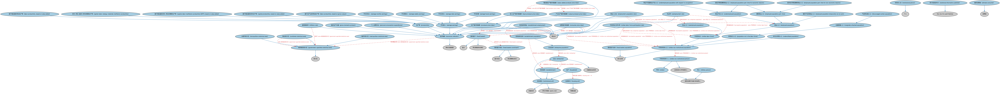

# 经济指标本体（Economic Indicators Ontology）结构与公理说明

本文档对应 `EconomicIndicators.rdf` / `EconomicIndicators.ttl`，说明该本体的类、继承关系、属性和公理约定。结构图见 `EconomicIndicators-structure.png`（`EconomicIndicators-structure.svg` 为可缩放版本）。

## 1. 本体概述

定义宏观经济指标：国内生产总值（GDP）、消费者价格指数（CPI）、失业率等的通用结构（发布机构、频率、数值）。

**在体系中的位置**：IND 经济指标模块的核心，美国、加拿大经济指标个体本体以它为基础。

**上下游关系**：上游继承指标本体；下游被美加两国指标个体本体及宏观分析应用引用。

**与相近概念的差别**：经济指标≠利率——经济指标描述宏观运行状况（统计口径），利率是资金价格（市场或政策口径）；与指数的差别——经济指标是原始统计量，指数是加工合成量。

## 2. 类（Class）

| 类（Class） | 定义（Definition） |
|---|---|
| 平均日收入（average daily earnings） | 雇员在报告期内的平均日工资度量。 |
| 平均收入（average earnings） | 计时或受薪劳动者在给定时期内的平均工资度量。 |
| 平均时薪（average hourly earnings） | 雇员在报告期内的平均小时工资度量。 |
| 平均月收入（average monthly earnings） | 雇员在报告期内的平均月工资度量。 |
| 平均周收入（average weekly earnings） | 雇员在报告期内的平均周工资度量。 |
| 基于增加值的资本生产率（capital productivity, based on value added） | 增加值数量指数与资本投入数量指数之比。 |
| 基于增加值的资本-劳动多要素生产率（capital-labor multifactor productivity (MFP), based on value added） | 增加值数量指数与劳动和资本组合投入数量指数之比。 |
| 资本-劳动-能源-材料多要素生产率（capital-labor-energy-materials multifactor productivity） | 总产出数量指数与组合投入数量指数之比。 |
| 平民（civilian） | 非军队成员（即非现役）的人。 |
| 平民劳动力（civilian labor force） | 在给定报告期内被视为劳动力的平民非机构人口子集。 |
| 平民劳动力参与率（civilian labor force participation rate） | 表示给定经济体在某指定时期内劳动力参与率的经济指标。 |
| 平民非机构个人（civilian non-institutional person） | 不住在机构（如惩教所、长期护理医院或疗养院）内、且非现役的法定工作年龄人。 |
| 平民非机构人口（civilian non-institutional population） | 由居住在给定地区、达到一定年龄、不住在机构内的平民构成的统计全域。 |
| 联合统计区（combined statistical area） | 以通勤模式衡量具有经济联系的相邻大都市区和小都市区的组合。 |
| 消费者价格指数（consumer price index） | 表示家庭消费的消费货物与服务价格随时间变化之度量的经济指标。 |
| 气馁劳动者人口（discouraged worker population） | 边缘附着人口中因就业市场原因而当前不找工作的子集。 |
| 经济指标（economic indicator） | 在统计区（地区）情境内规律且可比的经济活动统计度量，用于经济绩效分析。 |
| 就业人口（employed population） | 报告期内被视为就业的平民劳动力子集。 |
| 兼职就业人口（employed population part-time） | 按通常工时每周工作少于 30 至 35 小时的就业人口子集。 |
| 因经济原因兼职就业人口（employed population part-time for economic reasons） | 因工作量不足、不利商业条件等经济原因每周工作少于 30 至 35 小时的就业人口子集。 |
| 因非经济原因兼职就业人口（employed population part-time for non-economic reasons） | 因疾病或其他健康医疗限制等非经济原因每周工作少于 30 至 35 小时的就业人口子集。 |
| 暂时不在岗就业人口（employed population temporarily not at work） | 因各种原因暂时离岗的就业人口子集。 |
| 就业人口比（employment-population ratio） | 表示给定经济体在某指定时期内就业人口与平民非机构总人口之比的经济指标。 |
| 企业（enterprise） | 生产和/或销售货物或服务的功能型企业实体。 |
| 企业总体（enterprise population） | 为支持就业和生产者价格等调查而设计的企业统计全域。 |
| 机构场所（establishment） | 从单一物理位置运营的企业（或企业的一部分）。 |
| 机构场所就业（establishment employment） | 表示在机构场所工作或为其工作的人员总数（含在业业主、活跃业务合伙人和无酬家庭工）的经济指标。 |
| 机构场所总体（establishment population） | 企业总体中聚焦于机构场所的子集。 |
| 固定篮子（fixed basket） | 数量与质量在某段时期内保持固定的货物与服务篮子。 |
| 固定篮子成分（fixed basket constituent） | 固定篮子的组成成分。 |
| 固定篮子总体（fixed basket population） | 由特定货物和/或服务构成的、为支持价格指数等调查而设计的统计全域。 |
| 政府指定统计区（government-specified statistical area） | 由政府机构定义的统计区。 |
| 国内生产总值（gross domestic product） | 表示总体经济活动最广度量的经济指标，计量全部最终货物与服务的不重复总市值。 |
| 住户（household） | 共同居住于一个住房单元（如房屋或公寓）作为通常居所、并共享部分或全部资源的个人或小群体。 |
| 住房单元（housing unit） | 作为独立居住空间占用的房屋、公寓、活动房屋、一组房间或单个房间，或空置但拟供居住者。 |
| 通货膨胀率（inflation rate） | 表示给定统计区在指定时期内货物与服务价格变化的经济指标。 |
| 投入生产者价格指数（input producer price index） | 表示生产者购买的货物与服务投入价格随时间变化率之度量的经济指标。 |
| 机构内人员（institutional person） | 因某种原因（如住院、康复或监禁）居住在机构内的人。 |
| 机构单位（institutional unit） | 能够以自身名义拥有资产、承担负债、从事经济活动并与他方交易的参与方。 |
| 基于总产出的劳动生产率（labor productivity, based on gross output） | 总产出数量指数与劳动投入数量指数之比。 |
| 基于增加值的劳动生产率（labor productivity, based on value added） | 增加值数量指数与劳动投入数量指数之比。 |
| 边缘附着人口（marginally attached population） | 当前既不工作也不找工作、但表示想要并可以工作且近期找过工作的人口子集。 |
| 大都市统计区（metropolitan statistical area） | 拥有至少一个 5 万人以上城市核心区的一个或多个相邻县（或同级单位）及其周边紧密联系地区。 |
| 小都市统计区（micropolitan statistical area） | 拥有至少一个 1 万至 5 万人城市核心区的一个或多个相邻县（或同级单位）及其周边地区。 |
| 军人（military person） | 现役军队成员。 |
| 产出生产者价格指数（output producer price index） | 表示产品离开生产者时的销售价格随时间变化率之度量的经济指标。 |
| 个人消费支出（personal consumption expenditures） | 表示「个人」或代表个人购买的货物与服务价值之度量的经济指标。 |
| 非劳动力人口（population not in the labor force） | 报告期内被报告机构认定为既非就业也非失业的平民非机构人口子集。 |
| 生产者价格指数（producer price index） | 表示生产者买卖的货物与服务价格随时间变化率之度量的经济指标。 |
| 生产率（productivity） | 表示产出量度量与投入使用量度量之比的经济指标。 |
| 统计信息发布方（statistical information publisher） | 打包并提供分析与统计数据的发布方。 |
| 最终消费者（ultimate consumer） | 货物、产品或服务的最终使用者。 |
| 就业不足人口（underemployed population） | 就业人口中因经济原因兼职、想要并可从事全职工作但不得不接受兼职的子集。 |
| 职业不匹配就业不足人口（underemployed population with respect to occupation） | 就业不足人口中所从事岗位与其培训和经验不符的子集（不含自愿转行者）。 |
| 未充分利用人口（underutilized population） | 平民非机构人口中因经济原因兼职者、边缘附着劳动力及失业者的子集。 |
| 失业人口（unemployed population） | 平民劳动力中被认为没有工作、但（除暂时生病外）可以工作、且已作出具体求职努力的子集。 |
| 失业率（unemployment rate） | 表示给定经济体在某指定时期内失业人口与平民劳动力之比的经济指标。 |
| 增加值生产者价格指数（value-added producer price index） | 表示投入与产出生产者价格指数加权平均的经济指标。 |

### 2.1 继承关系（Inheritance）

- 平均日收入（average daily earnings） ⊑ 平均收入（average earnings）
- 平均收入（average earnings） ⊑ 经济指标（economic indicator）
- 平均收入（average earnings） ⊑ 表达式
- 平均时薪（average hourly earnings） ⊑ 平均收入（average earnings）
- 平均月收入（average monthly earnings） ⊑ 平均收入（average earnings）
- 平均周收入（average weekly earnings） ⊑ 平均收入（average earnings）
- 基于增加值的资本生产率（capital productivity, based on value added） ⊑ 生产率（productivity）
- 基于增加值的资本-劳动多要素生产率（capital-labor multifactor productivity (MFP), based on value added） ⊑ 生产率（productivity）
- 资本-劳动-能源-材料多要素生产率（capital-labor-energy-materials multifactor productivity） ⊑ 生产率（productivity）
- 平民（civilian） ⊑ 具有法律行为能力的自然人
- 平民劳动力（civilian labor force） ⊑ 平民非机构人口（civilian non-institutional population）
- 平民劳动力参与率（civilian labor force participation rate） ⊑ 经济指标（economic indicator）
- 平民劳动力参与率（civilian labor force participation rate） ⊑ 表达式
- 平民非机构个人（civilian non-institutional person） ⊑ 达到法定工作年龄的人
- 平民非机构个人（civilian non-institutional person） ⊑ 平民（civilian）
- 平民非机构人口（civilian non-institutional population） ⊑ 统计全域
- 联合统计区（combined statistical area） ⊑ 政府指定统计区（government-specified statistical area）
- 消费者价格指数（consumer price index） ⊑ 经济指标（economic indicator）
- 消费者价格指数（consumer price index） ⊑ 表达式
- 气馁劳动者人口（discouraged worker population） ⊑ 边缘附着人口（marginally attached population）
- 经济指标（economic indicator） ⊑ 限定范围度量
- 就业人口（employed population） ⊑ 平民劳动力（civilian labor force）
- 兼职就业人口（employed population part-time） ⊑ 就业人口（employed population）
- 因经济原因兼职就业人口（employed population part-time for economic reasons） ⊑ 兼职就业人口（employed population part-time）
- 因经济原因兼职就业人口（employed population part-time for economic reasons） ⊑ 就业不足人口（underemployed population）
- 因非经济原因兼职就业人口（employed population part-time for non-economic reasons） ⊑ 兼职就业人口（employed population part-time）
- 暂时不在岗就业人口（employed population temporarily not at work） ⊑ 就业人口（employed population）
- 就业人口比（employment-population ratio） ⊑ 经济指标（economic indicator）
- 就业人口比（employment-population ratio） ⊑ 表达式
- 企业（enterprise） ⊑ 功能型企业实体
- 企业（enterprise） ⊑ 机构单位（institutional unit）
- 企业总体（enterprise population） ⊑ 统计全域
- 机构场所（establishment） ⊑ 机构单位（institutional unit）
- 机构场所就业（establishment employment） ⊑ 经济指标（economic indicator）
- 机构场所就业（establishment employment） ⊑ 表达式
- 机构场所总体（establishment population） ⊑ 企业总体（enterprise population）
- 固定篮子（fixed basket） ⊑ 篮子
- 固定篮子（fixed basket） ⊑ 带日期结构化集合
- 固定篮子成分（fixed basket constituent） ⊑ 篮子成分
- 固定篮子成分（fixed basket constituent） ⊑ 带日期集合成分
- 固定篮子总体（fixed basket population） ⊑ 统计全域
- 政府指定统计区（government-specified statistical area） ⊑ 统计区
- 国内生产总值（gross domestic product） ⊑ 经济指标（economic indicator）
- 住户（household） ⊑ 机构单位（institutional unit）
- 住房单元（housing unit） ⊑ 物理位置
- 通货膨胀率（inflation rate） ⊑ 经济指标（economic indicator）
- 投入生产者价格指数（input producer price index） ⊑ 生产者价格指数（producer price index）
- 机构内人员（institutional person） ⊑ 个人
- 机构单位（institutional unit） ⊑ 功能实体
- 机构单位（institutional unit） ⊑ 参与方角色（party role）
- 基于总产出的劳动生产率（labor productivity, based on gross output） ⊑ 生产率（productivity）
- 基于增加值的劳动生产率（labor productivity, based on value added） ⊑ 生产率（productivity）
- 边缘附着人口（marginally attached population） ⊑ 非劳动力人口（population not in the labor force）
- 大都市统计区（metropolitan statistical area） ⊑ 政府指定统计区（government-specified statistical area）
- 小都市统计区（micropolitan statistical area） ⊑ 政府指定统计区（government-specified statistical area）
- 军人（military person） ⊑ 具有法律行为能力的自然人
- 产出生产者价格指数（output producer price index） ⊑ 生产者价格指数（producer price index）
- 个人消费支出（personal consumption expenditures） ⊑ 经济指标（economic indicator）
- 非劳动力人口（population not in the labor force） ⊑ 平民非机构人口（civilian non-institutional population）
- 生产者价格指数（producer price index） ⊑ 经济指标（economic indicator）
- 生产者价格指数（producer price index） ⊑ 表达式
- 生产率（productivity） ⊑ 经济指标（economic indicator）
- 生产率（productivity） ⊑ 表达式
- 统计信息发布方（statistical information publisher） ⊑ fibo-be-fct-pub:Publisher
- 最终消费者（ultimate consumer） ⊑ 消费者
- 就业不足人口（underemployed population） ⊑ 就业人口（employed population）
- 职业不匹配就业不足人口（underemployed population with respect to occupation） ⊑ 就业不足人口（underemployed population）
- 未充分利用人口（underutilized population） ⊑ 平民非机构人口（civilian non-institutional population）
- 失业人口（unemployed population） ⊑ 平民劳动力（civilian labor force）
- 失业率（unemployment rate） ⊑ 经济指标（economic indicator）
- 失业率（unemployment rate） ⊑ 表达式
- 增加值生产者价格指数（value-added producer price index） ⊑ 生产者价格指数（producer price index）

## 3. 对象属性（Object Property）

| 属性（Property） | 中文（English） | 定义（Definition） | 说明 |
|---|---|---|---|
| fibo-ind-ei-ei:hasBaselinePopulation | 具有基线总体（has baseline population） | 指明用于比较或分析的起始统计全域或总体。 | 值域（range）：统计全域；子属性（subPropertyOf）：引用 |
| fibo-ind-ei-ei:hasComparisonPopulation | 具有比较总体（has comparison population） | 指明用于比较或分析的基线统计全域或总体的子集。 | 值域（range）：统计全域；子属性（subPropertyOf）：具有输入 |
| fibo-ind-ei-ei:hasDurationOfUnemployment | 具有失业时长（has duration of unemployment） | 指明被归类为失业的人持续寻找工作的时间长度，通常以周计。 | 值域（range）：时长；子属性（subPropertyOf）：具有时长 |
| fibo-ind-ei-ei:hasIndicatorValue | 具有指标值（has indicator value） | 指明给定指标的量值。 | 值域（range）：标量值；子属性（subPropertyOf）：具有量值 |
| fibo-ind-ei-ei:hasSeriesOrigin | 具有序列起点（has series origin） | 指明给定经济指标时间序列的原始起始日期。 | 值域（range）：日期；子属性（subPropertyOf）：具有起始日期 |

## 4. 数据属性（Datatype Property）

| 属性（Property） | 中文（English） | 定义（Definition） |
|---|---|---|
| fibo-ind-ei-ei:excludesEnergyAndFood | 剔除能源与食品（excludes energy and food） | 表明该指数的计算是否剔除能源与食品价格。 |
| fibo-ind-ei-ei:isSeasonallyAdjusted | 经季节调整（is seasonally adjusted） | 表明是否应用了某种公开的正式方法对总体或指数值的季节性波动进行补偿。 |

## 5. 公理约定（Axioms）

- 平均日收入（average daily earnings）：restriction
- 平均收入（average earnings）：具有参照期间 显式重复区间 =1
- 平均时薪（average hourly earnings）：restriction
- 平均月收入（average monthly earnings）：restriction
- 平均周收入（average weekly earnings）：restriction
- 平民劳动力（civilian labor force） 与 非劳动力人口（population not in the labor force） 互斥（disjointWith）
- 平民劳动力参与率（civilian labor force participation rate）：具有基线总体（has baseline population） some 平民非机构人口（civilian non-institutional population）
- 平民劳动力参与率（civilian labor force participation rate）：具有比较总体（has comparison population） some 平民劳动力（civilian labor force）
- 平民非机构个人（civilian non-institutional person） 与 机构内人员（institutional person） 互斥（disjointWith）
- 平民非机构人口（civilian non-institutional population）：具有成员 some 平民非机构个人（civilian non-institutional person）
- 联合统计区（combined statistical area）：包含 政府指定统计区（government-specified statistical area） ≥2
- 消费者价格指数（consumer price index）：具有输入 some 固定篮子（fixed basket）
- 消费者价格指数（consumer price index）：具有基线总体（has baseline population） some 平民非机构人口（civilian non-institutional population）
- 消费者价格指数（consumer price index） 与 平民劳动力参与率（civilian labor force participation rate） 互斥（disjointWith）
- 消费者价格指数（consumer price index） 与 就业人口比（employment-population ratio） 互斥（disjointWith）
- 消费者价格指数（consumer price index） 与 国内生产总值（gross domestic product） 互斥（disjointWith）
- 消费者价格指数（consumer price index） 与 通货膨胀率（inflation rate） 互斥（disjointWith）
- 消费者价格指数（consumer price index） 与 失业率（unemployment rate） 互斥（disjointWith）
- 经济指标（economic indicator）：经季节调整（is seasonally adjusted） only xsd:boolean
- 经济指标（economic indicator）：具有序列起点（has series origin） only 日期
- 经济指标（economic indicator）：具有发布日期 日期 ≥0
- 经济指标（economic indicator）：restriction
- 经济指标（economic indicator）：具有报告期 some 显式日期区间
- 经济指标（economic indicator）：具有覆盖区域 some 政府指定统计区（government-specified statistical area）
- 因非经济原因兼职就业人口（employed population part-time for non-economic reasons） 与 因经济原因兼职就业人口（employed population part-time for economic reasons） 互斥（disjointWith）
- 就业人口比（employment-population ratio）：具有基线总体（has baseline population） some 平民非机构人口（civilian non-institutional population）
- 就业人口比（employment-population ratio）：具有比较总体（has comparison population） some 就业人口（employed population）
- 企业（enterprise）：restriction
- 企业（enterprise）：由……分类 some 行业部门分类器
- 企业（enterprise）：具有成员 some 机构场所（establishment）
- 企业（enterprise）：适用于 some（restriction）
- 企业（enterprise）：由…扮演（is played by） some 法律主体
- 企业总体（enterprise population）：具有成员 some 企业（enterprise）
- 机构场所（establishment）：是……的组成成分 企业（enterprise） ≥0
- 机构场所（establishment）：具有地址 物理地址 =1
- 机构场所就业（establishment employment）：具有基线总体（has baseline population） some 机构场所总体（establishment population）
- 机构场所总体（establishment population）：具有成员 some 机构场所（establishment）
- 固定篮子（fixed basket）：具有成员 some 固定篮子成分（fixed basket constituent）
- 固定篮子成分（fixed basket constituent）：restriction
- 固定篮子总体（fixed basket population）：具有成员 some（restriction）
- 政府指定统计区（government-specified statistical area）：受……管辖 some 政府机关
- 国内生产总值（gross domestic product） 与 失业率（unemployment rate） 互斥（disjointWith）
- 住户（household）：具有位置 住房单元（housing unit） ≤1
- 住户（household）：具有成员 some 个人
- 住房单元（housing unit）：具有地址 only 物理地址
- 通货膨胀率（inflation rate）：适用于 some 政府指定统计区（government-specified statistical area）
- 军人（military person） 与 平民（civilian） 互斥（disjointWith）
- 非劳动力人口（population not in the labor force） 与 平民劳动力（civilian labor force） 互斥（disjointWith）
- 生产者价格指数（producer price index）：具有输入 some 固定篮子（fixed basket）
- 生产者价格指数（producer price index）：具有基线总体（has baseline population） some（restriction）
- 生产者价格指数（producer price index） 与 消费者价格指数（consumer price index） 互斥（disjointWith）
- 统计信息发布方（statistical information publisher）：由…扮演（is played by） some 正式组织
- 最终消费者（ultimate consumer）：由…扮演（is played by） some 个人
- 失业人口（unemployed population）：具有失业时长（has duration of unemployment） some 时长
- 失业人口（unemployed population） 与 就业人口（employed population） 互斥（disjointWith）
- 失业率（unemployment rate）：具有基线总体（has baseline population） some 平民劳动力（civilian labor force）
- 失业率（unemployment rate）：具有比较总体（has comparison population） some 失业人口（unemployed population）
- 增加值生产者价格指数（value-added producer price index）：具有输入 some 投入生产者价格指数（input producer price index）
- 增加值生产者价格指数（value-added producer price index）：具有输入 some 产出生产者价格指数（output producer price index）

## 6. 依赖（owl:imports，29 个）

本本体通过 `owl:imports` 引入以下本体，各项的中文名称与简介如下：

| 导入本体 | 中文名称 | 简介 |
|---|---|---|
| `BE/FunctionalEntities/FunctionalEntities.rdf` | 功能实体本体（Functional Entities Ontology） | 定义「功能实体」：按其在商业中承担的功能（而非法律形式）刻画的实体，是出版方、登记机构等功能性主体的基础。 |
| `BE/FunctionalEntities/Publishers.rdf` | 出版方本体（Publishers Ontology） | 定义出版方及其出版物，用于标识金融信息与文档的发布来源。 |
| `BE/GovernmentEntities/GovernmentEntities.rdf` | 政府实体本体（Government Entities Ontology） | 定义政府、政体（polity）、法域（jurisdiction）及政府实体的核心概念，是各区域政府实体本体的共同基础。 |
| `BE/LegalEntities/LegalPersons.rdf` | 法律主体本体（Legal Persons Ontology） | 定义法律主体（legal person）与法定实体（legal entity）的核心概念：能持有权利义务、可起诉与被诉的主体。 |
| `FBC/FinancialInstruments/FinancialInstruments.rdf` | 金融工具本体（Financial Instruments Ontology） | FIBO 核心本体之一，定义金融工具（financial instrument）的通用概念：可交易、代表某种权利义务的合同工具，是证券、衍生品等具体工具的共同基础。 |
| `FBC/ProductsAndServices/FinancialProductsAndServices.rdf` | 金融产品与服务本体（Financial Products and Services Ontology） | 定义金融产品（financial product）与金融服务（financial service）及其提供、购买关系。 |
| `FND/Accounting/CurrencyAmount.rdf` | 货币金额本体（Currency Amount Ontology） | 定义「金额＋币种」的货币金额（currency amount）表示，是 FIBO 中表达价格、债务金额、付款额等一切带币种数值的基础构件。 |
| `FND/AgentsAndPeople/People.rdf` | 人员本体（People Ontology） | 定义自然人（person）的核心属性：姓名、出生日期、国籍、身份标识与联系方式，为雇员、客户、签署人等角色提供「人」的基础模型。 |
| `FND/Arrangements/ClassificationSchemes.rdf` | 分类方案本体（Classification Schemes Ontology） | 定义分类方案（classification scheme）、类别及「将事物归入类别」的关系，支撑证券分类、行业分类等具体分类体系。 |
| `FND/Arrangements/Documents.rdf` | 文档本体（Documents Ontology） | 定义文档、文档类型及文档与其所记载内容的关系，为合同文本、募集说明书等法律文书建模。 |
| `FND/DatesAndTimes/FinancialDates.rdf` | 金融日期本体（Financial Dates Ontology） | 定义金融语境下的日期与期间概念：结算日、付息日、到期日、日计数基准等。 |
| `FND/DatesAndTimes/Occurrences.rdf` | 事件与发生本体（Occurrences Ontology） | 定义「发生」（occurrence）、事件与触发条件，用于表达企业行动、信用事件等「发生了什么」。 |
| `FND/Places/Addresses.rdf` | 地址本体（Addresses Ontology） | 定义邮政地址及其组成部分，为机构注册地、通讯地址建模。 |
| `FND/ProductsAndServices/ProductsAndServices.rdf` | 产品与服务本体（Products and Services Ontology） | 定义产品、服务及其提供者与客户的通用关系。 |
| `FND/Utilities/Analytics.rdf` | 分析本体（Analytics Ontology） | 定义分析工具、度量与比率的通用概念，支撑指标与模型的表达。 |
| `FND/Utilities/AnnotationVocabulary.rdf` | FIBO 标注词汇表（FIBO Annotation Vocabulary） | 定义 FIBO 专用的标注属性（如释义来源、成熟度等级），用于本体自身的元数据标注。 |
| `IND/Indicators/Indicators.rdf` | 指标本体（Indicators Ontology） | 定义「指标」（indicator）的通用概念：对某现象的可度量表示，是经济指标、利率等的上位模型。 |
| `https://www.omg.org/spec/Commons/AnnotationVocabulary/` | OMG 通用标注词汇表（OMG Commons Annotation Vocabulary） | OMG 通用本体库（Commons）中的标注词汇表，提供概念映射等标注属性，FIBO 用它标注术语与外部标准的对应关系。 |
| `https://www.omg.org/spec/Commons/Classifiers/` | OMG 通用分类器本体（OMG Commons Classifiers） | OMG 通用本体库（Commons）中的分类器本体，定义分类方案、类别与归类关系的通用概念，FIBO 的分类建模建立在其上。 |
| `https://www.omg.org/spec/Commons/Collections/` | OMG 通用集合本体（OMG Commons Collections） | Commons 库中的集合本体，定义集合、成员等通用概念。 |
| `https://www.omg.org/spec/Commons/ContextualDesignators/` | OMG 通用语境指称本体（OMG Commons Contextual Designators） | Commons 库中的语境指称本体，定义「在某个语境下指代某物的名称/符号」，是地址、账户号码等语境相关标识的基础。 |
| `https://www.omg.org/spec/Commons/DatesAndTimes/` | OMG 通用日期与时间本体（OMG Commons Dates and Times） | Commons 库中的日期时间本体，定义日期、期间、时间点等通用时间概念。 |
| `https://www.omg.org/spec/Commons/Documents/` | OMG 通用文档本体（OMG Commons Documents） | Commons 库中的文档本体，定义文档及其组成部分的通用概念。 |
| `https://www.omg.org/spec/Commons/Locations/` | OMG 通用位置本体（OMG Commons Locations） | Commons 库中的位置本体，定义地理位置、地点的通用概念。 |
| `https://www.omg.org/spec/Commons/Organizations/` | OMG 通用组织本体（OMG Commons Organizations） | Commons 库中的组织本体，定义组织、组织成员与组织结构的通用概念。 |
| `https://www.omg.org/spec/Commons/PartiesAndSituations/` | OMG 通用参与方与情境本体（OMG Commons Parties and Situations） | Commons 库中的参与方本体，定义独立主体、参与方及其角色扮演的通用概念，是 FIBO 参与方模型的上游。 |
| `https://www.omg.org/spec/Commons/QuantitiesAndUnits/` | OMG 通用量与单位本体（OMG Commons Quantities and Units） | Commons 库中的量与单位本体，定义数量、度量单位、量纲的通用概念，支撑金额、比率等数值表达。 |
| `https://www.omg.org/spec/Commons/RegulatoryAgencies/` | OMG 通用监管机构本体（OMG Commons Regulatory Agencies） | Commons 库中的监管机构本体，定义监管机构及其监管职权的通用概念。 |
| `https://www.omg.org/spec/Commons/RolesAndCompositions/` | OMG 通用角色与构成本体（OMG Commons Roles and Compositions） | Commons 库中的角色本体，定义角色及整体—部分构成关系的通用概念。 |

## 7. 文件

- 官方 RDF/XML：`EconomicIndicators.rdf`
- 中文 Turtle：`EconomicIndicators.ttl`
- 结构图：`EconomicIndicators-structure.png` / `EconomicIndicators-structure.svg`