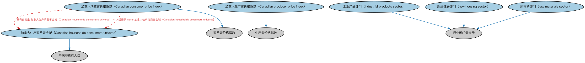

# 加拿大经济指标本体（Canadian Economic Indicators Ontology）结构与公理说明

本文档对应 `CAEconomicIndicators.rdf` / `CAEconomicIndicators.ttl`，说明该本体的类、继承关系、属性和公理约定。结构图见 `CAEconomicIndicators-structure.png`（`CAEconomicIndicators-structure.svg` 为可缩放版本）。

## 1. 本体概述

收录加拿大官方发布的经济指标个体，含发布机构与频率。

**在体系中的位置**：IND 经济指标模块的加拿大参考数据层，与美国个体本体平行。

**上下游关系**：上游依赖经济指标本体与 BE 加拿大法域；下游为加拿大宏观分析提供实例。

**与相近概念的差别**：同美国经济指标本体——统计体系与发布机构不同。

## 2. 类（Class）

| 类（Class） | 定义（Definition） |
|---|---|
| 加拿大消费者价格指数（Canadian consumer price index） | 表示加拿大私人住户消费的固定篮子消费货物与服务价格随时间变化之度量的经济指标。 |
| 加拿大住户消费者全域（Canadian households consumers universe） | 由加拿大全部私人住户构成的统计全域，不含军事基地士兵、第一民族保留地居民等。 |
| 加拿大生产者价格指数（Canadian producer price index） | 表示国内生产者固定篮子货物与服务价格随时间变化之度量的经济指标。 |
| 工业产品部门（industrial products sector） | 价格指数中用于聚焦加拿大制造商销售的主要商品的经济部门分类符。 |
| 新建住房部门（new housing sector） | 价格指数中用于聚焦承包商新建住宅销售价格的经济部门分类符。 |
| 原材料部门（raw materials sector） | 与加拿大各行业购入以供进一步加工的原材料相关的价格指数所用的分类符。 |

### 2.1 继承关系（Inheritance）

- 加拿大消费者价格指数（Canadian consumer price index） ⊑ 消费者价格指数
- 加拿大住户消费者全域（Canadian households consumers universe） ⊑ 平民非机构人口
- 加拿大生产者价格指数（Canadian producer price index） ⊑ 生产者价格指数
- 工业产品部门（industrial products sector） ⊑ 行业部门分类器
- 新建住房部门（new housing sector） ⊑ 行业部门分类器
- 原材料部门（raw materials sector） ⊑ 行业部门分类器

## 5. 公理约定（Axioms）

- 加拿大消费者价格指数（Canadian consumer price index）：restriction
- 加拿大消费者价格指数（Canadian consumer price index）：restriction
- 加拿大消费者价格指数（Canadian consumer price index）：具有自变量 加拿大住户消费者全域（Canadian households consumers universe） =1
- 加拿大消费者价格指数（Canadian consumer price index）：适用于 some 加拿大住户消费者全域（Canadian households consumers universe）
- 加拿大消费者价格指数（Canadian consumer price index）：具有自变量 some 固定篮子
- 加拿大住户消费者全域（Canadian households consumers universe）：具有成员 some（扮演角色（plays role） some 最终消费者）
- 加拿大住户消费者全域（Canadian households consumers universe）：适用于情境 some 住户
- 加拿大生产者价格指数（Canadian producer price index）：restriction
- 加拿大生产者价格指数（Canadian producer price index）：restriction
- 加拿大生产者价格指数（Canadian producer price index）：适用于 some（restriction）

## 6. 依赖（owl:imports，13 个）

本本体通过 `owl:imports` 引入以下本体，各项的中文名称与简介如下：

| 导入本体 | 中文名称 | 简介 |
|---|---|---|
| `BE/FunctionalEntities/Publishers.rdf` | 出版方本体（Publishers Ontology） | 定义出版方及其出版物，用于标识金融信息与文档的发布来源。 |
| `BE/GovernmentEntities/GovernmentEntities.rdf` | 政府实体本体（Government Entities Ontology） | 定义政府、政体（polity）、法域（jurisdiction）及政府实体的核心概念，是各区域政府实体本体的共同基础。 |
| `BE/GovernmentEntities/NorthAmericanJurisdiction/CAGovernmentEntitiesAndJurisdictions.rdf` | 加拿大政府实体与法域本体（Canadian Government Entities and Jurisdictions Ontology） | 收录加拿大的政体、联邦与省政府、法域个体。 |
| `FND/Arrangements/ClassificationSchemes.rdf` | 分类方案本体（Classification Schemes Ontology） | 定义分类方案（classification scheme）、类别及「将事物归入类别」的关系，支撑证券分类、行业分类等具体分类体系。 |
| `FND/Utilities/AnnotationVocabulary.rdf` | FIBO 标注词汇表（FIBO Annotation Vocabulary） | 定义 FIBO 专用的标注属性（如释义来源、成熟度等级），用于本体自身的元数据标注。 |
| `IND/EconomicIndicators/EconomicIndicators.rdf` | 经济指标本体（Economic Indicators Ontology） | 定义宏观经济指标（GDP、CPI、失业率等）的通用结构：发布机构、发布频率与数值。 |
| `https://www.omg.org/spec/Commons/AnnotationVocabulary/` | OMG 通用标注词汇表（OMG Commons Annotation Vocabulary） | OMG 通用本体库（Commons）中的标注词汇表，提供概念映射等标注属性，FIBO 用它标注术语与外部标准的对应关系。 |
| `https://www.omg.org/spec/Commons/Collections/` | OMG 通用集合本体（OMG Commons Collections） | Commons 库中的集合本体，定义集合、成员等通用概念。 |
| `https://www.omg.org/spec/Commons/ContextualDesignators/` | OMG 通用语境指称本体（OMG Commons Contextual Designators） | Commons 库中的语境指称本体，定义「在某个语境下指代某物的名称/符号」，是地址、账户号码等语境相关标识的基础。 |
| `https://www.omg.org/spec/Commons/Locations/` | OMG 通用位置本体（OMG Commons Locations） | Commons 库中的位置本体，定义地理位置、地点的通用概念。 |
| `https://www.omg.org/spec/Commons/QuantitiesAndUnits/` | OMG 通用量与单位本体（OMG Commons Quantities and Units） | Commons 库中的量与单位本体，定义数量、度量单位、量纲的通用概念，支撑金额、比率等数值表达。 |
| `https://www.omg.org/spec/Commons/RolesAndCompositions/` | OMG 通用角色与构成本体（OMG Commons Roles and Compositions） | Commons 库中的角色本体，定义角色及整体—部分构成关系的通用概念。 |
| `https://www.omg.org/spec/LCC/Countries/ISO3166-1-CountryCodes/` | LCC ISO 3166-1 国家代码（ISO 3166-1 Country Codes） | LCC 中 ISO 3166-1 标准的国家/地区代码个体集（如 CN、US、MX），供法域与地址建模引用。 |

## 7. 文件

- 官方 RDF/XML：`CAEconomicIndicators.rdf`
- 中文 Turtle：`CAEconomicIndicators.ttl`
- 结构图：`CAEconomicIndicators-structure.png` / `CAEconomicIndicators-structure.svg`