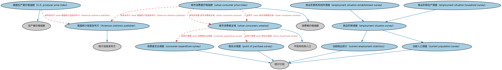

# 美国经济指标本体（US Economic Indicators Ontology）结构与公理说明

本文档对应 `USEconomicIndicators.rdf` / `USEconomicIndicators.ttl`，说明该本体的类、继承关系、属性和公理约定。结构图见 `USEconomicIndicators-structure.png`（`USEconomicIndicators-structure.svg` 为可缩放版本）。

## 1. 本体概述

收录美国官方发布的经济指标个体：非农就业、CPI 系列、GDP 系列等，含发布机构与频率。

**在体系中的位置**：IND 经济指标模块的美国参考数据层。

**上下游关系**：上游依赖经济指标本体与 BE 美国法域；下游为宏观分析、利率情景建模提供实例。

**与相近概念的差别**：与加拿大经济指标本体的差别——发布机构与统计体系不同（美国 BLS/BEA vs 加拿大统计局），同名指标口径也可能不同。

## 2. 类（Class）

| 类（Class） | 定义（Definition） |
|---|---|
| 美国统计信息发布方（American statistics publisher） | 由代表美国联邦政府发布统计信息的政府机构和部门构成的统计信息发布方。 |
| 美国生产者价格指数（U.S. producer price index） | 表示国内生产者产出所获销售价格随时间变化之度量的经济指标。 |
| 消费者支出调查（consumer expenditure survey） | 定期开展、提供消费者购买习惯信息（含支出、收入数据）的统计计划。 |
| 当前就业统计（current employment statistics） | 定期开展、提供与企业和政府机构相关的分析信息、以提供详细行业数据的调查。 |
| 当前人口调查（current population survey） | 定期开展、提供给定统计区一般人口之劳动力相关分析信息的调查。 |
| 就业形势机构场所调查（employment situation establishment survey） | 定期开展、从企业角度调查给定统计区劳动力分析信息的调查。 |
| 就业形势住户调查（employment situation household survey） | 定期开展、从住户角度调查给定统计区劳动力分析信息的调查。 |
| 就业形势调查（employment situation survey） | 定期开展、聚焦给定统计区就业特征之分析信息的调查。 |
| 购买点调查（point of purchase survey） | 定期开展、提供消费者购买各类物品与服务信息的计划。 |
| 城市消费者价格指数（urban consumer price index） | 表示城市消费者为一篮子消费货物与服务所付价格之平均变化的经济指标。 |
| 城市消费者全域（urban consumers universe） | 消费者支出调查的统计全域，由住户中共同作出支出决策的人构成。 |

### 2.1 继承关系（Inheritance）

- 美国统计信息发布方（American statistics publisher） ⊑ 统计信息发布方
- 美国生产者价格指数（U.S. producer price index） ⊑ 生产者价格指数
- 消费者支出调查（consumer expenditure survey） ⊑ 统计计划
- 当前就业统计（current employment statistics） ⊑ 统计计划
- 当前人口调查（current population survey） ⊑ 统计计划
- 就业形势机构场所调查（employment situation establishment survey） ⊑ 就业形势调查（employment situation survey）
- 就业形势住户调查（employment situation household survey） ⊑ 就业形势调查（employment situation survey）
- 就业形势调查（employment situation survey） ⊑ 当前就业统计（current employment statistics）
- 就业形势调查（employment situation survey） ⊑ 当前人口调查（current population survey）
- 购买点调查（point of purchase survey） ⊑ 统计计划
- 城市消费者价格指数（urban consumer price index） ⊑ 消费者价格指数
- 城市消费者全域（urban consumers universe） ⊑ 平民非机构人口

## 5. 公理约定（Axioms）

- 美国生产者价格指数（U.S. producer price index）：restriction
- 美国生产者价格指数（U.S. producer price index）：具有发布方 some 美国统计信息发布方（American statistics publisher）
- 当前人口调查（current population survey）：规定 some 平民非机构人口
- 就业形势机构场所调查（employment situation establishment survey）：适用于情境 some 机构场所
- 就业形势住户调查（employment situation household survey）：适用于情境 some 住户
- 就业形势调查（employment situation survey）：restriction
- 城市消费者价格指数（urban consumer price index）：restriction
- 城市消费者价格指数（urban consumer price index）：具有自变量 城市消费者全域（urban consumers universe） =1
- 城市消费者价格指数（urban consumer price index）：具有发布方 some 美国统计信息发布方（American statistics publisher）
- 城市消费者价格指数（urban consumer price index）：适用于 some 城市消费者全域（urban consumers universe）
- 城市消费者价格指数（urban consumer price index）：具有自变量 some 篮子
- 城市消费者全域（urban consumers universe）：具有成员 some（扮演角色（plays role） some 最终消费者）
- 城市消费者全域（urban consumers universe）：适用于情境 some 消费者支出调查（consumer expenditure survey）
- 城市消费者全域（urban consumers universe）：适用于情境 some 购买点调查（point of purchase survey）

## 6. 依赖（owl:imports，16 个）

本本体通过 `owl:imports` 引入以下本体，各项的中文名称与简介如下：

| 导入本体 | 中文名称 | 简介 |
|---|---|---|
| `BE/FunctionalEntities/Publishers.rdf` | 出版方本体（Publishers Ontology） | 定义出版方及其出版物，用于标识金融信息与文档的发布来源。 |
| `BE/GovernmentEntities/GovernmentEntities.rdf` | 政府实体本体（Government Entities Ontology） | 定义政府、政体（polity）、法域（jurisdiction）及政府实体的核心概念，是各区域政府实体本体的共同基础。 |
| `BE/GovernmentEntities/NorthAmericanJurisdiction/USGovernmentEntitiesAndJurisdictions.rdf` | 美国政府实体与法域本体（US Government Entities and Jurisdictions Ontology） | 收录美国的政体、联邦与各州政府、法域个体，是北美金融建模最常用的法域参考数据。 |
| `FBC/ProductsAndServices/FinancialProductsAndServices.rdf` | 金融产品与服务本体（Financial Products and Services Ontology） | 定义金融产品（financial product）与金融服务（financial service）及其提供、购买关系。 |
| `FND/Utilities/Analytics.rdf` | 分析本体（Analytics Ontology） | 定义分析工具、度量与比率的通用概念，支撑指标与模型的表达。 |
| `FND/Utilities/AnnotationVocabulary.rdf` | FIBO 标注词汇表（FIBO Annotation Vocabulary） | 定义 FIBO 专用的标注属性（如释义来源、成熟度等级），用于本体自身的元数据标注。 |
| `IND/EconomicIndicators/EconomicIndicators.rdf` | 经济指标本体（Economic Indicators Ontology） | 定义宏观经济指标（GDP、CPI、失业率等）的通用结构：发布机构、发布频率与数值。 |
| `https://www.omg.org/spec/Commons/AnnotationVocabulary/` | OMG 通用标注词汇表（OMG Commons Annotation Vocabulary） | OMG 通用本体库（Commons）中的标注词汇表，提供概念映射等标注属性，FIBO 用它标注术语与外部标准的对应关系。 |
| `https://www.omg.org/spec/Commons/Collections/` | OMG 通用集合本体（OMG Commons Collections） | Commons 库中的集合本体，定义集合、成员等通用概念。 |
| `https://www.omg.org/spec/Commons/ContextualDesignators/` | OMG 通用语境指称本体（OMG Commons Contextual Designators） | Commons 库中的语境指称本体，定义「在某个语境下指代某物的名称/符号」，是地址、账户号码等语境相关标识的基础。 |
| `https://www.omg.org/spec/Commons/Documents/` | OMG 通用文档本体（OMG Commons Documents） | Commons 库中的文档本体，定义文档及其组成部分的通用概念。 |
| `https://www.omg.org/spec/Commons/Locations/` | OMG 通用位置本体（OMG Commons Locations） | Commons 库中的位置本体，定义地理位置、地点的通用概念。 |
| `https://www.omg.org/spec/Commons/QuantitiesAndUnits/` | OMG 通用量与单位本体（OMG Commons Quantities and Units） | Commons 库中的量与单位本体，定义数量、度量单位、量纲的通用概念，支撑金额、比率等数值表达。 |
| `https://www.omg.org/spec/Commons/RegistrationAuthorities/` | OMG 通用登记主管机构本体（OMG Commons Registration Authorities） | Commons 库中的登记主管机构本体，定义负责登记注册的主管机构及其登记行为的通用概念。 |
| `https://www.omg.org/spec/Commons/RolesAndCompositions/` | OMG 通用角色与构成本体（OMG Commons Roles and Compositions） | Commons 库中的角色本体，定义角色及整体—部分构成关系的通用概念。 |
| `https://www.omg.org/spec/LCC/Countries/ISO3166-1-CountryCodes/` | LCC ISO 3166-1 国家代码（ISO 3166-1 Country Codes） | LCC 中 ISO 3166-1 标准的国家/地区代码个体集（如 CN、US、MX），供法域与地址建模引用。 |

## 7. 文件

- 官方 RDF/XML：`USEconomicIndicators.rdf`
- 中文 Turtle：`USEconomicIndicators.ttl`
- 结构图：`USEconomicIndicators-structure.png` / `USEconomicIndicators-structure.svg`