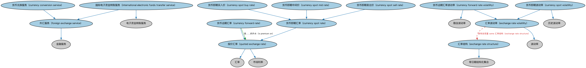

# 外汇本体（Foreign Exchange Ontology）结构与公理说明

本文档对应 `ForeignExchange.rdf` / `ForeignExchange.ttl`，说明该本体的类、继承关系、属性和公理约定。结构图见 `ForeignExchange-structure.png`（`ForeignExchange-structure.svg` 为可缩放版本）。

## 1. 本体概述

定义外汇（foreign exchange）与汇率（exchange rate）：货币对（currency pair）、直接/间接标价、即期与远期汇率。

**在体系中的位置**：IND 外汇模块的核心，是外汇衍生品（DER）与跨境金额换算的基础。

**上下游关系**：上游继承指标本体并依赖 FND 货币金额；下游被 DER 外汇合约、跨境交易建模引用。

**与相近概念的差别**：汇率≠货币——货币是计价单位（见 ISO 4217 个体），汇率是两种货币之间的比价，本质上是一种特殊的指标。

本本体中类与类的核心关系如下（完整细节见各类小节）：

- **货币兑换服务（currency conversion service）** 继承 **外汇服务（foreign exchange service）**
- **货币远期汇率（currency forward rate）** 继承 **报价汇率（quoted exchange rate）**
- **货币远期汇率波动率（currency forward rate volatility）** 继承 **汇率波动率（exchange rate volatility）**
- **货币远期汇率波动率（currency forward rate volatility）** 继承 **隐含波动率（ImpliedVolatility）**
- **货币即期买入价（currency spot buy rate）** 继承 **货币即期汇率（currency spot rate）**
- **货币即期中间价（currency spot mid rate）** 继承 **货币即期汇率（currency spot rate）**
- **货币即期汇率（currency spot rate）** 继承 **报价汇率（quoted exchange rate）**
- **货币即期卖出价（currency spot sell rate）** 继承 **货币即期汇率（currency spot rate）**
- **货币即期波动率（currency spot volatility）** 继承 **汇率波动率（exchange rate volatility）**
- **货币即期波动率（currency spot volatility）** 继承 **历史波动率（HistoricalVolatility）**
- **汇率结构（exchange rate structure）** 继承 **带日期结构化集合（DatedStructuredCollection）**
- **汇率波动率（exchange rate volatility）** 继承 **波动率（Volatility）**
- 其余 6 条关系从略。

## 2. 类（Class）

| 类（Class） | 定义（Definition） |
|---|---|
| 货币兑换服务（currency conversion service） | 将一国或一组国家的货币兑换为另一货币的外汇服务，通常（但非总是）作为某笔交易的对价。 foreign exchange service involving the conversion of currency of one country or group of countries for another, typically, but not always, as a counter transaction |
| 货币远期汇率（currency forward rate） | 两种货币之间在未来某时点结算的汇率，以相对于即期汇率的升水表示。 rate of exchange between two currencies for settlement at some future point in time, expressed as a premium on the spot rate |
| 货币远期汇率波动率（currency forward rate volatility） | 基于汇率一系列预测值的汇率波动度量。 measure of exchange rate fluctuation based on a range of projected values for exchange rates |
| 货币即期买入价（currency spot buy rate） | 报告来源观测到的指示性即期买入市场汇率。 indicative spot buying market rate as observed by the reporting source |
| 货币即期中间价（currency spot mid rate） | 报告来源观测到的指示性中间市场汇率（即期买入与卖出的均值）。 indicative middle market (mean of spot buying and selling) rate as observed by the reporting source |
| 货币即期汇率（currency spot rate） | 一种货币可立即交割兑换为另一种货币的汇率。 rate at which one currency may be exchanged for another for immediate delivery |
| 货币即期卖出价（currency spot sell rate） | 报告来源观测到的指示性即期卖出市场汇率。 indicative spot selling market rate as observed by the reporting source |
| 货币即期波动率（currency spot volatility） | 基于汇率一系列历史实际值的汇率波动度量。 measure of exchange rate fluctuation based on a range of past actual values for exchange rates |
| 汇率结构（exchange rate structure） | 报价或预测汇率的结构化集合，可据以构造波动率。 structured collection of quoted or projected exchange rates, such that volatility may be constructed for the structure |
| 汇率波动率（exchange rate volatility） | 一种货币兑换另一货币之汇率的变化率的统计度量。 statistical measure of the rate of change in the rate at which one currency can be exchanged for another |
| 外汇服务（foreign exchange service） | 涉及货币兑换、货币转换以及跨国资金转移的金融服务。 financial service involving the exchange of one currency for another, conversion of one currency for another, and transfer of money from one country to another whereby currency conversion is required |
| 国际电子资金转账服务（international electronic funds transfer service） | 涉及跨境资金转移、可能同时涉及货币兑换的电子资金转账（EFT）服务。 electronic funds transfer (EFT) service involving the transfer of funds across national borders, that may also involve currency conversion |
| 报价汇率（quoted exchange rate） | 在特定时点、针对以另一（基准）货币报价的给定金额货币所报的汇率。 exchange rate quoted at a specific point in time, for a given block amount of currency as quoted against another (base) currency |

以下按类逐个展开：每个类给出继承关系、相关属性与公理约定；子类在父类之下降一级编号。

### 2.1 汇率结构（exchange rate structure）

定义：报价或预测汇率的结构化集合，可据以构造波动率。

- 父类：**带日期结构化集合（DatedStructuredCollection）**

属性：

| 属性 | 定义 | 说明 |
|---|---|---|
| **具有成员（hasMember）** | — | — |

公理：

- **具有成员（hasMember）**至少有一个取值，类型是**汇率（ExchangeRate）**。

### 2.2 汇率波动率（exchange rate volatility）

定义：一种货币兑换另一货币之汇率的变化率的统计度量。

- 父类：**波动率（Volatility）**
- 直接子类：**货币远期汇率波动率（currency forward rate volatility）**、**货币即期波动率（currency spot volatility）**

属性：

| 属性 | 定义 | 说明 |
|---|---|---|
| **具有自变量（hasArgument）** | — | — |

公理：

- **具有自变量（hasArgument）**至少有一个取值，类型是**汇率结构（exchange rate structure）**。

#### 2.2.1 货币远期汇率波动率（currency forward rate volatility）

定义：基于汇率一系列预测值的汇率波动度量。

- 父类：**汇率波动率（exchange rate volatility）**、**隐含波动率（ImpliedVolatility）**

属性：

| 属性 | 定义 | 说明 |
|---|---|---|
| **是……的波动率（isVolatilityOf）** | — | — |

公理：

- **是……的波动率（isVolatilityOf）**的所有取值只能是**货币远期汇率（currency forward rate）**。

#### 2.2.2 货币即期波动率（currency spot volatility）

定义：基于汇率一系列历史实际值的汇率波动度量。

- 父类：**汇率波动率（exchange rate volatility）**、**历史波动率（HistoricalVolatility）**

属性：

| 属性 | 定义 | 说明 |
|---|---|---|
| **是……的波动率（isVolatilityOf）** | — | — |

公理：

- **是……的波动率（isVolatilityOf）**的所有取值只能是**货币即期汇率（currency spot rate）**。

### 2.3 外汇服务（foreign exchange service）

定义：涉及货币兑换、货币转换以及跨国资金转移的金融服务。

- 父类：**金融服务（FinancialService）**
- 直接子类：**货币兑换服务（currency conversion service）**、**国际电子资金转账服务（international electronic funds transfer service）**

#### 2.3.1 货币兑换服务（currency conversion service）

定义：将一国或一组国家的货币兑换为另一货币的外汇服务，通常（但非总是）作为某笔交易的对价。

- 父类：**外汇服务（foreign exchange service）**

#### 2.3.2 国际电子资金转账服务（international electronic funds transfer service）

定义：涉及跨境资金转移、可能同时涉及货币兑换的电子资金转账（EFT）服务。

- 父类：**电子资金转账服务（ElectronicFundsTransferService）**、**外汇服务（foreign exchange service）**

### 2.4 报价汇率（quoted exchange rate）

定义：在特定时点、针对以另一（基准）货币报价的给定金额货币所报的汇率。

- 父类：**汇率（ExchangeRate）**、**市场利率（MarketRate）**
- 直接子类：**货币远期汇率（currency forward rate）**、**货币即期汇率（currency spot rate）**

属性：

| 属性 | 定义 | 说明 |
|---|---|---|
| **具有汇率报价来源（has exchange rate quotation source）** | 标识报价汇率的来源。 indicates the origin of a quoted exchange rate | 值域：N236f4fc454da4ae49651c9fc03330926；子属性：引用 |
| **具有报价金额基准（has quotation block amount basis）** | 标识适用所述即期汇率的交易中将被兑换的交易货币金额。 indicates the amount of the dealt currency which would be exchanged in a trade for which the stated spot rate applies | 值域：货币数量 |
| **具有报价结算基准（has quotation settlement basis）** | 标识适用所述即期汇率的交易的结算周期。 indicates the settlement period for a trade for which the stated spot rate applies | 值域：时长；子属性：具有时长 |
| **具有报价货币（has quote currency）** | 标识汇率中的报价货币；该货币的 R 单位代表一单位基准货币。 indicates the quote currency in an exchange rate; R units of this currency represent one unit of the base currency | 值域：货币；子属性：具有交易货币 |

公理：

- **具有报价货币（has quote currency）**恰好有 1 个**货币（Currency）**。
- **具有汇率报价来源（has exchange rate quotation source）**至少有一个取值，该取值满足：该属性存在取值约束。

#### 2.4.1 货币远期汇率（currency forward rate）

定义：两种货币之间在未来某时点结算的汇率，以相对于即期汇率的升水表示。

- 父类：**报价汇率（quoted exchange rate）**

属性：

| 属性 | 定义 | 说明 |
|---|---|---|
| **具有结算日（hasSettlementDate）** | — | — |
| **是……的升水（is premium on）** | 以相对于该货币对即期汇率的升水表示的汇率。 an exchange rate expressed as a premium on the spot rate for the currency pair | 值域：报价汇率（quoted exchange rate） |

公理：

- **具有结算日（hasSettlementDate）**的所有取值只能是**日期（Date）**。

#### 2.4.2 货币即期汇率（currency spot rate）

定义：一种货币可立即交割兑换为另一种货币的汇率。

- 父类：**报价汇率（quoted exchange rate）**
- 直接子类：**货币即期买入价（currency spot buy rate）**、**货币即期中间价（currency spot mid rate）**、**货币即期卖出价（currency spot sell rate）**

##### 2.4.2.1 货币即期买入价（currency spot buy rate）

定义：报告来源观测到的指示性即期买入市场汇率。

- 父类：**货币即期汇率（currency spot rate）**

##### 2.4.2.2 货币即期中间价（currency spot mid rate）

定义：报告来源观测到的指示性中间市场汇率（即期买入与卖出的均值）。

- 父类：**货币即期汇率（currency spot rate）**

##### 2.4.2.3 货币即期卖出价（currency spot sell rate）

定义：报告来源观测到的指示性即期卖出市场汇率。

- 父类：**货币即期汇率（currency spot rate）**

## 3. 其他属性

以下属性未绑定到本体的具体类（定义域在外部本体或未声明）：

对象属性（Object Property）：

| 属性 | 定义 | 说明 |
|---|---|---|
| **具有报价汇率（has quoted exchange rate）** | 特定来源在某日期时间所报的两种货币之间的汇率。 rate of exchange between two currencies as specified as of some date and time as quoted by a specific source | 值域：报价汇率（quoted exchange rate）；子属性：具有量值 |

## 4. 依赖（owl:imports，14 个）

本本体通过 `owl:imports` 引入以下本体，各项的中文名称与简介如下：

| 导入本体 | 中文名称 | 简介 |
|---|---|---|
| `BE/FunctionalEntities/Publishers.rdf` | 出版方本体（Publishers Ontology） | 定义出版方及其出版物，用于标识金融信息与文档的发布来源。 |
| `FBC/FunctionalEntities/FinancialServicesEntities.rdf` | 金融服务实体本体（Financial Services Entities Ontology） | FBC 域核心本体，定义金融服务机构（银行、券商、保险公司、资管机构等）的功能分类体系。 |
| `FBC/FunctionalEntities/Markets.rdf` | 市场本体（Markets Ontology） | 定义金融市场（market）：交易所、场外市场及其功能。 |
| `FBC/ProductsAndServices/FinancialProductsAndServices.rdf` | 金融产品与服务本体（Financial Products and Services Ontology） | 定义金融产品（financial product）与金融服务（financial service）及其提供、购买关系。 |
| `FND/Accounting/CurrencyAmount.rdf` | 货币金额本体（Currency Amount Ontology） | 定义「金额＋币种」的货币金额（currency amount）表示，是 FIBO 中表达价格、债务金额、付款额等一切带币种数值的基础构件。 |
| `FND/DatesAndTimes/FinancialDates.rdf` | 金融日期本体（Financial Dates Ontology） | 定义金融语境下的日期与期间概念：结算日、付息日、到期日、日计数基准等。 |
| `FND/Relations/Relations.rdf` | 关系本体（Relations Ontology） | FIBO 最底层的基础本体，定义参考（reference）、分类（classify）等通用关系与抽象概念，全库普遍依赖。 |
| `FND/Utilities/AnnotationVocabulary.rdf` | FIBO 标注词汇表（FIBO Annotation Vocabulary） | 定义 FIBO 专用的标注属性（如释义来源、成熟度等级），用于本体自身的元数据标注。 |
| `IND/Indicators/Indicators.rdf` | 指标本体（Indicators Ontology） | 定义「指标」（indicator）的通用概念：对某现象的可度量表示，是经济指标、利率等的上位模型。 |
| `https://www.omg.org/spec/Commons/AnnotationVocabulary/` | OMG 通用标注词汇表（OMG Commons Annotation Vocabulary） | OMG 通用本体库（Commons）中的标注词汇表，提供概念映射等标注属性，FIBO 用它标注术语与外部标准的对应关系。 |
| `https://www.omg.org/spec/Commons/Collections/` | OMG 通用集合本体（OMG Commons Collections） | Commons 库中的集合本体，定义集合、成员等通用概念。 |
| `https://www.omg.org/spec/Commons/DatesAndTimes/` | OMG 通用日期与时间本体（OMG Commons Dates and Times） | Commons 库中的日期时间本体，定义日期、期间、时间点等通用时间概念。 |
| `https://www.omg.org/spec/Commons/Documents/` | OMG 通用文档本体（OMG Commons Documents） | Commons 库中的文档本体，定义文档及其组成部分的通用概念。 |
| `https://www.omg.org/spec/Commons/QuantitiesAndUnits/` | OMG 通用量与单位本体（OMG Commons Quantities and Units） | Commons 库中的量与单位本体，定义数量、度量单位、量纲的通用概念，支撑金额、比率等数值表达。 |

## 5. 文件

- 官方 RDF/XML：`ForeignExchange.rdf`
- 中文 Turtle：`ForeignExchange.ttl`
- 结构图：`ForeignExchange-structure.png` / `ForeignExchange-structure.svg`