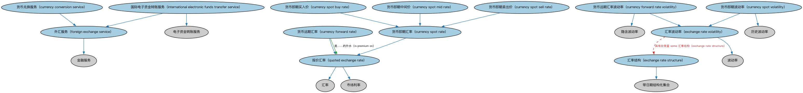

# 外汇本体（Foreign Exchange Ontology）结构与公理说明

本文档对应 `ForeignExchange.rdf` / `ForeignExchange.ttl`，说明该本体的类、继承关系、属性和公理约定。结构图见 `ForeignExchange-structure.png`（`ForeignExchange-structure.svg` 为可缩放版本）。

## 1. 本体概述

定义外汇（foreign exchange）与汇率（exchange rate）：货币对（currency pair）、直接/间接标价、即期与远期汇率。

**在体系中的位置**：IND 外汇模块的核心，是外汇衍生品（DER）与跨境金额换算的基础。

**上下游关系**：上游继承指标本体并依赖 FND 货币金额；下游被 DER 外汇合约、跨境交易建模引用。

**与相近概念的差别**：汇率≠货币——货币是计价单位（见 ISO 4217 个体），汇率是两种货币之间的比价，本质上是一种特殊的指标。

## 2. 类（Class）

| 类（Class） | 定义（Definition） |
|---|---|
| 货币兑换服务（currency conversion service） | 将一国或一组国家的货币兑换为另一货币的外汇服务，通常（但非总是）作为某笔交易的对价。 |
| 货币远期汇率（currency forward rate） | 两种货币之间在未来某时点结算的汇率，以相对于即期汇率的升水表示。 |
| 货币远期汇率波动率（currency forward rate volatility） | 基于汇率一系列预测值的汇率波动度量。 |
| 货币即期买入价（currency spot buy rate） | 报告来源观测到的指示性即期买入市场汇率。 |
| 货币即期中间价（currency spot mid rate） | 报告来源观测到的指示性中间市场汇率（即期买入与卖出的均值）。 |
| 货币即期汇率（currency spot rate） | 一种货币可立即交割兑换为另一种货币的汇率。 |
| 货币即期卖出价（currency spot sell rate） | 报告来源观测到的指示性即期卖出市场汇率。 |
| 货币即期波动率（currency spot volatility） | 基于汇率一系列历史实际值的汇率波动度量。 |
| 汇率结构（exchange rate structure） | 报价或预测汇率的结构化集合，可据以构造波动率。 |
| 汇率波动率（exchange rate volatility） | 一种货币兑换另一货币之汇率的变化率的统计度量。 |
| 外汇服务（foreign exchange service） | 涉及货币兑换、货币转换以及跨国资金转移的金融服务。 |
| 国际电子资金转账服务（international electronic funds transfer service） | 涉及跨境资金转移、可能同时涉及货币兑换的电子资金转账（EFT）服务。 |
| 报价汇率（quoted exchange rate） | 在特定时点、针对以另一（基准）货币报价的给定金额货币所报的汇率。 |

### 2.1 继承关系（Inheritance）

- 货币兑换服务（currency conversion service） ⊑ 外汇服务（foreign exchange service）
- 货币远期汇率（currency forward rate） ⊑ 报价汇率（quoted exchange rate）
- 货币远期汇率波动率（currency forward rate volatility） ⊑ 汇率波动率（exchange rate volatility）
- 货币远期汇率波动率（currency forward rate volatility） ⊑ 隐含波动率
- 货币即期买入价（currency spot buy rate） ⊑ 货币即期汇率（currency spot rate）
- 货币即期中间价（currency spot mid rate） ⊑ 货币即期汇率（currency spot rate）
- 货币即期汇率（currency spot rate） ⊑ 报价汇率（quoted exchange rate）
- 货币即期卖出价（currency spot sell rate） ⊑ 货币即期汇率（currency spot rate）
- 货币即期波动率（currency spot volatility） ⊑ 汇率波动率（exchange rate volatility）
- 货币即期波动率（currency spot volatility） ⊑ 历史波动率
- 汇率结构（exchange rate structure） ⊑ 带日期结构化集合
- 汇率波动率（exchange rate volatility） ⊑ 波动率
- 外汇服务（foreign exchange service） ⊑ 金融服务
- 国际电子资金转账服务（international electronic funds transfer service） ⊑ 电子资金转账服务
- 国际电子资金转账服务（international electronic funds transfer service） ⊑ 外汇服务（foreign exchange service）
- 报价汇率（quoted exchange rate） ⊑ 汇率
- 报价汇率（quoted exchange rate） ⊑ 市场利率

## 3. 对象属性（Object Property）

| 属性（Property） | 中文（English） | 定义（Definition） | 说明 |
|---|---|---|---|
| fibo-ind-fx-fx:hasExchangeRateQuotationSource | 具有汇率报价来源（has exchange rate quotation source） | 标识报价汇率的来源。 | 值域（range）：N8e83dc477e124c5381c1a1b4cdd36635；子属性（subPropertyOf）：引用 |
| fibo-ind-fx-fx:hasQuotationBlockAmountBasis | 具有报价金额基准（has quotation block amount basis） | 标识适用所述即期汇率的交易中将被兑换的交易货币金额。 | 定义域（domain）：报价汇率（quoted exchange rate）；值域（range）：货币数量 |
| fibo-ind-fx-fx:hasQuotationSettlementBasis | 具有报价结算基准（has quotation settlement basis） | 标识适用所述即期汇率的交易的结算周期。 | 定义域（domain）：报价汇率（quoted exchange rate）；值域（range）：时长；子属性（subPropertyOf）：具有时长 |
| fibo-ind-fx-fx:hasQuoteCurrency | 具有报价货币（has quote currency） | 标识汇率中的报价货币；该货币的 R 单位代表一单位基准货币。 | 值域（range）：货币；子属性（subPropertyOf）：具有交易货币 |
| fibo-ind-fx-fx:hasQuotedExchangeRate | 具有报价汇率（has quoted exchange rate） | 特定来源在某日期时间所报的两种货币之间的汇率。 | 值域（range）：报价汇率（quoted exchange rate）；子属性（subPropertyOf）：具有量值 |
| fibo-ind-fx-fx:isPremiumOn | 是……的升水（is premium on） | 以相对于该货币对即期汇率的升水表示的汇率。 | 定义域（domain）：货币远期汇率（currency forward rate）；值域（range）：报价汇率（quoted exchange rate） |

## 5. 公理约定（Axioms）

- 货币远期汇率（currency forward rate）：具有结算日 only 日期
- 货币远期汇率波动率（currency forward rate volatility）：是……的波动率 only 货币远期汇率（currency forward rate）
- 货币即期波动率（currency spot volatility）：是……的波动率 only 货币即期汇率（currency spot rate）
- 汇率结构（exchange rate structure）：具有成员 some 汇率
- 汇率波动率（exchange rate volatility）：具有自变量 some 汇率结构（exchange rate structure）
- 报价汇率（quoted exchange rate）：具有报价货币（has quote currency） 货币 =1
- 报价汇率（quoted exchange rate）：具有汇率报价来源（has exchange rate quotation source） some（restriction）

## 6. 依赖（owl:imports，14 个）

本本体通过 `owl:imports` 引入以下本体，各项的中文名称与简介如下：

| 导入本体 | 中文名称 | 简介 |
|---|---|---|
| `BE/FunctionalEntities/Publishers.rdf` | 出版方本体（Publishers Ontology） | 定义出版方及其出版物，用于标识金融信息与文档的发布来源。 |
| `FBC/FunctionalEntities/FinancialServicesEntities.rdf` | 金融服务实体本体（Financial Services Entities Ontology） | FBC 域核心本体，定义金融服务机构（银行、券商、保险公司、资管机构等）的功能分类体系。 |
| `FBC/FunctionalEntities/Markets.rdf` | 市场本体（Markets Ontology） | 定义金融市场（market）：交易所、场外市场及其功能。 |
| `FBC/ProductsAndServices/FinancialProductsAndServices.rdf` | 金融产品与服务本体（Financial Products and Services Ontology） | 定义金融产品（financial product）与金融服务（financial service）及其提供、购买关系。 |
| `FND/Accounting/CurrencyAmount.rdf` | 货币金额本体（Currency Amount Ontology） | 定义「金额＋币种」的货币金额（currency amount）表示，是 FIBO 中表达价格、债务金额、付款额等一切带币种数值的基础构件。 |
| `FND/DatesAndTimes/FinancialDates.rdf` | 金融日期本体（Financial Dates Ontology） | 定义金融语境下的日期与期间概念：结算日、付息日、到期日、日计数基准等。 |
| `FND/Relations/Relations.rdf` | 关系本体（Relations Ontology） | FIBO 最底层的基础本体，定义参考（reference）、分类（classify）等通用关系与抽象概念，全库普遍依赖。 |
| `FND/Utilities/AnnotationVocabulary.rdf` | FIBO 标注词汇表（FIBO Annotation Vocabulary） | 定义 FIBO 专用的标注属性（如释义来源、成熟度等级），用于本体自身的元数据标注。 |
| `IND/Indicators/Indicators.rdf` | 指标本体（Indicators Ontology） | 定义「指标」（indicator）的通用概念：对某现象的可度量表示，是经济指标、利率等的上位模型。 |
| `https://www.omg.org/spec/Commons/AnnotationVocabulary/` | OMG 通用标注词汇表（OMG Commons Annotation Vocabulary） | OMG 通用本体库（Commons）中的标注词汇表，提供概念映射等标注属性，FIBO 用它标注术语与外部标准的对应关系。 |
| `https://www.omg.org/spec/Commons/Collections/` | OMG 通用集合本体（OMG Commons Collections） | Commons 库中的集合本体，定义集合、成员等通用概念。 |
| `https://www.omg.org/spec/Commons/DatesAndTimes/` | OMG 通用日期与时间本体（OMG Commons Dates and Times） | Commons 库中的日期时间本体，定义日期、期间、时间点等通用时间概念。 |
| `https://www.omg.org/spec/Commons/Documents/` | OMG 通用文档本体（OMG Commons Documents） | Commons 库中的文档本体，定义文档及其组成部分的通用概念。 |
| `https://www.omg.org/spec/Commons/QuantitiesAndUnits/` | OMG 通用量与单位本体（OMG Commons Quantities and Units） | Commons 库中的量与单位本体，定义数量、度量单位、量纲的通用概念，支撑金额、比率等数值表达。 |

## 7. 文件

- 官方 RDF/XML：`ForeignExchange.rdf`
- 中文 Turtle：`ForeignExchange.ttl`
- 结构图：`ForeignExchange-structure.png` / `ForeignExchange-structure.svg`