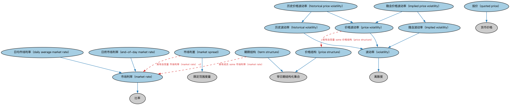

# 指标本体（Indicators Ontology）结构与公理说明

本文档对应 `Indicators.rdf` / `Indicators.ttl`，说明该本体的类、继承关系、属性和公理约定。结构图见 `Indicators-structure.png`（`Indicators-structure.svg` 为可缩放版本）。

## 1. 本体概述

定义「指标」（indicator）的通用概念：对某种现象的可度量表示，含发布机构、发布频率、修订机制等。

**在体系中的位置**：IND（指标与指数）域的基础本体，经济指标、利率、汇率、市场指数的共同上游。

**上下游关系**：上游依赖 FND 分析与安排本体；下游被 IND 域全部模块引用。

**与相近概念的差别**：指标≠指数——指标是单一的经济量度（如 CPI），指数是按规则加权合成的一篮子数值（如标普 500）；与分析本体的差别——分析本体提供度量机制，本本体定义业务指标。

## 2. 类（Class）

| 类（Class） | 定义（Definition） |
|---|---|
| 日均市场利率（daily average market rate） | 给定利率的总体水平，按所选观测值（特定参考利率、汇率、借贷利率等）之和平均计算。 |
| 日终市场利率（end-of-day market rate） | 特定日期营业日结束时给定市场利率的值。 |
| 历史价格波动率（historical price volatility） | 标的证券与指数过去价格交易区间的历史波动率度量。 |
| 历史波动率（historical volatility） | 使用此前某段时期内价格、利率及其他测算之实际值的波动率度量。 |
| 隐含价格波动率（implied price volatility） | 表示标的股票或指数在特定时间框架内预期波动的波动率度量。 |
| 隐含波动率（implied volatility） | 用于计算概率的前瞻性波动率度量。 |
| 市场利率（market rate） | 市场上对一组工具确立的利率值，或描述某行业和/或政治区域经济气候的利率值（如 SOFR）。 |
| 市场利差（market spread） | 提供两个市场利率之差（利差）的统计度量。 |
| 价格结构（price structure） | 价格（如某指数或证券的市场价格）的结构化集合，可据以进行波动率或其他分析。 |
| 价格波动率（price volatility） | 给定证券或市场指数定价变化率的统计度量。 |
| 报价（quoted price） | 某发布方在给定日期报出的货币价格。 |
| 期限结构（term structure） | 利率（如不同到期期限的债券收益率）的结构化集合，可据以构造收益率曲线。 |
| 波动率（volatility） | 某随机变量在某段时期内围绕其均值的离散程度的统计度量。 |

### 2.1 继承关系（Inheritance）

- 日均市场利率（daily average market rate） ⊑ 市场利率（market rate）
- 日终市场利率（end-of-day market rate） ⊑ 市场利率（market rate）
- 历史价格波动率（historical price volatility） ⊑ 历史波动率（historical volatility）
- 历史价格波动率（historical price volatility） ⊑ 价格波动率（price volatility）
- 历史波动率（historical volatility） ⊑ 波动率（volatility）
- 隐含价格波动率（implied price volatility） ⊑ 隐含波动率（implied volatility）
- 隐含价格波动率（implied price volatility） ⊑ 价格波动率（price volatility）
- 隐含波动率（implied volatility） ⊑ 波动率（volatility）
- 市场利率（market rate） ⊑ 比率
- 市场利差（market spread） ⊑ 限定范围度量
- 价格结构（price structure） ⊑ 带日期结构化集合
- 价格波动率（price volatility） ⊑ 波动率（volatility）
- 报价（quoted price） ⊑ 货币价格
- 期限结构（term structure） ⊑ 带日期结构化集合
- 波动率（volatility） ⊑ 离散度

## 3. 对象属性（Object Property）

| 属性（Property） | 中文（English） | 定义（Definition） | 说明 |
|---|---|---|---|
| fibo-ind-ind-ind:hasQuotationDate | 具有报价日期（has quotation date） | 标识给定市场利率或指标的报价日期。 | 值域（range）：日期；子属性（subPropertyOf）：具有日期 |
| fibo-ind-ind-ind:isVolatilityOf | 是……的波动率（is volatility of） | 标识波动率度量所适用并计量的对象。 | 定义域（domain）：波动率（volatility）；子属性（subPropertyOf）：适用于 |

## 4. 数据属性（Datatype Property）

| 属性（Property） | 中文（English） | 定义（Definition） |
|---|---|---|
| fibo-ind-ind-ind:hasQuotationDateTime | 具有报价日期时间（has quotation date and time） | 标识给定市场利率、利率、指标或其他报价信息的报价日期及可能的时间。 |

## 5. 公理约定（Axioms）

- 日均市场利率（daily average market rate）：restriction
- 日终市场利率（end-of-day market rate）：restriction
- 市场利率（market rate）：是……的值 限定范围度量 ≥0
- 市场利率（market rate）：restriction
- 市场利率（market rate）：restriction
- 市场利差（market spread）：具有自变量 市场利率（market rate） =2
- 价格结构（price structure）：具有成员 some 货币价格
- 价格波动率（price volatility）：具有自变量 some 价格结构（price structure）
- 报价（quoted price）：restriction
- 期限结构（term structure）：具有成员 some 市场利率（market rate）
- 波动率（volatility）：restriction
- 波动率（volatility）：具有日期区间 some 日期区间
- 波动率（volatility）：具有自变量 some 带日期结构化集合

## 6. 依赖（owl:imports，10 个）

本本体通过 `owl:imports` 引入以下本体，各项的中文名称与简介如下：

| 导入本体 | 中文名称 | 简介 |
|---|---|---|
| `FND/Accounting/CurrencyAmount.rdf` | 货币金额本体（Currency Amount Ontology） | 定义「金额＋币种」的货币金额（currency amount）表示，是 FIBO 中表达价格、债务金额、付款额等一切带币种数值的基础构件。 |
| `FND/DatesAndTimes/FinancialDates.rdf` | 金融日期本体（Financial Dates Ontology） | 定义金融语境下的日期与期间概念：结算日、付息日、到期日、日计数基准等。 |
| `FND/Organizations/FormalOrganizations.rdf` | 正式组织本体（Formal Organizations Ontology） | 定义正式组织、组织成员与组织内部角色，是公司、政府机构等组织形态建模的基础。 |
| `FND/Utilities/Analytics.rdf` | 分析本体（Analytics Ontology） | 定义分析工具、度量与比率的通用概念，支撑指标与模型的表达。 |
| `FND/Utilities/AnnotationVocabulary.rdf` | FIBO 标注词汇表（FIBO Annotation Vocabulary） | 定义 FIBO 专用的标注属性（如释义来源、成熟度等级），用于本体自身的元数据标注。 |
| `https://www.omg.org/spec/Commons/AnnotationVocabulary/` | OMG 通用标注词汇表（OMG Commons Annotation Vocabulary） | OMG 通用本体库（Commons）中的标注词汇表，提供概念映射等标注属性，FIBO 用它标注术语与外部标准的对应关系。 |
| `https://www.omg.org/spec/Commons/Collections/` | OMG 通用集合本体（OMG Commons Collections） | Commons 库中的集合本体，定义集合、成员等通用概念。 |
| `https://www.omg.org/spec/Commons/ContextualDesignators/` | OMG 通用语境指称本体（OMG Commons Contextual Designators） | Commons 库中的语境指称本体，定义「在某个语境下指代某物的名称/符号」，是地址、账户号码等语境相关标识的基础。 |
| `https://www.omg.org/spec/Commons/DatesAndTimes/` | OMG 通用日期与时间本体（OMG Commons Dates and Times） | Commons 库中的日期时间本体，定义日期、期间、时间点等通用时间概念。 |
| `https://www.omg.org/spec/Commons/QuantitiesAndUnits/` | OMG 通用量与单位本体（OMG Commons Quantities and Units） | Commons 库中的量与单位本体，定义数量、度量单位、量纲的通用概念，支撑金额、比率等数值表达。 |

## 7. 文件

- 官方 RDF/XML：`Indicators.rdf`
- 中文 Turtle：`Indicators.ttl`
- 结构图：`Indicators-structure.png` / `Indicators-structure.svg`