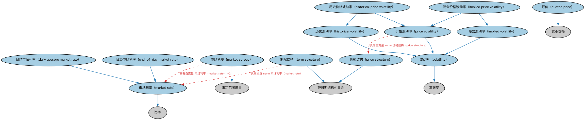

# 指标本体（Indicators Ontology）结构与公理说明

本文档对应 `Indicators.rdf` / `Indicators.ttl`，说明该本体的类、继承关系、属性和公理约定。结构图见 `Indicators-structure.png`（`Indicators-structure.svg` 为可缩放版本）。

## 1. 本体概述

定义「指标」（indicator）的通用概念：对某种现象的可度量表示，含发布机构、发布频率、修订机制等。

**在体系中的位置**：IND（指标与指数）域的基础本体，经济指标、利率、汇率、市场指数的共同上游。

**上下游关系**：上游依赖 FND 分析与安排本体；下游被 IND 域全部模块引用。

**与相近概念的差别**：指标≠指数——指标是单一的经济量度（如 CPI），指数是按规则加权合成的一篮子数值（如标普 500）；与分析本体的差别——分析本体提供度量机制，本本体定义业务指标。

本本体中类与类的核心关系如下（完整细节见各类小节）：

- **日均市场利率（daily average market rate）** 继承 **市场利率（market rate）**
- **日终市场利率（end-of-day market rate）** 继承 **市场利率（market rate）**
- **历史价格波动率（historical price volatility）** 继承 **历史波动率（historical volatility）**
- **历史价格波动率（historical price volatility）** 继承 **价格波动率（price volatility）**
- **历史波动率（historical volatility）** 继承 **波动率（volatility）**
- **隐含价格波动率（implied price volatility）** 继承 **隐含波动率（implied volatility）**
- **隐含价格波动率（implied price volatility）** 继承 **价格波动率（price volatility）**
- **隐含波动率（implied volatility）** 继承 **波动率（volatility）**
- **市场利率（market rate）** 继承 **比率（Ratio）**
- **市场利差（market spread）** 继承 **限定范围度量（ScopedMeasure）**
- **价格结构（price structure）** 继承 **带日期结构化集合（DatedStructuredCollection）**
- **价格波动率（price volatility）** 继承 **波动率（volatility）**
- 其余 3 条关系从略。

## 2. 类（Class）

| 类（Class） | 定义（Definition） |
|---|---|
| 日均市场利率（daily average market rate） | 给定利率的总体水平，按所选观测值（特定参考利率、汇率、借贷利率等）之和平均计算。 |
| 日终市场利率（end-of-day market rate） | 特定日期营业日结束时给定市场利率的值。 |
| 历史价格波动率（historical price volatility） | 标的证券与指数过去价格交易区间的历史波动率度量。 |
| 历史波动率（historical volatility） | 使用此前某段时期内价格、利率及其他测算之实际值的波动率度量。 |
| 隐含价格波动率（implied price volatility） | 表示标的股票或指数在特定时间框架内预期波动的波动率度量。 |
| 隐含波动率（implied volatility） | 用于计算概率的前瞻性波动率度量。 |
| 市场利率（market rate） | 市场上对一组工具确立的利率值，或描述某行业和/或政治区域经济气候的利率值（如 SOFR）。 |
| 市场利差（market spread） | 提供两个市场利率之差（利差）的统计度量。 |
| 价格结构（price structure） | 价格（如某指数或证券的市场价格）的结构化集合，可据以进行波动率或其他分析。 |
| 价格波动率（price volatility） | 给定证券或市场指数定价变化率的统计度量。 |
| 报价（quoted price） | 某发布方在给定日期报出的货币价格。 |
| 期限结构（term structure） | 利率（如不同到期期限的债券收益率）的结构化集合，可据以构造收益率曲线。 |
| 波动率（volatility） | 某随机变量在某段时期内围绕其均值的离散程度的统计度量。 |

以下按类逐个展开：每个类给出继承关系、相关属性与公理约定；子类在父类之下降一级编号。

### 2.1 市场利率（market rate）

定义：市场上对一组工具确立的利率值，或描述某行业和/或政治区域经济气候的利率值（如 SOFR）。

- 父类：**比率（Ratio）**
- 直接子类：**日均市场利率（daily average market rate）**、**日终市场利率（end-of-day market rate）**

属性：

| 属性 | 定义 | 说明 |
|---|---|---|
| **具有比率值（hasRateValue）** | — | — |
| **具有报价日期时间（has quotation date and time）** | 标识给定市场利率、利率、指标或其他报价信息的报价日期及可能的时间。 | 值域：cmns-dt:CombinedDateTime；子属性：具有观测日期时间 |
| **是……的值（isValueOf）** | — | — |

公理：

- **具有报价日期时间（has quotation date and time）**存在取值约束。
- **具有比率值（hasRateValue）**存在取值约束。
- **是……的值（isValueOf）**可以有 0 个或多个**限定范围度量（ScopedMeasure）**。

#### 2.1.1 日均市场利率（daily average market rate）

定义：给定利率的总体水平，按所选观测值（特定参考利率、汇率、借贷利率等）之和平均计算。

- 父类：**市场利率（market rate）**

属性：

| 属性 | 定义 | 说明 |
|---|---|---|
| **具有报价日期时间（has quotation date and time）** | 标识给定市场利率、利率、指标或其他报价信息的报价日期及可能的时间。 | 值域：cmns-dt:CombinedDateTime；子属性：具有观测日期时间 |

公理：

- **具有报价日期时间（has quotation date and time）**存在取值约束。

#### 2.1.2 日终市场利率（end-of-day market rate）

定义：特定日期营业日结束时给定市场利率的值。

- 父类：**市场利率（market rate）**

属性：

| 属性 | 定义 | 说明 |
|---|---|---|
| **具有报价日期时间（has quotation date and time）** | 标识给定市场利率、利率、指标或其他报价信息的报价日期及可能的时间。 | 值域：cmns-dt:CombinedDateTime；子属性：具有观测日期时间 |

公理：

- **具有报价日期时间（has quotation date and time）**存在取值约束。

### 2.2 市场利差（market spread）

定义：提供两个市场利率之差（利差）的统计度量。

- 父类：**限定范围度量（ScopedMeasure）**

属性：

| 属性 | 定义 | 说明 |
|---|---|---|
| **具有自变量（hasArgument）** | — | — |

公理：

- **具有自变量（hasArgument）**恰好有 2 个**市场利率（market rate）**。

### 2.3 价格结构（price structure）

定义：价格（如某指数或证券的市场价格）的结构化集合，可据以进行波动率或其他分析。

- 父类：**带日期结构化集合（DatedStructuredCollection）**

属性：

| 属性 | 定义 | 说明 |
|---|---|---|
| **具有成员（hasMember）** | — | — |

公理：

- **具有成员（hasMember）**至少有一个取值，类型是**货币价格（MonetaryPrice）**。

### 2.4 报价（quoted price）

定义：某发布方在给定日期报出的货币价格。

- 父类：**货币价格（MonetaryPrice）**

属性：

| 属性 | 定义 | 说明 |
|---|---|---|
| **具有报价日期时间（has quotation date and time）** | 标识给定市场利率、利率、指标或其他报价信息的报价日期及可能的时间。 | 值域：cmns-dt:CombinedDateTime；子属性：具有观测日期时间 |

公理：

- **具有报价日期时间（has quotation date and time）**存在取值约束。

### 2.5 期限结构（term structure）

定义：利率（如不同到期期限的债券收益率）的结构化集合，可据以构造收益率曲线。

- 父类：**带日期结构化集合（DatedStructuredCollection）**

属性：

| 属性 | 定义 | 说明 |
|---|---|---|
| **具有成员（hasMember）** | — | — |

公理：

- **具有成员（hasMember）**至少有一个取值，类型是**市场利率（market rate）**。

### 2.6 波动率（volatility）

定义：某随机变量在某段时期内围绕其均值的离散程度的统计度量。

- 父类：**离散度（Dispersion）**
- 直接子类：**历史波动率（historical volatility）**、**隐含波动率（implied volatility）**、**价格波动率（price volatility）**

属性：

| 属性 | 定义 | 说明 |
|---|---|---|
| **是……的波动率（is volatility of）** | 标识波动率度量所适用并计量的对象。 | 子属性：适用于 |
| **具有日期区间（hasDatePeriod）** | — | — |
| **具有自变量（hasArgument）** | — | — |

公理：

- **具有日期区间（hasDatePeriod）**至少有一个取值，类型是**日期区间（DatePeriod）**。
- **具有自变量（hasArgument）**至少有一个取值，类型是**带日期结构化集合（DatedStructuredCollection）**。
- 该属性存在取值约束。

#### 2.6.1 历史波动率（historical volatility）

定义：使用此前某段时期内价格、利率及其他测算之实际值的波动率度量。

- 父类：**波动率（volatility）**
- 直接子类：**历史价格波动率（historical price volatility）**

##### 2.6.1.1 历史价格波动率（historical price volatility）

定义：标的证券与指数过去价格交易区间的历史波动率度量。

- 父类：**历史波动率（historical volatility）**、**价格波动率（price volatility）**

#### 2.6.2 隐含波动率（implied volatility）

定义：用于计算概率的前瞻性波动率度量。

- 父类：**波动率（volatility）**
- 直接子类：**隐含价格波动率（implied price volatility）**

##### 2.6.2.1 隐含价格波动率（implied price volatility）

定义：表示标的股票或指数在特定时间框架内预期波动的波动率度量。

- 父类：**隐含波动率（implied volatility）**、**价格波动率（price volatility）**

#### 2.6.3 价格波动率（price volatility）

定义：给定证券或市场指数定价变化率的统计度量。

- 父类：**波动率（volatility）**
- 直接子类：**历史价格波动率（historical price volatility）**、**隐含价格波动率（implied price volatility）**

属性：

| 属性 | 定义 | 说明 |
|---|---|---|
| **具有自变量（hasArgument）** | — | — |

公理：

- **具有自变量（hasArgument）**至少有一个取值，类型是**价格结构（price structure）**。

## 3. 其他属性

以下属性未绑定到本体的具体类（定义域在外部本体或未声明）：

对象属性（Object Property）：

| 属性 | 定义 | 说明 |
|---|---|---|
| **具有报价日期（has quotation date）** | 标识给定市场利率或指标的报价日期。 | 值域：日期；子属性：具有日期 |

## 4. 依赖（owl:imports，10 个）

本本体通过 `owl:imports` 引入以下本体，各项的中文名称与简介如下：

| 导入本体 | 中文名称 | 简介 |
|---|---|---|
| `FND/Accounting/CurrencyAmount.rdf` | 货币金额本体（Currency Amount Ontology） | 定义「金额＋币种」的货币金额（currency amount）表示，是 FIBO 中表达价格、债务金额、付款额等一切带币种数值的基础构件。 |
| `FND/DatesAndTimes/FinancialDates.rdf` | 金融日期本体（Financial Dates Ontology） | 定义金融语境下的日期与期间概念：结算日、付息日、到期日、日计数基准等。 |
| `FND/Organizations/FormalOrganizations.rdf` | 正式组织本体（Formal Organizations Ontology） | 定义正式组织、组织成员与组织内部角色，是公司、政府机构等组织形态建模的基础。 |
| `FND/Utilities/Analytics.rdf` | 分析本体（Analytics Ontology） | 定义分析工具、度量与比率的通用概念，支撑指标与模型的表达。 |
| `FND/Utilities/AnnotationVocabulary.rdf` | FIBO 标注词汇表（FIBO Annotation Vocabulary） | 定义 FIBO 专用的标注属性（如释义来源、成熟度等级），用于本体自身的元数据标注。 |
| `https://www.omg.org/spec/Commons/AnnotationVocabulary/` | OMG 通用标注词汇表（OMG Commons Annotation Vocabulary） | OMG 通用本体库（Commons）中的标注词汇表，提供概念映射等标注属性，FIBO 用它标注术语与外部标准的对应关系。 |
| `https://www.omg.org/spec/Commons/Collections/` | OMG 通用集合本体（OMG Commons Collections） | Commons 库中的集合本体，定义集合、成员等通用概念。 |
| `https://www.omg.org/spec/Commons/ContextualDesignators/` | OMG 通用语境指称本体（OMG Commons Contextual Designators） | Commons 库中的语境指称本体，定义「在某个语境下指代某物的名称/符号」，是地址、账户号码等语境相关标识的基础。 |
| `https://www.omg.org/spec/Commons/DatesAndTimes/` | OMG 通用日期与时间本体（OMG Commons Dates and Times） | Commons 库中的日期时间本体，定义日期、期间、时间点等通用时间概念。 |
| `https://www.omg.org/spec/Commons/QuantitiesAndUnits/` | OMG 通用量与单位本体（OMG Commons Quantities and Units） | Commons 库中的量与单位本体，定义数量、度量单位、量纲的通用概念，支撑金额、比率等数值表达。 |

## 5. 文件

- 官方 RDF/XML：`Indicators.rdf`
- 中文 Turtle：`Indicators.ttl`
- 结构图：`Indicators-structure.png` / `Indicators-structure.svg`