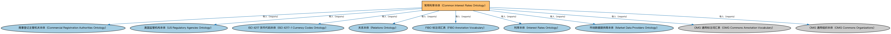

# 常用利率本体（Common Interest Rates Ontology）说明

本文档对应 `CommonInterestRates.rdf` / `CommonInterestRates.ttl`。

## 1. 本文件是什么

收录市场常用参考利率个体（如各期限基准、政策利率）。

从机制上说，这是一个个体（individuals）文件：它本身不定义任何新的类或属性，装的全是命名个体（owl:NamedIndividual）——也就是一条条真实存在的实例数据（如具体的货币、市场、监管机构、法域）。它的 `owl:imports` 引入的是这些个体所属的类定义所在的本体。应用需要实例级参考数据时加载这类文件。

## 2. 个体构成（共 529 个）

按个体所属类型统计（类型名为中文（English）对照）：

| 类型（Class） | 个体数量 |
|---|---|
| 利率基准（InterestRateBenchmark） | 529 |

个体数量较多，仅举前 10 个示例，完整清单见同名 `.ttl` 文件：

| 个体（示例） | 类型 |
|---|---|
| AED-EIBOR | 利率基准（InterestRateBenchmark） |
| AUD-AONIA | 利率基准（InterestRateBenchmark） |
| AUD-AONIA-OIS Compound | 利率基准（InterestRateBenchmark） |
| AUD-BBR-ISDC | 利率基准（InterestRateBenchmark） |
| AUD-BBSW | 利率基准（InterestRateBenchmark） |
| AUD-BBSW Quarterly Swap Rate ICAP | 利率基准（InterestRateBenchmark） |
| AUD-BBSW Semi Annual Swap Rate ICAP | 利率基准（InterestRateBenchmark） |
| AUD-BBSY Bid | 利率基准（InterestRateBenchmark） |
| AUD-LIBOR-BBA | 利率基准（InterestRateBenchmark） |
| AUD-LIBOR-BBA-Bloomberg | 利率基准（InterestRateBenchmark） |

## 3. 依赖的本体（owl:imports，9 个）

以下导入提供个体所属的类定义与相关参考数据：

| 导入本体 | 中文名称 | 简介 |
|---|---|---|
| `FBC/FunctionalEntities/CommercialRegistrationAuthorities.rdf` | 商事登记主管机关本体（Commercial Registration Authorities Ontology） | 定义负责商事登记的主管机关及其维护的登记记录。 |
| `FBC/FunctionalEntities/NorthAmericanEntities/USRegulatoryAgencies.rdf` | 美国监管机构本体（US Regulatory Agencies Ontology） | 收录美国金融监管机构个体（如美联储、证监会 SEC、货币监理署 OCC）。 |
| `FND/Accounting/ISO4217-CurrencyCodes.rdf` | ISO 4217 货币代码本体（ISO 4217-1 Currency Codes Ontology） | 收录 ISO 4217-1 标准的全部货币代码个体（如 USD、CNY、EUR），为货币金额提供标准化的币种取值。 |
| `FND/Relations/Relations.rdf` | 关系本体（Relations Ontology） | FIBO 最底层的基础本体，定义参考（reference）、分类（classify）等通用关系与抽象概念，全库普遍依赖。 |
| `FND/Utilities/AnnotationVocabulary.rdf` | FIBO 标注词汇表（FIBO Annotation Vocabulary） | 定义 FIBO 专用的标注属性（如释义来源、成熟度等级），用于本体自身的元数据标注。 |
| `IND/InterestRates/InterestRates.rdf` | 利率本体（Interest Rates Ontology） | 定义利率（interest rate）的结构：基准利率、利差、期限与重置机制。 |
| `IND/InterestRates/MarketDataProviders.rdf` | 市场数据提供商本体（Market Data Providers Ontology） | 定义市场数据提供商（交易所、资讯商等）及其发布的数据。 |
| `https://www.omg.org/spec/Commons/AnnotationVocabulary/` | OMG 通用标注词汇表（OMG Commons Annotation Vocabulary） | OMG 通用本体库（Commons）中的标注词汇表，提供概念映射等标注属性，FIBO 用它标注术语与外部标准的对应关系。 |
| `https://www.omg.org/spec/Commons/Organizations/` | OMG 通用组织本体（OMG Commons Organizations） | Commons 库中的组织本体，定义组织、组织成员与组织结构的通用概念。 |

## 4. 文件

- 官方 RDF/XML：`CommonInterestRates.rdf`
- 中文 Turtle：`CommonInterestRates.ttl`
- 结构图：`CommonInterestRates-structure.png` / `CommonInterestRates-structure.svg`