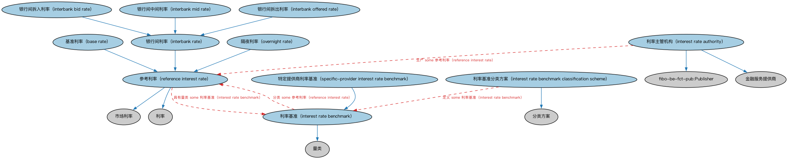

# 利率本体（Interest Rates Ontology）结构与公理说明

本文档对应 `InterestRates.rdf` / `InterestRates.ttl`，说明该本体的类、继承关系、属性和公理约定。结构图见 `InterestRates-structure.png`（`InterestRates-structure.svg` 为可缩放版本）。

## 1. 本体概述

定义利率（interest rate）的结构：基准利率、利差（spread）、期限、重置机制、浮动利率的确定方式。

**在体系中的位置**：IND 利率模块的核心，贷款、债券、利率衍生品的利率条款都基于它。

**上下游关系**：上游继承指标本体；下游被 LOAN 贷款、SEC 债券、DER 利率衍生品广泛引用；常用利率个体本体提供市场基准实例。

**与相近概念的差别**：利率≠收益率——利率是合同约定的资金价格，收益率（yield）是投资回报的市场度量；基准利率≠合同利率——合同利率＝基准＋利差。

本本体中类与类的核心关系如下（完整细节见各类小节）：

- **基准利率（base rate）** 继承 **参考利率（reference interest rate）**
- **银行间拆入利率（interbank bid rate）** 继承 **银行间利率（interbank rate）**
- **银行间中间利率（interbank mid rate）** 继承 **银行间利率（interbank rate）**
- **银行间拆出利率（interbank offered rate）** 继承 **银行间利率（interbank rate）**
- **银行间利率（interbank rate）** 继承 **参考利率（reference interest rate）**
- **利率主管机构（interest rate authority）** 继承 **fibo-be-fct-pub:Publisher（Publisher）**
- **利率主管机构（interest rate authority）** 继承 **金融服务提供商（FinancialServiceProvider）**
- **利率基准（interest rate benchmark）** 继承 **量类（QuantityKind）**
- **利率基准分类方案（interest rate benchmark classification scheme）** 继承 **分类方案（ClassificationScheme）**
- **隔夜利率（overnight rate）** 继承 **参考利率（reference interest rate）**
- **参考利率（reference interest rate）** 继承 **利率（InterestRate）**
- **参考利率（reference interest rate）** 继承 **市场利率（MarketRate）**
- 其余 1 条关系从略。

## 2. 类（Class）

| 类（Class） | 定义（Definition） |
|---|---|
| 基准利率（base rate） | 银行据此计算向客户贷款实际利率的基本利率。 basic rate of interest on which the actual rate a bank charges on loans to its customers is calculated |
| 银行间拆入利率（interbank bid rate） | 参与银行愿意从其他银行借入存款的银行间利率。 interbank rate that is the interest rate at which participating banks are willing to borrow deposits from other banks |
| 银行间中间利率（interbank mid rate） | 代表拆入与拆出利率中点的银行间利率。 interbank rate that represents the mid-point between bid and offer rates |
| 银行间拆出利率（interbank offered rate） | 参与银行贷出资金的银行间利率。 interbank rate that is the interest rate at which participating banks lend money |
| 银行间利率（interbank rate） | 银行之间短期贷款所收利率的参考利率。 reference rate that is the rate of interest charged on short-term loans between banks |
| 利率主管机构（interest rate authority） | 负责规定某项基准性利率的金融服务提供商/发布方。 financial service provider/publisher responsible for specifying some benchmark interest rate |
| 利率基准（interest rate benchmark） | 对定期更新、公众可获取的利率的分类符，通常由中央银行或金融机构集团设定。 classifier for regularly updated interest rates that are publicly accessible, typically set by a central bank or group of financial institutions |
| 利率基准分类方案（interest rate benchmark classification scheme） | 对利率基准进行分类的方案，如 FpML 分类方案。 scheme for classifying interest rate benchmarks, such as the FpML classification scheme |
| 隔夜利率（overnight rate） | 存款机构向另一存款机构（短期）拆出资金的利率，或中央银行所设的利率。 reference rate that is an interest rate at which a depository institution lends funds to another depository institution (short-term), or the interest rate the central bank charges a financial institution to borrow money overnight |
| 参考利率（reference interest rate） | 由某银行或银行集团支付或约定的市场利率。 market rate that is a rate of interest paid by or agreed among some bank or set of banks |
| 特定提供商利率基准（specific-provider interest rate benchmark） | 由特定市场数据提供商提供、供参考之用的利率基准。 interest rate benchmark that is made available by a specific market data provider for reference purposes |

以下按类逐个展开：每个类给出继承关系、相关属性与公理约定；子类在父类之下降一级编号。

### 2.1 利率主管机构（interest rate authority）

定义：负责规定某项基准性利率的金融服务提供商/发布方。

- 父类：**fibo-be-fct-pub:Publisher（Publisher）**、**金融服务提供商（FinancialServiceProvider）**

属性：

| 属性 | 定义 | 说明 |
|---|---|---|
| **生产（produces）** | — | — |

公理：

- **生产（produces）**至少有一个取值，类型是**参考利率（reference interest rate）**。

### 2.2 利率基准（interest rate benchmark）

定义：对定期更新、公众可获取的利率的分类符，通常由中央银行或金融机构集团设定。

- 父类：**量类（QuantityKind）**
- 直接子类：**特定提供商利率基准（specific-provider interest rate benchmark）**

属性：

| 属性 | 定义 | 说明 |
|---|---|---|
| **由……生产（isProducedBy）** | — | — |
| **具有利率重置时刻（has rate reset time of day）** | 标识基准利率变动发布的日内时刻，通常每个营业日相同。 indicates the time of day when a change in a benchmark rate is published, typically the same time every business day | 值域：日期时间；子属性：具有日期时间 |
| **具有参考货币（has reference currency）** | 将某事物关联到其所基于的货币。 relates something to the currency it is based on | 值域：货币；子属性：具有货币 |
| **具有期限（has tenor）** | 标识给定利率（如银行间利率、汇率、其他市场利率）的报价期限，或债务工具的剩余期限。 indicates the length of time for which a given rate, such as an interbank rate, exchange rate, other market rate is quoted, or a debt instrument has remaining prior to maturity or expiration | 值域：时长；子属性：具有时长 |
| **分类（classifies）** | — | — |
| **由……提供（isProvidedBy）** | — | — |

公理：

- **具有利率重置时刻（has rate reset time of day）**可以有 0 个或多个**日期时间（DateTime）**。
- **具有参考货币（has reference currency）**恰好有 1 个**货币（Currency）**。
- **具有期限（has tenor）**可以有 0 个或多个**时长（Duration）**。
- **分类（classifies）**至少有一个取值，类型是**参考利率（reference interest rate）**。
- **由……提供（isProvidedBy）**可以有 0 个或多个**市场数据提供商（MarketDataProvider）**。
- **由……生产（isProducedBy）**可以有 0 个或多个**fibo-be-fct-pub:Publisher（Publisher）**。

#### 2.2.1 特定提供商利率基准（specific-provider interest rate benchmark）

定义：由特定市场数据提供商提供、供参考之用的利率基准。

- 父类：**利率基准（interest rate benchmark）**

属性：

| 属性 | 定义 | 说明 |
|---|---|---|
| **由……提供（isProvidedBy）** | — | — |

公理：

- **由……提供（isProvidedBy）**恰好有 1 个**市场数据提供商（MarketDataProvider）**。

### 2.3 利率基准分类方案（interest rate benchmark classification scheme）

定义：对利率基准进行分类的方案，如 FpML 分类方案。

- 父类：**分类方案（ClassificationScheme）**

属性：

| 属性 | 定义 | 说明 |
|---|---|---|
| **定义（defines）** | — | — |

公理：

- **定义（defines）**至少有一个取值，类型是**利率基准（interest rate benchmark）**。

### 2.4 参考利率（reference interest rate）

定义：由某银行或银行集团支付或约定的市场利率。

- 父类：**利率（InterestRate）**、**市场利率（MarketRate）**
- 直接子类：**基准利率（base rate）**、**银行间利率（interbank rate）**、**隔夜利率（overnight rate）**

属性：

| 属性 | 定义 | 说明 |
|---|---|---|
| **具有利率重置时刻（has rate reset time of day）** | 标识基准利率变动发布的日内时刻，通常每个营业日相同。 indicates the time of day when a change in a benchmark rate is published, typically the same time every business day | 值域：日期时间；子属性：具有日期时间 |
| **具有参考货币（has reference currency）** | 将某事物关联到其所基于的货币。 relates something to the currency it is based on | 值域：货币；子属性：具有货币 |
| **具有期限（has tenor）** | 标识给定利率（如银行间利率、汇率、其他市场利率）的报价期限，或债务工具的剩余期限。 indicates the length of time for which a given rate, such as an interbank rate, exchange rate, other market rate is quoted, or a debt instrument has remaining prior to maturity or expiration | 值域：时长；子属性：具有时长 |
| **具有量类（hasQuantityKind）** | — | — |

公理：

- **具有利率重置时刻（has rate reset time of day）**可以有 0 个或多个**日期时间（DateTime）**。
- **具有参考货币（has reference currency）**恰好有 1 个**货币（Currency）**。
- **具有期限（has tenor）**的所有取值只能是**时长（Duration）**。
- **具有量类（hasQuantityKind）**至少有一个取值，类型是**利率基准（interest rate benchmark）**。

#### 2.4.1 基准利率（base rate）

定义：银行据此计算向客户贷款实际利率的基本利率。

- 父类：**参考利率（reference interest rate）**

#### 2.4.2 银行间利率（interbank rate）

定义：银行之间短期贷款所收利率的参考利率。

- 父类：**参考利率（reference interest rate）**
- 直接子类：**银行间拆入利率（interbank bid rate）**、**银行间中间利率（interbank mid rate）**、**银行间拆出利率（interbank offered rate）**

##### 2.4.2.1 银行间拆入利率（interbank bid rate）

定义：参与银行愿意从其他银行借入存款的银行间利率。

- 父类：**银行间利率（interbank rate）**

##### 2.4.2.2 银行间中间利率（interbank mid rate）

定义：代表拆入与拆出利率中点的银行间利率。

- 父类：**银行间利率（interbank rate）**

##### 2.4.2.3 银行间拆出利率（interbank offered rate）

定义：参与银行贷出资金的银行间利率。

- 父类：**银行间利率（interbank rate）**

#### 2.4.3 隔夜利率（overnight rate）

定义：存款机构向另一存款机构（短期）拆出资金的利率，或中央银行所设的利率。

- 父类：**参考利率（reference interest rate）**

属性：

| 属性 | 定义 | 说明 |
|---|---|---|
| **具有期限（has tenor）** | 标识给定利率（如银行间利率、汇率、其他市场利率）的报价期限，或债务工具的剩余期限。 indicates the length of time for which a given rate, such as an interbank rate, exchange rate, other market rate is quoted, or a debt instrument has remaining prior to maturity or expiration | 值域：时长；子属性：具有时长 |

公理：

- **具有期限（has tenor）**的取值固定为 OneDay。

## 3. 依赖（owl:imports，14 个）

本本体通过 `owl:imports` 引入以下本体，各项的中文名称与简介如下：

| 导入本体 | 中文名称 | 简介 |
|---|---|---|
| `BE/FunctionalEntities/Publishers.rdf` | 出版方本体（Publishers Ontology） | 定义出版方及其出版物，用于标识金融信息与文档的发布来源。 |
| `FBC/DebtAndEquities/Debt.rdf` | 债务本体（Debt Ontology） | 定义债务（debt）与债权债务关系的核心概念：借款人、贷款人、本金与利息义务。 |
| `FBC/FunctionalEntities/FinancialServicesEntities.rdf` | 金融服务实体本体（Financial Services Entities Ontology） | FBC 域核心本体，定义金融服务机构（银行、券商、保险公司、资管机构等）的功能分类体系。 |
| `FBC/ProductsAndServices/FinancialProductsAndServices.rdf` | 金融产品与服务本体（Financial Products and Services Ontology） | 定义金融产品（financial product）与金融服务（financial service）及其提供、购买关系。 |
| `FND/Accounting/CurrencyAmount.rdf` | 货币金额本体（Currency Amount Ontology） | 定义「金额＋币种」的货币金额（currency amount）表示，是 FIBO 中表达价格、债务金额、付款额等一切带币种数值的基础构件。 |
| `FND/Relations/Relations.rdf` | 关系本体（Relations Ontology） | FIBO 最底层的基础本体，定义参考（reference）、分类（classify）等通用关系与抽象概念，全库普遍依赖。 |
| `FND/Utilities/AnnotationVocabulary.rdf` | FIBO 标注词汇表（FIBO Annotation Vocabulary） | 定义 FIBO 专用的标注属性（如释义来源、成熟度等级），用于本体自身的元数据标注。 |
| `IND/Indicators/Indicators.rdf` | 指标本体（Indicators Ontology） | 定义「指标」（indicator）的通用概念：对某现象的可度量表示，是经济指标、利率等的上位模型。 |
| `https://www.omg.org/spec/Commons/AnnotationVocabulary/` | OMG 通用标注词汇表（OMG Commons Annotation Vocabulary） | OMG 通用本体库（Commons）中的标注词汇表，提供概念映射等标注属性，FIBO 用它标注术语与外部标准的对应关系。 |
| `https://www.omg.org/spec/Commons/Classifiers/` | OMG 通用分类器本体（OMG Commons Classifiers） | OMG 通用本体库（Commons）中的分类器本体，定义分类方案、类别与归类关系的通用概念，FIBO 的分类建模建立在其上。 |
| `https://www.omg.org/spec/Commons/DatesAndTimes/` | OMG 通用日期与时间本体（OMG Commons Dates and Times） | Commons 库中的日期时间本体，定义日期、期间、时间点等通用时间概念。 |
| `https://www.omg.org/spec/Commons/Designators/` | OMG 通用指称符本体（OMG Commons Designators） | Commons 库中的指称符本体，定义名称、标识符等「指代某物的符号」的通用概念。 |
| `https://www.omg.org/spec/Commons/Organizations/` | OMG 通用组织本体（OMG Commons Organizations） | Commons 库中的组织本体，定义组织、组织成员与组织结构的通用概念。 |
| `https://www.omg.org/spec/Commons/QuantitiesAndUnits/` | OMG 通用量与单位本体（OMG Commons Quantities and Units） | Commons 库中的量与单位本体，定义数量、度量单位、量纲的通用概念，支撑金额、比率等数值表达。 |

## 4. 文件

- 官方 RDF/XML：`InterestRates.rdf`
- 中文 Turtle：`InterestRates.ttl`
- 结构图：`InterestRates-structure.png` / `InterestRates-structure.svg`