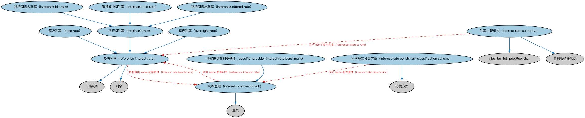

# 利率本体（Interest Rates Ontology）结构与公理说明

本文档对应 `InterestRates.rdf` / `InterestRates.ttl`，说明该本体的类、继承关系、属性和公理约定。结构图见 `InterestRates-structure.png`（`InterestRates-structure.svg` 为可缩放版本）。

## 1. 本体概述

定义利率（interest rate）的结构：基准利率、利差（spread）、期限、重置机制、浮动利率的确定方式。

**在体系中的位置**：IND 利率模块的核心，贷款、债券、利率衍生品的利率条款都基于它。

**上下游关系**：上游继承指标本体；下游被 LOAN 贷款、SEC 债券、DER 利率衍生品广泛引用；常用利率个体本体提供市场基准实例。

**与相近概念的差别**：利率≠收益率——利率是合同约定的资金价格，收益率（yield）是投资回报的市场度量；基准利率≠合同利率——合同利率＝基准＋利差。

## 2. 类（Class）

| 类（Class） | 定义（Definition） |
|---|---|
| 基准利率（base rate） | 银行据此计算向客户贷款实际利率的基本利率。 |
| 银行间拆入利率（interbank bid rate） | 参与银行愿意从其他银行借入存款的银行间利率。 |
| 银行间中间利率（interbank mid rate） | 代表拆入与拆出利率中点的银行间利率。 |
| 银行间拆出利率（interbank offered rate） | 参与银行贷出资金的银行间利率。 |
| 银行间利率（interbank rate） | 银行之间短期贷款所收利率的参考利率。 |
| 利率主管机构（interest rate authority） | 负责规定某项基准性利率的金融服务提供商/发布方。 |
| 利率基准（interest rate benchmark） | 对定期更新、公众可获取的利率的分类符，通常由中央银行或金融机构集团设定。 |
| 利率基准分类方案（interest rate benchmark classification scheme） | 对利率基准进行分类的方案，如 FpML 分类方案。 |
| 隔夜利率（overnight rate） | 存款机构向另一存款机构（短期）拆出资金的利率，或中央银行所设的利率。 |
| 参考利率（reference interest rate） | 由某银行或银行集团支付或约定的市场利率。 |
| 特定提供商利率基准（specific-provider interest rate benchmark） | 由特定市场数据提供商提供、供参考之用的利率基准。 |

### 2.1 继承关系（Inheritance）

- 基准利率（base rate） ⊑ 参考利率（reference interest rate）
- 银行间拆入利率（interbank bid rate） ⊑ 银行间利率（interbank rate）
- 银行间中间利率（interbank mid rate） ⊑ 银行间利率（interbank rate）
- 银行间拆出利率（interbank offered rate） ⊑ 银行间利率（interbank rate）
- 银行间利率（interbank rate） ⊑ 参考利率（reference interest rate）
- 利率主管机构（interest rate authority） ⊑ fibo-be-fct-pub:Publisher
- 利率主管机构（interest rate authority） ⊑ 金融服务提供商
- 利率基准（interest rate benchmark） ⊑ 量类
- 利率基准分类方案（interest rate benchmark classification scheme） ⊑ 分类方案
- 隔夜利率（overnight rate） ⊑ 参考利率（reference interest rate）
- 参考利率（reference interest rate） ⊑ 利率
- 参考利率（reference interest rate） ⊑ 市场利率
- 特定提供商利率基准（specific-provider interest rate benchmark） ⊑ 利率基准（interest rate benchmark）

## 3. 对象属性（Object Property）

| 属性（Property） | 中文（English） | 定义（Definition） | 说明 |
|---|---|---|---|
| fibo-ind-ir-ir:hasRateResetTimeOfDay | 具有利率重置时刻（has rate reset time of day） | 标识基准利率变动发布的日内时刻，通常每个营业日相同。 | 值域（range）：日期时间；子属性（subPropertyOf）：具有日期时间 |
| fibo-ind-ir-ir:hasReferenceCurrency | 具有参考货币（has reference currency） | 将某事物关联到其所基于的货币。 | 值域（range）：货币；子属性（subPropertyOf）：具有货币 |
| fibo-ind-ir-ir:hasTenor | 具有期限（has tenor） | 标识给定利率（如银行间利率、汇率、其他市场利率）的报价期限，或债务工具的剩余期限。 | 值域（range）：时长；子属性（subPropertyOf）：具有时长 |

## 5. 公理约定（Axioms）

- 利率主管机构（interest rate authority）：生产 some 参考利率（reference interest rate）
- 利率基准（interest rate benchmark）：由……提供 市场数据提供商 ≥0
- 利率基准（interest rate benchmark）：由……生产 fibo-be-fct-pub:Publisher ≥0
- 利率基准（interest rate benchmark）：具有利率重置时刻（has rate reset time of day） 日期时间 ≥0
- 利率基准（interest rate benchmark）：具有期限（has tenor） 时长 ≥0
- 利率基准（interest rate benchmark）：具有参考货币（has reference currency） 货币 =1
- 利率基准（interest rate benchmark）：分类 some 参考利率（reference interest rate）
- 利率基准分类方案（interest rate benchmark classification scheme）：定义 some 利率基准（interest rate benchmark）
- 隔夜利率（overnight rate）：restriction
- 参考利率（reference interest rate）：具有期限（has tenor） only 时长
- 参考利率（reference interest rate）：具有利率重置时刻（has rate reset time of day） 日期时间 ≥0
- 参考利率（reference interest rate）：具有参考货币（has reference currency） 货币 =1
- 参考利率（reference interest rate）：具有量类 some 利率基准（interest rate benchmark）
- 特定提供商利率基准（specific-provider interest rate benchmark）：由……提供 市场数据提供商 =1

## 6. 依赖（owl:imports，14 个）

本本体通过 `owl:imports` 引入以下本体，各项的中文名称与简介如下：

| 导入本体 | 中文名称 | 简介 |
|---|---|---|
| `BE/FunctionalEntities/Publishers.rdf` | 出版方本体（Publishers Ontology） | 定义出版方及其出版物，用于标识金融信息与文档的发布来源。 |
| `FBC/DebtAndEquities/Debt.rdf` | 债务本体（Debt Ontology） | 定义债务（debt）与债权债务关系的核心概念：借款人、贷款人、本金与利息义务。 |
| `FBC/FunctionalEntities/FinancialServicesEntities.rdf` | 金融服务实体本体（Financial Services Entities Ontology） | FBC 域核心本体，定义金融服务机构（银行、券商、保险公司、资管机构等）的功能分类体系。 |
| `FBC/ProductsAndServices/FinancialProductsAndServices.rdf` | 金融产品与服务本体（Financial Products and Services Ontology） | 定义金融产品（financial product）与金融服务（financial service）及其提供、购买关系。 |
| `FND/Accounting/CurrencyAmount.rdf` | 货币金额本体（Currency Amount Ontology） | 定义「金额＋币种」的货币金额（currency amount）表示，是 FIBO 中表达价格、债务金额、付款额等一切带币种数值的基础构件。 |
| `FND/Relations/Relations.rdf` | 关系本体（Relations Ontology） | FIBO 最底层的基础本体，定义参考（reference）、分类（classify）等通用关系与抽象概念，全库普遍依赖。 |
| `FND/Utilities/AnnotationVocabulary.rdf` | FIBO 标注词汇表（FIBO Annotation Vocabulary） | 定义 FIBO 专用的标注属性（如释义来源、成熟度等级），用于本体自身的元数据标注。 |
| `IND/Indicators/Indicators.rdf` | 指标本体（Indicators Ontology） | 定义「指标」（indicator）的通用概念：对某现象的可度量表示，是经济指标、利率等的上位模型。 |
| `https://www.omg.org/spec/Commons/AnnotationVocabulary/` | OMG 通用标注词汇表（OMG Commons Annotation Vocabulary） | OMG 通用本体库（Commons）中的标注词汇表，提供概念映射等标注属性，FIBO 用它标注术语与外部标准的对应关系。 |
| `https://www.omg.org/spec/Commons/Classifiers/` | OMG 通用分类器本体（OMG Commons Classifiers） | OMG 通用本体库（Commons）中的分类器本体，定义分类方案、类别与归类关系的通用概念，FIBO 的分类建模建立在其上。 |
| `https://www.omg.org/spec/Commons/DatesAndTimes/` | OMG 通用日期与时间本体（OMG Commons Dates and Times） | Commons 库中的日期时间本体，定义日期、期间、时间点等通用时间概念。 |
| `https://www.omg.org/spec/Commons/Designators/` | OMG 通用指称符本体（OMG Commons Designators） | Commons 库中的指称符本体，定义名称、标识符等「指代某物的符号」的通用概念。 |
| `https://www.omg.org/spec/Commons/Organizations/` | OMG 通用组织本体（OMG Commons Organizations） | Commons 库中的组织本体，定义组织、组织成员与组织结构的通用概念。 |
| `https://www.omg.org/spec/Commons/QuantitiesAndUnits/` | OMG 通用量与单位本体（OMG Commons Quantities and Units） | Commons 库中的量与单位本体，定义数量、度量单位、量纲的通用概念，支撑金额、比率等数值表达。 |

## 7. 文件

- 官方 RDF/XML：`InterestRates.rdf`
- 中文 Turtle：`InterestRates.ttl`
- 结构图：`InterestRates-structure.png` / `InterestRates-structure.svg`