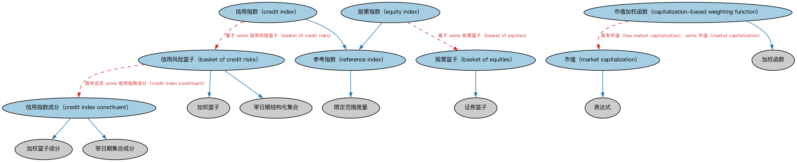

# 篮子指数本体（Basket Indices Ontology）结构与公理说明

本文档对应 `BasketIndices.rdf` / `BasketIndices.ttl`，说明该本体的类、继承关系、属性和公理约定。结构图见 `BasketIndices-structure.png`（`BasketIndices-structure.svg` 为可缩放版本）。

## 1. 本体概述

定义以一篮子成分为基础的指数（basket index）：成分、权重、计算方法与维护规则。

**在体系中的位置**：IND 市场指数模块的核心，股指示例（如道琼斯）以此为基础。

**上下游关系**：上游继承指标本体并引用 SEC 篮子本体；下游服务指数基金、衍生品标的建模。

**与相近概念的差别**：指数≠指标——指数是按既定规则对一篮子成分加权计算的合成数值，可投资可复制；指标是单一统计量，不可直接投资。

## 2. 类（Class）

| 类（Class） | 定义（Definition） |
|---|---|
| 信用风险篮子（basket of credit risks） | 为风险分析目的而汇集的工具、法律实体或其组合的篮子。 |
| 股票篮子（basket of equities） | 成分为上市股票的证券篮子。 |
| 市值加权函数（capitalization-based weighting function） | 由指数所跟踪公司的相对市值（股价乘以流通股数）导出的加权函数。 |
| 信用指数（credit index） | 以改变标的组合价值的信用事件为函数的参考指数。 |
| 信用指数成分（credit index constituent） | 信用风险篮子的组成成分。 |
| 股票指数（equity index） | 成分全部为股票工具的基准指数。 |
| 市值（market capitalization） | 表示股票市场在特定时点对公司之估值的表达式。 |
| 参考指数（reference index） | 篮子内容在给定时期内价值变化的度量。 |

### 2.1 继承关系（Inheritance）

- 信用风险篮子（basket of credit risks） ⊑ 加权篮子
- 信用风险篮子（basket of credit risks） ⊑ 带日期结构化集合
- 股票篮子（basket of equities） ⊑ 证券篮子
- 市值加权函数（capitalization-based weighting function） ⊑ 加权函数
- 信用指数（credit index） ⊑ 参考指数（reference index）
- 信用指数成分（credit index constituent） ⊑ 加权篮子成分
- 信用指数成分（credit index constituent） ⊑ 带日期集合成分
- 股票指数（equity index） ⊑ 参考指数（reference index）
- 市值（market capitalization） ⊑ 表达式
- 参考指数（reference index） ⊑ 限定范围度量

## 3. 对象属性（Object Property）

| 属性（Property） | 中文（English） | 定义（Definition） | 说明 |
|---|---|---|---|
| fibo-ind-mkt-bas:hasMarketCapitalization | 具有市值（has market capitalization） | 标识某发行人在某日期的市值。 | 定义域（domain）：股份发行人；值域（range）：市值（market capitalization） |
| fibo-ind-mkt-bas:hasMarketCapitalizationValue | 具有市值金额（has market capitalization value） | 标识表示某发行人在某日期市值的货币金额。 | 定义域（domain）：市值（market capitalization）；值域（range）：货币数量；子属性（subPropertyOf）：具有货币数量 |
| fibo-ind-mkt-bas:hasOriginalNotionalValue | 具有原始名义价值（has original notional value） | 标识该指数最初构成时所代表的名义金额。 | 定义域（domain）：信用指数（credit index）；值域（range）：货币数量；子属性（subPropertyOf）：具有名义金额 |
| fibo-ind-mkt-bas:hasPremium | 具有权利金（has premium） | 标识基于该指数的合同应付的权利金。 | 定义域（domain）：信用指数（credit index）；值域（range）：货币数量；子属性（subPropertyOf）：具有货币数量 |
| fibo-ind-mkt-bas:hasUpFrontFee | 具有预付费用（has up front fee） | 指明任何希望在合同开始后参与基于该指数之合同的参与方应付的费用。 | 定义域（domain）：信用指数（credit index）；值域（range）：货币数量 |

## 4. 数据属性（Datatype Property）

| 属性（Property） | 中文（English） | 定义（Definition） |
|---|---|---|
| fibo-ind-mkt-bas:hasDebtRanking | 具有债务排序（has debt ranking） | 标识该债务工具相对于信用指数整体的排序。 |
| fibo-ind-mkt-bas:hasIndexName | 具有指数名称（has index name） | 指明该指数的正式名称。 |
| fibo-ind-mkt-bas:hasIndexValue | 具有指数值（has index value） | 指明给定指数在发布日的值。 |
| fibo-ind-mkt-bas:hasSpreadRange | 具有利差区间（has spread range） | 指数各成分的信用利差区间。 |

## 5. 公理约定（Axioms）

- 信用风险篮子（basket of credit risks）：具有成员 some 信用指数成分（credit index constituent）
- 股票篮子（basket of equities）：具有成员 some（restriction）
- 市值加权函数（capitalization-based weighting function）：具有市值（has market capitalization） some 市值（market capitalization）
- 信用指数（credit index）：基于 some 信用风险篮子（basket of credit risks）
- 信用指数成分（credit index constituent）：具有货币 some 货币
- 信用指数成分（credit index constituent）：引用 some 信用事件
- 股票指数（equity index）：基于 some 股票篮子（basket of equities）
- 市值（market capitalization）：具有市值金额（has market capitalization value） some 货币数量
- 市值（market capitalization）：具有流通股数 some xsd:nonNegativeInteger
- 市值（market capitalization）：适用于 some 股份发行人
- 市值（market capitalization）：具有观测日期时间 some cmns-dt:CombinedDateTime
- 市值（market capitalization）：具有自变量 some 每股价格
- 参考指数（reference index）：具有周期性 only 重复区间
- 参考指数（reference index）：由……分类 行业部门分类器 ≥0
- 参考指数（reference index）：由……分类 资产类别 ≥0
- 参考指数（reference index）：具有发布日期 日期 ≥0
- 参考指数（reference index）：restriction
- 参考指数（reference index）：具有报告期 显式日期区间 =1
- 参考指数（reference index）：基于 some 加权篮子

## 6. 依赖（owl:imports，21 个）

本本体通过 `owl:imports` 引入以下本体，各项的中文名称与简介如下：

| 导入本体 | 中文名称 | 简介 |
|---|---|---|
| `FBC/DebtAndEquities/CreditEvents.rdf` | 信用事件本体（Credit Events Ontology） | 定义信用事件（credit event）：破产、拒付、重组等会触发信用衍生品结算的事件类型。 |
| `FBC/DebtAndEquities/Debt.rdf` | 债务本体（Debt Ontology） | 定义债务（debt）与债权债务关系的核心概念：借款人、贷款人、本金与利息义务。 |
| `FBC/ProductsAndServices/FinancialProductsAndServices.rdf` | 金融产品与服务本体（Financial Products and Services Ontology） | 定义金融产品（financial product）与金融服务（financial service）及其提供、购买关系。 |
| `FND/Accounting/CurrencyAmount.rdf` | 货币金额本体（Currency Amount Ontology） | 定义「金额＋币种」的货币金额（currency amount）表示，是 FIBO 中表达价格、债务金额、付款额等一切带币种数值的基础构件。 |
| `FND/Agreements/Contracts.rdf` | 合同本体（Contracts Ontology） | 在协议之上定义具有法律约束力的合同（contract）：合同当事方、合同条款、义务与权利，是金融工具与交易合同建模的基石。 |
| `FND/Arrangements/ClassificationSchemes.rdf` | 分类方案本体（Classification Schemes Ontology） | 定义分类方案（classification scheme）、类别及「将事物归入类别」的关系，支撑证券分类、行业分类等具体分类体系。 |
| `FND/Arrangements/Documents.rdf` | 文档本体（Documents Ontology） | 定义文档、文档类型及文档与其所记载内容的关系，为合同文本、募集说明书等法律文书建模。 |
| `FND/DatesAndTimes/FinancialDates.rdf` | 金融日期本体（Financial Dates Ontology） | 定义金融语境下的日期与期间概念：结算日、付息日、到期日、日计数基准等。 |
| `FND/Relations/Relations.rdf` | 关系本体（Relations Ontology） | FIBO 最底层的基础本体，定义参考（reference）、分类（classify）等通用关系与抽象概念，全库普遍依赖。 |
| `FND/Utilities/Analytics.rdf` | 分析本体（Analytics Ontology） | 定义分析工具、度量与比率的通用概念，支撑指标与模型的表达。 |
| `FND/Utilities/AnnotationVocabulary.rdf` | FIBO 标注词汇表（FIBO Annotation Vocabulary） | 定义 FIBO 专用的标注属性（如释义来源、成熟度等级），用于本体自身的元数据标注。 |
| `SEC/Equities/EquityInstruments.rdf` | 股权工具本体（Equity Instruments Ontology） | 定义股票等股权工具：普通股、优先股及其附带的权利。 |
| `SEC/Securities/Baskets.rdf` | 篮子本体（Baskets Ontology） | 定义证券篮子（basket）：作为整体交易或定价的一组证券。 |
| `SEC/Securities/SecuritiesClassification.rdf` | 证券分类本体（Securities Classification Ontology） | 定义证券分类方案：按 CFI 代码、按资产类别等对证券归类。 |
| `https://www.omg.org/spec/Commons/AnnotationVocabulary/` | OMG 通用标注词汇表（OMG Commons Annotation Vocabulary） | OMG 通用本体库（Commons）中的标注词汇表，提供概念映射等标注属性，FIBO 用它标注术语与外部标准的对应关系。 |
| `https://www.omg.org/spec/Commons/Classifiers/` | OMG 通用分类器本体（OMG Commons Classifiers） | OMG 通用本体库（Commons）中的分类器本体，定义分类方案、类别与归类关系的通用概念，FIBO 的分类建模建立在其上。 |
| `https://www.omg.org/spec/Commons/Collections/` | OMG 通用集合本体（OMG Commons Collections） | Commons 库中的集合本体，定义集合、成员等通用概念。 |
| `https://www.omg.org/spec/Commons/ContextualDesignators/` | OMG 通用语境指称本体（OMG Commons Contextual Designators） | Commons 库中的语境指称本体，定义「在某个语境下指代某物的名称/符号」，是地址、账户号码等语境相关标识的基础。 |
| `https://www.omg.org/spec/Commons/DatesAndTimes/` | OMG 通用日期与时间本体（OMG Commons Dates and Times） | Commons 库中的日期时间本体，定义日期、期间、时间点等通用时间概念。 |
| `https://www.omg.org/spec/Commons/Documents/` | OMG 通用文档本体（OMG Commons Documents） | Commons 库中的文档本体，定义文档及其组成部分的通用概念。 |
| `https://www.omg.org/spec/Commons/QuantitiesAndUnits/` | OMG 通用量与单位本体（OMG Commons Quantities and Units） | Commons 库中的量与单位本体，定义数量、度量单位、量纲的通用概念，支撑金额、比率等数值表达。 |

## 7. 文件

- 官方 RDF/XML：`BasketIndices.rdf`
- 中文 Turtle：`BasketIndices.ttl`
- 结构图：`BasketIndices-structure.png` / `BasketIndices-structure.svg`