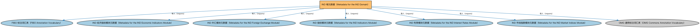

# IND 域元数据（Metadata for the IND Domain）说明

本文档对应 `MetadataIND.rdf` / `MetadataIND.ttl`。

## 1. 本文件是什么

声明指标与指数（IND）域由五个模块构成：指标、经济指标、利率、外汇、市场指数。

从机制上说，这是一个元数据清单（metadata manifest）文件：它本身不定义任何类或属性，而是通过 `dct:hasPart` 声明一个域或模块由哪些本体构成，并携带版本 IRI、版权、许可与成熟度等发布管理信息。它回答的问题是「这个域/模块包含什么、当前是什么版本」，供发布工具和文档系统按模块组织内容；它的 `owl:imports` 只引入标注词汇表，不是用来加载业务本体的入口（加载入口是 `All*` 与 `About*` 聚合文件）。

## 2. 声明的构成（dct:hasPart，5 个）

| 构成项 | 中文名称 | 简介 |
|---|---|---|
| `IND/EconomicIndicators/MetadataINDEconomicIndicators.rdf` | IND 经济指标模块元数据（Metadata for the IND Economic Indicators Module） | 声明经济指标（Economic Indicators）模块由经济指标本体及美国、加拿大经济指标个体本体构成，及版本信息。 |
| `IND/ForeignExchange/MetadataINDForeignExchange.rdf` | IND 外汇模块元数据（Metadata for the IND Foreign Exchange Module） | 声明外汇（Foreign Exchange）模块由外汇本体构成，及版本信息。 |
| `IND/Indicators/MetadataINDIndicators.rdf` | IND 指标模块元数据（Metadata for the IND Indicators Module） | 声明指标（Indicators）模块由指标本体构成，及版本信息。 |
| `IND/InterestRates/MetadataINDInterestRates.rdf` | IND 利率模块元数据（Metadata for the IND Interest Rates Module） | 声明利率（Interest Rates）模块由利率、常用利率、市场数据提供商三个本体构成，及版本信息。 |
| `IND/MarketIndices/MetadataINDMarketIndices.rdf` | IND 市场指数模块元数据（Metadata for the IND Market Indices Module） | 声明市场指数（Market Indices）模块由篮子指数本体构成，及版本信息。 |

## 3. 标注依赖（owl:imports，7 个）

以下导入仅用于支撑元数据标注本身（如成熟度等级、概念映射），不属于业务内容：

| 导入本体 | 中文名称 | 简介 |
|---|---|---|
| `FND/Utilities/AnnotationVocabulary.rdf` | FIBO 标注词汇表（FIBO Annotation Vocabulary） | 定义 FIBO 专用的标注属性（如释义来源、成熟度等级），用于本体自身的元数据标注。 |
| `IND/EconomicIndicators/MetadataINDEconomicIndicators.rdf` | IND 经济指标模块元数据（Metadata for the IND Economic Indicators Module） | 声明经济指标（Economic Indicators）模块由经济指标本体及美国、加拿大经济指标个体本体构成，及版本信息。 |
| `IND/ForeignExchange/MetadataINDForeignExchange.rdf` | IND 外汇模块元数据（Metadata for the IND Foreign Exchange Module） | 声明外汇（Foreign Exchange）模块由外汇本体构成，及版本信息。 |
| `IND/Indicators/MetadataINDIndicators.rdf` | IND 指标模块元数据（Metadata for the IND Indicators Module） | 声明指标（Indicators）模块由指标本体构成，及版本信息。 |
| `IND/InterestRates/MetadataINDInterestRates.rdf` | IND 利率模块元数据（Metadata for the IND Interest Rates Module） | 声明利率（Interest Rates）模块由利率、常用利率、市场数据提供商三个本体构成，及版本信息。 |
| `IND/MarketIndices/MetadataINDMarketIndices.rdf` | IND 市场指数模块元数据（Metadata for the IND Market Indices Module） | 声明市场指数（Market Indices）模块由篮子指数本体构成，及版本信息。 |
| `https://www.omg.org/spec/Commons/AnnotationVocabulary/` | OMG 通用标注词汇表（OMG Commons Annotation Vocabulary） | OMG 通用本体库（Commons）中的标注词汇表，提供概念映射等标注属性，FIBO 用它标注术语与外部标准的对应关系。 |

## 4. 文件

- 官方 RDF/XML：`MetadataIND.rdf`
- 中文 Turtle：`MetadataIND.ttl`
- 结构图：`MetadataIND-structure.png` / `MetadataIND-structure.svg`