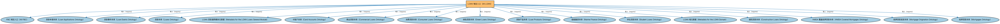

# LOAN 域总入口（All LOAN）聚合说明

本文档对应 `AllLOAN.rdf` / `AllLOAN.ttl`。

## 1. 本文件是什么

聚合贷款（Loans，LOAN）域的全部生产本体：贷款通用概念、贷款申请与事件、各类具体贷款（商业、消费、学生、绿色、船舶、抵押贷款等），一次导入即获得 LOAN 域完整模型。

从机制上说，这是一个聚合入口（load-all）文件：它本身不定义任何新的类或属性，只通过 `owl:imports` 把一组本体打包在一起。应用只要导入这一个文件，推理机就会把它列出的所有本体一次性加载进来，免去逐个声明的麻烦。因此它的价值不在「内容」，而在「组合」——组合方式本身就表达了发布方的意图（例如按域打包、按区域扩展打包、按是否含参考数据打包）。

## 2. 聚合的本地本体（17 个）

以下本体均可在本目录结构中找到同名 `.rdf` 文件及配套中文文档：

| 导入本体 | 中文名称 | 简介 |
|---|---|---|
| `FBC/AllFBC.rdf` | FBC 域总入口（All FBC） | 聚合金融商业与贸易（Financial Business and Commerce，FBC）域的全部生产本体：金融工具、金融市场、金融服务机构、监管机构、金融产品与服务、债务与担保等，一次导入即获得 FBC 域完整模型。 |
| `LOAN/LoansGeneral/LoanApplications.rdf` | 贷款申请本体（Loan Applications Ontology） | 定义贷款申请、申请人与审批流程的概念。 |
| `LOAN/LoansGeneral/LoanEvents.rdf` | 贷款事件本体（Loan Events Ontology） | 定义贷款生命周期中的事件：放款、逾期、违约、核销等。 |
| `LOAN/LoansGeneral/Loans.rdf` | 贷款本体（Loans Ontology） | LOAN 域核心本体，定义贷款（loan）的通用结构：借款人、贷款人、本金、利率与还款安排。 |
| `LOAN/LoansGeneral/MetadataLOANLoansGeneral.rdf` | LOAN 贷款通用模块元数据（Metadata for the LOAN Loans General Module） | 声明贷款通用（Loans General）模块由贷款、贷款申请、贷款事件、贷款监管四个本体构成，及版本信息。 |
| `LOAN/LoansSpecific/CardAccounts.rdf` | 卡账户本体（Card Accounts Ontology） | 定义信用卡、借记卡账户及其信贷特征。 |
| `LOAN/LoansSpecific/CommercialLoans.rdf` | 商业贷款本体（Commercial Loans Ontology） | 定义面向企业的商业贷款。 |
| `LOAN/LoansSpecific/ConsumerLoans.rdf` | 消费贷款本体（Consumer Loans Ontology） | 定义面向个人消费者的贷款。 |
| `LOAN/LoansSpecific/GreenLoans.rdf` | 绿色贷款本体（Green Loans Ontology） | 定义符合绿色融资原则（资金投向环保项目）的绿色贷款。 |
| `LOAN/LoansSpecific/LoanProducts.rdf` | 贷款产品本体（Loan Products Ontology） | 定义金融机构提供的贷款产品及其条款模板。 |
| `LOAN/LoansSpecific/MarineFinance.rdf` | 船舶融资本体（Marine Finance Ontology） | 定义船舶等海运资产融资的贷款结构。 |
| `LOAN/LoansSpecific/StudentLoans.rdf` | 学生贷款本体（Student Loans Ontology） | 定义用于教育支出的学生贷款。 |
| `LOAN/MetadataLOAN.rdf` | LOAN 域元数据（Metadata for the LOAN Domain） | 声明贷款（LOAN）域由三个模块构成：贷款通用、具体贷款、房地产贷款。 |
| `LOAN/RealEstateLoans/ConstructionLoans.rdf` | 建筑贷款本体（Construction Loans Ontology） | 定义用于房地产建设、按工程进度阶段性放款的建筑贷款。 |
| `LOAN/RealEstateLoans/HomeMortgageDisclosureActCoveredMortgages.rdf` | HMDA 覆盖抵押贷款本体（HMDA Covered Mortgages Ontology） | 定义受美国《住房抵押贷款披露法》（HMDA）报告要求约束的抵押贷款。 |
| `LOAN/RealEstateLoans/MortgageOrigination.rdf` | 抵押贷款发放本体（Mortgage Origination Ontology） | 定义抵押贷款的发起与发放流程。 |
| `LOAN/RealEstateLoans/Mortgages.rdf` | 抵押贷款本体（Mortgages Ontology） | 定义以不动产为抵押的贷款：抵押物、抵押登记与止赎。 |

## 3. 文件

- 官方 RDF/XML：`AllLOAN.rdf`
- 中文 Turtle：`AllLOAN.ttl`
- 结构图：`AllLOAN-structure.png` / `AllLOAN-structure.svg`