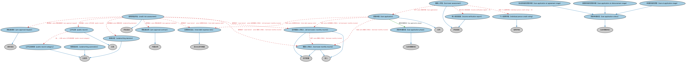

# 贷款申请本体（Loan Applications Ontology）结构与公理说明

本文档对应 `LoanApplications.rdf` / `LoanApplications.ttl`，说明该本体的类、继承关系、属性和公理约定。结构图见 `LoanApplications-structure.png`（`LoanApplications-structure.svg` 为可缩放版本）。

## 1. 本体概述

定义贷款申请（loan application）：申请人、申请金额、审批流程与审批结果。

**在体系中的位置**：LOAN 贷款通用模块中覆盖贷款生命周期的「贷前」环节。

**上下游关系**：上游依赖贷款、FND 文档与参与方本体；下游与贷款事件（审批通过/拒绝）衔接。

**与相近概念的差别**：申请≠合同——申请是借款意向与资料提交，审批通过并签约后才形成贷款合同；与贷款产品的差别——产品是机构的条款模板，申请是客户按模板提出的个案。

## 2. 类（Class）

| 类（Class） | 定义（Definition） |
|---|---|
| 全体借款人月收入（all borrowers' monthly income） | 贷款全部借款人的月度合格收入总额。 |
| 借款人评估（borrower assessment） | 详述借款人及其与贷款申请可能相关的信用历史的评估报告。 |
| 借款人月收入（borrower monthly income） | 潜在借款人的月度合格收入总额。 |
| 信用风险评估（credit risk assessment） | 聚焦于确定潜在借款人偿还贷款之可能性的风险评估。 |
| 收入核实报告（income verification report） | 提供核实借款人收入所用方法及支持文件的报告。 |
| 个人信用评级（individual person credit rating） | 提供对个人信用状况之意见的信用评级。 |
| 贷款申请（loan application） | 潜在借款人向潜在贷款人提出的借款请求，包含用于决定是否批准贷款的信息。 |
| 协议阶段的贷款申请（loan application at agreement stage） | 处于协议阶段的贷款申请。 |
| 放款阶段的贷款申请（loan application at disbursement stage） | 处于放款阶段的贷款申请。 |
| 贷款申请阶段（loan application phase） | 贷款申请所处的阶段。 |
| 贷款申请状态（loan application status） | 贷款申请的状态。 |
| 申请阶段的贷款（loan at application stage） | 处于申请阶段的贷款。 |
| 预批准合同（pre-approval contract） | 当特定条件满足（如找到合适房产、信用状况不变）时提供贷款的书面承诺。 |
| 预批准请求（pre-approval request） | 潜在借款人请求贷款人承诺为其预批准不超过指定金额贷款的请求。 |
| 公开记录（public record） | 可从法院或其他政府机构公开获取的、关于某参与方所涉行动的记录。 |
| 公开记录类别（public record category） | 与贷款申请相关的公开记录分类符，如税务留置、工资扣押、止赎。 |
| 总债务支出比（total debt expense ratio） | 全体借款人全部月度债务偿付（含拟议支出）与其收入之比。 |
| 核保自动化（underwriting automation） | 表明贷款是人工核保还是通过自动核保系统核保的分类符。 |
| 核保决定（underwriting decision） | 由人工或自动核保系统确定的贷款批准建议分类符。 |

### 2.1 继承关系（Inheritance）

- 全体借款人月收入（all borrowers' monthly income） ⊑ 货币数量
- 全体借款人月收入（all borrowers' monthly income） ⊑ 收入
- 借款人评估（borrower assessment） ⊑ 评估报告
- 借款人月收入（borrower monthly income） ⊑ 货币数量
- 借款人月收入（borrower monthly income） ⊑ 收入
- 信用风险评估（credit risk assessment） ⊑ 评估活动
- 收入核实报告（income verification report） ⊑ 评估报告
- 个人信用评级（individual person credit rating） ⊑ 信用评级
- 贷款申请（loan application） ⊑ 文件
- 协议阶段的贷款申请（loan application at agreement stage） ⊑ 贷款申请状态（loan application status）
- 放款阶段的贷款申请（loan application at disbursement stage） ⊑ 贷款申请状态（loan application status）
- 贷款申请阶段（loan application phase） ⊑ 生命周期阶段
- 贷款申请状态（loan application status） ⊑ 生命周期状态
- 申请阶段的贷款（loan at application stage） ⊑ 贷款申请状态（loan application status）
- 预批准合同（pre-approval contract） ⊑ 书面合同
- 预批准请求（pre-approval request） ⊑ 请求活动
- 公开记录（public record） ⊑ 记录
- 公开记录类别（public record category） ⊑ 分类符
- 总债务支出比（total debt expense ratio） ⊑ 百分比货币数量
- 核保自动化（underwriting automation） ⊑ 分类符
- 核保决定（underwriting decision） ⊑ 分类符

## 3. 对象属性（Object Property）

| 属性（Property） | 中文（English） | 定义（Definition） | 说明 |
|---|---|---|---|
| fibo-loan-ln-app:hasApplicationDate | 具有申请日期（has application date） | 申请签署并提交的日期。 | 定义域（domain）：贷款申请（loan application）；值域（range）：显式日期；子属性（subPropertyOf）：具有请求日期 |
| fibo-loan-ln-app:hasApplicationPhase | 具有申请阶段（has application phase） | 该贷款申请在申请生命周期中所处的阶段。 | 定义域（domain）：贷款申请（loan application）；值域（range）：贷款申请阶段（loan application phase）；子属性（subPropertyOf）：具有阶段 |
| fibo-loan-ln-app:hasApprovedAmount | 具有批准金额（has approved amount） | 将某事物（如贷款）关联到批准的资金金额。 | 子属性（subPropertyOf）：具有货币数量 |
| fibo-loan-ln-app:hasGrossIncome | 具有总收入（has gross income） | 标识借款人的个人总收入。 | 定义域（domain）：借款人评估（borrower assessment）；值域（range）：货币数量；子属性（subPropertyOf）：具有货币数量 |
| fibo-loan-ln-app:hasRequestedAmount | 具有申请金额（has requested amount） | 将某事物（如贷款申请）关联到所申请的资金金额。 | 子属性（subPropertyOf）：具有货币数量 |
| fibo-loan-ln-app:usesFactor | 使用因子（uses factor） | 将（如）风险评估关联到评估中作为因子使用的事物。 | 子属性（subPropertyOf）：基于 |

## 4. 数据属性（Datatype Property）

| 属性（Property） | 中文（English） | 定义（Definition） |
|---|---|---|
| fibo-loan-ln-app:hasIntendedLoanPurpose | 具有拟定贷款用途（has intended loan purpose） | 标识贷款资金的拟定用途。 |
| fibo-loan-ln-app:hasOriginalLoanDebtToIncomeRatio | 具有原始贷款债务收入比（has original loan debt-to-income ratio） | 标识贷款发放时的债务收入比（DTI），按合并收入计。 |
| fibo-loan-ln-app:isPreApprovalRequested | 已申请预批准（is pre-approval requested） | 表明是否已随贷款申请一并申请预批准。 |

## 5. 公理约定（Axioms）

- 全体借款人月收入（all borrowers' monthly income）：基于 some 借款人月收入（borrower monthly income）
- 借款人评估（borrower assessment）：包含 收入核实报告（income verification report） ≥0
- 借款人评估（borrower assessment）：包含 个人信用评级（individual person credit rating） ≥0
- 借款人评估（borrower assessment）：包含 还款历史 ≥0
- 借款人评估（borrower assessment）：具有评估日期 some 显式日期
- 借款人评估（borrower assessment）：关于 some 借款人
- 借款人评估（borrower assessment）：关于 some 贷款申请（loan application）
- 借款人月收入（borrower monthly income）：具有参与方角色（has party role） some 借款人
- 信用风险评估（credit risk assessment）：具有输入 some 信用报告
- 信用风险评估（credit risk assessment）：具有输入 some 预批准合同（pre-approval contract）
- 信用风险评估（credit risk assessment）：具有输入 some 预批准请求（pre-approval request）
- 信用风险评估（credit risk assessment）：具有输入 some 公开记录（public record）
- 信用风险评估（credit risk assessment）：具有输出 some 核保决定（underwriting decision）
- 信用风险评估（credit risk assessment）：使用因子（uses factor） some 全体借款人月收入（all borrowers' monthly income）
- 信用风险评估（credit risk assessment）：使用因子（uses factor） some 借款人月收入（borrower monthly income）
- 信用风险评估（credit risk assessment）：使用因子（uses factor） some 总债务支出比（total debt expense ratio）
- 信用风险评估（credit risk assessment）：使用因子（uses factor） some 合并贷款价值比
- 信用风险评估（credit risk assessment）：适用于 some 贷款
- 贷款申请（loan application）：包含 合并贷款价值比 ≥0
- 贷款申请（loan application）：包含 贷款价值比 ≥0
- 贷款申请（loan application）：具有接收日期 显式日期 ≥0
- 贷款申请（loan application）：具有申请日期（has application date） 显式日期 =1
- 贷款申请（loan application）：由……提交 some 请求方
- 贷款申请（loan application）：已申请预批准（is pre-approval requested） some xsd:boolean
- 贷款申请（loan application）：包含 some 全体借款人月收入（all borrowers' monthly income）
- 贷款申请（loan application）：包含 some 借款人月收入（borrower monthly income）
- 贷款申请（loan application）：包含 some 总债务支出比（total debt expense ratio）
- 预批准合同（pre-approval contract）：具有利率 some 利率
- 预批准合同（pre-approval contract）：具有批准金额（has approved amount） some 货币数量
- 预批准请求（pre-approval request）：具有借款人 some 借款人
- 预批准请求（pre-approval request）：具有申请金额（has requested amount） some 货币数量
- 公开记录（public record）：引用 账户 ≥0
- 公开记录（public record）：由……证明 法律文件 ≥0
- 公开记录（public record）：由……分类 some 公开记录类别（public record category）

## 6. 依赖（owl:imports，20 个）

本本体通过 `owl:imports` 引入以下本体，各项的中文名称与简介如下：

| 导入本体 | 中文名称 | 简介 |
|---|---|---|
| `FBC/DebtAndEquities/CreditRatings.rdf` | 信用评级本体（Credit Ratings Ontology） | 定义信用评级、评级机构与评级结果，刻画债务人与债务工具的信用水平。 |
| `FBC/DebtAndEquities/Debt.rdf` | 债务本体（Debt Ontology） | 定义债务（debt）与债权债务关系的核心概念：借款人、贷款人、本金与利息义务。 |
| `FBC/ProductsAndServices/ClientsAndAccounts.rdf` | 客户与账户本体（Clients and Accounts Ontology） | 定义金融机构的客户、账户及账户持有关系。 |
| `FND/Accounting/CurrencyAmount.rdf` | 货币金额本体（Currency Amount Ontology） | 定义「金额＋币种」的货币金额（currency amount）表示，是 FIBO 中表达价格、债务金额、付款额等一切带币种数值的基础构件。 |
| `FND/Agreements/Contracts.rdf` | 合同本体（Contracts Ontology） | 在协议之上定义具有法律约束力的合同（contract）：合同当事方、合同条款、义务与权利，是金融工具与交易合同建模的基石。 |
| `FND/Arrangements/Assessments.rdf` | 评估本体（Assessments Ontology） | 定义评估活动、评估结果与评估方的通用结构，为信用评级、风险打分等判断性活动提供基础模型。 |
| `FND/Arrangements/Lifecycles.rdf` | 生命周期本体（Lifecycles Ontology） | 定义生命周期、生命周期阶段与状态转移，用于描述合同、金融工具、机构从创设到终止的演化过程。 |
| `FND/Arrangements/Reporting.rdf` | 报告本体（Reporting Ontology） | 定义报告、报告方与报告内容的关系，支撑监管报告、财务报告等报送场景。 |
| `FND/DatesAndTimes/FinancialDates.rdf` | 金融日期本体（Financial Dates Ontology） | 定义金融语境下的日期与期间概念：结算日、付息日、到期日、日计数基准等。 |
| `FND/DatesAndTimes/Occurrences.rdf` | 事件与发生本体（Occurrences Ontology） | 定义「发生」（occurrence）、事件与触发条件，用于表达企业行动、信用事件等「发生了什么」。 |
| `FND/OwnershipAndControl/Ownership.rdf` | 所有权本体（Ownership Ontology） | 定义「拥有」关系：所有者、被拥有资产及所有权份额。 |
| `FND/Utilities/Analytics.rdf` | 分析本体（Analytics Ontology） | 定义分析工具、度量与比率的通用概念，支撑指标与模型的表达。 |
| `FND/Utilities/AnnotationVocabulary.rdf` | FIBO 标注词汇表（FIBO Annotation Vocabulary） | 定义 FIBO 专用的标注属性（如释义来源、成熟度等级），用于本体自身的元数据标注。 |
| `https://www.omg.org/spec/Commons/AnnotationVocabulary/` | OMG 通用标注词汇表（OMG Commons Annotation Vocabulary） | OMG 通用本体库（Commons）中的标注词汇表，提供概念映射等标注属性，FIBO 用它标注术语与外部标准的对应关系。 |
| `https://www.omg.org/spec/Commons/Classifiers/` | OMG 通用分类器本体（OMG Commons Classifiers） | OMG 通用本体库（Commons）中的分类器本体，定义分类方案、类别与归类关系的通用概念，FIBO 的分类建模建立在其上。 |
| `https://www.omg.org/spec/Commons/Collections/` | OMG 通用集合本体（OMG Commons Collections） | Commons 库中的集合本体，定义集合、成员等通用概念。 |
| `https://www.omg.org/spec/Commons/ContextualDesignators/` | OMG 通用语境指称本体（OMG Commons Contextual Designators） | Commons 库中的语境指称本体，定义「在某个语境下指代某物的名称/符号」，是地址、账户号码等语境相关标识的基础。 |
| `https://www.omg.org/spec/Commons/DatesAndTimes/` | OMG 通用日期与时间本体（OMG Commons Dates and Times） | Commons 库中的日期时间本体，定义日期、期间、时间点等通用时间概念。 |
| `https://www.omg.org/spec/Commons/Documents/` | OMG 通用文档本体（OMG Commons Documents） | Commons 库中的文档本体，定义文档及其组成部分的通用概念。 |
| `https://www.omg.org/spec/Commons/PartiesAndSituations/` | OMG 通用参与方与情境本体（OMG Commons Parties and Situations） | Commons 库中的参与方本体，定义独立主体、参与方及其角色扮演的通用概念，是 FIBO 参与方模型的上游。 |

## 7. 文件

- 官方 RDF/XML：`LoanApplications.rdf`
- 中文 Turtle：`LoanApplications.ttl`
- 结构图：`LoanApplications-structure.png` / `LoanApplications-structure.svg`