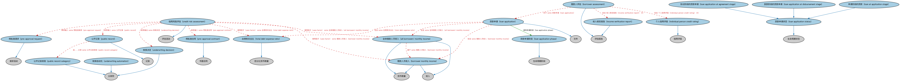

# 贷款申请本体（Loan Applications Ontology）结构与公理说明

本文档对应 `LoanApplications.rdf` / `LoanApplications.ttl`，说明该本体的类、继承关系、属性和公理约定。结构图见 `LoanApplications-structure.png`（`LoanApplications-structure.svg` 为可缩放版本）。

## 1. 本体概述

定义贷款申请（loan application）：申请人、申请金额、审批流程与审批结果。

**在体系中的位置**：LOAN 贷款通用模块中覆盖贷款生命周期的「贷前」环节。

**上下游关系**：上游依赖贷款、FND 文档与参与方本体；下游与贷款事件（审批通过/拒绝）衔接。

**与相近概念的差别**：申请≠合同——申请是借款意向与资料提交，审批通过并签约后才形成贷款合同；与贷款产品的差别——产品是机构的条款模板，申请是客户按模板提出的个案。

本本体中类与类的核心关系如下（完整细节见各类小节）：

- **全体借款人月收入（all borrowers' monthly income）** 继承 **货币数量（MonetaryAmount）**
- **全体借款人月收入（all borrowers' monthly income）** 继承 **收入（Income）**
- **借款人评估（borrower assessment）** 继承 **评估报告（AssessmentReport）**
- **借款人月收入（borrower monthly income）** 继承 **货币数量（MonetaryAmount）**
- **借款人月收入（borrower monthly income）** 继承 **收入（Income）**
- **信用风险评估（credit risk assessment）** 继承 **评估活动（AssessmentActivity）**
- **收入核实报告（income verification report）** 继承 **评估报告（AssessmentReport）**
- **个人信用评级（individual person credit rating）** 继承 **信用评级（CreditRating）**
- **贷款申请（loan application）** 继承 **文件（Document）**
- **协议阶段的贷款申请（loan application at agreement stage）** 继承 **贷款申请状态（loan application status）**
- **放款阶段的贷款申请（loan application at disbursement stage）** 继承 **贷款申请状态（loan application status）**
- **贷款申请阶段（loan application phase）** 继承 **生命周期阶段（LifecycleStage）**
- 其余 10 条关系从略。

## 2. 类（Class）

| 类（Class） | 定义（Definition） |
|---|---|
| 全体借款人月收入（all borrowers' monthly income） | 贷款全部借款人的月度合格收入总额。 total monthly qualifying income for all borrowers on the loan |
| 借款人评估（borrower assessment） | 详述借款人及其与贷款申请可能相关的信用历史的评估报告。 assessment report detailing information about the borrower and their credit history that may be relevant to the loan application |
| 借款人月收入（borrower monthly income） | 潜在借款人的月度合格收入总额。 total monthly qualifying income of a potential borrower |
| 信用风险评估（credit risk assessment） | 聚焦于确定潜在借款人偿还贷款之可能性的风险评估。 risk assessment that focuses on determining the likelihood of a potential borrower repaying a loan |
| 收入核实报告（income verification report） | 提供核实借款人收入所用方法及支持文件的报告。 report providing the methodology and supporting documentation used to verify the borrower's income |
| 个人信用评级（individual person credit rating） | 提供对个人信用状况之意见的信用评级。 credit rating that provides an opinion of the creditworthiness of a person |
| 贷款申请（loan application） | 潜在借款人向潜在贷款人提出的借款请求，包含用于决定是否批准贷款的信息。 request by a potential borrower to a potential lender to borrow money containing information used to decide whether to grant the loan |
| 协议阶段的贷款申请（loan application at agreement stage） | 处于协议阶段的贷款申请。 |
| 放款阶段的贷款申请（loan application at disbursement stage） | 处于放款阶段的贷款申请。 |
| 贷款申请阶段（loan application phase） | 贷款申请所处的阶段。 |
| 贷款申请状态（loan application status） | 贷款申请的状态。 |
| 申请阶段的贷款（loan at application stage） | 处于申请阶段的贷款。 |
| 预批准合同（pre-approval contract） | 当特定条件满足（如找到合适房产、信用状况不变）时提供贷款的书面承诺。 written commitment to lend when specified conditions are met, such as finding suitable property, and unchanged creditworthiness |
| 预批准请求（pre-approval request） | 潜在借款人请求贷款人承诺为其预批准不超过指定金额贷款的请求。 request from a potential borrower that a lender commit to pre-approving the borrower for a loan of up to a specified amount of money |
| 公开记录（public record） | 可从法院或其他政府机构公开获取的、关于某参与方所涉行动的记录。 record about an action involving a party that is publicly available from a court or other government agency |
| 公开记录类别（public record category） | 与贷款申请相关的公开记录分类符，如税务留置、工资扣押、止赎。 classifier of public records relevant to a loan application, e.g. tax lien, wage garnishment, foreclosure |
| 总债务支出比（total debt expense ratio） | 全体借款人全部月度债务偿付（含拟议支出）与其收入之比。 ratio of all monthly debt payments of all borrowers, including proposed expenses, with respect to the income of the borrowers as relied upon to make a credit decision |
| 核保自动化（underwriting automation） | 表明贷款是人工核保还是通过自动核保系统核保的分类符。 classifier indicating whether a loan was underwritten manually or using an automated underwriting system |
| 核保决定（underwriting decision） | 由人工或自动核保系统确定的贷款批准建议分类符。 classifier providing a loan approval recommendation determined either manually or by an automated underwriting system |

以下按类逐个展开：每个类给出继承关系、相关属性与公理约定；子类在父类之下降一级编号。

### 2.1 全体借款人月收入（all borrowers' monthly income）

定义：贷款全部借款人的月度合格收入总额。

- 父类：**货币数量（MonetaryAmount）**、**收入（Income）**

属性：

| 属性 | 定义 | 说明 |
|---|---|---|
| **基于（isBasedOn）** | — | — |

公理：

- **基于（isBasedOn）**至少有一个取值，类型是**借款人月收入（borrower monthly income）**。

### 2.2 借款人评估（borrower assessment）

定义：详述借款人及其与贷款申请可能相关的信用历史的评估报告。

- 父类：**评估报告（AssessmentReport）**

属性：

| 属性 | 定义 | 说明 |
|---|---|---|
| **具有评估日期（hasDateOfAssessment）** | — | — |
| **具有总收入（has gross income）** | 标识借款人的个人总收入。 indicates the personal gross income of the borrower | 值域：货币数量；子属性：具有货币数量 |
| **具有原始贷款债务收入比（has original loan debt-to-income ratio）** | 标识贷款发放时的债务收入比（DTI），按合并收入计。 indicates the debt-to-income (DTI) ratio at the time when the loan was advanced; for combined income | 值域：xsd:decimal |
| **包含（comprises）** | — | — |
| **关于（isAbout）** | — | — |

公理：

- **关于（isAbout）**至少有一个取值，类型是**借款人（Borrower）**。
- **关于（isAbout）**至少有一个取值，类型是**贷款申请（loan application）**。
- **具有评估日期（hasDateOfAssessment）**至少有一个取值，类型是**显式日期（ExplicitDate）**。
- **包含（comprises）**可以有 0 个或多个**个人信用评级（individual person credit rating）**。
- **包含（comprises）**可以有 0 个或多个**收入核实报告（income verification report）**。
- **包含（comprises）**可以有 0 个或多个**还款历史（PaymentHistory）**。

### 2.3 借款人月收入（borrower monthly income）

定义：潜在借款人的月度合格收入总额。

- 父类：**货币数量（MonetaryAmount）**、**收入（Income）**

属性：

| 属性 | 定义 | 说明 |
|---|---|---|
| **具有参与方角色（has party role）** | — | — |

公理：

- **具有参与方角色（has party role）**至少有一个取值，类型是**借款人（Borrower）**。

### 2.4 信用风险评估（credit risk assessment）

定义：聚焦于确定潜在借款人偿还贷款之可能性的风险评估。

- 父类：**评估活动（AssessmentActivity）**

属性：

| 属性 | 定义 | 说明 |
|---|---|---|
| **具有输入（hasInput）** | — | — |
| **具有输出（hasOutput）** | — | — |
| **使用因子（uses factor）** | 将（如）风险评估关联到评估中作为因子使用的事物。 relates e.g. a risk assessment to something used as a factor to make the assessment | 子属性：基于 |
| **适用于（appliesTo）** | — | — |

公理：

- **使用因子（uses factor）**至少有一个取值，类型是**借款人月收入（borrower monthly income）**。
- **使用因子（uses factor）**至少有一个取值，类型是**全体借款人月收入（all borrowers' monthly income）**。
- **使用因子（uses factor）**至少有一个取值，类型是**合并贷款价值比（CombinedLoanToValueRatio）**。
- **使用因子（uses factor）**至少有一个取值，类型是**总债务支出比（total debt expense ratio）**。
- **具有输入（hasInput）**至少有一个取值，类型是**信用报告（CreditReport）**。
- **具有输入（hasInput）**至少有一个取值，类型是**公开记录（public record）**。
- **具有输入（hasInput）**至少有一个取值，类型是**预批准合同（pre-approval contract）**。
- **具有输入（hasInput）**至少有一个取值，类型是**预批准请求（pre-approval request）**。
- **具有输出（hasOutput）**至少有一个取值，类型是**核保决定（underwriting decision）**。
- **适用于（appliesTo）**至少有一个取值，类型是**贷款（Loan）**。

### 2.5 收入核实报告（income verification report）

定义：提供核实借款人收入所用方法及支持文件的报告。

- 父类：**评估报告（AssessmentReport）**

### 2.6 个人信用评级（individual person credit rating）

定义：提供对个人信用状况之意见的信用评级。

- 父类：**信用评级（CreditRating）**

### 2.7 贷款申请（loan application）

定义：潜在借款人向潜在贷款人提出的借款请求，包含用于决定是否批准贷款的信息。

- 父类：**文件（Document）**

属性：

| 属性 | 定义 | 说明 |
|---|---|---|
| **由……提交（isSubmittedBy）** | — | — |
| **具有接收日期（hasDateReceived）** | — | — |
| **具有申请日期（has application date）** | 申请签署并提交的日期。 date on which an application was signed and submitted | 值域：显式日期；子属性：具有请求日期 |
| **具有申请阶段（has application phase）** | 该贷款申请在申请生命周期中所处的阶段。 The phase within the application lifecycle, that this Loan Application is at, | 值域：贷款申请阶段（loan application phase）；子属性：具有阶段 |
| **具有拟定贷款用途（has intended loan purpose）** | 标识贷款资金的拟定用途。 indicates the purpose to which the loaned funds are to be put | 值域：xsd:string |
| **已申请预批准（is pre-approval requested）** | 表明是否已随贷款申请一并申请预批准。 indicates whether a pre-approval has been requested, in conjunction with a loan application | 值域：xsd:boolean |
| **包含（comprises）** | — | — |

公理：

- **具有接收日期（hasDateReceived）**可以有 0 个或多个**显式日期（ExplicitDate）**。
- **具有申请日期（has application date）**恰好有 1 个**显式日期（ExplicitDate）**。
- **包含（comprises）**可以有 0 个或多个**合并贷款价值比（CombinedLoanToValueRatio）**。
- **包含（comprises）**可以有 0 个或多个**贷款价值比（LoanToValueRatio）**。
- **包含（comprises）**至少有一个取值，类型是**借款人月收入（borrower monthly income）**。
- **包含（comprises）**至少有一个取值，类型是**全体借款人月收入（all borrowers' monthly income）**。
- **包含（comprises）**至少有一个取值，类型是**总债务支出比（total debt expense ratio）**。
- **已申请预批准（is pre-approval requested）**至少有一个取值，类型是**xsd:boolean（boolean）**。
- **由……提交（isSubmittedBy）**至少有一个取值，类型是**请求方（Requester）**。

### 2.8 贷款申请阶段（loan application phase）

定义：贷款申请所处的阶段。

- 父类：**生命周期阶段（LifecycleStage）**

### 2.9 贷款申请状态（loan application status）

定义：贷款申请的状态。

- 父类：**生命周期状态（LifecycleStatus）**
- 直接子类：**协议阶段的贷款申请（loan application at agreement stage）**、**放款阶段的贷款申请（loan application at disbursement stage）**、**申请阶段的贷款（loan at application stage）**

#### 2.9.1 协议阶段的贷款申请（loan application at agreement stage）

定义：处于协议阶段的贷款申请。

- 父类：**贷款申请状态（loan application status）**

#### 2.9.2 放款阶段的贷款申请（loan application at disbursement stage）

定义：处于放款阶段的贷款申请。

- 父类：**贷款申请状态（loan application status）**

#### 2.9.3 申请阶段的贷款（loan at application stage）

定义：处于申请阶段的贷款。

- 父类：**贷款申请状态（loan application status）**

### 2.10 预批准合同（pre-approval contract）

定义：当特定条件满足（如找到合适房产、信用状况不变）时提供贷款的书面承诺。

- 父类：**书面合同（WrittenContract）**

属性：

| 属性 | 定义 | 说明 |
|---|---|---|
| **具有利率（hasInterestRate）** | — | — |
| **具有批准金额（has approved amount）** | 将某事物（如贷款）关联到批准的资金金额。 relates something, e.g. a loan, to the amount of funds approved | 子属性：具有货币数量 |

公理：

- **具有利率（hasInterestRate）**至少有一个取值，类型是**利率（InterestRate）**。
- **具有批准金额（has approved amount）**至少有一个取值，类型是**货币数量（MonetaryAmount）**。

### 2.11 预批准请求（pre-approval request）

定义：潜在借款人请求贷款人承诺为其预批准不超过指定金额贷款的请求。

- 父类：**请求活动（RequestActivity）**

属性：

| 属性 | 定义 | 说明 |
|---|---|---|
| **具有借款人（hasBorrower）** | — | — |
| **具有申请金额（has requested amount）** | 将某事物（如贷款申请）关联到所申请的资金金额。 relates something, e.g. a request for a loan, to the amount of funds requested | 子属性：具有货币数量 |

公理：

- **具有借款人（hasBorrower）**至少有一个取值，类型是**借款人（Borrower）**。
- **具有申请金额（has requested amount）**至少有一个取值，类型是**货币数量（MonetaryAmount）**。

### 2.12 公开记录（public record）

定义：可从法院或其他政府机构公开获取的、关于某参与方所涉行动的记录。

- 父类：**记录（Record）**

属性：

| 属性 | 定义 | 说明 |
|---|---|---|
| **由……证明（isEvidencedBy）** | — | — |
| **由……分类（isClassifiedBy）** | — | — |
| **引用（refersTo）** | — | — |

公理：

- **引用（refersTo）**可以有 0 个或多个**账户（Account）**。
- **由……分类（isClassifiedBy）**至少有一个取值，类型是**公开记录类别（public record category）**。
- **由……证明（isEvidencedBy）**可以有 0 个或多个**法律文件（LegalDocument）**。

### 2.13 公开记录类别（public record category）

定义：与贷款申请相关的公开记录分类符，如税务留置、工资扣押、止赎。

- 父类：**分类符（Classifier）**

### 2.14 总债务支出比（total debt expense ratio）

定义：全体借款人全部月度债务偿付（含拟议支出）与其收入之比。

- 父类：**百分比货币数量（PercentageMonetaryAmount）**

### 2.15 核保自动化（underwriting automation）

定义：表明贷款是人工核保还是通过自动核保系统核保的分类符。

- 父类：**分类符（Classifier）**

### 2.16 核保决定（underwriting decision）

定义：由人工或自动核保系统确定的贷款批准建议分类符。

- 父类：**分类符（Classifier）**

## 3. 依赖（owl:imports，20 个）

本本体通过 `owl:imports` 引入以下本体，各项的中文名称与简介如下：

| 导入本体 | 中文名称 | 简介 |
|---|---|---|
| `FBC/DebtAndEquities/CreditRatings.rdf` | 信用评级本体（Credit Ratings Ontology） | 定义信用评级、评级机构与评级结果，刻画债务人与债务工具的信用水平。 |
| `FBC/DebtAndEquities/Debt.rdf` | 债务本体（Debt Ontology） | 定义债务（debt）与债权债务关系的核心概念：借款人、贷款人、本金与利息义务。 |
| `FBC/ProductsAndServices/ClientsAndAccounts.rdf` | 客户与账户本体（Clients and Accounts Ontology） | 定义金融机构的客户、账户及账户持有关系。 |
| `FND/Accounting/CurrencyAmount.rdf` | 货币金额本体（Currency Amount Ontology） | 定义「金额＋币种」的货币金额（currency amount）表示，是 FIBO 中表达价格、债务金额、付款额等一切带币种数值的基础构件。 |
| `FND/Agreements/Contracts.rdf` | 合同本体（Contracts Ontology） | 在协议之上定义具有法律约束力的合同（contract）：合同当事方、合同条款、义务与权利，是金融工具与交易合同建模的基石。 |
| `FND/Arrangements/Assessments.rdf` | 评估本体（Assessments Ontology） | 定义评估活动、评估结果与评估方的通用结构，为信用评级、风险打分等判断性活动提供基础模型。 |
| `FND/Arrangements/Lifecycles.rdf` | 生命周期本体（Lifecycles Ontology） | 定义生命周期、生命周期阶段与状态转移，用于描述合同、金融工具、机构从创设到终止的演化过程。 |
| `FND/Arrangements/Reporting.rdf` | 报告本体（Reporting Ontology） | 定义报告、报告方与报告内容的关系，支撑监管报告、财务报告等报送场景。 |
| `FND/DatesAndTimes/FinancialDates.rdf` | 金融日期本体（Financial Dates Ontology） | 定义金融语境下的日期与期间概念：结算日、付息日、到期日、日计数基准等。 |
| `FND/DatesAndTimes/Occurrences.rdf` | 事件与发生本体（Occurrences Ontology） | 定义「发生」（occurrence）、事件与触发条件，用于表达企业行动、信用事件等「发生了什么」。 |
| `FND/OwnershipAndControl/Ownership.rdf` | 所有权本体（Ownership Ontology） | 定义「拥有」关系：所有者、被拥有资产及所有权份额。 |
| `FND/Utilities/Analytics.rdf` | 分析本体（Analytics Ontology） | 定义分析工具、度量与比率的通用概念，支撑指标与模型的表达。 |
| `FND/Utilities/AnnotationVocabulary.rdf` | FIBO 标注词汇表（FIBO Annotation Vocabulary） | 定义 FIBO 专用的标注属性（如释义来源、成熟度等级），用于本体自身的元数据标注。 |
| `https://www.omg.org/spec/Commons/AnnotationVocabulary/` | OMG 通用标注词汇表（OMG Commons Annotation Vocabulary） | OMG 通用本体库（Commons）中的标注词汇表，提供概念映射等标注属性，FIBO 用它标注术语与外部标准的对应关系。 |
| `https://www.omg.org/spec/Commons/Classifiers/` | OMG 通用分类器本体（OMG Commons Classifiers） | OMG 通用本体库（Commons）中的分类器本体，定义分类方案、类别与归类关系的通用概念，FIBO 的分类建模建立在其上。 |
| `https://www.omg.org/spec/Commons/Collections/` | OMG 通用集合本体（OMG Commons Collections） | Commons 库中的集合本体，定义集合、成员等通用概念。 |
| `https://www.omg.org/spec/Commons/ContextualDesignators/` | OMG 通用语境指称本体（OMG Commons Contextual Designators） | Commons 库中的语境指称本体，定义「在某个语境下指代某物的名称/符号」，是地址、账户号码等语境相关标识的基础。 |
| `https://www.omg.org/spec/Commons/DatesAndTimes/` | OMG 通用日期与时间本体（OMG Commons Dates and Times） | Commons 库中的日期时间本体，定义日期、期间、时间点等通用时间概念。 |
| `https://www.omg.org/spec/Commons/Documents/` | OMG 通用文档本体（OMG Commons Documents） | Commons 库中的文档本体，定义文档及其组成部分的通用概念。 |
| `https://www.omg.org/spec/Commons/PartiesAndSituations/` | OMG 通用参与方与情境本体（OMG Commons Parties and Situations） | Commons 库中的参与方本体，定义独立主体、参与方及其角色扮演的通用概念，是 FIBO 参与方模型的上游。 |

## 4. 文件

- 官方 RDF/XML：`LoanApplications.rdf`
- 中文 Turtle：`LoanApplications.ttl`
- 结构图：`LoanApplications-structure.png` / `LoanApplications-structure.svg`