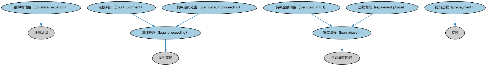

# 贷款事件本体（Loan Events Ontology）结构与公理说明

本文档对应 `LoanEvents.rdf` / `LoanEvents.ttl`，说明该本体的类、继承关系、属性和公理约定。结构图见 `LoanEvents-structure.png`（`LoanEvents-structure.svg` 为可缩放版本）。

## 1. 本体概述

定义贷款生命周期中的事件：放款、还款、逾期、违约、重组、核销。

**在体系中的位置**：LOAN 贷款通用模块中覆盖贷款「存续期动态」的本体。

**上下游关系**：上游依赖贷款与 FND 事件本体；下游支撑贷款监控、风险预警建模。

**与相近概念的差别**：贷款事件≠贷款状态——事件是时间点上的发生（某月逾期），状态是持续的处境（处于逾期中，见生命周期概念）；违约事件达到严重程度可能构成信用事件（FBC）。

## 2. 类（Class）

| 类（Class） | 定义（Definition） |
|---|---|
| 抵押物估值（collateral valuation） | 对作为抵押品的不动产进行估值的评估活动。 |
| 法院判决（court judgment） | 法院或其他裁判机构解决争议、确定各方权利与义务的决定。 |
| 法律程序（legal proceeding） | 在法院或机构指示或授权下采取的法律步骤或行动。 |
| 贷款违约处置（loan default proceeding） | 处理贷款违约的程序，通常属于贷款服务部门的工作。 |
| 贷款全额清偿（loan paid in full） | 贷款本息全部还清的事件。 |
| 贷款阶段（loan phase） | 贷款所处的阶段。 |
| 提前还款（prepayment） | 在到期前提前偿还贷款。 |
| 还款阶段（repayment phase） | 贷款处于还款期的阶段。 |

### 2.1 继承关系（Inheritance）

- 抵押物估值（collateral valuation） ⊑ 评估活动
- 法院判决（court judgment） ⊑ 法律程序（legal proceeding）
- 法律程序（legal proceeding） ⊑ 发生事项
- 贷款违约处置（loan default proceeding） ⊑ 法律程序（legal proceeding）
- 贷款全额清偿（loan paid in full） ⊑ 贷款阶段（loan phase）
- 贷款阶段（loan phase） ⊑ 生命周期阶段
- 提前还款（prepayment） ⊑ 支付
- 还款阶段（repayment phase） ⊑ 贷款阶段（loan phase）

## 3. 对象属性（Object Property）

| 属性（Property） | 中文（English） | 定义（Definition） | 说明 |
|---|---|---|---|
| fibo-loan-ln-ev:hasDisbursementDate | 放款日期（disbursement date） | 贷款资金实际发放的日期。 | 定义域（domain）：贷款；值域（range）：显式日期；子属性（subPropertyOf）：具有显式日期 |
| fibo-loan-ln-ev:hasDefaultAmount | 具有违约金额（has default amount） | 在扣除出售所得和回收款之前的违约金额。 | 定义域（domain）：贷款违约处置（loan default proceeding）；值域（range）：货币数量；子属性（subPropertyOf）：具有货币数量 |
| fibo-loan-ln-ev:hasJudgementAmount | 具有判决金额（has judgement amount） | 对主要借款人记录且已/未履行（核保时点）的法院判决或等效事项的总金额。 | 定义域（domain）：法院判决（court judgment）；值域（range）：货币数量；子属性（subPropertyOf）：具有货币数量 |
| fibo-loan-ln-ev:isAgainst | 针对（is against） | 标识该程序或行动所针对的对象。 | 定义域（domain）：法律程序（legal proceeding）；值域（range）：法律主体 |
| fibo-loan-ln-ev:isDeliveredBy | 由……交付（is delivered by） | 标识交付某事物的参与方。 | 定义域（domain）：法院判决（court judgment）；值域（range）：法院 |

## 4. 数据属性（Datatype Property）

| 属性（Property） | 中文（English） | 定义（Definition） |
|---|---|---|
| fibo-loan-ln-ev:inDefault | 违约（in default） | 发行人未能支付其合同义务所要求的款项。 |
| fibo-loan-ln-ev:isDeferred | 已延期（is deferred） | 表明某事项是否已延期。 |

## 5. 公理约定（Axioms）

- 抵押物估值（collateral valuation）：评估 only 抵押品
- 抵押物估值（collateral valuation）：由……提供 some 估价师
- 法院判决（court judgment）：具有判决金额（has judgement amount） 货币数量 ≥0
- 法院判决（court judgment）：由……交付（is delivered by） some 法院
- 法律程序（legal proceeding）：针对（is against） some 法律主体
- 法律程序（legal proceeding）：受……管辖 some 管辖权

## 6. 依赖（owl:imports，15 个）

本本体通过 `owl:imports` 引入以下本体，各项的中文名称与简介如下：

| 导入本体 | 中文名称 | 简介 |
|---|---|---|
| `FBC/DebtAndEquities/Debt.rdf` | 债务本体（Debt Ontology） | 定义债务（debt）与债权债务关系的核心概念：借款人、贷款人、本金与利息义务。 |
| `FND/Accounting/CurrencyAmount.rdf` | 货币金额本体（Currency Amount Ontology） | 定义「金额＋币种」的货币金额（currency amount）表示，是 FIBO 中表达价格、债务金额、付款额等一切带币种数值的基础构件。 |
| `FND/Arrangements/Assessments.rdf` | 评估本体（Assessments Ontology） | 定义评估活动、评估结果与评估方的通用结构，为信用评级、风险打分等判断性活动提供基础模型。 |
| `FND/Arrangements/Lifecycles.rdf` | 生命周期本体（Lifecycles Ontology） | 定义生命周期、生命周期阶段与状态转移，用于描述合同、金融工具、机构从创设到终止的演化过程。 |
| `FND/DatesAndTimes/Occurrences.rdf` | 事件与发生本体（Occurrences Ontology） | 定义「发生」（occurrence）、事件与触发条件，用于表达企业行动、信用事件等「发生了什么」。 |
| `FND/Law/LegalCore.rdf` | 法律核心本体（Legal Core Ontology） | 定义法域（jurisdiction）、法律、法规等核心法律概念，为监管主体与适用法律建模。 |
| `FND/Parties/Parties.rdf` | 参与方本体（Parties Ontology） | 定义参与方（party）、独立主体（autonomous agent）与「角色扮演」（party in role），是 FIBO 全库使用最广的基础本体之一。 |
| `FND/ProductsAndServices/PaymentsAndSchedules.rdf` | 付款与计划表本体（Payments and Schedules Ontology） | 定义付款、付款计划表（payment schedule）及其日期与金额结构，是贷款还款、债券付息建模的基础。 |
| `FND/Relations/Relations.rdf` | 关系本体（Relations Ontology） | FIBO 最底层的基础本体，定义参考（reference）、分类（classify）等通用关系与抽象概念，全库普遍依赖。 |
| `FND/Utilities/AnnotationVocabulary.rdf` | FIBO 标注词汇表（FIBO Annotation Vocabulary） | 定义 FIBO 专用的标注属性（如释义来源、成熟度等级），用于本体自身的元数据标注。 |
| `LOAN/LoansGeneral/Loans.rdf` | 贷款本体（Loans Ontology） | LOAN 域核心本体，定义贷款（loan）的通用结构：借款人、贷款人、本金、利率与还款安排。 |
| `https://www.omg.org/spec/Commons/AnnotationVocabulary/` | OMG 通用标注词汇表（OMG Commons Annotation Vocabulary） | OMG 通用本体库（Commons）中的标注词汇表，提供概念映射等标注属性，FIBO 用它标注术语与外部标准的对应关系。 |
| `https://www.omg.org/spec/Commons/DatesAndTimes/` | OMG 通用日期与时间本体（OMG Commons Dates and Times） | Commons 库中的日期时间本体，定义日期、期间、时间点等通用时间概念。 |
| `https://www.omg.org/spec/Commons/Organizations/` | OMG 通用组织本体（OMG Commons Organizations） | Commons 库中的组织本体，定义组织、组织成员与组织结构的通用概念。 |
| `https://www.omg.org/spec/Commons/RegulatoryAgencies/` | OMG 通用监管机构本体（OMG Commons Regulatory Agencies） | Commons 库中的监管机构本体，定义监管机构及其监管职权的通用概念。 |

## 7. 文件

- 官方 RDF/XML：`LoanEvents.rdf`
- 中文 Turtle：`LoanEvents.ttl`
- 结构图：`LoanEvents-structure.png` / `LoanEvents-structure.svg`