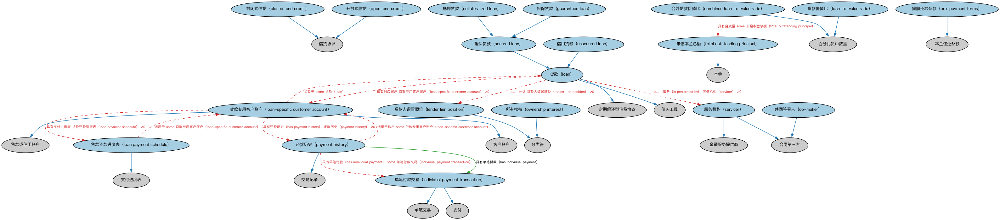

# 贷款本体（Loans Ontology）结构与公理说明

本文档对应 `Loans.rdf` / `Loans.ttl`，说明该本体的类、继承关系、属性和公理约定。结构图见 `Loans-structure.png`（`Loans-structure.svg` 为可缩放版本）。

## 1. 本体概述

定义贷款（loan）的通用结构：借款人、贷款人、本金、利率、还款安排与贷款状态，是 LOAN 域的核心本体。

**在体系中的位置**：LOAN 贷款通用模块的中心，各类具体贷款（商业、消费、抵押、学生等）的共同上游。

**上下游关系**：上游依赖 FBC 债务、FND 合同与付款计划表本体；下游被贷款通用模块其余本体（申请、事件、监管）和全部具体贷款本体引用。

**与相近概念的差别**：贷款≠债务工具——贷款是双边的债权债务关系（通常不可转让），债券等债务工具是可交易的证券化凭证；贷款≠授信额度——额度是可动用的上限，贷款是已发生的提款。

本本体中类与类的核心关系如下（完整细节见各类小节）：

- **封闭式信贷（closed-end credit）** 继承 **信贷协议（CreditAgreement）**
- **共同签署人（co-maker）** 继承 **合同第三方（ContractThirdParty）**
- **抵押贷款（collateralized loan）** 继承 **担保贷款（secured loan）**
- **合并贷款价值比（combined loan-to-value ratio）** 继承 **百分比货币数量（PercentageMonetaryAmount）**
- **担保贷款（guaranteed loan）** 继承 **担保贷款（secured loan）**
- **单笔付款交易（individual payment transaction）** 继承 **单笔交易（IndividualTransaction）**
- **单笔付款交易（individual payment transaction）** 继承 **支付（Payment）**
- **贷款人留置顺位（lender lien position）** 继承 **分类符（Classifier）**
- **贷款（loan）** 继承 **定期偿还型信贷协议（CreditAgreementRepaidPeriodically）**
- **贷款（loan）** 继承 **债务工具（DebtInstrument）**
- **贷款还款进度表（loan payment schedule）** 继承 **支付进度表（PaymentSchedule）**
- **贷款专用客户账户（loan-specific customer account）** 继承 **客户账户（CustomerAccount）**
- 其余 12 条关系从略。

## 2. 类（Class）

| 类（Class） | 定义（Definition） |
|---|---|
| 封闭式信贷（closed-end credit） | 贷款结清、资金全额发放后本金不得再增加的信贷协议。 credit agreement in which the loan principal cannot be increased after funds are dispersed in full when the loan closes |
| 共同签署人（co-maker） | 在借款人本票上共同签署、提供额外担保并可能改善债务质量的参与方。 party that signs a borrower's promissory note, providing additional security and potentially improving the quality of the debt |
| 抵押贷款（collateralized loan） | 以借款人提供的现金或其他可接受抵押品（不动产、证券或其他资产）作担保的担保贷款。 secured loan that is secured with cash or other acceptable collateral (real property, securities or other assets) provided by the borrower as specified in the collateral agreement |
| 合并贷款价值比（combined loan-to-value ratio） | 以资产作担保的全部债务总额与该资产评估价值之比。 ratio of the total amount of debt that is secured by the asset(s) and the appraised value of the asset(s) securing the financing |
| 担保贷款（guaranteed loan） | 本金与利息的偿付由担保作保的贷款。 loan that is secured with respect to repayment of principal and interest by guaranty |
| 单笔付款交易（individual payment transaction） | 为履行债务义务而实际支付本金、利息、费用或其他相关款项的单笔交易。 actual payment of principal, interest, fees, or other related amounts towards fulfillment of a debt obligation |
| 贷款人留置顺位（lender lien position） | 表明贷款人对贷款抵押资产是否拥有第一留置权的分类符。 classifier indicating whether the lender has the primary lien position with respect to an asset used as collateral for the loan |
| 贷款（loan） | 一方向另一方（或多方）提供货币或信用、并约定借款将获偿还的债务工具。 debt instrument whereby one party extends money or credit to another party (or parties) with the understanding that the borrowed money will be repaid according to the terms of the contract |
| 贷款还款进度表（loan payment schedule） | 与特定贷款账户关联的定期或显式（临时）还款进度表。 regular or explicit (ad hoc) payment schedule associated with a given loan-specific account |
| 贷款专用客户账户（loan-specific customer account） | 借款人持有的、与特定贷款关联的账户。 account held by the borrower associated with a specific loan |
| 贷款价值比（loan-to-value ratio） | 贷款本金与担保融资之资产评估价值之比，以百分比表示。 ratio, expressed as a percentage, between the principal amount of the loan and the appraised value of the asset securing the financing |
| 开放式信贷（open-end credit） | 可在约定信用额度内随时支取和偿还、并就支取部分计息的信贷协议。 credit agreement that may be extended up to an agreed credit limit and paid down at any time within the period of the line, if any, and on which interest is charged only on the outstanding balance |
| 所有权益（ownership interest） | 表明申请人或借款人对贷款抵押资产的所有权或租赁权益性质的分类符。 classifier indicating the nature of the applicant's or borrower's ownership or leasehold interest in an asset used as collateral for the loan |
| 还款历史（payment history） | 借款人为履行还款义务向贷款人或服务机构实际支付本金、利息及其他相关款项的记录。 record of actual payments of principal, interest, and other related amounts made by a borrower to a lender or servicer in order to fulfill their re-payment obligation |
| 提前还款条款（pre-payment terms） | 与贷款到期前还款相关的本金偿付条款。 principal repayment terms related to payment of the loan prior to maturity |
| 担保贷款（secured loan） | 借款人通过担保协议以某项资产作抵押、或通过第三方担保作保的贷款。 loan in which the borrower pledges some asset via a security agreement as collateral for the loan, or that is secured via third-party guarantee |
| 服务机构（servicer） | 为资产池提供收款、管理等服务的机构。 party that collects principal and interest payments on behalf of the lender |
| 未偿本金总额（total outstanding principal） | 以该房产作担保的全部贷款的本金余额。 the principal balance of all loans secured by the property |
| 信用贷款（unsecured loan） | 基于借款人信用历史或声誉而发放的贷款。 loan granted based on the strength of the borrower's credit history or reputation in the community |

以下按类逐个展开：每个类给出继承关系、相关属性与公理约定；子类在父类之下降一级编号。

### 2.1 封闭式信贷（closed-end credit）

定义：贷款结清、资金全额发放后本金不得再增加的信贷协议。

- 父类：**信贷协议（CreditAgreement）**

### 2.2 共同签署人（co-maker）

定义：在借款人本票上共同签署、提供额外担保并可能改善债务质量的参与方。

- 父类：**合同第三方（ContractThirdParty）**

### 2.3 合并贷款价值比（combined loan-to-value ratio）

定义：以资产作担保的全部债务总额与该资产评估价值之比。

- 父类：**百分比货币数量（PercentageMonetaryAmount）**

属性：

| 属性 | 定义 | 说明 |
|---|---|---|
| **适用于（appliesTo）** | — | — |
| **引用（refersTo）** | — | — |
| **具有自变量（hasArgument）** | — | — |

公理：

- **具有自变量（hasArgument）**至少有一个取值，类型是**未偿本金总额（total outstanding principal）**。
- **具有自变量（hasArgument）**至少有一个取值，类型是**评估价值（AppraisedValue）**。
- **引用（refersTo）**至少有一个取值，类型是**估价报告（Appraisal）**。
- **适用于（appliesTo）**至少有一个取值，类型是**资产（Asset）**。

### 2.4 单笔付款交易（individual payment transaction）

定义：为履行债务义务而实际支付本金、利息、费用或其他相关款项的单笔交易。

- 父类：**单笔交易（IndividualTransaction）**、**支付（Payment）**

### 2.5 贷款人留置顺位（lender lien position）

定义：表明贷款人对贷款抵押资产是否拥有第一留置权的分类符。

- 父类：**分类符（Classifier）**

### 2.6 贷款（loan）

定义：一方向另一方（或多方）提供货币或信用、并约定借款将获偿还的债务工具。

- 父类：**定期偿还型信贷协议（CreditAgreementRepaidPeriodically）**、**债务工具（DebtInstrument）**
- 直接子类：**担保贷款（secured loan）**、**信用贷款（unsecured loan）**

属性：

| 属性 | 定义 | 说明 |
|---|---|---|
| **具有到期日（hasMaturityDate）** | — | — |
| **具有担保人（hasGuarantor）** | — | — |
| **具有对应账户（hasCorrespondingAccount）** | — | — |
| **具有第三方（hasThirdParty）** | — | — |
| **具有负摊销（has negative amortization）** | 表明合同条款是否允许将未付利息计入未偿本金余额。 indicates whether the contractual terms include or would have included a feature that allows unpaid interest to be added to the balance of unpaid principal | 值域：xsd:boolean |
| **具有本金金额（has principal amount）** | 标识到期时或之前须偿还的贷款名义金额。 indicates the nominal amount of the loan that must be paid at or before maturity | 值域：货币数量；子属性：具有本金 |
| **具有总结清费用（has total closing costs）** | 标识房地产交易结清（产权转移）时支付的总费用。 indicates the total the amount paid at the closing of a real estate transaction, i.e., at the time when the title to the property is conveyed (transferred) to the buyer | 子属性：具有成本（has cost） |
| **具有总点数与费用（has total points and fees）** | 标识贷款人以点数形式收取的预付利息及费用，作为提高贷款利率的替代。 indicates a form of pre-paid interest, charged by the lender as an alternative to charging a higher rate of interest on the mortgage loan | 子属性：具有成本（has cost） |
| **可承接（is assumable）** | 表明另一借款人是否可承接本贷款的还款。 indicates whether or not another borrower may assume the payments on this loan | 值域：xsd:boolean |
| **仅付息（is interest only）** | 表明合同条款是否包含仅付息的还款方式。 indicates whether the contractual terms include or would have included interest only payments | 值域：xsd:boolean |
| **由……服务（is performed by）** | 将贷款关联到为其提供服务的金融服务提供商。 relates a loan to the financial service provider that services it | 值域：服务机构（servicer）；子属性：具有参与方角色（has party role） |
| **由……分类（isClassifiedBy）** | — | — |

公理：

- **仅付息（is interest only）**存在取值约束。
- **具有到期日（hasMaturityDate）**可以有 0 个或多个**显式日期（ExplicitDate）**。
- **具有对应账户（hasCorrespondingAccount）**可以有 0 个或多个**贷款专用客户账户（loan-specific customer account）**。
- **具有总点数与费用（has total points and fees）**可以有 0 个或多个**货币数量（MonetaryAmount）**。
- **具有总结清费用（has total closing costs）**可以有 0 个或多个**货币数量（MonetaryAmount）**。
- **具有担保人（hasGuarantor）**可以有 0 个或多个**担保人（Guarantor）**。
- **具有本金金额（has principal amount）**至少有一个取值，类型是**货币数量（MonetaryAmount）**。
- **具有第三方（hasThirdParty）**可以有 0 个或多个**合同第三方（ContractThirdParty）**。
- **具有负摊销（has negative amortization）**存在取值约束。
- **由……分类（isClassifiedBy）**可以有 0 个或多个**贷款人留置顺位（lender lien position）**。
- **由……服务（is performed by）**可以有 0 个或多个**服务机构（servicer）**。

#### 2.6.1 担保贷款（secured loan）

定义：借款人通过担保协议以某项资产作抵押、或通过第三方担保作保的贷款。

- 父类：**贷款（loan）**
- 直接子类：**抵押贷款（collateralized loan）**、**担保贷款（guaranteed loan）**

公理：

- 该属性存在取值约束。

##### 2.6.1.1 抵押贷款（collateralized loan）

定义：以借款人提供的现金或其他可接受抵押品（不动产、证券或其他资产）作担保的担保贷款。

- 父类：**担保贷款（secured loan）**

属性：

| 属性 | 定义 | 说明 |
|---|---|---|
| **以……为抵押（isCollateralizedBy）** | — | — |
| **是……的主合同（isPrimaryContractFor）** | — | — |

公理：

- **以……为抵押（isCollateralizedBy）**至少有一个取值，类型是**抵押品（Collateral）**。
- **是……的主合同（isPrimaryContractFor）**至少有一个取值，类型是**附属协议（CollateralAgreement）**。

##### 2.6.1.2 担保贷款（guaranteed loan）

定义：本金与利息的偿付由担保作保的贷款。

- 父类：**担保贷款（secured loan）**

属性：

| 属性 | 定义 | 说明 |
|---|---|---|
| **具有担保人（hasGuarantor）** | — | — |
| **包含（comprises）** | — | — |

公理：

- **具有担保人（hasGuarantor）**至少有一个取值，类型是**担保人（Guarantor）**。
- **包含（comprises）**至少有一个取值，类型是**担保（Guaranty）**。

#### 2.6.2 信用贷款（unsecured loan）

定义：基于借款人信用历史或声誉而发放的贷款。

- 父类：**贷款（loan）**

公理：

- 与**担保贷款（secured loan）**互斥：同一个体不能同时属于两者。

### 2.7 贷款还款进度表（loan payment schedule）

定义：与特定贷款账户关联的定期或显式（临时）还款进度表。

- 父类：**支付进度表（PaymentSchedule）**

属性：

| 属性 | 定义 | 说明 |
|---|---|---|
| **具有预计付款次数（hasAnticipatedNumberOfPayments）** | — | — |
| **适用于（appliesTo）** | — | — |

公理：

- **具有预计付款次数（hasAnticipatedNumberOfPayments）**至少有一个取值，类型是**xsd:positiveInteger（positiveInteger）**。
- **适用于（appliesTo）**至少有一个取值，类型是**贷款专用客户账户（loan-specific customer account）**。

### 2.8 贷款专用客户账户（loan-specific customer account）

定义：借款人持有的、与特定贷款关联的账户。

- 父类：**客户账户（CustomerAccount）**、**贷款或信用账户（LoanOrCreditAccount）**

属性：

| 属性 | 定义 | 说明 |
|---|---|---|
| **关联于（relatesTo）** | — | — |
| **具有支付进度表（hasPaymentSchedule）** | — | — |
| **由……持有（isHeldBy）** | — | — |
| **具有贷款余额（has loan balance）** | 标识截至某日期的贷款本金余额。 indicates the balance with respect to the principal on the loan as of some date | 子属性：具有未偿金额 |
| **具有还款历史（has payment history）** | 将信贷协议、贷款或承诺关联到借款人截至某时点的还款历史。 relates a credit agreement, loan, or commitment to any history of payments that have been made by the borrower up to the point that payment history is requested | 值域：还款历史（payment history）；子属性：具有记录 |
| **由……提供（isProvidedBy）** | — | — |

公理：

- **关联于（relatesTo）**至少有一个取值，类型是**贷款（loan）**。
- **具有支付进度表（hasPaymentSchedule）**可以有 0 个或多个**贷款还款进度表（loan payment schedule）**。
- **具有贷款余额（has loan balance）**可以有 0 个或多个**余额（Balance）**。
- **具有还款历史（has payment history）**可以有 0 个或多个**还款历史（payment history）**。
- **由……持有（isHeldBy）**至少有一个取值，类型是**借款人（Borrower）**。
- **由……提供（isProvidedBy）**至少有一个取值，该取值满足：该属性存在取值约束。

### 2.9 贷款价值比（loan-to-value ratio）

定义：贷款本金与担保融资之资产评估价值之比，以百分比表示。

- 父类：**百分比货币数量（PercentageMonetaryAmount）**

属性：

| 属性 | 定义 | 说明 |
|---|---|---|
| **适用于（appliesTo）** | — | — |
| **引用（refersTo）** | — | — |
| **具有自变量（hasArgument）** | — | — |

公理：

- **具有自变量（hasArgument）**至少有一个取值，类型是**本金（Principal）**。
- **具有自变量（hasArgument）**至少有一个取值，类型是**评估价值（AppraisedValue）**。
- **引用（refersTo）**至少有一个取值，类型是**估价报告（Appraisal）**。
- **适用于（appliesTo）**至少有一个取值，类型是**资产（Asset）**。

### 2.10 开放式信贷（open-end credit）

定义：可在约定信用额度内随时支取和偿还、并就支取部分计息的信贷协议。

- 父类：**信贷协议（CreditAgreement）**

属性：

| 属性 | 定义 | 说明 |
|---|---|---|
| **具有信用限额（hasCreditLimit）** | — | — |

公理：

- **具有信用限额（hasCreditLimit）**可以有 0 个或多个**货币数量（MonetaryAmount）**。
- 与**封闭式信贷（closed-end credit）**互斥：同一个体不能同时属于两者。

### 2.11 所有权益（ownership interest）

定义：表明申请人或借款人对贷款抵押资产的所有权或租赁权益性质的分类符。

- 父类：**分类符（Classifier）**

属性：

| 属性 | 定义 | 说明 |
|---|---|---|
| **分类（classifies）** | — | — |

公理：

- **分类（classifies）**至少有一个取值，类型是**所有权（Ownership）**。

### 2.12 还款历史（payment history）

定义：借款人为履行还款义务向贷款人或服务机构实际支付本金、利息及其他相关款项的记录。

- 父类：**交易记录（TransactionRecord）**

属性：

| 属性 | 定义 | 说明 |
|---|---|---|
| **适用于账户（appliesToAccount）** | — | — |
| **具有单笔付款（has individual payment）** | 将本金、利息及其他相关款项的单笔实际支付关联到账户的整体还款历史。 links an actual payment of principal, interest, and other related amounts to the overall payment history for an account | 值域：单笔付款交易（individual payment transaction）；子属性：包含 |

公理：

- **具有单笔付款（has individual payment）**至少有一个取值，类型是**单笔付款交易（individual payment transaction）**。
- **适用于账户（appliesToAccount）**至少有一个取值，类型是**贷款专用客户账户（loan-specific customer account）**。

### 2.13 提前还款条款（pre-payment terms）

定义：与贷款到期前还款相关的本金偿付条款。

- 父类：**本金偿还条款（PrincipalRepaymentTerms）**

属性：

| 属性 | 定义 | 说明 |
|---|---|---|
| **具有提前还款罚则期限（has pre-payment penalty term）** | 将贷款关联到一个期限（月），超过该期限后不再收取提前还款罚金。 relates a loan to a period of time in months after which there is no prepayment penalty | 子属性：具有时长 |

公理：

- **具有提前还款罚则期限（has pre-payment penalty term）**至少有一个取值，类型是**显式时长（ExplicitDuration）**。

### 2.14 服务机构（servicer）

定义：为资产池提供收款、管理等服务的机构。

- 父类：**金融服务提供商（FinancialServiceProvider）**、**合同第三方（ContractThirdParty）**

### 2.15 未偿本金总额（total outstanding principal）

定义：以该房产作担保的全部贷款的本金余额。

- 父类：**本金（Principal）**

## 3. 其他属性

以下属性未绑定到本体的具体类（定义域在外部本体或未声明）：

对象属性（Object Property）：

| 属性 | 定义 | 说明 |
|---|---|---|
| **具有成本（has cost）** | 应付的本金、利息、费用或其他开支金额。 has amount payable for principal, interest, fees or other expenses | 子属性：具有货币数量 |
| **具有首次利率变动期限（has first rate change term）** | 指明发放后利率不得变动的月数。 specifies a period of time in months after origination during which the interest rate cannot change | 子属性：具有时长 |
| **具有计划未偿余额（has scheduled unpaid balance）** | 标识按合同条款完成计划还款后应有的余额。 indicates what the balance should be after a scheduled payment is made according to contract terms | 值域：余额；子属性：具有余额 |

数据属性（Datatype Property）：

| 属性 | 定义 |
|---|---|
| **具有期末大额还款（has balloon payment）** | 表明合同条款是否包含在贷款期末一次性偿还全部未偿本金。 indicates whether the contractual terms include or would have included repayment of the outstanding principal sum at the end of a loan period, prior to which only partial or no payments were made on the principal |
| **初始应付对象（is initially payable）** | 表明本贷款所生义务最初应付给该金融机构（申请情形则为应付对象）。 indicates whether the obligation arising from the covered loan was, or in the case of an application, would have been initially payable to the financial institution |

## 4. 依赖（owl:imports，25 个）

本本体通过 `owl:imports` 引入以下本体，各项的中文名称与简介如下：

| 导入本体 | 中文名称 | 简介 |
|---|---|---|
| `FBC/DebtAndEquities/Debt.rdf` | 债务本体（Debt Ontology） | 定义债务（debt）与债权债务关系的核心概念：借款人、贷款人、本金与利息义务。 |
| `FBC/DebtAndEquities/Guaranty.rdf` | 担保本体（Guaranty Ontology） | 定义担保（guaranty）：担保人、被担保债务与担保范围。 |
| `FBC/FinancialInstruments/FinancialInstruments.rdf` | 金融工具本体（Financial Instruments Ontology） | FIBO 核心本体之一，定义金融工具（financial instrument）的通用概念：可交易、代表某种权利义务的合同工具，是证券、衍生品等具体工具的共同基础。 |
| `FBC/ProductsAndServices/ClientsAndAccounts.rdf` | 客户与账户本体（Clients and Accounts Ontology） | 定义金融机构的客户、账户及账户持有关系。 |
| `FBC/ProductsAndServices/FinancialProductsAndServices.rdf` | 金融产品与服务本体（Financial Products and Services Ontology） | 定义金融产品（financial product）与金融服务（financial service）及其提供、购买关系。 |
| `FND/Accounting/CurrencyAmount.rdf` | 货币金额本体（Currency Amount Ontology） | 定义「金额＋币种」的货币金额（currency amount）表示，是 FIBO 中表达价格、债务金额、付款额等一切带币种数值的基础构件。 |
| `FND/Agreements/Agreements.rdf` | 协议本体（Agreements Ontology） | 定义两个或以上参与方之间协议（agreement）的通用概念：协议的当事方、条款、生效与终止，是合同等一切契约性安排的上位模型。 |
| `FND/Agreements/Contracts.rdf` | 合同本体（Contracts Ontology） | 在协议之上定义具有法律约束力的合同（contract）：合同当事方、合同条款、义务与权利，是金融工具与交易合同建模的基石。 |
| `FND/Arrangements/Assessments.rdf` | 评估本体（Assessments Ontology） | 定义评估活动、评估结果与评估方的通用结构，为信用评级、风险打分等判断性活动提供基础模型。 |
| `FND/Arrangements/Documents.rdf` | 文档本体（Documents Ontology） | 定义文档、文档类型及文档与其所记载内容的关系，为合同文本、募集说明书等法律文书建模。 |
| `FND/DatesAndTimes/FinancialDates.rdf` | 金融日期本体（Financial Dates Ontology） | 定义金融语境下的日期与期间概念：结算日、付息日、到期日、日计数基准等。 |
| `FND/OwnershipAndControl/Ownership.rdf` | 所有权本体（Ownership Ontology） | 定义「拥有」关系：所有者、被拥有资产及所有权份额。 |
| `FND/ProductsAndServices/PaymentsAndSchedules.rdf` | 付款与计划表本体（Payments and Schedules Ontology） | 定义付款、付款计划表（payment schedule）及其日期与金额结构，是贷款还款、债券付息建模的基础。 |
| `FND/Relations/Relations.rdf` | 关系本体（Relations Ontology） | FIBO 最底层的基础本体，定义参考（reference）、分类（classify）等通用关系与抽象概念，全库普遍依赖。 |
| `FND/Utilities/AnnotationVocabulary.rdf` | FIBO 标注词汇表（FIBO Annotation Vocabulary） | 定义 FIBO 专用的标注属性（如释义来源、成熟度等级），用于本体自身的元数据标注。 |
| `https://www.omg.org/spec/Commons/AnnotationVocabulary/` | OMG 通用标注词汇表（OMG Commons Annotation Vocabulary） | OMG 通用本体库（Commons）中的标注词汇表，提供概念映射等标注属性，FIBO 用它标注术语与外部标准的对应关系。 |
| `https://www.omg.org/spec/Commons/Classifiers/` | OMG 通用分类器本体（OMG Commons Classifiers） | OMG 通用本体库（Commons）中的分类器本体，定义分类方案、类别与归类关系的通用概念，FIBO 的分类建模建立在其上。 |
| `https://www.omg.org/spec/Commons/Collections/` | OMG 通用集合本体（OMG Commons Collections） | Commons 库中的集合本体，定义集合、成员等通用概念。 |
| `https://www.omg.org/spec/Commons/ContextualDesignators/` | OMG 通用语境指称本体（OMG Commons Contextual Designators） | Commons 库中的语境指称本体，定义「在某个语境下指代某物的名称/符号」，是地址、账户号码等语境相关标识的基础。 |
| `https://www.omg.org/spec/Commons/DatesAndTimes/` | OMG 通用日期与时间本体（OMG Commons Dates and Times） | Commons 库中的日期时间本体，定义日期、期间、时间点等通用时间概念。 |
| `https://www.omg.org/spec/Commons/Documents/` | OMG 通用文档本体（OMG Commons Documents） | Commons 库中的文档本体，定义文档及其组成部分的通用概念。 |
| `https://www.omg.org/spec/Commons/Organizations/` | OMG 通用组织本体（OMG Commons Organizations） | Commons 库中的组织本体，定义组织、组织成员与组织结构的通用概念。 |
| `https://www.omg.org/spec/Commons/PartiesAndSituations/` | OMG 通用参与方与情境本体（OMG Commons Parties and Situations） | Commons 库中的参与方本体，定义独立主体、参与方及其角色扮演的通用概念，是 FIBO 参与方模型的上游。 |
| `https://www.omg.org/spec/Commons/QuantitiesAndUnits/` | OMG 通用量与单位本体（OMG Commons Quantities and Units） | Commons 库中的量与单位本体，定义数量、度量单位、量纲的通用概念，支撑金额、比率等数值表达。 |
| `https://www.omg.org/spec/Commons/RegistrationAuthorities/` | OMG 通用登记主管机构本体（OMG Commons Registration Authorities） | Commons 库中的登记主管机构本体，定义负责登记注册的主管机构及其登记行为的通用概念。 |

## 5. 文件

- 官方 RDF/XML：`Loans.rdf`
- 中文 Turtle：`Loans.ttl`
- 结构图：`Loans-structure.png` / `Loans-structure.svg`