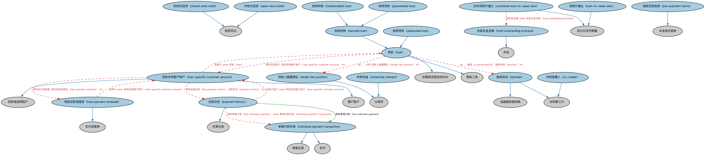

# 贷款本体（Loans Ontology）结构与公理说明

本文档对应 `Loans.rdf` / `Loans.ttl`，说明该本体的类、继承关系、属性和公理约定。结构图见 `Loans-structure.png`（`Loans-structure.svg` 为可缩放版本）。

## 1. 本体概述

定义贷款（loan）的通用结构：借款人、贷款人、本金、利率、还款安排与贷款状态，是 LOAN 域的核心本体。

**在体系中的位置**：LOAN 贷款通用模块的中心，各类具体贷款（商业、消费、抵押、学生等）的共同上游。

**上下游关系**：上游依赖 FBC 债务、FND 合同与付款计划表本体；下游被贷款通用模块其余本体（申请、事件、监管）和全部具体贷款本体引用。

**与相近概念的差别**：贷款≠债务工具——贷款是双边的债权债务关系（通常不可转让），债券等债务工具是可交易的证券化凭证；贷款≠授信额度——额度是可动用的上限，贷款是已发生的提款。

## 2. 类（Class）

| 类（Class） | 定义（Definition） |
|---|---|
| 封闭式信贷（closed-end credit） | 贷款结清、资金全额发放后本金不得再增加的信贷协议。 |
| 共同签署人（co-maker） | 在借款人本票上共同签署、提供额外担保并可能改善债务质量的参与方。 |
| 抵押贷款（collateralized loan） | 以借款人提供的现金或其他可接受抵押品（不动产、证券或其他资产）作担保的担保贷款。 |
| 合并贷款价值比（combined loan-to-value ratio） | 以资产作担保的全部债务总额与该资产评估价值之比。 |
| 担保贷款（guaranteed loan） | 本金与利息的偿付由担保作保的贷款。 |
| 单笔付款交易（individual payment transaction） | 为履行债务义务而实际支付本金、利息、费用或其他相关款项的单笔交易。 |
| 贷款人留置顺位（lender lien position） | 表明贷款人对贷款抵押资产是否拥有第一留置权的分类符。 |
| 贷款（loan） | 一方向另一方（或多方）提供货币或信用、并约定借款将获偿还的债务工具。 |
| 贷款还款进度表（loan payment schedule） | 与特定贷款账户关联的定期或显式（临时）还款进度表。 |
| 贷款专用客户账户（loan-specific customer account） | 借款人持有的、与特定贷款关联的账户。 |
| 贷款价值比（loan-to-value ratio） | 贷款本金与担保融资之资产评估价值之比，以百分比表示。 |
| 开放式信贷（open-end credit） | 可在约定信用额度内随时支取和偿还、并就支取部分计息的信贷协议。 |
| 所有权益（ownership interest） | 表明申请人或借款人对贷款抵押资产的所有权或租赁权益性质的分类符。 |
| 还款历史（payment history） | 借款人为履行还款义务向贷款人或服务机构实际支付本金、利息及其他相关款项的记录。 |
| 提前还款条款（pre-payment terms） | 与贷款到期前还款相关的本金偿付条款。 |
| 担保贷款（secured loan） | 借款人通过担保协议以某项资产作抵押、或通过第三方担保作保的贷款。 |
| 服务机构（servicer） | 为资产池提供收款、管理等服务的机构。 |
| 未偿本金总额（total outstanding principal） | 以该房产作担保的全部贷款的本金余额。 |
| 信用贷款（unsecured loan） | 基于借款人信用历史或声誉而发放的贷款。 |

### 2.1 继承关系（Inheritance）

- 封闭式信贷（closed-end credit） ⊑ 信贷协议
- 共同签署人（co-maker） ⊑ 合同第三方
- 抵押贷款（collateralized loan） ⊑ 担保贷款（secured loan）
- 合并贷款价值比（combined loan-to-value ratio） ⊑ 百分比货币数量
- 担保贷款（guaranteed loan） ⊑ 担保贷款（secured loan）
- 单笔付款交易（individual payment transaction） ⊑ 单笔交易
- 单笔付款交易（individual payment transaction） ⊑ 支付
- 贷款人留置顺位（lender lien position） ⊑ 分类符
- 贷款（loan） ⊑ 定期偿还型信贷协议
- 贷款（loan） ⊑ 债务工具
- 贷款还款进度表（loan payment schedule） ⊑ 支付进度表
- 贷款专用客户账户（loan-specific customer account） ⊑ 客户账户
- 贷款专用客户账户（loan-specific customer account） ⊑ 贷款或信用账户
- 贷款价值比（loan-to-value ratio） ⊑ 百分比货币数量
- 开放式信贷（open-end credit） ⊑ 信贷协议
- 所有权益（ownership interest） ⊑ 分类符
- 还款历史（payment history） ⊑ 交易记录
- 提前还款条款（pre-payment terms） ⊑ 本金偿还条款
- 担保贷款（secured loan） ⊑ 贷款（loan）
- 服务机构（servicer） ⊑ 金融服务提供商
- 服务机构（servicer） ⊑ 合同第三方
- 未偿本金总额（total outstanding principal） ⊑ 本金
- 信用贷款（unsecured loan） ⊑ 贷款（loan）

## 3. 对象属性（Object Property）

| 属性（Property） | 中文（English） | 定义（Definition） | 说明 |
|---|---|---|---|
| fibo-loan-ln-ln:hasCost | 具有成本（has cost） | 应付的本金、利息、费用或其他开支金额。 | 子属性（subPropertyOf）：具有货币数量 |
| fibo-loan-ln-ln:hasFirstRateChangeTerm | 具有首次利率变动期限（has first rate change term） | 指明发放后利率不得变动的月数。 | 子属性（subPropertyOf）：具有时长 |
| fibo-loan-ln-ln:hasIndividualPayment | 具有单笔付款（has individual payment） | 将本金、利息及其他相关款项的单笔实际支付关联到账户的整体还款历史。 | 定义域（domain）：还款历史（payment history）；值域（range）：单笔付款交易（individual payment transaction）；子属性（subPropertyOf）：包含 |
| fibo-loan-ln-ln:hasLoanBalance | 具有贷款余额（has loan balance） | 标识截至某日期的贷款本金余额。 | 子属性（subPropertyOf）：具有未偿金额 |
| fibo-loan-ln-ln:hasPaymentHistory | 具有还款历史（has payment history） | 将信贷协议、贷款或承诺关联到借款人截至某时点的还款历史。 | 值域（range）：还款历史（payment history）；子属性（subPropertyOf）：具有记录 |
| fibo-loan-ln-ln:hasPrePaymentPenaltyTerm | 具有提前还款罚则期限（has pre-payment penalty term） | 将贷款关联到一个期限（月），超过该期限后不再收取提前还款罚金。 | 子属性（subPropertyOf）：具有时长 |
| fibo-loan-ln-ln:hasPrincipalAmount | 具有本金金额（has principal amount） | 标识到期时或之前须偿还的贷款名义金额。 | 值域（range）：货币数量；子属性（subPropertyOf）：具有本金 |
| fibo-loan-ln-ln:hasScheduledUnpaidBalance | 具有计划未偿余额（has scheduled unpaid balance） | 标识按合同条款完成计划还款后应有的余额。 | 值域（range）：余额；子属性（subPropertyOf）：具有余额 |
| fibo-loan-ln-ln:hasTotalClosingCosts | 具有总结清费用（has total closing costs） | 标识房地产交易结清（产权转移）时支付的总费用。 | 子属性（subPropertyOf）：具有成本（has cost） |
| fibo-loan-ln-ln:hasTotalPointsAndFees | 具有总点数与费用（has total points and fees） | 标识贷款人以点数形式收取的预付利息及费用，作为提高贷款利率的替代。 | 子属性（subPropertyOf）：具有成本（has cost） |
| fibo-loan-ln-ln:isServicedBy | 由……服务（is performed by） | 将贷款关联到为其提供服务的金融服务提供商。 | 值域（range）：服务机构（servicer）；子属性（subPropertyOf）：具有参与方角色（has party role） |

## 4. 数据属性（Datatype Property）

| 属性（Property） | 中文（English） | 定义（Definition） |
|---|---|---|
| fibo-loan-ln-ln:hasBalloonPayment | 具有期末大额还款（has balloon payment） | 表明合同条款是否包含在贷款期末一次性偿还全部未偿本金。 |
| fibo-loan-ln-ln:hasNegativeAmortization | 具有负摊销（has negative amortization） | 表明合同条款是否允许将未付利息计入未偿本金余额。 |
| fibo-loan-ln-ln:isAssumable | 可承接（is assumable） | 表明另一借款人是否可承接本贷款的还款。 |
| fibo-loan-ln-ln:isInitiallyPayable | 初始应付对象（is initially payable） | 表明本贷款所生义务最初应付给该金融机构（申请情形则为应付对象）。 |
| fibo-loan-ln-ln:isInterestOnly | 仅付息（is interest only） | 表明合同条款是否包含仅付息的还款方式。 |

## 5. 公理约定（Axioms）

- 抵押贷款（collateralized loan）：以……为抵押 some 抵押品
- 抵押贷款（collateralized loan）：是……的主合同 some 附属协议
- 合并贷款价值比（combined loan-to-value ratio）：适用于 some 资产
- 合并贷款价值比（combined loan-to-value ratio）：引用 some 估价报告
- 合并贷款价值比（combined loan-to-value ratio）：具有自变量 some 评估价值
- 合并贷款价值比（combined loan-to-value ratio）：具有自变量 some 未偿本金总额（total outstanding principal）
- 担保贷款（guaranteed loan）：具有担保人 some 担保人
- 担保贷款（guaranteed loan）：包含 some 担保
- 贷款（loan）：具有担保人 担保人 ≥0
- 贷款（loan）：具有总结清费用（has total closing costs） 货币数量 ≥0
- 贷款（loan）：具有总点数与费用（has total points and fees） 货币数量 ≥0
- 贷款（loan）：具有第三方 合同第三方 ≥0
- 贷款（loan）：由……分类 贷款人留置顺位（lender lien position） ≥0
- 贷款（loan）：具有对应账户 贷款专用客户账户（loan-specific customer account） ≥0
- 贷款（loan）：由……服务（is performed by） 服务机构（servicer） ≥0
- 贷款（loan）：具有到期日 显式日期 ≥0
- 贷款（loan）：restriction
- 贷款（loan）：restriction
- 贷款（loan）：具有本金金额（has principal amount） some 货币数量
- 贷款还款进度表（loan payment schedule）：具有预计付款次数 some xsd:positiveInteger
- 贷款还款进度表（loan payment schedule）：适用于 some 贷款专用客户账户（loan-specific customer account）
- 贷款专用客户账户（loan-specific customer account）：具有贷款余额（has loan balance） 余额 ≥0
- 贷款专用客户账户（loan-specific customer account）：具有支付进度表 贷款还款进度表（loan payment schedule） ≥0
- 贷款专用客户账户（loan-specific customer account）：具有还款历史（has payment history） 还款历史（payment history） ≥0
- 贷款专用客户账户（loan-specific customer account）：关联于 some 贷款（loan）
- 贷款专用客户账户（loan-specific customer account）：由……持有 some 借款人
- 贷款专用客户账户（loan-specific customer account）：由……提供 some（restriction）
- 贷款价值比（loan-to-value ratio）：适用于 some 资产
- 贷款价值比（loan-to-value ratio）：引用 some 估价报告
- 贷款价值比（loan-to-value ratio）：具有自变量 some 本金
- 贷款价值比（loan-to-value ratio）：具有自变量 some 评估价值
- 开放式信贷（open-end credit）：具有信用限额 货币数量 ≥0
- 开放式信贷（open-end credit） 与 封闭式信贷（closed-end credit） 互斥（disjointWith）
- 所有权益（ownership interest）：分类 some 所有权
- 还款历史（payment history）：适用于账户 some 贷款专用客户账户（loan-specific customer account）
- 还款历史（payment history）：具有单笔付款（has individual payment） some 单笔付款交易（individual payment transaction）
- 提前还款条款（pre-payment terms）：具有提前还款罚则期限（has pre-payment penalty term） some 显式时长
- 担保贷款（secured loan）：restriction
- 信用贷款（unsecured loan） 与 担保贷款（secured loan） 互斥（disjointWith）

## 6. 依赖（owl:imports，25 个）

本本体通过 `owl:imports` 引入以下本体，各项的中文名称与简介如下：

| 导入本体 | 中文名称 | 简介 |
|---|---|---|
| `FBC/DebtAndEquities/Debt.rdf` | 债务本体（Debt Ontology） | 定义债务（debt）与债权债务关系的核心概念：借款人、贷款人、本金与利息义务。 |
| `FBC/DebtAndEquities/Guaranty.rdf` | 担保本体（Guaranty Ontology） | 定义担保（guaranty）：担保人、被担保债务与担保范围。 |
| `FBC/FinancialInstruments/FinancialInstruments.rdf` | 金融工具本体（Financial Instruments Ontology） | FIBO 核心本体之一，定义金融工具（financial instrument）的通用概念：可交易、代表某种权利义务的合同工具，是证券、衍生品等具体工具的共同基础。 |
| `FBC/ProductsAndServices/ClientsAndAccounts.rdf` | 客户与账户本体（Clients and Accounts Ontology） | 定义金融机构的客户、账户及账户持有关系。 |
| `FBC/ProductsAndServices/FinancialProductsAndServices.rdf` | 金融产品与服务本体（Financial Products and Services Ontology） | 定义金融产品（financial product）与金融服务（financial service）及其提供、购买关系。 |
| `FND/Accounting/CurrencyAmount.rdf` | 货币金额本体（Currency Amount Ontology） | 定义「金额＋币种」的货币金额（currency amount）表示，是 FIBO 中表达价格、债务金额、付款额等一切带币种数值的基础构件。 |
| `FND/Agreements/Agreements.rdf` | 协议本体（Agreements Ontology） | 定义两个或以上参与方之间协议（agreement）的通用概念：协议的当事方、条款、生效与终止，是合同等一切契约性安排的上位模型。 |
| `FND/Agreements/Contracts.rdf` | 合同本体（Contracts Ontology） | 在协议之上定义具有法律约束力的合同（contract）：合同当事方、合同条款、义务与权利，是金融工具与交易合同建模的基石。 |
| `FND/Arrangements/Assessments.rdf` | 评估本体（Assessments Ontology） | 定义评估活动、评估结果与评估方的通用结构，为信用评级、风险打分等判断性活动提供基础模型。 |
| `FND/Arrangements/Documents.rdf` | 文档本体（Documents Ontology） | 定义文档、文档类型及文档与其所记载内容的关系，为合同文本、募集说明书等法律文书建模。 |
| `FND/DatesAndTimes/FinancialDates.rdf` | 金融日期本体（Financial Dates Ontology） | 定义金融语境下的日期与期间概念：结算日、付息日、到期日、日计数基准等。 |
| `FND/OwnershipAndControl/Ownership.rdf` | 所有权本体（Ownership Ontology） | 定义「拥有」关系：所有者、被拥有资产及所有权份额。 |
| `FND/ProductsAndServices/PaymentsAndSchedules.rdf` | 付款与计划表本体（Payments and Schedules Ontology） | 定义付款、付款计划表（payment schedule）及其日期与金额结构，是贷款还款、债券付息建模的基础。 |
| `FND/Relations/Relations.rdf` | 关系本体（Relations Ontology） | FIBO 最底层的基础本体，定义参考（reference）、分类（classify）等通用关系与抽象概念，全库普遍依赖。 |
| `FND/Utilities/AnnotationVocabulary.rdf` | FIBO 标注词汇表（FIBO Annotation Vocabulary） | 定义 FIBO 专用的标注属性（如释义来源、成熟度等级），用于本体自身的元数据标注。 |
| `https://www.omg.org/spec/Commons/AnnotationVocabulary/` | OMG 通用标注词汇表（OMG Commons Annotation Vocabulary） | OMG 通用本体库（Commons）中的标注词汇表，提供概念映射等标注属性，FIBO 用它标注术语与外部标准的对应关系。 |
| `https://www.omg.org/spec/Commons/Classifiers/` | OMG 通用分类器本体（OMG Commons Classifiers） | OMG 通用本体库（Commons）中的分类器本体，定义分类方案、类别与归类关系的通用概念，FIBO 的分类建模建立在其上。 |
| `https://www.omg.org/spec/Commons/Collections/` | OMG 通用集合本体（OMG Commons Collections） | Commons 库中的集合本体，定义集合、成员等通用概念。 |
| `https://www.omg.org/spec/Commons/ContextualDesignators/` | OMG 通用语境指称本体（OMG Commons Contextual Designators） | Commons 库中的语境指称本体，定义「在某个语境下指代某物的名称/符号」，是地址、账户号码等语境相关标识的基础。 |
| `https://www.omg.org/spec/Commons/DatesAndTimes/` | OMG 通用日期与时间本体（OMG Commons Dates and Times） | Commons 库中的日期时间本体，定义日期、期间、时间点等通用时间概念。 |
| `https://www.omg.org/spec/Commons/Documents/` | OMG 通用文档本体（OMG Commons Documents） | Commons 库中的文档本体，定义文档及其组成部分的通用概念。 |
| `https://www.omg.org/spec/Commons/Organizations/` | OMG 通用组织本体（OMG Commons Organizations） | Commons 库中的组织本体，定义组织、组织成员与组织结构的通用概念。 |
| `https://www.omg.org/spec/Commons/PartiesAndSituations/` | OMG 通用参与方与情境本体（OMG Commons Parties and Situations） | Commons 库中的参与方本体，定义独立主体、参与方及其角色扮演的通用概念，是 FIBO 参与方模型的上游。 |
| `https://www.omg.org/spec/Commons/QuantitiesAndUnits/` | OMG 通用量与单位本体（OMG Commons Quantities and Units） | Commons 库中的量与单位本体，定义数量、度量单位、量纲的通用概念，支撑金额、比率等数值表达。 |
| `https://www.omg.org/spec/Commons/RegistrationAuthorities/` | OMG 通用登记主管机构本体（OMG Commons Registration Authorities） | Commons 库中的登记主管机构本体，定义负责登记注册的主管机构及其登记行为的通用概念。 |

## 7. 文件

- 官方 RDF/XML：`Loans.rdf`
- 中文 Turtle：`Loans.ttl`
- 结构图：`Loans-structure.png` / `Loans-structure.svg`