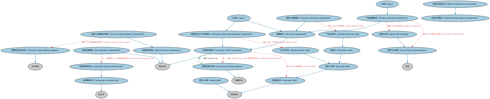

# 贷款监管本体（Loans Regulatory Ontology）结构与公理说明

本文档对应 `LoansRegulatory.rdf` / `LoansRegulatory.ttl`，说明该本体的类、继承关系、属性和公理约定。结构图见 `LoansRegulatory-structure.png`（`LoansRegulatory-structure.svg` 为可缩放版本）。

## 1. 本体概述

定义贷款监管相关概念：监管分类、资本与报告要求（如贷款分类、披露义务）。

**在体系中的位置**：LOAN 贷款通用模块的合规配套本体。

**上下游关系**：上游依赖贷款与 FND 报告本体；下游被 HMDA 覆盖抵押贷款等具体监管场景引用。

**与相近概念的差别**：与贷款本体的差别——贷款本体建模业务结构，本本体建模监管视角的分类与报送要求；与 HMDA 本体的差别——HMDA 是美国特定法案的具体落地。

## 2. 类（Class）

| 类（Class） | 定义（Definition） |
|---|---|
| 借款人数据保护要求（borrower data protection requirement） | 关于借款人个人数据如何保存与使用的监管要求。 |
| 借款人披露要求（borrower disclosure requirement） | 要求贷款人向借款人或潜在借款人披露信息的监管要求。 |
| 借款人权利（borrower right） | 借款人在借贷关系中享有的权利。 |
| 消费信贷公平对待要求（consumer credit equal treatment requirement） | 要求贷款人在信贷业务中公平对待借款人的监管要求。 |
| 消费信贷保护法（consumer credit protection law） | 保护消费信贷借款人的法律。 |
| 消费信贷征信机构（consumer credit reference agency） | 收集并提供消费者信用信息的机构，其可披露内容受各辖区法规约束。 |
| 消费信贷要求（consumer credit requirement） | 对贷款人如何对待贷款申请所设定的要求。 |
| 消费者保护机构（consumer protection agency） | 在某辖区负责消费者保护监管的机构。 |
| 消费者保护法（consumer protection law） | 保护消费者权益的法律。 |
| 消费者权利（consumer right） | 消费者依法享有的权利。 |
| 征信机构要求（credit reference agency requirements） | 除数据保护外、规制征信机构可为与不可为的要求。 |
| 数据保护要求（data protection requirement） | 规定个人数据如何保存的要求，如欧盟数据保护指令（数据归个人所有）。 |
| 披露要求（disclosure requirement） | 向借款人或潜在借款人披露的要求，包括所持有信息的披露与产品条款的披露两类。 |
| 公平对待权（equal treatment right） | 在法律下获得公平对待的权利。 |
| 诚信估价单（good faith estimate） | 贷款人就贷款结清（提前终止）的成本与影响所作的说明（GFE）。 |
| 知情权（information right） | 在某情境中获得某项信息的权利，如购买产品时的充分公平披露权。 |
| 贷款人权利（lender right） | 保护贷款人免受损失的权利。 |
| 贷款产品说明（loan product representations） | 关于贷款产品及其对借款人适当性的陈述。 |
| 贷款监管要求（loan regulatory requirement） | 由消费信贷法或其他立法在法规中定义的监管要求。 |
| 产品披露要求（product disclosure requirement） | 规制对产品可作出何种陈述（就其影响消费者而言）的要求。 |
| 产品知情权（product disclosure right） | 在购买产品时获得产品信息的权利。 |
| B 条例（reg b） | 美国关于《平等信贷机会法》的条例，涉及披露的电子化送达。 |
| Z 条例（reg z） | 美联储《诚实借贷法》条例，规定披露电子化送达的统一标准。 |
| 信用记录更正权（right of credit record correction） | 要求更正信用记录的权利。 |

### 2.1 继承关系（Inheritance）

- 借款人数据保护要求（borrower data protection requirement） ⊑ 数据保护要求（data protection requirement）
- 借款人披露要求（borrower disclosure requirement） ⊑ 披露要求（disclosure requirement）
- 借款人权利（borrower right） ⊑ 消费者权利（consumer right）
- 消费信贷公平对待要求（consumer credit equal treatment requirement） ⊑ 消费信贷要求（consumer credit requirement）
- 消费信贷保护法（consumer credit protection law） ⊑ 消费者保护法（consumer protection law）
- 消费信贷征信机构（consumer credit reference agency） ⊑ 正式组织
- 消费信贷要求（consumer credit requirement） ⊑ 法律义务
- 消费者保护机构（consumer protection agency） ⊑ 监管机构
- 消费者保护法（consumer protection law） ⊑ 成文法
- 消费者权利（consumer right） ⊑ 法律权利
- 数据保护要求（data protection requirement） ⊑ 法律义务
- 披露要求（disclosure requirement） ⊑ 消费信贷要求（consumer credit requirement）
- 公平对待权（equal treatment right） ⊑ 借款人权利（borrower right）
- 诚信估价单（good faith estimate） ⊑ 贷款产品说明（loan product representations）
- 知情权（information right） ⊑ 借款人权利（borrower right）
- 贷款人权利（lender right） ⊑ 法律权利
- 贷款产品说明（loan product representations） ⊑ 陈述
- 贷款监管要求（loan regulatory requirement） ⊑ 法律义务
- 产品披露要求（product disclosure requirement） ⊑ 披露要求（disclosure requirement）
- 产品知情权（product disclosure right） ⊑ 知情权（information right）
- B 条例（reg b） ⊑ 消费信贷公平对待要求（consumer credit equal treatment requirement）
- B 条例（reg b） ⊑ 披露要求（disclosure requirement）
- Z 条例（reg z） ⊑ 产品披露要求（product disclosure requirement）
- 信用记录更正权（right of credit record correction） ⊑ 征信机构要求（credit reference agency requirements）

## 3. 对象属性（Object Property）

| 属性（Property） | 中文（English） | 定义（Definition） | 说明 |
|---|---|---|---|
| fibo-loan-ln-reg:administeredBy | 由……管理（administered by） | 标识负责管理某事物的机构。 | 定义域（domain）：贷款监管要求（loan regulatory requirement）；值域（range）：监管机构 |
| fibo-loan-ln-reg:overseenBy | 由……监督（overseen by） | 标识负责监督某事物的机构。 | 定义域（domain）：消费信贷要求（consumer credit requirement）；值域（range）：消费者保护机构（consumer protection agency） |

## 4. 数据属性（Datatype Property）

| 属性（Property） | 中文（English） | 定义（Definition） |
|---|---|---|
| fibo-loan-ln-reg:requirementActReference | 要求法案引用（requirement act reference） | 该监管要求所依据的法案引用。 |
| fibo-loan-ln-reg:requirementSectionAndParagraph | 要求条款与段落（requirement section and paragraph） | 该监管要求所在的条款与段落。 |

## 5. 公理约定（Axioms）

- 借款人数据保护要求（borrower data protection requirement）：管辖 some 消费信贷征信机构（consumer credit reference agency）
- 借款人披露要求（borrower disclosure requirement）：授予 some 产品知情权（product disclosure right）
- 借款人披露要求（borrower disclosure requirement）：管辖 some 借款人评估
- 消费信贷公平对待要求（consumer credit equal treatment requirement）：授予 some 公平对待权（equal treatment right）
- 消费信贷要求（consumer credit requirement）：授予 some 消费者权利（consumer right）
- 消费信贷要求（consumer credit requirement）：由……监督（overseen by） some 消费者保护机构（consumer protection agency）
- 贷款监管要求（loan regulatory requirement）：由……授权要求 some 消费信贷保护法（consumer credit protection law）
- 贷款监管要求（loan regulatory requirement）：由……管理（administered by） some 监管机构
- 贷款监管要求（loan regulatory requirement）：监管 some 贷款
- 产品披露要求（product disclosure requirement）：管辖 some 诚信估价单（good faith estimate）
- 产品披露要求（product disclosure requirement）：管辖 some 贷款产品说明（loan product representations）

## 6. 依赖（owl:imports，10 个）

本本体通过 `owl:imports` 引入以下本体，各项的中文名称与简介如下：

| 导入本体 | 中文名称 | 简介 |
|---|---|---|
| `FND/Agreements/Contracts.rdf` | 合同本体（Contracts Ontology） | 在协议之上定义具有法律约束力的合同（contract）：合同当事方、合同条款、义务与权利，是金融工具与交易合同建模的基石。 |
| `FND/Law/LegalCapacity.rdf` | 法律能力本体（Legal Capacity Ontology） | 定义法律能力、缔约能力、签章权等概念，刻画主体从事法律行为的资格。 |
| `FND/Law/LegalCore.rdf` | 法律核心本体（Legal Core Ontology） | 定义法域（jurisdiction）、法律、法规等核心法律概念，为监管主体与适用法律建模。 |
| `FND/Relations/Relations.rdf` | 关系本体（Relations Ontology） | FIBO 最底层的基础本体，定义参考（reference）、分类（classify）等通用关系与抽象概念，全库普遍依赖。 |
| `FND/Utilities/AnnotationVocabulary.rdf` | FIBO 标注词汇表（FIBO Annotation Vocabulary） | 定义 FIBO 专用的标注属性（如释义来源、成熟度等级），用于本体自身的元数据标注。 |
| `LOAN/LoansGeneral/LoanApplications.rdf` | 贷款申请本体（Loan Applications Ontology） | 定义贷款申请、申请人与审批流程的概念。 |
| `LOAN/LoansGeneral/Loans.rdf` | 贷款本体（Loans Ontology） | LOAN 域核心本体，定义贷款（loan）的通用结构：借款人、贷款人、本金、利率与还款安排。 |
| `https://www.omg.org/spec/Commons/AnnotationVocabulary/` | OMG 通用标注词汇表（OMG Commons Annotation Vocabulary） | OMG 通用本体库（Commons）中的标注词汇表，提供概念映射等标注属性，FIBO 用它标注术语与外部标准的对应关系。 |
| `https://www.omg.org/spec/Commons/Organizations/` | OMG 通用组织本体（OMG Commons Organizations） | Commons 库中的组织本体，定义组织、组织成员与组织结构的通用概念。 |
| `https://www.omg.org/spec/Commons/RegulatoryAgencies/` | OMG 通用监管机构本体（OMG Commons Regulatory Agencies） | Commons 库中的监管机构本体，定义监管机构及其监管职权的通用概念。 |

## 7. 文件

- 官方 RDF/XML：`LoansRegulatory.rdf`
- 中文 Turtle：`LoansRegulatory.ttl`
- 结构图：`LoansRegulatory-structure.png` / `LoansRegulatory-structure.svg`