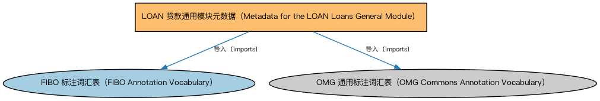

# LOAN 贷款通用模块元数据（Metadata for the LOAN Loans General Module）说明

本文档对应 `MetadataLOANLoansGeneral.rdf` / `MetadataLOANLoansGeneral.ttl`。

## 1. 本文件是什么

声明贷款通用（Loans General）模块由贷款、贷款申请、贷款事件、贷款监管四个本体构成，及版本信息。

从机制上说，这是一个元数据清单（metadata manifest）文件：它本身不定义任何类或属性，而是通过 `dct:hasPart` 声明一个域或模块由哪些本体构成，并携带版本 IRI、版权、许可与成熟度等发布管理信息。它回答的问题是「这个域/模块包含什么、当前是什么版本」，供发布工具和文档系统按模块组织内容；它的 `owl:imports` 只引入标注词汇表，不是用来加载业务本体的入口（加载入口是 `All*` 与 `About*` 聚合文件）。

## 2. 声明的构成（dct:hasPart，4 个）

| 构成项 | 中文名称 | 简介 |
|---|---|---|
| `LOAN/LoansGeneral/LoanApplications.rdf` | 贷款申请本体（Loan Applications Ontology） | 定义贷款申请、申请人与审批流程的概念。 |
| `LOAN/LoansGeneral/LoanEvents.rdf` | 贷款事件本体（Loan Events Ontology） | 定义贷款生命周期中的事件：放款、逾期、违约、核销等。 |
| `LOAN/LoansGeneral/Loans.rdf` | 贷款本体（Loans Ontology） | LOAN 域核心本体，定义贷款（loan）的通用结构：借款人、贷款人、本金、利率与还款安排。 |
| `LOAN/LoansGeneral/LoansRegulatory.rdf` | 贷款监管本体（Loans Regulatory Ontology） | 定义贷款监管相关概念：监管分类与报告要求。 |

## 3. 标注依赖（owl:imports，2 个）

以下导入仅用于支撑元数据标注本身（如成熟度等级、概念映射），不属于业务内容：

| 导入本体 | 中文名称 | 简介 |
|---|---|---|
| `FND/Utilities/AnnotationVocabulary.rdf` | FIBO 标注词汇表（FIBO Annotation Vocabulary） | 定义 FIBO 专用的标注属性（如释义来源、成熟度等级），用于本体自身的元数据标注。 |
| `https://www.omg.org/spec/Commons/AnnotationVocabulary/` | OMG 通用标注词汇表（OMG Commons Annotation Vocabulary） | OMG 通用本体库（Commons）中的标注词汇表，提供概念映射等标注属性，FIBO 用它标注术语与外部标准的对应关系。 |

## 4. 文件

- 官方 RDF/XML：`MetadataLOANLoansGeneral.rdf`
- 中文 Turtle：`MetadataLOANLoansGeneral.ttl`
- 结构图：`MetadataLOANLoansGeneral-structure.png` / `MetadataLOANLoansGeneral-structure.svg`