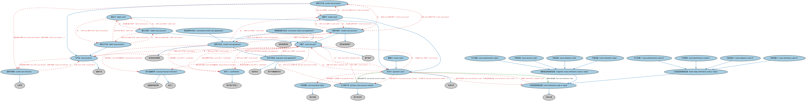

# 卡账户本体（Card Accounts Ontology）结构与公理说明

本文档对应 `CardAccounts.rdf` / `CardAccounts.ttl`，说明该本体的类、继承关系、属性和公理约定。结构图见 `CardAccounts-structure.png`（`CardAccounts-structure.svg` 为可缩放版本）。

## 1. 本体概述

定义信用卡、借记卡账户及其信贷特征：信用额度、循环余额、最低还款。

**在体系中的位置**：LOAN 具体贷款模块的品种本体之一。

**上下游关系**：上游依赖贷款与 FBC 客户账户本体；下游服务零售信贷建模。

**与相近概念的差别**：卡账户≠普通消费贷款——信用卡是循环授信（随借随还、额度循环），消费贷款是一次放款分期偿还；卡账户同时兼具支付工具与信贷工具双重属性。

## 2. 类（Class）

| 类（Class） | 定义（Definition） |
|---|---|
| 卡账户（card account） | 条款与条件由以支付卡为载体的卡协议定义的账户。 |
| 卡认证值（card authentication value） | 专用于 JCB 支付卡的卡验证值。 |
| 卡认证值 2（card authentication value 2） | 专用于 JCB 支付卡的卡验证值。 |
| 卡有效期（card expiration date） | 给定支付卡的到期日期。 |
| 卡识别码（card identification number） | 专用于美国运通和 Discover 支付卡的卡验证值。 |
| 卡产品（card product） | 涉及发行信用卡、借记卡或其他支付卡的金融产品。 |
| 卡安全码（card security code） | 专用于美国运通支付卡的卡验证值。 |
| 卡验证码（card validation code） | 专用于万事达支付卡的卡验证码。 |
| 卡验证码 2（card validation code 2） | 专用于万事达支付卡的卡验证值。 |
| 卡验证码或验证值（card verification code or value） | 指 (1) 磁条数据或 (2) 印刷安全特征的代码，用于保护数据完整性并限制篡改。 |
| 卡验证值（card verification value） | 专用于 Visa 和 Discover 支付卡的卡验证值。 |
| 卡验证值 2（card verification value 2） | 专用于 Visa 支付卡的卡验证值。 |
| 持卡人（cardholder） | 获发支付卡的账户持有人。 |
| 商业信用卡协议（commercial credit card agreement） | 向正式组织（如小企业、中型企业、政府机构）发行或与其联名发行的信用卡的协议。 |
| 消费者信用卡协议（consumer credit card agreement） | 为家庭、家属或其他个人支出而发行、由借款人使用信用卡支取的信用卡协议。 |
| 信用卡（credit card） | 由金融服务提供商发行、使持卡人能够借入资金的卡。 |
| 信用卡账户（credit card account） | 条款与条件由以信用卡为载体的信用卡协议定义的卡账户。 |
| 信用卡协议（credit card agreement） | 规定发行人向持卡人提供信用卡之条款与条件的账户专用信贷安排。 |
| 信用卡网络（credit card network） | 对授权、处理信用卡交易并设定其条款、以及在购物者、商户与机构之间划转支付的网络的分类符。 |
| 信用卡产品（credit card product） | 允许持卡人凭信用购买货物或服务的卡产品。 |
| 借记卡（debit card） | 由金融服务提供商发行、使持卡人能够动用活期存款账户资金的支付卡。 |
| 借记卡账户（debit card account） | 以一张或多张借记卡为载体的卡账户。 |
| 借记卡产品（debit card product） | 通常由存款机构提供、允许持卡人在消费时向另一账户电子转账的卡产品。 |
| 发卡金融机构（issuing financial institution） | 发行支付卡、或履行/促成/支持发卡服务的发行人及金融服务提供商。 |
| 磁条验证码或验证值（magnetic stripe verification code or value） | 卡磁条上的验证码，采用安全加密过程保护磁条数据完整性并可揭示篡改。 |
| 支付卡（payment card） | 由金融服务提供商发行的法律凭证，使持卡人能够动用其指定银行账户中的资金或获得信用。 |
| 支付卡协议（payment card agreement） | 规定发行人向持卡人提供支付卡之条款与条件的账户专用信贷协议。 |
| 主卡账户号（primary card account number） | 压印在银行卡或支付卡上、并编码于磁条中的 14 或 16 位复合标识符。 |
| 智能卡（smart card） | 内嵌集成电路的支付卡。 |
| 三位验证码或验证值（three-digit verification code or value） | 印在卡背面签名栏区域最右三位数字的卡验证码。 |

### 2.1 继承关系（Inheritance）

- 卡账户（card account） ⊑ 客户账户
- 卡认证值（card authentication value） ⊑ 磁条验证码或验证值（magnetic stripe verification code or value）
- 卡认证值 2（card authentication value 2） ⊑ 三位验证码或验证值（three-digit verification code or value）
- 卡有效期（card expiration date） ⊑ 显式日期
- 卡识别码（card identification number） ⊑ 三位验证码或验证值（three-digit verification code or value）
- 卡产品（card product） ⊑ 金融产品
- 卡安全码（card security code） ⊑ 磁条验证码或验证值（magnetic stripe verification code or value）
- 卡验证码（card validation code） ⊑ 磁条验证码或验证值（magnetic stripe verification code or value）
- 卡验证码 2（card validation code 2） ⊑ 三位验证码或验证值（three-digit verification code or value）
- 卡验证码或验证值（card verification code or value） ⊑ 代码元素
- 卡验证值（card verification value） ⊑ 磁条验证码或验证值（magnetic stripe verification code or value）
- 卡验证值 2（card verification value 2） ⊑ 三位验证码或验证值（three-digit verification code or value）
- 持卡人（cardholder） ⊑ 客户账户持有人
- 商业信用卡协议（commercial credit card agreement） ⊑ 信用卡协议（credit card agreement）
- 消费者信用卡协议（consumer credit card agreement） ⊑ 信用卡协议（credit card agreement）
- 消费者信用卡协议（consumer credit card agreement） ⊑ 信用消费贷款
- 信用卡（credit card） ⊑ 支付卡（payment card）
- 信用卡账户（credit card account） ⊑ 贷款或信用账户
- 信用卡账户（credit card account） ⊑ 卡账户（card account）
- 信用卡协议（credit card agreement） ⊑ 承诺性信贷额度
- 信用卡协议（credit card agreement） ⊑ 支付卡协议（payment card agreement）
- 信用卡网络（credit card network） ⊑ 分类符
- 信用卡产品（credit card product） ⊑ 卡产品（card product）
- 借记卡（debit card） ⊑ 支付卡（payment card）
- 借记卡账户（debit card account） ⊑ 卡账户（card account）
- 借记卡产品（debit card product） ⊑ 卡产品（card product）
- 发卡金融机构（issuing financial institution） ⊑ 发行人
- 发卡金融机构（issuing financial institution） ⊑ 金融服务提供商
- 磁条验证码或验证值（magnetic stripe verification code or value） ⊑ 卡验证码或验证值（card verification code or value）
- 支付卡（payment card） ⊑ 法律文件
- 支付卡协议（payment card agreement） ⊑ 信贷协议
- 支付卡协议（payment card agreement） ⊑ 账户专属服务协议
- 主卡账户号（primary card account number） ⊑ 账户标识符
- 智能卡（smart card） ⊑ 支付卡（payment card）
- 三位验证码或验证值（three-digit verification code or value） ⊑ 卡验证码或验证值（card verification code or value）

## 3. 对象属性（Object Property）

| 属性（Property） | 中文（English） | 定义（Definition） | 说明 |
|---|---|---|---|
| fibo-loan-spc-crd:hasCardVerificationCode | 具有卡验证码（has card verification code） | 将信用卡关联到 (1) 磁条数据或 (2) 用于保护数据完整性并限制篡改的印刷安全特征。 | 定义域（domain）：支付卡（payment card）；值域（range）：卡验证码或验证值（card verification code or value） |
| fibo-loan-spc-crd:hasCreditCardNetwork | 具有信用卡网络（has credit card network） | 标识信用卡产品的底层网络。 | 值域（range）：信用卡网络（credit card network）；子属性（subPropertyOf）：由……分类 |
| fibo-loan-spc-crd:hasPrimaryAccountNumber | 具有主账户号（has primary account number） | 指明卡面上显示的账户号。 | 定义域（domain）：支付卡（payment card）；值域（range）：主卡账户号（primary card account number） |
| fibo-loan-spc-crd:usesCurrency | 使用货币（uses currency） | 标识信用卡产品所定义的货币。 | 值域（range）：货币；子属性（subPropertyOf）：使用 |

## 5. 公理约定（Axioms）

- 卡账户（card account）：关联至账户 客户账户 ≥0
- 卡账户（card account）：具有主要账户持有人 some 持卡人（cardholder）
- 卡账户（card account）：例证 some 卡产品（card product）
- 卡账户（card account）：定义于 some 支付卡协议（payment card agreement）
- 卡账户（card account）：由……表示 some 支付卡（payment card）
- 卡账户（card account）：由……标识 some 主卡账户号（primary card account number）
- 卡产品（card product）：具有信用卡网络（has credit card network） 信用卡网络（credit card network） ≥0
- 卡产品（card product）：具有行政区划 国家行政区划 ≥0
- 卡产品（card product）：使用货币（uses currency） 货币 =1
- 卡产品（card product）：具有国家 国家 =1
- 卡产品（card product）：由……例证 some 卡账户（card account）
- 卡验证码或验证值（card verification code or value）：restriction
- 卡验证码或验证值（card verification code or value）：适用于 some 支付卡（payment card）
- 持卡人（cardholder）：持有 some 卡账户（card account）
- 持卡人（cardholder）：由…扮演（is played by） some（拥有 some 卡账户（card account））
- 持卡人（cardholder）：由…扮演（is played by） some（是…的参与方（is a party to） some 卡账户（card account））
- 商业信用卡协议（commercial credit card agreement）：具有借款人 some（由…扮演（is played by） some 正式组织）
- 消费者信用卡协议（consumer credit card agreement）：具有借款人 some 消费者
- 信用卡（credit card）：是……的证据 信用卡账户（credit card account） =1
- 信用卡（credit card）：由……分类 some 信用卡产品（credit card product）
- 信用卡账户（credit card account）：具有付款到期日 some 付款到期日
- 信用卡账户（credit card account）：例证 some 信用卡产品（credit card product）
- 信用卡账户（credit card account）：定义于 some 信用卡协议（credit card agreement）
- 信用卡账户（credit card account）：由……表示 some 信用卡（credit card）
- 信用卡协议（credit card agreement）：具有借款人 some 持卡人（cardholder）
- 信用卡协议（credit card agreement）：具有贷款人 some 发卡金融机构（issuing financial institution）
- 信用卡协议（credit card agreement）：由……证明 some 信用卡（credit card）
- 信用卡协议（credit card agreement）：适用于 some 信用卡账户（credit card account）
- 信用卡网络（credit card network）：分类 some 卡产品（card product）
- 信用卡网络（credit card network）：具有标签 some xsd:string
- 信用卡产品（credit card product）：具有信用卡网络（has credit card network） 信用卡网络（credit card network） =1
- 信用卡产品（credit card product）：由……例证 some 信用卡账户（credit card account）
- 信用卡产品（credit card product）：分类 some 信用卡（credit card）
- 借记卡（debit card）：是……的证据 借记卡账户（debit card account） =1
- 借记卡（debit card）：由……分类 some 借记卡产品（debit card product）
- 借记卡账户（debit card account）：例证 some 借记卡产品（debit card product）
- 借记卡账户（debit card account）：由……表示 some 借记卡（debit card）
- 借记卡产品（debit card product）：由……例证 some 借记卡账户（debit card account）
- 借记卡产品（debit card product）：分类 some 借记卡（debit card）
- 支付卡（payment card）：具有到期日 卡有效期（card expiration date） =1
- 支付卡（payment card）：具有卡验证码（has card verification code） 卡验证码或验证值（card verification code or value） =1
- 支付卡（payment card）：具有主账户号（has primary account number） 主卡账户号（primary card account number） =1
- 支付卡（payment card）：是……的证据 some 卡账户（card account）
- 支付卡协议（payment card agreement）：具有合同当事方 some 持卡人（cardholder）
- 支付卡协议（payment card agreement）：具有合同当事方 some 发卡金融机构（issuing financial institution）
- 支付卡协议（payment card agreement）：由……证明 some 支付卡（payment card）
- 支付卡协议（payment card agreement）：适用于 some 卡账户（card account）
- 主卡账户号（primary card account number）：标识 卡账户（card account） =1

## 6. 依赖（owl:imports，23 个）

本本体通过 `owl:imports` 引入以下本体，各项的中文名称与简介如下：

| 导入本体 | 中文名称 | 简介 |
|---|---|---|
| `FBC/DebtAndEquities/Debt.rdf` | 债务本体（Debt Ontology） | 定义债务（debt）与债权债务关系的核心概念：借款人、贷款人、本金与利息义务。 |
| `FBC/FinancialInstruments/FinancialInstruments.rdf` | 金融工具本体（Financial Instruments Ontology） | FIBO 核心本体之一，定义金融工具（financial instrument）的通用概念：可交易、代表某种权利义务的合同工具，是证券、衍生品等具体工具的共同基础。 |
| `FBC/ProductsAndServices/ClientsAndAccounts.rdf` | 客户与账户本体（Clients and Accounts Ontology） | 定义金融机构的客户、账户及账户持有关系。 |
| `FBC/ProductsAndServices/FinancialProductsAndServices.rdf` | 金融产品与服务本体（Financial Products and Services Ontology） | 定义金融产品（financial product）与金融服务（financial service）及其提供、购买关系。 |
| `FND/Accounting/CurrencyAmount.rdf` | 货币金额本体（Currency Amount Ontology） | 定义「金额＋币种」的货币金额（currency amount）表示，是 FIBO 中表达价格、债务金额、付款额等一切带币种数值的基础构件。 |
| `FND/Agreements/Contracts.rdf` | 合同本体（Contracts Ontology） | 在协议之上定义具有法律约束力的合同（contract）：合同当事方、合同条款、义务与权利，是金融工具与交易合同建模的基石。 |
| `FND/Arrangements/Documents.rdf` | 文档本体（Documents Ontology） | 定义文档、文档类型及文档与其所记载内容的关系，为合同文本、募集说明书等法律文书建模。 |
| `FND/OwnershipAndControl/Ownership.rdf` | 所有权本体（Ownership Ontology） | 定义「拥有」关系：所有者、被拥有资产及所有权份额。 |
| `FND/ProductsAndServices/ProductsAndServices.rdf` | 产品与服务本体（Products and Services Ontology） | 定义产品、服务及其提供者与客户的通用关系。 |
| `FND/Relations/Relations.rdf` | 关系本体（Relations Ontology） | FIBO 最底层的基础本体，定义参考（reference）、分类（classify）等通用关系与抽象概念，全库普遍依赖。 |
| `FND/Utilities/AnnotationVocabulary.rdf` | FIBO 标注词汇表（FIBO Annotation Vocabulary） | 定义 FIBO 专用的标注属性（如释义来源、成熟度等级），用于本体自身的元数据标注。 |
| `LOAN/LoansSpecific/ConsumerLoans.rdf` | 消费贷款本体（Consumer Loans Ontology） | 定义面向个人消费者的贷款。 |
| `https://www.omg.org/spec/Commons/AnnotationVocabulary/` | OMG 通用标注词汇表（OMG Commons Annotation Vocabulary） | OMG 通用本体库（Commons）中的标注词汇表，提供概念映射等标注属性，FIBO 用它标注术语与外部标准的对应关系。 |
| `https://www.omg.org/spec/Commons/Classifiers/` | OMG 通用分类器本体（OMG Commons Classifiers） | OMG 通用本体库（Commons）中的分类器本体，定义分类方案、类别与归类关系的通用概念，FIBO 的分类建模建立在其上。 |
| `https://www.omg.org/spec/Commons/CodesAndCodeSets/` | OMG 通用代码与代码集本体（OMG Commons Codes and Code Sets） | Commons 库中的代码本体，定义代码、代码集及其维护方的通用概念，是 ISO 4217、ISO 3166 等编码体系建模的基础。 |
| `https://www.omg.org/spec/Commons/ContextualDesignators/` | OMG 通用语境指称本体（OMG Commons Contextual Designators） | Commons 库中的语境指称本体，定义「在某个语境下指代某物的名称/符号」，是地址、账户号码等语境相关标识的基础。 |
| `https://www.omg.org/spec/Commons/DatesAndTimes/` | OMG 通用日期与时间本体（OMG Commons Dates and Times） | Commons 库中的日期时间本体，定义日期、期间、时间点等通用时间概念。 |
| `https://www.omg.org/spec/Commons/Designators/` | OMG 通用指称符本体（OMG Commons Designators） | Commons 库中的指称符本体，定义名称、标识符等「指代某物的符号」的通用概念。 |
| `https://www.omg.org/spec/Commons/Identifiers/` | OMG 通用标识符本体（OMG Commons Identifiers） | Commons 库中的标识符本体，定义标识符及其编码方案的通用概念。 |
| `https://www.omg.org/spec/Commons/Locations/` | OMG 通用位置本体（OMG Commons Locations） | Commons 库中的位置本体，定义地理位置、地点的通用概念。 |
| `https://www.omg.org/spec/Commons/Organizations/` | OMG 通用组织本体（OMG Commons Organizations） | Commons 库中的组织本体，定义组织、组织成员与组织结构的通用概念。 |
| `https://www.omg.org/spec/Commons/PartiesAndSituations/` | OMG 通用参与方与情境本体（OMG Commons Parties and Situations） | Commons 库中的参与方本体，定义独立主体、参与方及其角色扮演的通用概念，是 FIBO 参与方模型的上游。 |
| `https://www.omg.org/spec/Commons/RolesAndCompositions/` | OMG 通用角色与构成本体（OMG Commons Roles and Compositions） | Commons 库中的角色本体，定义角色及整体—部分构成关系的通用概念。 |

## 7. 文件

- 官方 RDF/XML：`CardAccounts.rdf`
- 中文 Turtle：`CardAccounts.ttl`
- 结构图：`CardAccounts-structure.png` / `CardAccounts-structure.svg`