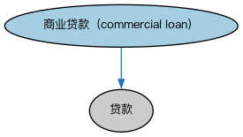

# 商业贷款本体（Commercial Loans Ontology）结构与公理说明

本文档对应 `CommercialLoans.rdf` / `CommercialLoans.ttl`，说明该本体的类、继承关系、属性和公理约定。结构图见 `CommercialLoans-structure.png`（`CommercialLoans-structure.svg` 为可缩放版本）。

## 1. 本体概述

定义面向企业的商业贷款（commercial loan）：营运资金贷款、设备融资等。

**在体系中的位置**：LOAN 具体贷款模块的品种本体之一。

**上下游关系**：上游继承贷款本体并依赖 BE 商业实体；下游服务公司信贷建模。

**与相近概念的差别**：与消费贷款的差别——借款主体是企业而非个人，审批看经营状况而非个人信用；与银团贷款（SEC 分销贷款）的差别——商业贷款通常单一贷款人，银团贷款多家分销。

本本体中类与类的核心关系如下（完整细节见各类小节）：

- **商业贷款（commercial loan）** 继承 **贷款（Loan）**

## 2. 类（Class）

| 类（Class） | 定义（Definition） |
|---|---|
| 商业贷款（commercial loan） | 向公司、商业企业、合资企业或其他组织（而非消费者个人）发放的贷款。 loan extended to a corporation, commercial enterprise, joint venture, or other organization as opposed to a consumer |

以下按类逐个展开：每个类给出继承关系、相关属性与公理约定；子类在父类之下降一级编号。

### 2.1 商业贷款（commercial loan）

定义：向公司、商业企业、合资企业或其他组织（而非消费者个人）发放的贷款。

- 父类：**贷款（Loan）**

属性：

| 属性 | 定义 | 说明 |
|---|---|---|
| **具有借款人（hasBorrower）** | — | — |
| **具有目标（hasObjective）** | — | — |
| **具有业务用途描述（has business purpose description）** | 从借款人角度对贷款用途的描述。 provides a description of the purpose of the loan from the perspective of the borrower | 子属性：具有描述 |

公理：

- **具有业务用途描述（has business purpose description）**存在取值约束。
- **具有借款人（hasBorrower）**至少有一个取值，该取值满足：**由…扮演（is played by）**至少有一个取值，类型是**法律实体（LegalEntity）**。
- **具有目标（hasObjective）**可以有 0 个或多个**业务目标（BusinessObjective）**。

## 3. 依赖（owl:imports，8 个）

本本体通过 `owl:imports` 引入以下本体，各项的中文名称与简介如下：

| 导入本体 | 中文名称 | 简介 |
|---|---|---|
| `FBC/DebtAndEquities/Debt.rdf` | 债务本体（Debt Ontology） | 定义债务（debt）与债权债务关系的核心概念：借款人、贷款人、本金与利息义务。 |
| `FND/GoalsAndObjectives/Objectives.rdf` | 目标本体（Objectives Ontology） | 定义目标（objective）及其与组织、计划的关系，用于表达机构的经营目标与投资目标。 |
| `FND/Utilities/AnnotationVocabulary.rdf` | FIBO 标注词汇表（FIBO Annotation Vocabulary） | 定义 FIBO 专用的标注属性（如释义来源、成熟度等级），用于本体自身的元数据标注。 |
| `LOAN/LoansGeneral/Loans.rdf` | 贷款本体（Loans Ontology） | LOAN 域核心本体，定义贷款（loan）的通用结构：借款人、贷款人、本金、利率与还款安排。 |
| `https://www.omg.org/spec/Commons/AnnotationVocabulary/` | OMG 通用标注词汇表（OMG Commons Annotation Vocabulary） | OMG 通用本体库（Commons）中的标注词汇表，提供概念映射等标注属性，FIBO 用它标注术语与外部标准的对应关系。 |
| `https://www.omg.org/spec/Commons/Designators/` | OMG 通用指称符本体（OMG Commons Designators） | Commons 库中的指称符本体，定义名称、标识符等「指代某物的符号」的通用概念。 |
| `https://www.omg.org/spec/Commons/Organizations/` | OMG 通用组织本体（OMG Commons Organizations） | Commons 库中的组织本体，定义组织、组织成员与组织结构的通用概念。 |
| `https://www.omg.org/spec/Commons/RolesAndCompositions/` | OMG 通用角色与构成本体（OMG Commons Roles and Compositions） | Commons 库中的角色本体，定义角色及整体—部分构成关系的通用概念。 |

## 4. 文件

- 官方 RDF/XML：`CommercialLoans.rdf`
- 中文 Turtle：`CommercialLoans.ttl`
- 结构图：`CommercialLoans-structure.png` / `CommercialLoans-structure.svg`