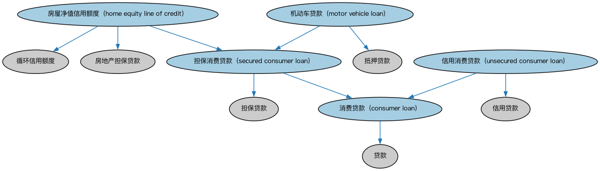

# 消费贷款本体（Consumer Loans Ontology）结构与公理说明

本文档对应 `ConsumerLoans.rdf` / `ConsumerLoans.ttl`，说明该本体的类、继承关系、属性和公理约定。结构图见 `ConsumerLoans-structure.png`（`ConsumerLoans-structure.svg` 为可缩放版本）。

## 1. 本体概述

定义面向个人消费者的贷款（consumer loan）：个人信用贷款、耐用消费品分期等。

**在体系中的位置**：LOAN 具体贷款模块的品种本体之一。

**上下游关系**：上游继承贷款本体并依赖 FND 人员本体；下游服务零售信贷建模。

**与相近概念的差别**：与商业贷款的差别——借款主体是自然人；与抵押贷款的差别——消费贷款多为无抵押信用贷款，金额小、期限短；与学生贷款的差别——用途不限于教育。

## 2. 类（Class）

| 类（Class） | 定义（Definition） |
|---|---|
| 消费贷款（consumer loan） | 向一个或多个个人发放、用于家庭或个人支出的贷款，不含抵押贷款和学生贷款。 |
| 房屋净值信用额度（home equity line of credit） | 以借款人住房或其他财产的净值作担保向房主授予的信用额度。 |
| 机动车贷款（motor vehicle loan） | 用于购买机动车的抵押单利贷款，通常分三到五年按月偿还。 |
| 担保消费贷款（secured consumer loan） | 向个人发放、借款人通过担保协议以某项资产作抵押的消费贷款。 |
| 信用消费贷款（unsecured consumer loan） | 基于借款人信用历史或声誉向个人发放的消费贷款。 |

### 2.1 继承关系（Inheritance）

- 消费贷款（consumer loan） ⊑ 贷款
- 房屋净值信用额度（home equity line of credit） ⊑ 循环信用额度
- 房屋净值信用额度（home equity line of credit） ⊑ 担保消费贷款（secured consumer loan）
- 房屋净值信用额度（home equity line of credit） ⊑ 房地产担保贷款
- 机动车贷款（motor vehicle loan） ⊑ 抵押贷款
- 机动车贷款（motor vehicle loan） ⊑ 担保消费贷款（secured consumer loan）
- 担保消费贷款（secured consumer loan） ⊑ 担保贷款
- 担保消费贷款（secured consumer loan） ⊑ 消费贷款（consumer loan）
- 信用消费贷款（unsecured consumer loan） ⊑ 信用贷款
- 信用消费贷款（unsecured consumer loan） ⊑ 消费贷款（consumer loan）

## 5. 公理约定（Axioms）

- 消费贷款（consumer loan）：具有借款人 some（restriction）
- 机动车贷款（motor vehicle loan）：以……为抵押 some 实物抵押品

## 6. 依赖（owl:imports，8 个）

本本体通过 `owl:imports` 引入以下本体，各项的中文名称与简介如下：

| 导入本体 | 中文名称 | 简介 |
|---|---|---|
| `BE/LegalEntities/LegalPersons.rdf` | 法律主体本体（Legal Persons Ontology） | 定义法律主体（legal person）与法定实体（legal entity）的核心概念：能持有权利义务、可起诉与被诉的主体。 |
| `FBC/DebtAndEquities/Debt.rdf` | 债务本体（Debt Ontology） | 定义债务（debt）与债权债务关系的核心概念：借款人、贷款人、本金与利息义务。 |
| `FND/ProductsAndServices/ProductsAndServices.rdf` | 产品与服务本体（Products and Services Ontology） | 定义产品、服务及其提供者与客户的通用关系。 |
| `FND/Utilities/AnnotationVocabulary.rdf` | FIBO 标注词汇表（FIBO Annotation Vocabulary） | 定义 FIBO 专用的标注属性（如释义来源、成熟度等级），用于本体自身的元数据标注。 |
| `LOAN/LoansGeneral/Loans.rdf` | 贷款本体（Loans Ontology） | LOAN 域核心本体，定义贷款（loan）的通用结构：借款人、贷款人、本金、利率与还款安排。 |
| `LOAN/RealEstateLoans/Mortgages.rdf` | 抵押贷款本体（Mortgages Ontology） | 定义以不动产为抵押的贷款：抵押物、抵押登记与止赎。 |
| `https://www.omg.org/spec/Commons/AnnotationVocabulary/` | OMG 通用标注词汇表（OMG Commons Annotation Vocabulary） | OMG 通用本体库（Commons）中的标注词汇表，提供概念映射等标注属性，FIBO 用它标注术语与外部标准的对应关系。 |
| `https://www.omg.org/spec/Commons/RolesAndCompositions/` | OMG 通用角色与构成本体（OMG Commons Roles and Compositions） | Commons 库中的角色本体，定义角色及整体—部分构成关系的通用概念。 |

## 7. 文件

- 官方 RDF/XML：`ConsumerLoans.rdf`
- 中文 Turtle：`ConsumerLoans.ttl`
- 结构图：`ConsumerLoans-structure.png` / `ConsumerLoans-structure.svg`