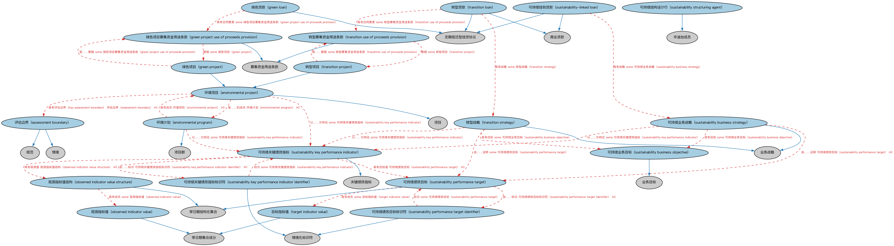

# 绿色贷款本体（Green Loans Ontology）结构与公理说明

本文档对应 `GreenLoans.rdf` / `GreenLoans.ttl`，说明该本体的类、继承关系、属性和公理约定。结构图见 `GreenLoans-structure.png`（`GreenLoans-structure.svg` 为可缩放版本）。

## 1. 本体概述

定义绿色贷款（green loan）：资金用途符合绿色融资原则（投向环保、节能、清洁能源项目）的贷款。

**在体系中的位置**：LOAN 具体贷款模块的品种本体之一，反映可持续金融实践。

**上下游关系**：上游继承贷款本体；下游服务 ESG 与绿色金融报送建模。

**与相近概念的差别**：绿色贷款的「绿色」是资金用途属性而非贷款结构属性——其还款结构可以是任何品种；与可持续发展挂钩贷款（SLL）的差别——绿色贷款看资金用途，SLL 看借款人可持续绩效目标。

## 2. 类（Class）

| 类（Class） | 定义（Definition） |
|---|---|
| 评估边界（assessment boundary） | 用于确定环境影响评估、分析或计量之纳入与排除范围的界限与标准。 |
| 环境计划（environmental program） | 旨在改善环境可持续性、减少生态损害或应对环境挑战的大规模倡议、活动或投资。 |
| 环境项目（environmental project） | 旨在改善环境可持续性、减少生态损害或应对环境挑战的具体倡议、活动或投资。 |
| 绿色贷款（green loan） | 专门用于为绿色项目融资或再融资的信贷协议和/或或有融资安排（如保函额度、担保额度或信用证）。 |
| 绿色项目（green project） | 通过应对气候变化、保护自然资源、减少污染或促进可持续发展而贡献于环境可持续性的项目。 |
| 绿色项目募集资金用途条款（green project use of proceeds provision） | 规定融资所得资金专用于绿色项目的募集资金用途条款。 |
| 观测指标值（observed indicator value） | 在特定日期时间对关键绩效指标的观测（测量）值。 |
| 观测指标值结构（observed indicator value structure） | 某关键绩效指标在指定时间窗口内观测值的集合。 |
| 可持续业务目标（sustainability business objective） | 与改善企业可持续状况相关的目标。 |
| 可持续业务战略（sustainability business strategy） | 从环境、社会和/或治理（ESG）视角实现可持续相关特定业务目标的战略。 |
| 可持续关键绩效指标（sustainability key performance indicator） | 可持续领域特定的可测绩效指标。 |
| 可持续关键绩效指标标识符（sustainability key performance indicator identifier） | 唯一标识特定可持续相关关键绩效指标的字符序列。 |
| 可持续绩效目标（sustainability performance target） | 用于校准借款人就某关键绩效指标之达成水平的一组定量目标值。 |
| 可持续绩效目标标识符（sustainability performance target identifier） | 唯一标识特定可持续相关绩效目标的字符序列。 |
| 可持续结构设计行（sustainability structuring agent） | 受委任帮助设计、实施和监测银团绿色贷款可持续方面安排的金融机构。 |
| 可持续挂钩贷款（sustainability-linked loan） | 其经济特征可随借款人可持续绩效目标达成情况而变化的信贷协议和/或或有融资安排。 |
| 目标指标值（target indicator value） | 关键绩效指标在特定日期时间的目标值。 |
| 转型贷款（transition loan） | 旨在帮助企业或组织支持其长期脱碳或可持续转型的信贷协议和/或或有融资安排。 |
| 转型项目（transition project） | 支持行业层面减少环境影响的广泛努力的项目。 |
| 转型战略（transition strategy） | 在长期脱碳或可持续转型背景下实现可持续相关特定业务目标的战略。 |
| 转型募集资金用途条款（transition use of proceeds provision） | 规定融资所得资金用于转型目的的募集资金用途条款。 |

### 2.1 继承关系（Inheritance）

- 评估边界（assessment boundary） ⊑ 情境
- 评估边界（assessment boundary） ⊑ 规范
- 环境计划（environmental program） ⊑ 项目群
- 环境项目（environmental project） ⊑ 项目
- 绿色贷款（green loan） ⊑ 定期偿还型信贷协议
- 绿色项目（green project） ⊑ 环境项目（environmental project）
- 绿色项目募集资金用途条款（green project use of proceeds provision） ⊑ 募集资金用途条款
- 观测指标值（observed indicator value） ⊑ 带日期集合成分
- 观测指标值结构（observed indicator value structure） ⊑ 带日期结构化集合
- 可持续业务目标（sustainability business objective） ⊑ 业务目标
- 可持续业务战略（sustainability business strategy） ⊑ 业务战略
- 可持续关键绩效指标（sustainability key performance indicator） ⊑ 关键绩效指标
- 可持续关键绩效指标标识符（sustainability key performance indicator identifier） ⊑ 情境化标识符
- 可持续绩效目标（sustainability performance target） ⊑ 带日期结构化集合
- 可持续绩效目标标识符（sustainability performance target identifier） ⊑ 情境化标识符
- 可持续结构设计行（sustainability structuring agent） ⊑ 辛迪加成员
- 可持续挂钩贷款（sustainability-linked loan） ⊑ 定期偿还型信贷协议
- 可持续挂钩贷款（sustainability-linked loan） ⊑ 商业贷款
- 目标指标值（target indicator value） ⊑ 带日期集合成分
- 转型贷款（transition loan） ⊑ 定期偿还型信贷协议
- 转型贷款（transition loan） ⊑ 商业贷款
- 转型项目（transition project） ⊑ 环境项目（environmental project）
- 转型战略（transition strategy） ⊑ 业务战略
- 转型募集资金用途条款（transition use of proceeds provision） ⊑ 募集资金用途条款

## 3. 对象属性（Object Property）

| 属性（Property） | 中文（English） | 定义（Definition） | 说明 |
|---|---|---|---|
| fibo-loan-spc-grn:hasAssessmentBoundary | 具有评估边界（has assessment boundary） | 标识环境或可持续项目的范围、界限与情境。 | 值域（range）：评估边界（assessment boundary）；子属性（subPropertyOf）：适用于情境 |
| fibo-loan-spc-grn:hasSpatialBoundary | 具有空间边界（has spatial boundary） | 指明环境或可持续评估所涵盖的地理区域，可为特定场所、设施、区域或全球。 | 值域（range）：地理区域；子属性（subPropertyOf）：具有区域 |

## 5. 公理约定（Axioms）

- 评估边界（assessment boundary）：适用于情境 管辖权 ≥0
- 评估边界（assessment boundary）：适用于 设施 ≥0
- 评估边界（assessment boundary）：涉及 场所 ≥0
- 评估边界（assessment boundary）：具有空间边界（has spatial boundary） some 地理区域
- 环境计划（environmental program）：具有成员 环境项目（environmental project） ≥0
- 环境计划（environmental program）：以……为特征 some 可持续关键绩效指标（sustainability key performance indicator）
- 环境项目（environmental project）：具有评估边界（has assessment boundary） 评估边界（assessment boundary） ≥0
- 环境项目（environmental project）：是……的成员 环境计划（environmental program） ≥0
- 环境项目（environmental project）：具有进度表 some 里程碑进度表
- 环境项目（environmental project）：以……为特征 some 可持续关键绩效指标（sustainability key performance indicator）
- 绿色贷款（green loan）：具有里程碑条款 合同里程碑 ≥0
- 绿色贷款（green loan）：具有进度表 里程碑进度表 ≥0
- 绿色贷款（green loan）：具有合同要素 some 披露条款
- 绿色贷款（green loan）：具有合同要素 some 绿色项目募集资金用途条款（green project use of proceeds provision）
- 绿色项目（green project）：受……管辖 some 绿色项目募集资金用途条款（green project use of proceeds provision）
- 绿色项目募集资金用途条款（green project use of proceeds provision）：管辖 some 绿色项目（green project）
- 观测指标值（observed indicator value）：具有量值 some 标量值
- 观测指标值结构（observed indicator value structure）：具有成员 some 观测指标值（observed indicator value）
- 观测指标值结构（observed indicator value structure）：具有日期区间 some 计算期间
- 可持续业务战略（sustainability business strategy）：由……证明 可持续绩效目标（sustainability performance target） ≥0
- 可持续业务战略（sustainability business strategy）：具有目标 some 可持续业务目标（sustainability business objective）
- 可持续业务战略（sustainability business strategy）：以……为特征 some 可持续关键绩效指标（sustainability key performance indicator）
- 可持续关键绩效指标（sustainability key performance indicator）：具有观测值 观测指标值结构（observed indicator value structure） ≥0
- 可持续关键绩效指标（sustainability key performance indicator）：由……标识 可持续关键绩效指标标识符（sustainability key performance indicator identifier） ≥0
- 可持续关键绩效指标（sustainability key performance indicator）：具有目标值 可持续绩效目标（sustainability performance target） ≥0
- 可持续关键绩效指标标识符（sustainability key performance indicator identifier）：标识 some 可持续关键绩效指标（sustainability key performance indicator）
- 可持续绩效目标（sustainability performance target）：由……标识 可持续绩效目标标识符（sustainability performance target identifier） ≥0
- 可持续绩效目标（sustainability performance target）：按方法论计算 some xsd:string
- 可持续绩效目标（sustainability performance target）：具有成员 some 目标指标值（target indicator value）
- 可持续绩效目标（sustainability performance target）：具有日期区间 some 计算期间
- 可持续绩效目标标识符（sustainability performance target identifier）：标识 some 可持续绩效目标（sustainability performance target）
- 可持续挂钩贷款（sustainability-linked loan）：具有里程碑条款 合同里程碑 ≥0
- 可持续挂钩贷款（sustainability-linked loan）：具有进度表 里程碑进度表 ≥0
- 可持续挂钩贷款（sustainability-linked loan）：具有合同要素 some 披露条款
- 可持续挂钩贷款（sustainability-linked loan）：具有战略 some 可持续业务战略（sustainability business strategy）
- 目标指标值（target indicator value）：具有量值 some 标量值
- 转型贷款（transition loan）：具有里程碑条款 合同里程碑 ≥0
- 转型贷款（transition loan）：具有进度表 里程碑进度表 ≥0
- 转型贷款（transition loan）：具有合同要素 some 披露条款
- 转型贷款（transition loan）：具有合同要素 some 转型募集资金用途条款（transition use of proceeds provision）
- 转型贷款（transition loan）：具有战略 some 转型战略（transition strategy）
- 转型项目（transition project）：受……管辖 some 转型募集资金用途条款（transition use of proceeds provision）
- 转型战略（transition strategy）：由……证明 some 可持续绩效目标（sustainability performance target）
- 转型战略（transition strategy）：具有目标 some 可持续业务目标（sustainability business objective）
- 转型战略（transition strategy）：以……为特征 some 可持续关键绩效指标（sustainability key performance indicator）
- 转型募集资金用途条款（transition use of proceeds provision）：管辖 some 转型项目（transition project）

## 6. 依赖（owl:imports，25 个）

本本体通过 `owl:imports` 引入以下本体，各项的中文名称与简介如下：

| 导入本体 | 中文名称 | 简介 |
|---|---|---|
| `BE/FunctionalEntities/FunctionalEntities.rdf` | 功能实体本体（Functional Entities Ontology） | 定义「功能实体」：按其在商业中承担的功能（而非法律形式）刻画的实体，是出版方、登记机构等功能性主体的基础。 |
| `FBC/DebtAndEquities/Debt.rdf` | 债务本体（Debt Ontology） | 定义债务（debt）与债权债务关系的核心概念：借款人、贷款人、本金与利息义务。 |
| `FND/Agreements/Contracts.rdf` | 合同本体（Contracts Ontology） | 在协议之上定义具有法律约束力的合同（contract）：合同当事方、合同条款、义务与权利，是金融工具与交易合同建模的基石。 |
| `FND/DatesAndTimes/FinancialDates.rdf` | 金融日期本体（Financial Dates Ontology） | 定义金融语境下的日期与期间概念：结算日、付息日、到期日、日计数基准等。 |
| `FND/GoalsAndObjectives/Objectives.rdf` | 目标本体（Objectives Ontology） | 定义目标（objective）及其与组织、计划的关系，用于表达机构的经营目标与投资目标。 |
| `FND/ProductsAndServices/ProductsAndServices.rdf` | 产品与服务本体（Products and Services Ontology） | 定义产品、服务及其提供者与客户的通用关系。 |
| `FND/Relations/Relations.rdf` | 关系本体（Relations Ontology） | FIBO 最底层的基础本体，定义参考（reference）、分类（classify）等通用关系与抽象概念，全库普遍依赖。 |
| `FND/Utilities/Analytics.rdf` | 分析本体（Analytics Ontology） | 定义分析工具、度量与比率的通用概念，支撑指标与模型的表达。 |
| `FND/Utilities/AnnotationVocabulary.rdf` | FIBO 标注词汇表（FIBO Annotation Vocabulary） | 定义 FIBO 专用的标注属性（如释义来源、成熟度等级），用于本体自身的元数据标注。 |
| `LOAN/LoansGeneral/Loans.rdf` | 贷款本体（Loans Ontology） | LOAN 域核心本体，定义贷款（loan）的通用结构：借款人、贷款人、本金、利率与还款安排。 |
| `LOAN/LoansSpecific/CommercialLoans.rdf` | 商业贷款本体（Commercial Loans Ontology） | 定义面向企业的商业贷款。 |
| `https://www.omg.org/spec/Commons/AnnotationVocabulary/` | OMG 通用标注词汇表（OMG Commons Annotation Vocabulary） | OMG 通用本体库（Commons）中的标注词汇表，提供概念映射等标注属性，FIBO 用它标注术语与外部标准的对应关系。 |
| `https://www.omg.org/spec/Commons/Classifiers/` | OMG 通用分类器本体（OMG Commons Classifiers） | OMG 通用本体库（Commons）中的分类器本体，定义分类方案、类别与归类关系的通用概念，FIBO 的分类建模建立在其上。 |
| `https://www.omg.org/spec/Commons/Collections/` | OMG 通用集合本体（OMG Commons Collections） | Commons 库中的集合本体，定义集合、成员等通用概念。 |
| `https://www.omg.org/spec/Commons/ContextualDesignators/` | OMG 通用语境指称本体（OMG Commons Contextual Designators） | Commons 库中的语境指称本体，定义「在某个语境下指代某物的名称/符号」，是地址、账户号码等语境相关标识的基础。 |
| `https://www.omg.org/spec/Commons/ContextualIdentifiers/` | OMG 通用语境标识符本体（OMG Commons Contextual Identifiers） | Commons 库中的语境标识符本体，定义在特定语境下唯一标识事物的标识符结构，是地址、账户类标识的基础。 |
| `https://www.omg.org/spec/Commons/DatesAndTimes/` | OMG 通用日期与时间本体（OMG Commons Dates and Times） | Commons 库中的日期时间本体，定义日期、期间、时间点等通用时间概念。 |
| `https://www.omg.org/spec/Commons/Designators/` | OMG 通用指称符本体（OMG Commons Designators） | Commons 库中的指称符本体，定义名称、标识符等「指代某物的符号」的通用概念。 |
| `https://www.omg.org/spec/Commons/Documents/` | OMG 通用文档本体（OMG Commons Documents） | Commons 库中的文档本体，定义文档及其组成部分的通用概念。 |
| `https://www.omg.org/spec/Commons/Identifiers/` | OMG 通用标识符本体（OMG Commons Identifiers） | Commons 库中的标识符本体，定义标识符及其编码方案的通用概念。 |
| `https://www.omg.org/spec/Commons/Locations/` | OMG 通用位置本体（OMG Commons Locations） | Commons 库中的位置本体，定义地理位置、地点的通用概念。 |
| `https://www.omg.org/spec/Commons/QuantitiesAndUnits/` | OMG 通用量与单位本体（OMG Commons Quantities and Units） | Commons 库中的量与单位本体，定义数量、度量单位、量纲的通用概念，支撑金额、比率等数值表达。 |
| `https://www.omg.org/spec/Commons/RegulatoryAgencies/` | OMG 通用监管机构本体（OMG Commons Regulatory Agencies） | Commons 库中的监管机构本体，定义监管机构及其监管职权的通用概念。 |
| `https://www.omg.org/spec/Commons/RolesAndCompositions/` | OMG 通用角色与构成本体（OMG Commons Roles and Compositions） | Commons 库中的角色本体，定义角色及整体—部分构成关系的通用概念。 |
| `https://www.omg.org/spec/Commons/SitesAndFacilities/` | OMG 通用场所与设施本体（OMG Commons Sites and Facilities） | Commons 库中的场所与设施本体，定义物理场所、设施及其位置的通用概念。 |

## 7. 文件

- 官方 RDF/XML：`GreenLoans.rdf`
- 中文 Turtle：`GreenLoans.ttl`
- 结构图：`GreenLoans-structure.png` / `GreenLoans-structure.svg`