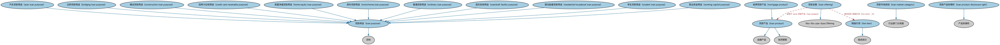

# 贷款产品本体（Loan Products Ontology）结构与公理说明

本文档对应 `LoanProducts.rdf` / `LoanProducts.ttl`，说明该本体的类、继承关系、属性和公理约定。结构图见 `LoanProducts-structure.png`（`LoanProducts-structure.svg` 为可缩放版本）。

## 1. 本体概述

定义贷款产品（loan product）：金融机构设计的贷款条款模板（利率类型、期限、还款方式），客户按产品申请贷款。

**在体系中的位置**：LOAN 具体贷款模块中连接「机构供给」与「具体贷款」的本体。

**上下游关系**：上游依赖贷款与 FBC 金融产品与服务本体；下游被各品种贷款引用。

**与相近概念的差别**：产品≠贷款——产品是标准化的条款模板，贷款是按模板签订的个案合同；一款产品对应成千上万笔贷款。

本本体中类与类的核心关系如下（完整细节见各类小节）：

- **汽车贷款用途（auto loan purpose）** 继承 **贷款用途（loan purpose）**
- **过桥贷款用途（bridging loan purpose）** 继承 **贷款用途（loan purpose）**
- **建设贷款用途（construction loan purpose）** 继承 **贷款用途（loan purpose）**
- **信用卡应收用途（credit card receivable purpose）** 继承 **贷款用途（loan purpose）**
- **房屋净值贷款用途（home equity loan purpose）** 继承 **贷款用途（loan purpose）**
- **明细行项（line item）** 继承 **组成成分（Constituent）**
- **贷款市场类别（loan market category）** 继承 **行业部门分类器（IndustrySectorClassifier）**
- **贷款发售（loan offering）** 继承 **fibo-fbc-pas-fpas:Offering（Offering）**
- **贷款产品（loan product）** 继承 **信贷额度（CreditFacility）**
- **贷款产品（loan product）** 继承 **金融产品（FinancialProduct）**
- **贷款产品知情权（loan product disclosure right）** 继承 **产品知情权（ProductDisclosureRight）**
- **贷款用途（loan purpose）** 继承 **目标（Objective）**
- 其余 7 条关系从略。

## 2. 类（Class）

| 类（Class） | 定义（Definition） |
|---|---|
| 汽车贷款用途（auto loan purpose） | 用于购买汽车的贷款用途。 |
| 过桥贷款用途（bridging loan purpose） | 用于短期过渡性融资的贷款用途。 |
| 建设贷款用途（construction loan purpose） | 用于建设项目的贷款用途。 |
| 信用卡应收用途（credit card receivable purpose） | 与信用卡应收款相关的用途。 |
| 房屋净值贷款用途（home equity loan purpose） | 以房屋净值为基础的贷款用途。 |
| 明细行项（line item） | 对产品或服务的描述，包括单价、数量与总价。 |
| 贷款市场类别（loan market category） | 表明贷款产品所面向市场领域的类别。 |
| 贷款发售（loan offering） | 与贷款产品相关的发售，可针对特定情形、某组借款人或单个借款人定制。 |
| 贷款产品（loan product） | 以贷款形式实现、参与方可从贷款机构获得的具有特定特征与条款的金融产品。 |
| 贷款产品知情权（loan product disclosure right） | 在订立贷款产品协议之前获得其产品事实之公允陈述的权利。 |
| 贷款用途（loan purpose） | 贷款（信贷）提取金额的用途与使用方式，有多种类型可选。 |
| 抵押贷款产品（mortgage product） | 以不动产抵押为基础的贷款产品。 |
| 房车贷款用途（motorhome loan purpose） | 用于购买房车的贷款用途。 |
| 普通贷款用途（ordinary loan purpose） | 一般用途的贷款。 |
| 透支安排用途（overdraft facility purpose） | 用于透支安排的用途。 |
| 居住船屋贷款用途（residential houseboat loan purpose） | 用于购买居住用船屋的贷款用途。 |
| 学生贷款用途（student loan purpose） | 用于教育支出的贷款用途。 |
| 营运资金用途（working capital purpose） | 用于补充营运资金的贷款用途。 |

以下按类逐个展开：每个类给出继承关系、相关属性与公理约定；子类在父类之下降一级编号。

### 2.1 明细行项（line item）

定义：对产品或服务的描述，包括单价、数量与总价。

- 父类：**组成成分（Constituent）**

属性：

| 属性 | 定义 | 说明 |
|---|---|---|
| **具有成本（hasCost）** | — | — |
| **具有单价（has unit cost）** | 将某行项关联到其单位成本。 | 子属性：具有成本 |
| **引用（refersTo）** | — | — |
| **具有数值（hasNumericValue）** | — | — |

公理：

- **具有单价（has unit cost）**可以有 0 个或多个**货币数量（MonetaryAmount）**。
- **具有成本（hasCost）**至少有一个取值，类型是**货币数量（MonetaryAmount）**。
- **具有数值（hasNumericValue）**存在取值约束。
- **引用（refersTo）**至少有一个取值，该取值满足：该属性存在取值约束。

### 2.2 贷款市场类别（loan market category）

定义：表明贷款产品所面向市场领域的类别。

- 父类：**行业部门分类器（IndustrySectorClassifier）**

### 2.3 贷款发售（loan offering）

定义：与贷款产品相关的发售，可针对特定情形、某组借款人或单个借款人定制。

- 父类：**fibo-fbc-pas-fpas:Offering（Offering）**

属性：

| 属性 | 定义 | 说明 |
|---|---|---|
| **具有成员（hasMember）** | — | — |
| **适用于（appliesTo）** | — | — |

公理：

- **具有成员（hasMember）**可以有 0 个或多个**明细行项（line item）**。
- **适用于（appliesTo）**至少有一个取值，类型是**贷款产品（loan product）**。

### 2.4 贷款产品（loan product）

定义：以贷款形式实现、参与方可从贷款机构获得的具有特定特征与条款的金融产品。

- 父类：**信贷额度（CreditFacility）**、**金融产品（FinancialProduct）**
- 直接子类：**抵押贷款产品（mortgage product）**

属性：

| 属性 | 定义 | 说明 |
|---|---|---|
| **由……例证（isExemplifiedBy）** | — | — |
| **具有前提条件（has preconditions）** | 标识某产品或发售的前提条件。 | 值域：先决条件 |
| **引用（refersTo）** | — | — |

公理：

- **具有前提条件（has preconditions）**可以有 0 个或多个**先决条件（ConditionPrecedent）**。
- **引用（refersTo）**可以有 0 个或多个**抵押品（Collateral）**。
- **由……例证（isExemplifiedBy）**可以有 0 个或多个**贷款（Loan）**。

#### 2.4.1 抵押贷款产品（mortgage product）

定义：以不动产抵押为基础的贷款产品。

- 父类：**贷款产品（loan product）**

属性：

| 属性 | 定义 | 说明 |
|---|---|---|
| **由……例证（isExemplifiedBy）** | — | — |

公理：

- **由……例证（isExemplifiedBy）**可以有 0 个或多个**房地产担保贷款（LoanSecuredByRealEstate）**。

### 2.5 贷款产品知情权（loan product disclosure right）

定义：在订立贷款产品协议之前获得其产品事实之公允陈述的权利。

- 父类：**产品知情权（ProductDisclosureRight）**

### 2.6 贷款用途（loan purpose）

定义：贷款（信贷）提取金额的用途与使用方式，有多种类型可选。

- 父类：**目标（Objective）**
- 直接子类：**汽车贷款用途（auto loan purpose）**、**过桥贷款用途（bridging loan purpose）**、**建设贷款用途（construction loan purpose）**、**信用卡应收用途（credit card receivable purpose）**、**房屋净值贷款用途（home equity loan purpose）**、**房车贷款用途（motorhome loan purpose）**、**普通贷款用途（ordinary loan purpose）**、**透支安排用途（overdraft facility purpose）**、**居住船屋贷款用途（residential houseboat loan purpose）**、**学生贷款用途（student loan purpose）**、**营运资金用途（working capital purpose）**

#### 2.6.1 汽车贷款用途（auto loan purpose）

定义：用于购买汽车的贷款用途。

- 父类：**贷款用途（loan purpose）**

#### 2.6.2 过桥贷款用途（bridging loan purpose）

定义：用于短期过渡性融资的贷款用途。

- 父类：**贷款用途（loan purpose）**

#### 2.6.3 建设贷款用途（construction loan purpose）

定义：用于建设项目的贷款用途。

- 父类：**贷款用途（loan purpose）**

#### 2.6.4 信用卡应收用途（credit card receivable purpose）

定义：与信用卡应收款相关的用途。

- 父类：**贷款用途（loan purpose）**

#### 2.6.5 房屋净值贷款用途（home equity loan purpose）

定义：以房屋净值为基础的贷款用途。

- 父类：**贷款用途（loan purpose）**

#### 2.6.6 房车贷款用途（motorhome loan purpose）

定义：用于购买房车的贷款用途。

- 父类：**贷款用途（loan purpose）**

#### 2.6.7 普通贷款用途（ordinary loan purpose）

定义：一般用途的贷款。

- 父类：**贷款用途（loan purpose）**

#### 2.6.8 透支安排用途（overdraft facility purpose）

定义：用于透支安排的用途。

- 父类：**贷款用途（loan purpose）**

#### 2.6.9 居住船屋贷款用途（residential houseboat loan purpose）

定义：用于购买居住用船屋的贷款用途。

- 父类：**贷款用途（loan purpose）**

#### 2.6.10 学生贷款用途（student loan purpose）

定义：用于教育支出的贷款用途。

- 父类：**贷款用途（loan purpose）**

#### 2.6.11 营运资金用途（working capital purpose）

定义：用于补充营运资金的贷款用途。

- 父类：**贷款用途（loan purpose）**

## 3. 依赖（owl:imports，19 个）

本本体通过 `owl:imports` 引入以下本体，各项的中文名称与简介如下：

| 导入本体 | 中文名称 | 简介 |
|---|---|---|
| `FBC/DebtAndEquities/Debt.rdf` | 债务本体（Debt Ontology） | 定义债务（debt）与债权债务关系的核心概念：借款人、贷款人、本金与利息义务。 |
| `FBC/ProductsAndServices/FinancialProductsAndServices.rdf` | 金融产品与服务本体（Financial Products and Services Ontology） | 定义金融产品（financial product）与金融服务（financial service）及其提供、购买关系。 |
| `FND/Accounting/CurrencyAmount.rdf` | 货币金额本体（Currency Amount Ontology） | 定义「金额＋币种」的货币金额（currency amount）表示，是 FIBO 中表达价格、债务金额、付款额等一切带币种数值的基础构件。 |
| `FND/Agreements/Contracts.rdf` | 合同本体（Contracts Ontology） | 在协议之上定义具有法律约束力的合同（contract）：合同当事方、合同条款、义务与权利，是金融工具与交易合同建模的基石。 |
| `FND/Arrangements/ClassificationSchemes.rdf` | 分类方案本体（Classification Schemes Ontology） | 定义分类方案（classification scheme）、类别及「将事物归入类别」的关系，支撑证券分类、行业分类等具体分类体系。 |
| `FND/GoalsAndObjectives/Objectives.rdf` | 目标本体（Objectives Ontology） | 定义目标（objective）及其与组织、计划的关系，用于表达机构的经营目标与投资目标。 |
| `FND/ProductsAndServices/ProductsAndServices.rdf` | 产品与服务本体（Products and Services Ontology） | 定义产品、服务及其提供者与客户的通用关系。 |
| `FND/Relations/Relations.rdf` | 关系本体（Relations Ontology） | FIBO 最底层的基础本体，定义参考（reference）、分类（classify）等通用关系与抽象概念，全库普遍依赖。 |
| `FND/Utilities/AnnotationVocabulary.rdf` | FIBO 标注词汇表（FIBO Annotation Vocabulary） | 定义 FIBO 专用的标注属性（如释义来源、成熟度等级），用于本体自身的元数据标注。 |
| `LOAN/LoansGeneral/Loans.rdf` | 贷款本体（Loans Ontology） | LOAN 域核心本体，定义贷款（loan）的通用结构：借款人、贷款人、本金、利率与还款安排。 |
| `LOAN/LoansGeneral/LoansRegulatory.rdf` | 贷款监管本体（Loans Regulatory Ontology） | 定义贷款监管相关概念：监管分类与报告要求。 |
| `LOAN/RealEstateLoans/MortgageOrigination.rdf` | 抵押贷款发放本体（Mortgage Origination Ontology） | 定义抵押贷款的发起与发放流程。 |
| `LOAN/RealEstateLoans/Mortgages.rdf` | 抵押贷款本体（Mortgages Ontology） | 定义以不动产为抵押的贷款：抵押物、抵押登记与止赎。 |
| `https://www.omg.org/spec/Commons/AnnotationVocabulary/` | OMG 通用标注词汇表（OMG Commons Annotation Vocabulary） | OMG 通用本体库（Commons）中的标注词汇表，提供概念映射等标注属性，FIBO 用它标注术语与外部标准的对应关系。 |
| `https://www.omg.org/spec/Commons/Classifiers/` | OMG 通用分类器本体（OMG Commons Classifiers） | OMG 通用本体库（Commons）中的分类器本体，定义分类方案、类别与归类关系的通用概念，FIBO 的分类建模建立在其上。 |
| `https://www.omg.org/spec/Commons/Collections/` | OMG 通用集合本体（OMG Commons Collections） | Commons 库中的集合本体，定义集合、成员等通用概念。 |
| `https://www.omg.org/spec/Commons/ContextualDesignators/` | OMG 通用语境指称本体（OMG Commons Contextual Designators） | Commons 库中的语境指称本体，定义「在某个语境下指代某物的名称/符号」，是地址、账户号码等语境相关标识的基础。 |
| `https://www.omg.org/spec/Commons/Documents/` | OMG 通用文档本体（OMG Commons Documents） | Commons 库中的文档本体，定义文档及其组成部分的通用概念。 |
| `https://www.omg.org/spec/Commons/QuantitiesAndUnits/` | OMG 通用量与单位本体（OMG Commons Quantities and Units） | Commons 库中的量与单位本体，定义数量、度量单位、量纲的通用概念，支撑金额、比率等数值表达。 |

## 4. 文件

- 官方 RDF/XML：`LoanProducts.rdf`
- 中文 Turtle：`LoanProducts.ttl`
- 结构图：`LoanProducts-structure.png` / `LoanProducts-structure.svg`