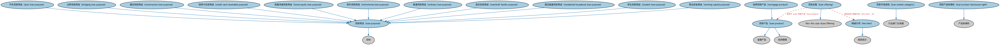

# 贷款产品本体（Loan Products Ontology）结构与公理说明

本文档对应 `LoanProducts.rdf` / `LoanProducts.ttl`，说明该本体的类、继承关系、属性和公理约定。结构图见 `LoanProducts-structure.png`（`LoanProducts-structure.svg` 为可缩放版本）。

## 1. 本体概述

定义贷款产品（loan product）：金融机构设计的贷款条款模板（利率类型、期限、还款方式），客户按产品申请贷款。

**在体系中的位置**：LOAN 具体贷款模块中连接「机构供给」与「具体贷款」的本体。

**上下游关系**：上游依赖贷款与 FBC 金融产品与服务本体；下游被各品种贷款引用。

**与相近概念的差别**：产品≠贷款——产品是标准化的条款模板，贷款是按模板签订的个案合同；一款产品对应成千上万笔贷款。

## 2. 类（Class）

| 类（Class） | 定义（Definition） |
|---|---|
| 汽车贷款用途（auto loan purpose） | 用于购买汽车的贷款用途。 |
| 过桥贷款用途（bridging loan purpose） | 用于短期过渡性融资的贷款用途。 |
| 建设贷款用途（construction loan purpose） | 用于建设项目的贷款用途。 |
| 信用卡应收用途（credit card receivable purpose） | 与信用卡应收款相关的用途。 |
| 房屋净值贷款用途（home equity loan purpose） | 以房屋净值为基础的贷款用途。 |
| 明细行项（line item） | 对产品或服务的描述，包括单价、数量与总价。 |
| 贷款市场类别（loan market category） | 表明贷款产品所面向市场领域的类别。 |
| 贷款发售（loan offering） | 与贷款产品相关的发售，可针对特定情形、某组借款人或单个借款人定制。 |
| 贷款产品（loan product） | 以贷款形式实现、参与方可从贷款机构获得的具有特定特征与条款的金融产品。 |
| 贷款产品知情权（loan product disclosure right） | 在订立贷款产品协议之前获得其产品事实之公允陈述的权利。 |
| 贷款用途（loan purpose） | 贷款（信贷）提取金额的用途与使用方式，有多种类型可选。 |
| 抵押贷款产品（mortgage product） | 以不动产抵押为基础的贷款产品。 |
| 房车贷款用途（motorhome loan purpose） | 用于购买房车的贷款用途。 |
| 普通贷款用途（ordinary loan purpose） | 一般用途的贷款。 |
| 透支安排用途（overdraft facility purpose） | 用于透支安排的用途。 |
| 居住船屋贷款用途（residential houseboat loan purpose） | 用于购买居住用船屋的贷款用途。 |
| 学生贷款用途（student loan purpose） | 用于教育支出的贷款用途。 |
| 营运资金用途（working capital purpose） | 用于补充营运资金的贷款用途。 |

### 2.1 继承关系（Inheritance）

- 汽车贷款用途（auto loan purpose） ⊑ 贷款用途（loan purpose）
- 过桥贷款用途（bridging loan purpose） ⊑ 贷款用途（loan purpose）
- 建设贷款用途（construction loan purpose） ⊑ 贷款用途（loan purpose）
- 信用卡应收用途（credit card receivable purpose） ⊑ 贷款用途（loan purpose）
- 房屋净值贷款用途（home equity loan purpose） ⊑ 贷款用途（loan purpose）
- 明细行项（line item） ⊑ 组成成分
- 贷款市场类别（loan market category） ⊑ 行业部门分类器
- 贷款发售（loan offering） ⊑ fibo-fbc-pas-fpas:Offering
- 贷款产品（loan product） ⊑ 信贷额度
- 贷款产品（loan product） ⊑ 金融产品
- 贷款产品知情权（loan product disclosure right） ⊑ 产品知情权
- 贷款用途（loan purpose） ⊑ 目标
- 抵押贷款产品（mortgage product） ⊑ 贷款产品（loan product）
- 房车贷款用途（motorhome loan purpose） ⊑ 贷款用途（loan purpose）
- 普通贷款用途（ordinary loan purpose） ⊑ 贷款用途（loan purpose）
- 透支安排用途（overdraft facility purpose） ⊑ 贷款用途（loan purpose）
- 居住船屋贷款用途（residential houseboat loan purpose） ⊑ 贷款用途（loan purpose）
- 学生贷款用途（student loan purpose） ⊑ 贷款用途（loan purpose）
- 营运资金用途（working capital purpose） ⊑ 贷款用途（loan purpose）

## 3. 对象属性（Object Property）

| 属性（Property） | 中文（English） | 定义（Definition） | 说明 |
|---|---|---|---|
| fibo-loan-spc-prod:hasPreconditions | 具有前提条件（has preconditions） | 标识某产品或发售的前提条件。 | 定义域（domain）：贷款产品（loan product）；值域（range）：先决条件 |
| fibo-loan-spc-prod:hasUnitCost | 具有单价（has unit cost） | 将某行项关联到其单位成本。 | 子属性（subPropertyOf）：具有成本 |

## 5. 公理约定（Axioms）

- 明细行项（line item）：具有单价（has unit cost） 货币数量 ≥0
- 明细行项（line item）：restriction
- 明细行项（line item）：具有成本 some 货币数量
- 明细行项（line item）：引用 some（restriction）
- 贷款发售（loan offering）：具有成员 明细行项（line item） ≥0
- 贷款发售（loan offering）：适用于 some 贷款产品（loan product）
- 贷款产品（loan product）：引用 抵押品 ≥0
- 贷款产品（loan product）：具有前提条件（has preconditions） 先决条件 ≥0
- 贷款产品（loan product）：由……例证 贷款 ≥0
- 抵押贷款产品（mortgage product）：由……例证 房地产担保贷款 ≥0

## 6. 依赖（owl:imports，19 个）

本本体通过 `owl:imports` 引入以下本体，各项的中文名称与简介如下：

| 导入本体 | 中文名称 | 简介 |
|---|---|---|
| `FBC/DebtAndEquities/Debt.rdf` | 债务本体（Debt Ontology） | 定义债务（debt）与债权债务关系的核心概念：借款人、贷款人、本金与利息义务。 |
| `FBC/ProductsAndServices/FinancialProductsAndServices.rdf` | 金融产品与服务本体（Financial Products and Services Ontology） | 定义金融产品（financial product）与金融服务（financial service）及其提供、购买关系。 |
| `FND/Accounting/CurrencyAmount.rdf` | 货币金额本体（Currency Amount Ontology） | 定义「金额＋币种」的货币金额（currency amount）表示，是 FIBO 中表达价格、债务金额、付款额等一切带币种数值的基础构件。 |
| `FND/Agreements/Contracts.rdf` | 合同本体（Contracts Ontology） | 在协议之上定义具有法律约束力的合同（contract）：合同当事方、合同条款、义务与权利，是金融工具与交易合同建模的基石。 |
| `FND/Arrangements/ClassificationSchemes.rdf` | 分类方案本体（Classification Schemes Ontology） | 定义分类方案（classification scheme）、类别及「将事物归入类别」的关系，支撑证券分类、行业分类等具体分类体系。 |
| `FND/GoalsAndObjectives/Objectives.rdf` | 目标本体（Objectives Ontology） | 定义目标（objective）及其与组织、计划的关系，用于表达机构的经营目标与投资目标。 |
| `FND/ProductsAndServices/ProductsAndServices.rdf` | 产品与服务本体（Products and Services Ontology） | 定义产品、服务及其提供者与客户的通用关系。 |
| `FND/Relations/Relations.rdf` | 关系本体（Relations Ontology） | FIBO 最底层的基础本体，定义参考（reference）、分类（classify）等通用关系与抽象概念，全库普遍依赖。 |
| `FND/Utilities/AnnotationVocabulary.rdf` | FIBO 标注词汇表（FIBO Annotation Vocabulary） | 定义 FIBO 专用的标注属性（如释义来源、成熟度等级），用于本体自身的元数据标注。 |
| `LOAN/LoansGeneral/Loans.rdf` | 贷款本体（Loans Ontology） | LOAN 域核心本体，定义贷款（loan）的通用结构：借款人、贷款人、本金、利率与还款安排。 |
| `LOAN/LoansGeneral/LoansRegulatory.rdf` | 贷款监管本体（Loans Regulatory Ontology） | 定义贷款监管相关概念：监管分类与报告要求。 |
| `LOAN/RealEstateLoans/MortgageOrigination.rdf` | 抵押贷款发放本体（Mortgage Origination Ontology） | 定义抵押贷款的发起与发放流程。 |
| `LOAN/RealEstateLoans/Mortgages.rdf` | 抵押贷款本体（Mortgages Ontology） | 定义以不动产为抵押的贷款：抵押物、抵押登记与止赎。 |
| `https://www.omg.org/spec/Commons/AnnotationVocabulary/` | OMG 通用标注词汇表（OMG Commons Annotation Vocabulary） | OMG 通用本体库（Commons）中的标注词汇表，提供概念映射等标注属性，FIBO 用它标注术语与外部标准的对应关系。 |
| `https://www.omg.org/spec/Commons/Classifiers/` | OMG 通用分类器本体（OMG Commons Classifiers） | OMG 通用本体库（Commons）中的分类器本体，定义分类方案、类别与归类关系的通用概念，FIBO 的分类建模建立在其上。 |
| `https://www.omg.org/spec/Commons/Collections/` | OMG 通用集合本体（OMG Commons Collections） | Commons 库中的集合本体，定义集合、成员等通用概念。 |
| `https://www.omg.org/spec/Commons/ContextualDesignators/` | OMG 通用语境指称本体（OMG Commons Contextual Designators） | Commons 库中的语境指称本体，定义「在某个语境下指代某物的名称/符号」，是地址、账户号码等语境相关标识的基础。 |
| `https://www.omg.org/spec/Commons/Documents/` | OMG 通用文档本体（OMG Commons Documents） | Commons 库中的文档本体，定义文档及其组成部分的通用概念。 |
| `https://www.omg.org/spec/Commons/QuantitiesAndUnits/` | OMG 通用量与单位本体（OMG Commons Quantities and Units） | Commons 库中的量与单位本体，定义数量、度量单位、量纲的通用概念，支撑金额、比率等数值表达。 |

## 7. 文件

- 官方 RDF/XML：`LoanProducts.rdf`
- 中文 Turtle：`LoanProducts.ttl`
- 结构图：`LoanProducts-structure.png` / `LoanProducts-structure.svg`