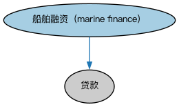

# 船舶融资本体（Marine Finance Ontology）结构与公理说明

本文档对应 `MarineFinance.rdf` / `MarineFinance.ttl`，说明该本体的类、继承关系、属性和公理约定。结构图见 `MarineFinance-structure.png`（`MarineFinance-structure.svg` 为可缩放版本）。

## 1. 本体概述

定义船舶融资（marine finance）：以船舶等海运资产为对象或抵押的贷款结构。

**在体系中的位置**：LOAN 具体贷款模块的品种本体之一，属于资产融资。

**上下游关系**：上游继承贷款本体并引入船舶资产概念；下游服务航运金融建模。

**与相近概念的差别**：与抵押贷款的差别——抵押物是可移动的船舶而非不动产，涉及船舶登记、海事留置权等特殊制度；与普通商业贷款的差别——有特定资产支持。

## 2. 类（Class）

| 类（Class） | 定义（Definition） |
|---|---|
| 船舶融资（marine finance） | 用于购买船只或其他船舶的贷款。 |

### 2.1 继承关系（Inheritance）

- 船舶融资（marine finance） ⊑ 贷款

## 3. 对象属性（Object Property）

| 属性（Property） | 中文（English） | 定义（Definition） | 说明 |
|---|---|---|---|
| fibo-loan-spc-mar:percentageAdvanced | 垫付百分比（percentage advanced） | 贷款垫付金额占购买价格的百分比。 | 定义域（domain）：船舶融资（marine finance）；值域（range）：百分比 |

## 4. 数据属性（Datatype Property）

| 属性（Property） | 中文（English） | 定义（Definition） |
|---|---|---|
| fibo-loan-spc-mar:boatHeldAsChattel | 船只作为动产持有（boat held as chattel） | 贷款期间该船舶是否作为动产由贷款人持有。 |
| fibo-loan-spc-mar:mooredAt | 停泊于（moored at） | 船舶固定停泊地点的文本描述（名称等）。 |
| fibo-loan-spc-mar:residential | 居住用途（residential） | 该船只是否拟用作、且在法律上可用作居住场所。 |

## 6. 依赖（owl:imports，4 个）

本本体通过 `owl:imports` 引入以下本体，各项的中文名称与简介如下：

| 导入本体 | 中文名称 | 简介 |
|---|---|---|
| `FND/Utilities/AnnotationVocabulary.rdf` | FIBO 标注词汇表（FIBO Annotation Vocabulary） | 定义 FIBO 专用的标注属性（如释义来源、成熟度等级），用于本体自身的元数据标注。 |
| `LOAN/LoansGeneral/Loans.rdf` | 贷款本体（Loans Ontology） | LOAN 域核心本体，定义贷款（loan）的通用结构：借款人、贷款人、本金、利率与还款安排。 |
| `https://www.omg.org/spec/Commons/AnnotationVocabulary/` | OMG 通用标注词汇表（OMG Commons Annotation Vocabulary） | OMG 通用本体库（Commons）中的标注词汇表，提供概念映射等标注属性，FIBO 用它标注术语与外部标准的对应关系。 |
| `https://www.omg.org/spec/Commons/QuantitiesAndUnits/` | OMG 通用量与单位本体（OMG Commons Quantities and Units） | Commons 库中的量与单位本体，定义数量、度量单位、量纲的通用概念，支撑金额、比率等数值表达。 |

## 7. 文件

- 官方 RDF/XML：`MarineFinance.rdf`
- 中文 Turtle：`MarineFinance.ttl`
- 结构图：`MarineFinance-structure.png` / `MarineFinance-structure.svg`