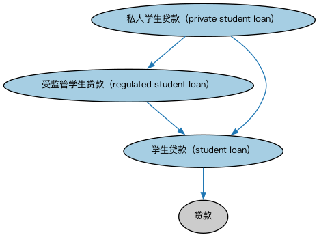

# 学生贷款本体（Student Loans Ontology）结构与公理说明

本文档对应 `StudentLoans.rdf` / `StudentLoans.ttl`，说明该本体的类、继承关系、属性和公理约定。结构图见 `StudentLoans-structure.png`（`StudentLoans-structure.svg` 为可缩放版本）。

## 1. 本体概述

定义学生贷款（student loan）：用于支付教育费用、通常享有宽限期（在校期间不需还款）的贷款。

**在体系中的位置**：LOAN 具体贷款模块的品种本体之一。

**上下游关系**：上游继承消费贷款与贷款本体；下游服务教育金融建模。

**与相近概念的差别**：与普通消费贷款的差别——有入学宽限期、还款常与毕业挂钩，且在美国多有政府担保背景；与绿色贷款一样，「学生」是用途与政策属性而非结构属性。

## 2. 类（Class）

| 类（Class） | 定义（Definition） |
|---|---|
| 私人学生贷款（private student loan） | 不属于政府支持/监管贷款的学生贷款。 |
| 受监管学生贷款（regulated student loan） | 贷款人为政府机构或部属单位、和/或因税务规定而获特殊对待的学生贷款。 |
| 学生贷款（student loan） | 为教育目的提供的贷款，允许学生及其父母/监护人为上大学借款。 |

### 2.1 继承关系（Inheritance）

- 私人学生贷款（private student loan） ⊑ 受监管学生贷款（regulated student loan）
- 私人学生贷款（private student loan） ⊑ 学生贷款（student loan）
- 受监管学生贷款（regulated student loan） ⊑ 学生贷款（student loan）
- 学生贷款（student loan） ⊑ 贷款

## 5. 公理约定（Axioms）

- 学生贷款（student loan）：具有借款人 some（由…扮演（is played by） some 具有法律行为能力的自然人）

## 6. 依赖（owl:imports，6 个）

本本体通过 `owl:imports` 引入以下本体，各项的中文名称与简介如下：

| 导入本体 | 中文名称 | 简介 |
|---|---|---|
| `BE/LegalEntities/LegalPersons.rdf` | 法律主体本体（Legal Persons Ontology） | 定义法律主体（legal person）与法定实体（legal entity）的核心概念：能持有权利义务、可起诉与被诉的主体。 |
| `FBC/DebtAndEquities/Debt.rdf` | 债务本体（Debt Ontology） | 定义债务（debt）与债权债务关系的核心概念：借款人、贷款人、本金与利息义务。 |
| `FND/Utilities/AnnotationVocabulary.rdf` | FIBO 标注词汇表（FIBO Annotation Vocabulary） | 定义 FIBO 专用的标注属性（如释义来源、成熟度等级），用于本体自身的元数据标注。 |
| `LOAN/LoansGeneral/Loans.rdf` | 贷款本体（Loans Ontology） | LOAN 域核心本体，定义贷款（loan）的通用结构：借款人、贷款人、本金、利率与还款安排。 |
| `https://www.omg.org/spec/Commons/AnnotationVocabulary/` | OMG 通用标注词汇表（OMG Commons Annotation Vocabulary） | OMG 通用本体库（Commons）中的标注词汇表，提供概念映射等标注属性，FIBO 用它标注术语与外部标准的对应关系。 |
| `https://www.omg.org/spec/Commons/RolesAndCompositions/` | OMG 通用角色与构成本体（OMG Commons Roles and Compositions） | Commons 库中的角色本体，定义角色及整体—部分构成关系的通用概念。 |

## 7. 文件

- 官方 RDF/XML：`StudentLoans.rdf`
- 中文 Turtle：`StudentLoans.ttl`
- 结构图：`StudentLoans-structure.png` / `StudentLoans-structure.svg`