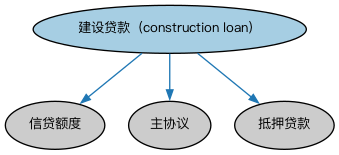

# 建筑贷款本体（Construction Loans Ontology）结构与公理说明

本文档对应 `ConstructionLoans.rdf` / `ConstructionLoans.ttl`，说明该本体的类、继承关系、属性和公理约定。结构图见 `ConstructionLoans-structure.png`（`ConstructionLoans-structure.svg` 为可缩放版本）。

## 1. 本体概述

定义建筑贷款（construction loan）：用于房地产建设、按工程进度阶段性放款的贷款。

**在体系中的位置**：LOAN 房地产贷款模块的品种本体之一。

**上下游关系**：上游继承抵押贷款本体；下游与抵押贷款衔接（建成后常转为长期按揭，即「建转贷」）。

**与相近概念的差别**：与普通抵押贷款的差别——放款方式不同（按进度分批而非一次性），风险形态不同（建设风险＋市场风险），期限短。

## 2. 类（Class）

| 类（Class） | 定义（Definition） |
|---|---|
| 建设贷款（construction loan） | 覆盖建设与开发成本、以所融资房产之抵押作担保的贷款。 |

### 2.1 继承关系（Inheritance）

- 建设贷款（construction loan） ⊑ 信贷额度
- 建设贷款（construction loan） ⊑ 主协议
- 建设贷款（construction loan） ⊑ 抵押贷款

## 3. 对象属性（Object Property）

| 属性（Property） | 中文（English） | 定义（Definition） | 说明 |
|---|---|---|---|
| fibo-loan-reln-cnst:hasMaximumAllowedBalance | 具有最高允许余额（has maximum allowed balance） | 对具有灵活再提取安排的贷款，任何时点允许未偿的最高余额（低于信用额度）。 | 定义域（domain）：Nfa655d6745684d5dbc89323e7c02b218；值域（range）：货币数量；子属性（subPropertyOf）：具有可用金额 |
| fibo-loan-reln-cnst:hasMaximumAnticipatedBalance | 具有最高预期余额（has maximum anticipated balance） | 借款人出于规划目的预计可能需要的最高余额（低于信用额度）。 | 定义域（domain）：Ne86c84fc0210432db4b26ba1ad087116；值域（range）：货币数量；子属性（subPropertyOf）：具有可用金额 |
| fibo-loan-reln-cnst:hasMilestoneMaximumDrawdownAmount | 具有里程碑最高提取额（has milestone maximum drawdown amount） | 里程碑完成后借款人可提取的最高贷款金额。 | 定义域（domain）：合同里程碑；值域（range）：货币数量；子属性（subPropertyOf）：具有可用金额 |

## 5. 公理约定（Axioms）

- 建设贷款（construction loan）：具有里程碑条款 合同里程碑 ≥0
- 建设贷款（construction loan）：以……为抵押 不动产 ≥0

## 6. 依赖（owl:imports，9 个）

本本体通过 `owl:imports` 引入以下本体，各项的中文名称与简介如下：

| 导入本体 | 中文名称 | 简介 |
|---|---|---|
| `FBC/DebtAndEquities/Debt.rdf` | 债务本体（Debt Ontology） | 定义债务（debt）与债权债务关系的核心概念：借款人、贷款人、本金与利息义务。 |
| `FBC/ProductsAndServices/ClientsAndAccounts.rdf` | 客户与账户本体（Clients and Accounts Ontology） | 定义金融机构的客户、账户及账户持有关系。 |
| `FND/Accounting/CurrencyAmount.rdf` | 货币金额本体（Currency Amount Ontology） | 定义「金额＋币种」的货币金额（currency amount）表示，是 FIBO 中表达价格、债务金额、付款额等一切带币种数值的基础构件。 |
| `FND/Agreements/Contracts.rdf` | 合同本体（Contracts Ontology） | 在协议之上定义具有法律约束力的合同（contract）：合同当事方、合同条款、义务与权利，是金融工具与交易合同建模的基石。 |
| `FND/Places/RealProperty.rdf` | 不动产本体（Real Property Ontology） | 定义不动产（real property）及其与地点、所有权的关系，支撑抵押贷款与房地产金融。 |
| `FND/Utilities/AnnotationVocabulary.rdf` | FIBO 标注词汇表（FIBO Annotation Vocabulary） | 定义 FIBO 专用的标注属性（如释义来源、成熟度等级），用于本体自身的元数据标注。 |
| `LOAN/LoansGeneral/Loans.rdf` | 贷款本体（Loans Ontology） | LOAN 域核心本体，定义贷款（loan）的通用结构：借款人、贷款人、本金、利率与还款安排。 |
| `https://www.omg.org/spec/Commons/AnnotationVocabulary/` | OMG 通用标注词汇表（OMG Commons Annotation Vocabulary） | OMG 通用本体库（Commons）中的标注词汇表，提供概念映射等标注属性，FIBO 用它标注术语与外部标准的对应关系。 |
| `https://www.omg.org/spec/Commons/Classifiers/` | OMG 通用分类器本体（OMG Commons Classifiers） | OMG 通用本体库（Commons）中的分类器本体，定义分类方案、类别与归类关系的通用概念，FIBO 的分类建模建立在其上。 |

## 7. 文件

- 官方 RDF/XML：`ConstructionLoans.rdf`
- 中文 Turtle：`ConstructionLoans.ttl`
- 结构图：`ConstructionLoans-structure.png` / `ConstructionLoans-structure.svg`