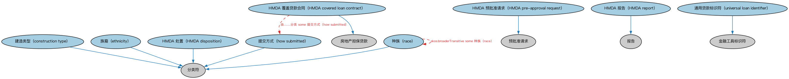

# HMDA 覆盖抵押贷款本体（HMDA Covered Mortgages Ontology）结构与公理说明

本文档对应 `HomeMortgageDisclosureActCoveredMortgages.rdf` / `HomeMortgageDisclosureActCoveredMortgages.ttl`，说明该本体的类、继承关系、属性和公理约定。结构图见 `HomeMortgageDisclosureActCoveredMortgages-structure.png`（`HomeMortgageDisclosureActCoveredMortgages-structure.svg` 为可缩放版本）。

## 1. 本体概述

定义受美国《住房抵押贷款披露法》（HMDA）报告要求约束的抵押贷款及其报送数据字段。

**在体系中的位置**：LOAN 房地产贷款模块的合规特化本体。

**上下游关系**：上游继承抵押贷款本体并依赖贷款监管、FND 报告本体；下游服务 HMDA 数据报送与公平信贷分析。

**与相近概念的差别**：这是「监管标签」类本体——同一笔贷款在业务上是普通抵押贷款，在监管上是否属于 HMDA 覆盖范围决定其报送义务；与贷款监管本体的差别——本本体落到具体法案。

## 2. 类（Class）

| 类（Class） | 定义（Definition） |
|---|---|
| HMDA 覆盖贷款合同（HMDA covered loan contract） | 按美国《住房抵押贷款披露法》修订版第 1003.3(c) 条不属于 HMDA 报告豁免交易的封闭式抵押贷款或开放式信用额度。 |
| HMDA 处置（HMDA disposition） | 对 HMDA 覆盖贷款申请所采取行动的类型。 |
| HMDA 预批准请求（HMDA pre-approval request） | 对不超过一定金额、且受若干非信用条件约束的购房贷款预批准请求。 |
| HMDA 报告（HMDA report） | 为满足《住房抵押贷款披露法》监管报告要求而编制的报告。 |
| 建造类型（construction type） | 特定种类的建造方式。 |
| 族裔（ethnicity） | 基于文化因素（包括国籍、地域文化、祖籍和语言）的类别。 |
| 提交方式（how submitted） | 表明申请人或借款人是否直接向报告金融机构提交覆盖贷款申请的类别。 |
| 种族（race） | 基于人的身体特征（如骨骼结构和肤色、发色或瞳色）的类别。 |
| 通用贷款标识符（universal loan identifier） | 用于无歧义标识以房地产作担保之特定贷款的唯一标识符。 |

### 2.1 继承关系（Inheritance）

- HMDA 覆盖贷款合同（HMDA covered loan contract） ⊑ 房地产担保贷款
- HMDA 处置（HMDA disposition） ⊑ 分类符
- HMDA 预批准请求（HMDA pre-approval request） ⊑ 预批准请求
- HMDA 报告（HMDA report） ⊑ 报告
- 建造类型（construction type） ⊑ 分类符
- 族裔（ethnicity） ⊑ 分类符
- 提交方式（how submitted） ⊑ 分类符
- 种族（race） ⊑ 分类符
- 通用贷款标识符（universal loan identifier） ⊑ 金融工具标识符

## 3. 对象属性（Object Property）

| 属性（Property） | 中文（English） | 定义（Definition） | 说明 |
|---|---|---|---|
| fibo-loan-reln-hmda:hasHMDA-DispositionDate | HMDA 处置日期（HMDA disposition date） | 与 HMDA 覆盖贷款之 HMDA 处置关联的日期。 | 子属性（subPropertyOf）：具有日期 |

## 5. 公理约定（Axioms）

- HMDA 覆盖贷款合同（HMDA covered loan contract）：由……分类 some 提交方式（how submitted）
- HMDA 报告（HMDA report）：由……提交 N0769fd7efb8c40f483453329caa64ab9 ≥0
- HMDA 报告（HMDA report）：被提交给 some 监管机构
- HMDA 报告（HMDA report）：具有条目数 some xsd:positiveInteger
- 族裔（ethnicity）：分类 some 具有法律行为能力的自然人
- 种族（race）：skos:broaderTransitive some 种族（race）
- 种族（race）：分类 some 具有法律行为能力的自然人
- 通用贷款标识符（universal loan identifier）：包含 法律实体标识符 =1
- 通用贷款标识符（universal loan identifier）：标识 房地产担保贷款 =1

## 6. 依赖（owl:imports，16 个）

本本体通过 `owl:imports` 引入以下本体，各项的中文名称与简介如下：

| 导入本体 | 中文名称 | 简介 |
|---|---|---|
| `BE/LegalEntities/LEIEntities.rdf` | LEI 法人实体本体（Legal Entity Identifier Entities Ontology） | 定义持有全球法人识别编码（LEI）的法人实体，对接 ISO 17442 标准的 LEI 体系。 |
| `BE/LegalEntities/LegalPersons.rdf` | 法律主体本体（Legal Persons Ontology） | 定义法律主体（legal person）与法定实体（legal entity）的核心概念：能持有权利义务、可起诉与被诉的主体。 |
| `FBC/FinancialInstruments/FinancialInstruments.rdf` | 金融工具本体（Financial Instruments Ontology） | FIBO 核心本体之一，定义金融工具（financial instrument）的通用概念：可交易、代表某种权利义务的合同工具，是证券、衍生品等具体工具的共同基础。 |
| `FND/Arrangements/Reporting.rdf` | 报告本体（Reporting Ontology） | 定义报告、报告方与报告内容的关系，支撑监管报告、财务报告等报送场景。 |
| `FND/Utilities/Analytics.rdf` | 分析本体（Analytics Ontology） | 定义分析工具、度量与比率的通用概念，支撑指标与模型的表达。 |
| `FND/Utilities/AnnotationVocabulary.rdf` | FIBO 标注词汇表（FIBO Annotation Vocabulary） | 定义 FIBO 专用的标注属性（如释义来源、成熟度等级），用于本体自身的元数据标注。 |
| `LOAN/LoansGeneral/Loans.rdf` | 贷款本体（Loans Ontology） | LOAN 域核心本体，定义贷款（loan）的通用结构：借款人、贷款人、本金、利率与还款安排。 |
| `LOAN/RealEstateLoans/Mortgages.rdf` | 抵押贷款本体（Mortgages Ontology） | 定义以不动产为抵押的贷款：抵押物、抵押登记与止赎。 |
| `https://www.omg.org/spec/Commons/AnnotationVocabulary/` | OMG 通用标注词汇表（OMG Commons Annotation Vocabulary） | OMG 通用本体库（Commons）中的标注词汇表，提供概念映射等标注属性，FIBO 用它标注术语与外部标准的对应关系。 |
| `https://www.omg.org/spec/Commons/Classifiers/` | OMG 通用分类器本体（OMG Commons Classifiers） | OMG 通用本体库（Commons）中的分类器本体，定义分类方案、类别与归类关系的通用概念，FIBO 的分类建模建立在其上。 |
| `https://www.omg.org/spec/Commons/Collections/` | OMG 通用集合本体（OMG Commons Collections） | Commons 库中的集合本体，定义集合、成员等通用概念。 |
| `https://www.omg.org/spec/Commons/DatesAndTimes/` | OMG 通用日期与时间本体（OMG Commons Dates and Times） | Commons 库中的日期时间本体，定义日期、期间、时间点等通用时间概念。 |
| `https://www.omg.org/spec/Commons/Identifiers/` | OMG 通用标识符本体（OMG Commons Identifiers） | Commons 库中的标识符本体，定义标识符及其编码方案的通用概念。 |
| `https://www.omg.org/spec/Commons/Organizations/` | OMG 通用组织本体（OMG Commons Organizations） | Commons 库中的组织本体，定义组织、组织成员与组织结构的通用概念。 |
| `https://www.omg.org/spec/Commons/RegulatoryAgencies/` | OMG 通用监管机构本体（OMG Commons Regulatory Agencies） | Commons 库中的监管机构本体，定义监管机构及其监管职权的通用概念。 |
| `https://www.omg.org/spec/Commons/RolesAndCompositions/` | OMG 通用角色与构成本体（OMG Commons Roles and Compositions） | Commons 库中的角色本体，定义角色及整体—部分构成关系的通用概念。 |

## 7. 文件

- 官方 RDF/XML：`HomeMortgageDisclosureActCoveredMortgages.rdf`
- 中文 Turtle：`HomeMortgageDisclosureActCoveredMortgages.ttl`
- 结构图：`HomeMortgageDisclosureActCoveredMortgages-structure.png` / `HomeMortgageDisclosureActCoveredMortgages-structure.svg`