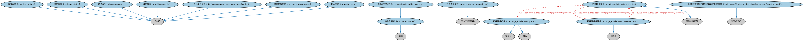

# 抵押贷款发放本体（Mortgage Origination Ontology）结构与公理说明

本文档对应 `MortgageOrigination.rdf` / `MortgageOrigination.ttl`，说明该本体的类、继承关系、属性和公理约定。结构图见 `MortgageOrigination-structure.png`（`MortgageOrigination-structure.svg` 为可缩放版本）。

## 1. 本体概述

定义抵押贷款的发起与发放（origination）流程：获客、核保（underwriting）、审批、放款。

**在体系中的位置**：LOAN 房地产贷款模块中覆盖「贷前流程」的本体。

**上下游关系**：上游依赖抵押贷款、贷款申请与 BP 流程概念；下游产生的贷款进入存续期管理或被出售证券化。

**与相近概念的差别**：发起≠服务（servicing）——发起是贷款诞生环节，服务是放款后的收息管账环节；与贷款申请本体的差别——申请看客户视角，发放看机构操作全流程。

## 2. 类（Class）

| 类（Class） | 定义（Definition） |
|---|---|
| 全国抵押贷款许可系统与登记处标识符（Nationwide Mortgage Licensing System and Registry Identifier） | NMLS 为每个维持登记的公司、分支和个人永久分配的编号。 |
| 摊销类型（amortization type） | 摊销算法的分类符。 |
| 自动化系统（automated system） | 减少或消除人工参与即可完成任务的系统。 |
| 自动核保系统（automated underwriting system） | 收集批准贷款申请所需信息、支持抵押贷款人对新申请进行分析的软件系统。 |
| 提现状态（cash-out status） | 表明在以新贷款为现有贷款再融资的发放中向借款人释放资金之程度的分类符。 |
| 收费类别（charge category） | 收费类别，如结清费用、利息、税项及其他服务相关费用。 |
| 住宅容量（dwelling capacity） | 表明某物业拥有多少住宅单元的分类符。 |
| 政府支持贷款（government-sponsored loan） | 由政府支持机构发起或担保的贷款。 |
| 活动房屋法律分类（manufactured home legal classification） | 表明覆盖贷款仅以活动房屋作担保、还是连同土地一起作担保的类别。 |
| 抵押赔偿担保（mortgage indemnity guarantee） | 在抵押贷款还款因故中断（如借款人死亡或失业）时保护贷款人的保险型担保。 |
| 抵押赔偿担保人（mortgage indemnity guarantor） | 以抵押赔偿担保（MIG）形式提供抵押保险的担保人兼保险人。 |
| 抵押赔偿保险单（mortgage indemnity insurance policy） | 提供抵押赔偿担保的保险单。 |
| 抵押贷款用途（mortgage loan purpose） | 抵押贷款资金的用途，如购置不动产、住宅建设或贷款再融资。 |
| 物业用途（property usage） | 表明借款人拟如何使用该物业的类别。 |

### 2.1 继承关系（Inheritance）

- 全国抵押贷款许可系统与登记处标识符（Nationwide Mortgage Licensing System and Registry Identifier） ⊑ 许可标识符
- 摊销类型（amortization type） ⊑ 分类符
- 自动化系统（automated system） ⊑ 编排
- 自动核保系统（automated underwriting system） ⊑ 自动化系统（automated system）
- 提现状态（cash-out status） ⊑ 分类符
- 收费类别（charge category） ⊑ 分类符
- 住宅容量（dwelling capacity） ⊑ 分类符
- 政府支持贷款（government-sponsored loan） ⊑ 房地产担保贷款
- 活动房屋法律分类（manufactured home legal classification） ⊑ 分类符
- 抵押赔偿担保（mortgage indemnity guarantee） ⊑ 保险支持担保
- 抵押赔偿担保人（mortgage indemnity guarantor） ⊑ 担保人
- 抵押赔偿担保人（mortgage indemnity guarantor） ⊑ 保险人
- 抵押赔偿保险单（mortgage indemnity insurance policy） ⊑ 保险单
- 抵押贷款用途（mortgage loan purpose） ⊑ 分类符
- 物业用途（property usage） ⊑ 分类符

## 3. 对象属性（Object Property）

| 属性（Property） | 中文（English） | 定义（Definition） | 说明 |
|---|---|---|---|
| fibo-loan-reln-org:assumes | 承接（assumes） | 将新抵押贷款合同关联到先前就同一物业向不同借款人发放的旧合同；新合同通过法律行为设立。 | — |
| fibo-loan-reln-org:hasOriginatingServiceProvider | 具有发起服务提供商（has originating service provider） | 将某事物（通常为贷款合同）关联到负责发起该贷款的服务提供商。 | 值域（range）：N33d37b94a58d4994b83eddb4ad9ba3f7；子属性（subPropertyOf）：具有参与方角色（has party role） |
| fibo-loan-reln-org:hasOriginatorPerson | 具有发起人（has originator person） | 将某事物（通常为贷款）关联到最初发起或创建它的人。 | 值域（range）：具有法律行为能力的自然人；子属性（subPropertyOf）：具有参与方（has party） |
| fibo-loan-reln-org:isLienOn | 是……的留置权（is lien on） | 标识留置权所针对的财产。 | — |

## 4. 数据属性（Datatype Property）

| 属性（Property） | 中文（English） | 定义（Definition） |
|---|---|---|
| fibo-loan-reln-org:hasNumberOfAffordableDwellingUnits | 具有可负担住宅单元数（has number of affordable dwelling units） | 将房地产关联到其中按联邦、州或地方可负担住房计划设有收入限制的住宅单元数。 |
| fibo-loan-reln-org:hasNumberOfDwellingUnits | 具有住宅单元数（has number of dwelling units） | 将房地产关联到其所含的住宅单元数。 |

## 5. 公理约定（Axioms）

- 抵押赔偿担保（mortgage indemnity guarantee）：由……担保 some 抵押赔偿担保人（mortgage indemnity guarantor）
- 抵押赔偿担保（mortgage indemnity guarantee）：由……例证 some 抵押赔偿保险单（mortgage indemnity insurance policy）
- 抵押赔偿保险单（mortgage indemnity insurance policy）：是……的证据 some 抵押赔偿担保（mortgage indemnity guarantee）

## 6. 依赖（owl:imports，26 个）

本本体通过 `owl:imports` 引入以下本体，各项的中文名称与简介如下：

| 导入本体 | 中文名称 | 简介 |
|---|---|---|
| `BE/LegalEntities/LEIEntities.rdf` | LEI 法人实体本体（Legal Entity Identifier Entities Ontology） | 定义持有全球法人识别编码（LEI）的法人实体，对接 ISO 17442 标准的 LEI 体系。 |
| `BE/LegalEntities/LegalPersons.rdf` | 法律主体本体（Legal Persons Ontology） | 定义法律主体（legal person）与法定实体（legal entity）的核心概念：能持有权利义务、可起诉与被诉的主体。 |
| `FBC/DebtAndEquities/Debt.rdf` | 债务本体（Debt Ontology） | 定义债务（debt）与债权债务关系的核心概念：借款人、贷款人、本金与利息义务。 |
| `FBC/DebtAndEquities/Guaranty.rdf` | 担保本体（Guaranty Ontology） | 定义担保（guaranty）：担保人、被担保债务与担保范围。 |
| `FBC/FinancialInstruments/FinancialInstruments.rdf` | 金融工具本体（Financial Instruments Ontology） | FIBO 核心本体之一，定义金融工具（financial instrument）的通用概念：可交易、代表某种权利义务的合同工具，是证券、衍生品等具体工具的共同基础。 |
| `FBC/ProductsAndServices/FinancialProductsAndServices.rdf` | 金融产品与服务本体（Financial Products and Services Ontology） | 定义金融产品（financial product）与金融服务（financial service）及其提供、购买关系。 |
| `FND/Accounting/CurrencyAmount.rdf` | 货币金额本体（Currency Amount Ontology） | 定义「金额＋币种」的货币金额（currency amount）表示，是 FIBO 中表达价格、债务金额、付款额等一切带币种数值的基础构件。 |
| `FND/Agreements/Contracts.rdf` | 合同本体（Contracts Ontology） | 在协议之上定义具有法律约束力的合同（contract）：合同当事方、合同条款、义务与权利，是金融工具与交易合同建模的基石。 |
| `FND/Arrangements/Assessments.rdf` | 评估本体（Assessments Ontology） | 定义评估活动、评估结果与评估方的通用结构，为信用评级、风险打分等判断性活动提供基础模型。 |
| `FND/DatesAndTimes/FinancialDates.rdf` | 金融日期本体（Financial Dates Ontology） | 定义金融语境下的日期与期间概念：结算日、付息日、到期日、日计数基准等。 |
| `FND/DatesAndTimes/Occurrences.rdf` | 事件与发生本体（Occurrences Ontology） | 定义「发生」（occurrence）、事件与触发条件，用于表达企业行动、信用事件等「发生了什么」。 |
| `FND/Law/LegalCapacity.rdf` | 法律能力本体（Legal Capacity Ontology） | 定义法律能力、缔约能力、签章权等概念，刻画主体从事法律行为的资格。 |
| `FND/Places/Addresses.rdf` | 地址本体（Addresses Ontology） | 定义邮政地址及其组成部分，为机构注册地、通讯地址建模。 |
| `FND/Places/RealProperty.rdf` | 不动产本体（Real Property Ontology） | 定义不动产（real property）及其与地点、所有权的关系，支撑抵押贷款与房地产金融。 |
| `FND/Relations/Relations.rdf` | 关系本体（Relations Ontology） | FIBO 最底层的基础本体，定义参考（reference）、分类（classify）等通用关系与抽象概念，全库普遍依赖。 |
| `FND/Utilities/AnnotationVocabulary.rdf` | FIBO 标注词汇表（FIBO Annotation Vocabulary） | 定义 FIBO 专用的标注属性（如释义来源、成熟度等级），用于本体自身的元数据标注。 |
| `LOAN/LoansGeneral/Loans.rdf` | 贷款本体（Loans Ontology） | LOAN 域核心本体，定义贷款（loan）的通用结构：借款人、贷款人、本金、利率与还款安排。 |
| `LOAN/RealEstateLoans/Mortgages.rdf` | 抵押贷款本体（Mortgages Ontology） | 定义以不动产为抵押的贷款：抵押物、抵押登记与止赎。 |
| `https://www.omg.org/spec/Commons/AnnotationVocabulary/` | OMG 通用标注词汇表（OMG Commons Annotation Vocabulary） | OMG 通用本体库（Commons）中的标注词汇表，提供概念映射等标注属性，FIBO 用它标注术语与外部标准的对应关系。 |
| `https://www.omg.org/spec/Commons/Classifiers/` | OMG 通用分类器本体（OMG Commons Classifiers） | OMG 通用本体库（Commons）中的分类器本体，定义分类方案、类别与归类关系的通用概念，FIBO 的分类建模建立在其上。 |
| `https://www.omg.org/spec/Commons/Collections/` | OMG 通用集合本体（OMG Commons Collections） | Commons 库中的集合本体，定义集合、成员等通用概念。 |
| `https://www.omg.org/spec/Commons/ContextualDesignators/` | OMG 通用语境指称本体（OMG Commons Contextual Designators） | Commons 库中的语境指称本体，定义「在某个语境下指代某物的名称/符号」，是地址、账户号码等语境相关标识的基础。 |
| `https://www.omg.org/spec/Commons/DatesAndTimes/` | OMG 通用日期与时间本体（OMG Commons Dates and Times） | Commons 库中的日期时间本体，定义日期、期间、时间点等通用时间概念。 |
| `https://www.omg.org/spec/Commons/Identifiers/` | OMG 通用标识符本体（OMG Commons Identifiers） | Commons 库中的标识符本体，定义标识符及其编码方案的通用概念。 |
| `https://www.omg.org/spec/Commons/PartiesAndSituations/` | OMG 通用参与方与情境本体（OMG Commons Parties and Situations） | Commons 库中的参与方本体，定义独立主体、参与方及其角色扮演的通用概念，是 FIBO 参与方模型的上游。 |
| `https://www.omg.org/spec/Commons/RolesAndCompositions/` | OMG 通用角色与构成本体（OMG Commons Roles and Compositions） | Commons 库中的角色本体，定义角色及整体—部分构成关系的通用概念。 |

## 7. 文件

- 官方 RDF/XML：`MortgageOrigination.rdf`
- 中文 Turtle：`MortgageOrigination.ttl`
- 结构图：`MortgageOrigination-structure.png` / `MortgageOrigination-structure.svg`