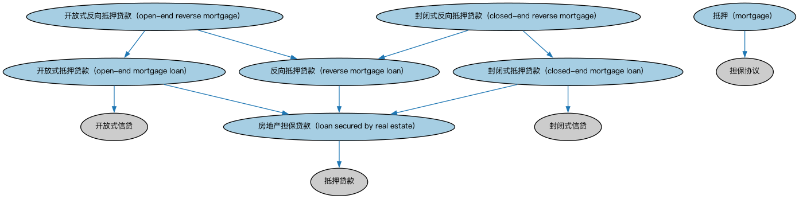

# 抵押贷款本体（Mortgages Ontology）结构与公理说明

本文档对应 `Mortgages.rdf` / `Mortgages.ttl`，说明该本体的类、继承关系、属性和公理约定。结构图见 `Mortgages-structure.png`（`Mortgages-structure.svg` 为可缩放版本）。

## 1. 本体概述

定义抵押贷款（mortgage）：以不动产为抵押担保的贷款，含抵押物、抵押登记与止赎（foreclosure）机制。

**在体系中的位置**：LOAN 房地产贷款模块的核心，建筑贷款、HMDA 抵押贷款的基础。

**上下游关系**：上游继承贷款本体并依赖 FND 不动产本体；下游被抵押贷款发放、MBS（抵押池的底层资产）引用。

**与相近概念的差别**：抵押≠担保——抵押是以特定财产作偿（物的担保），担保是第三人信用承诺；抵押贷款≠按揭产品的差别——按揭是抵押贷款在住房场景的具体产品形态。

## 2. 类（Class）

| 类（Class） | 定义（Definition） |
|---|---|
| 封闭式抵押贷款（closed-end mortgage loan） | 以房地产作担保、借款人日后不得再提取额外资金的贷款。 |
| 封闭式反向抵押贷款（closed-end reverse mortgage） | 在结清时向借款人一次性支付、借款人日后不得再提取额外资金的反向抵押贷款。 |
| 房地产担保贷款（loan secured by real estate） | 发放时全部或主要由不动产留置权作担保、且该留置权为授信核心的贷款。 |
| 抵押（mortgage） | 向非该不动产所有人的参与方授予的不动产财产权益，由注册机构登记。 |
| 开放式抵押贷款（open-end mortgage loan） | 以房地产作担保、约定经借贷双方同意可增加未偿贷款金额的贷款。 |
| 开放式反向抵押贷款（open-end reverse mortgage） | 结构类似房屋净值信用额度的反向抵押贷款，结清后借款人可获得额外资金。 |
| 反向抵押贷款（reverse mortgage loan） | 以房地产作担保、按抵押物现有净值设定本金限额并向借款人支付资金的贷款。 |

### 2.1 继承关系（Inheritance）

- 封闭式抵押贷款（closed-end mortgage loan） ⊑ 封闭式信贷
- 封闭式抵押贷款（closed-end mortgage loan） ⊑ 房地产担保贷款（loan secured by real estate）
- 封闭式反向抵押贷款（closed-end reverse mortgage） ⊑ 封闭式抵押贷款（closed-end mortgage loan）
- 封闭式反向抵押贷款（closed-end reverse mortgage） ⊑ 反向抵押贷款（reverse mortgage loan）
- 房地产担保贷款（loan secured by real estate） ⊑ 抵押贷款
- 抵押（mortgage） ⊑ 担保协议
- 开放式抵押贷款（open-end mortgage loan） ⊑ 开放式信贷
- 开放式抵押贷款（open-end mortgage loan） ⊑ 房地产担保贷款（loan secured by real estate）
- 开放式反向抵押贷款（open-end reverse mortgage） ⊑ 开放式抵押贷款（open-end mortgage loan）
- 开放式反向抵押贷款（open-end reverse mortgage） ⊑ 反向抵押贷款（reverse mortgage loan）
- 反向抵押贷款（reverse mortgage loan） ⊑ 房地产担保贷款（loan secured by real estate）

## 3. 对象属性（Object Property）

| 属性（Property） | 中文（English） | 定义（Definition） | 说明 |
|---|---|---|---|
| fibo-loan-reln-mtg:hasInitialFundingDate | 具有初始放款日（has initial funding date） | 将抵押贷款关联到合同成立、正式产生其义务的日期。 | 子属性（subPropertyOf）：具有生效日期 |

## 4. 数据属性（Datatype Property）

| 属性（Property） | 中文（English） | 定义（Definition） |
|---|---|---|
| fibo-loan-reln-mtg:isARMConvertible | 可转可调整利率（is ARM convertible） | 表明该贷款是否可转换为可调整利率抵押贷款合同（ARM）。 |

## 5. 公理约定（Axioms）

- 房地产担保贷款（loan secured by real estate）：以……为抵押 some 不动产
- 房地产担保贷款（loan secured by real estate）：具有合同要素 some 披露条款
- 房地产担保贷款（loan secured by real estate）：具有合同要素 some 募集资金用途条款
- 房地产担保贷款（loan secured by real estate）：具有初始放款日（has initial funding date） some 交易日期
- 房地产担保贷款（loan secured by real estate）：引用 some 担保协议
- 抵押（mortgage）：以……为抵押 some 不动产
- 反向抵押贷款（reverse mortgage loan）：具有信用限额 some 货币数量

## 6. 依赖（owl:imports，9 个）

本本体通过 `owl:imports` 引入以下本体，各项的中文名称与简介如下：

| 导入本体 | 中文名称 | 简介 |
|---|---|---|
| `FBC/DebtAndEquities/Debt.rdf` | 债务本体（Debt Ontology） | 定义债务（debt）与债权债务关系的核心概念：借款人、贷款人、本金与利息义务。 |
| `FBC/ProductsAndServices/ClientsAndAccounts.rdf` | 客户与账户本体（Clients and Accounts Ontology） | 定义金融机构的客户、账户及账户持有关系。 |
| `FND/Accounting/CurrencyAmount.rdf` | 货币金额本体（Currency Amount Ontology） | 定义「金额＋币种」的货币金额（currency amount）表示，是 FIBO 中表达价格、债务金额、付款额等一切带币种数值的基础构件。 |
| `FND/Agreements/Contracts.rdf` | 合同本体（Contracts Ontology） | 在协议之上定义具有法律约束力的合同（contract）：合同当事方、合同条款、义务与权利，是金融工具与交易合同建模的基石。 |
| `FND/Places/RealProperty.rdf` | 不动产本体（Real Property Ontology） | 定义不动产（real property）及其与地点、所有权的关系，支撑抵押贷款与房地产金融。 |
| `FND/Utilities/AnnotationVocabulary.rdf` | FIBO 标注词汇表（FIBO Annotation Vocabulary） | 定义 FIBO 专用的标注属性（如释义来源、成熟度等级），用于本体自身的元数据标注。 |
| `LOAN/LoansGeneral/Loans.rdf` | 贷款本体（Loans Ontology） | LOAN 域核心本体，定义贷款（loan）的通用结构：借款人、贷款人、本金、利率与还款安排。 |
| `https://www.omg.org/spec/Commons/AnnotationVocabulary/` | OMG 通用标注词汇表（OMG Commons Annotation Vocabulary） | OMG 通用本体库（Commons）中的标注词汇表，提供概念映射等标注属性，FIBO 用它标注术语与外部标准的对应关系。 |
| `https://www.omg.org/spec/Commons/Documents/` | OMG 通用文档本体（OMG Commons Documents） | Commons 库中的文档本体，定义文档及其组成部分的通用概念。 |

## 7. 文件

- 官方 RDF/XML：`Mortgages.rdf`
- 中文 Turtle：`Mortgages.ttl`
- 结构图：`Mortgages-structure.png` / `Mortgages-structure.svg`