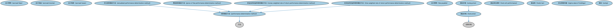

# 基金时序本体（Funds Temporal Ontology）结构与公理说明

本文档对应 `FundsTemporal.rdf` / `FundsTemporal.ttl`，说明该本体的类、继承关系、属性和公理约定。结构图见 `FundsTemporal-structure.png`（`FundsTemporal-structure.svg` 为可缩放版本）。

## 1. 本体概述

定义基金净值（NAV）、份额规模等随时间变化的时间序列数据。

**在体系中的位置**：MD 集合投资工具时序模块的核心。

**上下游关系**：上游依赖 SEC 基金与集合投资工具本体；下游服务基金评价与申赎分析。

**与相近概念的差别**：基金净值≠股票价格——净值是按组合资产估值计算的账面价值（通常每日一次），股票价格是连续竞价形成的市场价格；ETF 两者都有。

本本体中类与类的核心关系如下（完整细节见各类小节）：

- **年化绩效确定方法（annualized performance determination method）** 继承 **绩效确定方法（performance determination method）**
- **基金价格（fund price）** 继承 **证券价格（SecurityPrice）**
- **费前绩效确定方法（gross of fee performance determination method）** 继承 **绩效确定方法（performance determination method）**
- **资金加权收益率绩效确定方法（money weighted rate of return performance determination method）** 继承 **绩效确定方法（performance determination method）**
- **绩效确定方法（performance determination method）** 继承 **方法（Method）**
- **摆动价格（swing price）** 继承 **基金价格（fund price）**
- **时间加权收益率绩效确定方法（time weighted rate of return performance determination method）** 继承 **绩效确定方法（performance determination method）**

## 2. 类（Class）

| 类（Class） | 定义（Definition） |
|---|---|
| 应计费用（accrued fees） | 已发生但尚未支付的费用。 |
| 应计收益（accrued income） | 已赚取但尚未收到的收益。 |
| 应计税款（accrued taxes） | 已发生但尚未缴纳的税款。 |
| 年化绩效确定方法（annualized performance determination method） | 以年化方式确定绩效的方法。 |
| 应付费用（fee payable） | 应支付的费用。 |
| 基金价格（fund price） | 基金单位的价格。 |
| 基金单位绩效（fund unit performance） | 基金单位在一定时期内的绩效表现。 |
| 基金税（funds tax） | 与基金相关的税项。 |
| 费前绩效确定方法（gross of fee performance determination method） | 在扣除费用之前确定绩效的方法。 |
| 资金加权收益率绩效确定方法（money weighted rate of return performance determination method） | 以资金加权收益率确定绩效的方法。 |
| 绩效确定方法（performance determination method） | 确定绩效的方法（如时间加权、资金加权、年化、费前），连同确定绩效的时间框架。 |
| 持仓西格玛值（sigma value of holdings） | 持仓的标准差值。 |
| 摆动（swing） | 基金单位价格因大额申购或赎回而进行的摆动调整。 |
| 摆动价格（swing price） | 经摆动调整后的基金单位价格。 |
| 时间加权收益率绩效确定方法（time weighted rate of return performance determination method） | 以时间加权收益率确定绩效的方法。 |

以下按类逐个展开：每个类给出继承关系、相关属性与公理约定；子类在父类之下降一级编号。

### 2.1 应计费用（accrued fees）

定义：已发生但尚未支付的费用。

### 2.2 应计收益（accrued income）

定义：已赚取但尚未收到的收益。

### 2.3 应计税款（accrued taxes）

定义：已发生但尚未缴纳的税款。

### 2.4 应付费用（fee payable）

定义：应支付的费用。

### 2.5 基金价格（fund price）

定义：基金单位的价格。

- 父类：**证券价格（SecurityPrice）**
- 直接子类：**摆动价格（swing price）**

#### 2.5.1 摆动价格（swing price）

定义：经摆动调整后的基金单位价格。

- 父类：**基金价格（fund price）**

### 2.6 基金单位绩效（fund unit performance）

定义：基金单位在一定时期内的绩效表现。

属性：

| 属性 | 定义 | 说明 |
|---|---|---|
| **确定日期（determination date）** | 绩效确定的日期。 | 值域：日期 |
| **确定期间（determination period）** | 绩效所确定的期间。 | 值域：日期区间 |
| **费后或费前（net or gross of fees）** | 表明绩效是扣除费用后（费后）还是扣除费用前（费前）。 | 值域：xsd:string |

### 2.7 基金税（funds tax）

定义：与基金相关的税项。

属性：

| 属性 | 定义 | 说明 |
|---|---|---|
| **适用于（appliesTo）** | — | — |

公理：

- **适用于（appliesTo）**至少有一个取值，类型是**投资者（Investor）**。

### 2.8 绩效确定方法（performance determination method）

定义：确定绩效的方法（如时间加权、资金加权、年化、费前），连同确定绩效的时间框架。

- 父类：**方法（Method）**
- 直接子类：**年化绩效确定方法（annualized performance determination method）**、**费前绩效确定方法（gross of fee performance determination method）**、**资金加权收益率绩效确定方法（money weighted rate of return performance determination method）**、**时间加权收益率绩效确定方法（time weighted rate of return performance determination method）**

属性：

| 属性 | 定义 | 说明 |
|---|---|---|
| **绩效确定时间框架（performance determination timeframe）** | 绩效报告所基于的时间框架（如 1 个月、1 年、年初至今）。 | 值域：日期区间 |

#### 2.8.1 年化绩效确定方法（annualized performance determination method）

定义：以年化方式确定绩效的方法。

- 父类：**绩效确定方法（performance determination method）**

#### 2.8.2 费前绩效确定方法（gross of fee performance determination method）

定义：在扣除费用之前确定绩效的方法。

- 父类：**绩效确定方法（performance determination method）**

#### 2.8.3 资金加权收益率绩效确定方法（money weighted rate of return performance determination method）

定义：以资金加权收益率确定绩效的方法。

- 父类：**绩效确定方法（performance determination method）**

#### 2.8.4 时间加权收益率绩效确定方法（time weighted rate of return performance determination method）

定义：以时间加权收益率确定绩效的方法。

- 父类：**绩效确定方法（performance determination method）**

### 2.9 持仓西格玛值（sigma value of holdings）

定义：持仓的标准差值。

### 2.10 摆动（swing）

定义：基金单位价格因大额申购或赎回而进行的摆动调整。

## 3. 其他属性

以下属性未绑定到本体的具体类（定义域在外部本体或未声明）：

对象属性（Object Property）：

| 属性 | 定义 | 说明 |
|---|---|---|
| **确定（determines）** | 对某事物进行确定。 | 值域：应付费用（fee payable） |
| **具有绩效（has performance）** | 标识某事物的绩效。 | 值域：基金单位绩效（fund unit performance） |
| **具有绩效确定方法（has performance determination method）** | 标识绩效确定所用的方法。 | 值域：绩效确定方法（performance determination method） |
| **发生（incurs）** | 发生某项费用或税项。 | 值域：基金税（funds tax） |
| **发生费用（incurs fees）** | 发生费用。 | 值域：应付费用（fee payable） |
| **发生费用（incurs fees）** | 发生费用。 | 值域：应付费用（fee payable） |
| **发生税项（incurs tax）** | 发生税项。 | 值域：基金税（funds tax） |
| **发生税项（incurs tax）** | 发生税项。 | 值域：基金税（funds tax） |
| **发生交易费用（incurs transaction fee）** | 发生交易费用。 | 值域：应付费用（fee payable） |

## 4. 依赖（owl:imports，10 个）

本本体通过 `owl:imports` 引入以下本体，各项的中文名称与简介如下：

| 导入本体 | 中文名称 | 简介 |
|---|---|---|
| `BE/OwnershipAndControl/OwnershipParties.rdf` | 所有权方本体（Ownership Parties Ontology） | 定义所有权关系中的各方角色：所有者、受益所有人、名义持有人等。 |
| `FBC/FinancialInstruments/InstrumentPricing.rdf` | 工具定价本体（Instrument Pricing Ontology） | 定义金融工具的价格、报价与估值概念。 |
| `FND/GoalsAndObjectives/Objectives.rdf` | 目标本体（Objectives Ontology） | 定义目标（objective）及其与组织、计划的关系，用于表达机构的经营目标与投资目标。 |
| `FND/Utilities/AnnotationVocabulary.rdf` | FIBO 标注词汇表（FIBO Annotation Vocabulary） | 定义 FIBO 专用的标注属性（如释义来源、成熟度等级），用于本体自身的元数据标注。 |
| `SEC/Funds/CollectiveInvestmentVehicles.rdf` | 集合投资工具本体（Collective Investment Vehicles Ontology） | 定义集合投资工具（CIV）：汇集多投资者资金共同投资的载体，是基金的上位概念。 |
| `SEC/Funds/Funds.rdf` | 基金本体（Funds Ontology） | 定义投资基金（fund）：基金份额、净值与管理结构。 |
| `SEC/Securities/Pools.rdf` | 证券池本体（Securities Pools Ontology） | 定义证券池（pool）：归集起来作为证券化基础的一组资产。 |
| `https://www.omg.org/spec/Commons/AnnotationVocabulary/` | OMG 通用标注词汇表（OMG Commons Annotation Vocabulary） | OMG 通用本体库（Commons）中的标注词汇表，提供概念映射等标注属性，FIBO 用它标注术语与外部标准的对应关系。 |
| `https://www.omg.org/spec/Commons/ContextualDesignators/` | OMG 通用语境指称本体（OMG Commons Contextual Designators） | Commons 库中的语境指称本体，定义「在某个语境下指代某物的名称/符号」，是地址、账户号码等语境相关标识的基础。 |
| `https://www.omg.org/spec/Commons/DatesAndTimes/` | OMG 通用日期与时间本体（OMG Commons Dates and Times） | Commons 库中的日期时间本体，定义日期、期间、时间点等通用时间概念。 |

## 5. 文件

- 官方 RDF/XML：`FundsTemporal.rdf`
- 中文 Turtle：`FundsTemporal.ttl`
- 结构图：`FundsTemporal-structure.png` / `FundsTemporal-structure.svg`