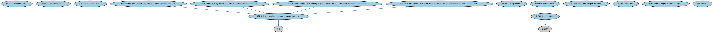

# 基金时序本体（Funds Temporal Ontology）结构与公理说明

本文档对应 `FundsTemporal.rdf` / `FundsTemporal.ttl`，说明该本体的类、继承关系、属性和公理约定。结构图见 `FundsTemporal-structure.png`（`FundsTemporal-structure.svg` 为可缩放版本）。

## 1. 本体概述

定义基金净值（NAV）、份额规模等随时间变化的时间序列数据。

**在体系中的位置**：MD 集合投资工具时序模块的核心。

**上下游关系**：上游依赖 SEC 基金与集合投资工具本体；下游服务基金评价与申赎分析。

**与相近概念的差别**：基金净值≠股票价格——净值是按组合资产估值计算的账面价值（通常每日一次），股票价格是连续竞价形成的市场价格；ETF 两者都有。

## 2. 类（Class）

| 类（Class） | 定义（Definition） |
|---|---|
| 应计费用（accrued fees） | 已发生但尚未支付的费用。 |
| 应计收益（accrued income） | 已赚取但尚未收到的收益。 |
| 应计税款（accrued taxes） | 已发生但尚未缴纳的税款。 |
| 年化绩效确定方法（annualized performance determination method） | 以年化方式确定绩效的方法。 |
| 应付费用（fee payable） | 应支付的费用。 |
| 基金价格（fund price） | 基金单位的价格。 |
| 基金单位绩效（fund unit performance） | 基金单位在一定时期内的绩效表现。 |
| 基金税（funds tax） | 与基金相关的税项。 |
| 费前绩效确定方法（gross of fee performance determination method） | 在扣除费用之前确定绩效的方法。 |
| 资金加权收益率绩效确定方法（money weighted rate of return performance determination method） | 以资金加权收益率确定绩效的方法。 |
| 绩效确定方法（performance determination method） | 确定绩效的方法（如时间加权、资金加权、年化、费前），连同确定绩效的时间框架。 |
| 持仓西格玛值（sigma value of holdings） | 持仓的标准差值。 |
| 摆动（swing） | 基金单位价格因大额申购或赎回而进行的摆动调整。 |
| 摆动价格（swing price） | 经摆动调整后的基金单位价格。 |
| 时间加权收益率绩效确定方法（time weighted rate of return performance determination method） | 以时间加权收益率确定绩效的方法。 |

### 2.1 继承关系（Inheritance）

- 年化绩效确定方法（annualized performance determination method） ⊑ 绩效确定方法（performance determination method）
- 基金价格（fund price） ⊑ 证券价格
- 费前绩效确定方法（gross of fee performance determination method） ⊑ 绩效确定方法（performance determination method）
- 资金加权收益率绩效确定方法（money weighted rate of return performance determination method） ⊑ 绩效确定方法（performance determination method）
- 绩效确定方法（performance determination method） ⊑ 方法
- 摆动价格（swing price） ⊑ 基金价格（fund price）
- 时间加权收益率绩效确定方法（time weighted rate of return performance determination method） ⊑ 绩效确定方法（performance determination method）

## 3. 对象属性（Object Property）

| 属性（Property） | 中文（English） | 定义（Definition） | 说明 |
|---|---|---|---|
| fibo-md-civx-fun:determinationDate.1 | 确定日期（determination date） | 绩效确定的日期。 | 定义域（domain）：基金单位绩效（fund unit performance）；值域（range）：日期 |
| fibo-md-civx-fun:determinationPeriod | 确定期间（determination period） | 绩效所确定的期间。 | 定义域（domain）：基金单位绩效（fund unit performance）；值域（range）：日期区间 |
| fibo-md-civx-fun:determines | 确定（determines） | 对某事物进行确定。 | 定义域（domain）：集合投资工具；值域（range）：应付费用（fee payable） |
| fibo-md-civx-fun:hasPerformance | 具有绩效（has performance） | 标识某事物的绩效。 | 定义域（domain）：基金单位；值域（range）：基金单位绩效（fund unit performance） |
| fibo-md-civx-fun:hasPerformanceDeterminationMethod | 具有绩效确定方法（has performance determination method） | 标识绩效确定所用的方法。 | 定义域（domain）：集合投资工具；值域（range）：绩效确定方法（performance determination method） |
| fibo-md-civx-fun:incurs | 发生（incurs） | 发生某项费用或税项。 | 定义域（domain）：基金组合；值域（range）：基金税（funds tax） |
| fibo-md-civx-fun:incursFees | 发生费用（incurs fees） | 发生费用。 | 定义域（domain）：投资者；值域（range）：应付费用（fee payable） |
| fibo-md-civx-fun:incursFees.1 | 发生费用（incurs fees） | 发生费用。 | 定义域（domain）：基金单位；值域（range）：应付费用（fee payable） |
| fibo-md-civx-fun:incursTax | 发生税项（incurs tax） | 发生税项。 | 定义域（domain）：投资者；值域（range）：基金税（funds tax） |
| fibo-md-civx-fun:incursTax.1 | 发生税项（incurs tax） | 发生税项。 | 定义域（domain）：基金单位；值域（range）：基金税（funds tax） |
| fibo-md-civx-fun:incursTransactionFee | 发生交易费用（incurs transaction fee） | 发生交易费用。 | 定义域（domain）：基金组合；值域（range）：应付费用（fee payable） |
| fibo-md-civx-fun:performanceDeterminationTimeframe | 绩效确定时间框架（performance determination timeframe） | 绩效报告所基于的时间框架（如 1 个月、1 年、年初至今）。 | 定义域（domain）：绩效确定方法（performance determination method）；值域（range）：日期区间 |

## 4. 数据属性（Datatype Property）

| 属性（Property） | 中文（English） | 定义（Definition） |
|---|---|---|
| fibo-md-civx-fun:netOrGrossOfFees | 费后或费前（net or gross of fees） | 表明绩效是扣除费用后（费后）还是扣除费用前（费前）。 |

## 5. 公理约定（Axioms）

- 基金税（funds tax）：适用于 some 投资者

## 6. 依赖（owl:imports，10 个）

本本体通过 `owl:imports` 引入以下本体，各项的中文名称与简介如下：

| 导入本体 | 中文名称 | 简介 |
|---|---|---|
| `BE/OwnershipAndControl/OwnershipParties.rdf` | 所有权方本体（Ownership Parties Ontology） | 定义所有权关系中的各方角色：所有者、受益所有人、名义持有人等。 |
| `FBC/FinancialInstruments/InstrumentPricing.rdf` | 工具定价本体（Instrument Pricing Ontology） | 定义金融工具的价格、报价与估值概念。 |
| `FND/GoalsAndObjectives/Objectives.rdf` | 目标本体（Objectives Ontology） | 定义目标（objective）及其与组织、计划的关系，用于表达机构的经营目标与投资目标。 |
| `FND/Utilities/AnnotationVocabulary.rdf` | FIBO 标注词汇表（FIBO Annotation Vocabulary） | 定义 FIBO 专用的标注属性（如释义来源、成熟度等级），用于本体自身的元数据标注。 |
| `SEC/Funds/CollectiveInvestmentVehicles.rdf` | 集合投资工具本体（Collective Investment Vehicles Ontology） | 定义集合投资工具（CIV）：汇集多投资者资金共同投资的载体，是基金的上位概念。 |
| `SEC/Funds/Funds.rdf` | 基金本体（Funds Ontology） | 定义投资基金（fund）：基金份额、净值与管理结构。 |
| `SEC/Securities/Pools.rdf` | 证券池本体（Securities Pools Ontology） | 定义证券池（pool）：归集起来作为证券化基础的一组资产。 |
| `https://www.omg.org/spec/Commons/AnnotationVocabulary/` | OMG 通用标注词汇表（OMG Commons Annotation Vocabulary） | OMG 通用本体库（Commons）中的标注词汇表，提供概念映射等标注属性，FIBO 用它标注术语与外部标准的对应关系。 |
| `https://www.omg.org/spec/Commons/ContextualDesignators/` | OMG 通用语境指称本体（OMG Commons Contextual Designators） | Commons 库中的语境指称本体，定义「在某个语境下指代某物的名称/符号」，是地址、账户号码等语境相关标识的基础。 |
| `https://www.omg.org/spec/Commons/DatesAndTimes/` | OMG 通用日期与时间本体（OMG Commons Dates and Times） | Commons 库中的日期时间本体，定义日期、期间、时间点等通用时间概念。 |

## 7. 文件

- 官方 RDF/XML：`FundsTemporal.rdf`
- 中文 Turtle：`FundsTemporal.ttl`
- 结构图：`FundsTemporal-structure.png` / `FundsTemporal-structure.svg`