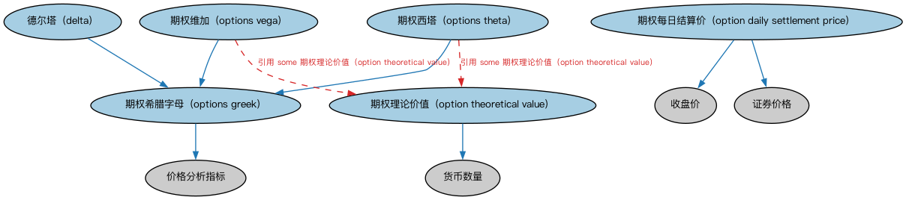

# 场内期权时序本体（Exchange-Traded Options Temporal Ontology）结构与公理说明

本文档对应 `ETOptionsTemporal.rdf` / `ETOptionsTemporal.ttl`，说明该本体的类、继承关系、属性和公理约定。结构图见 `ETOptionsTemporal-structure.png`（`ETOptionsTemporal-structure.svg` 为可缩放版本）。

## 1. 本体概述

定义交易所交易期权（ET option）行情：权利金报价、隐含波动率、行权价序列等时间序列数据。

**在体系中的位置**：MD 衍生品时序模块的两个本体之一。

**上下游关系**：上游依赖 DER 期权本体；下游服务期权定价与波动率分析。

**与相近概念的差别**：期权行情比期货多了「行权价×到期日」两个维度，同一标的对应一整个期权链（option chain）而非单一合约。

## 2. 类（Class）

| 类（Class） | 定义（Definition） |
|---|---|
| 德尔塔（delta） | 期权价值对标的价格的一阶导数（或持仓上的对应值）。 |
| 期权每日结算价（option daily settlement price） | 交易时段结束时的官方价格，由期权清算公司确定，用于计算账户权益变动。 |
| 期权理论价值（option theoretical value） | 由期权定价模型确定的期权公允价值。 |
| 期权希腊字母（options greek） | 表示期权价格对其价值所依赖的标的参数变化之敏感度的量。 |
| 期权西塔（options theta） | 期权理论价值对到期时间单位变化之变化率的度量。 |
| 期权维加（options vega） | 期权理论价值对波动率假设单位变化之变化率的度量。 |

### 2.1 继承关系（Inheritance）

- 德尔塔（delta） ⊑ 期权希腊字母（options greek）
- 期权每日结算价（option daily settlement price） ⊑ 收盘价
- 期权每日结算价（option daily settlement price） ⊑ 证券价格
- 期权理论价值（option theoretical value） ⊑ 货币数量
- 期权希腊字母（options greek） ⊑ 价格分析指标
- 期权西塔（options theta） ⊑ 期权希腊字母（options greek）
- 期权维加（options vega） ⊑ 期权希腊字母（options greek）

## 5. 公理约定（Axioms）

- 期权每日结算价（option daily settlement price）：具有发布方 some（restriction）
- 期权理论价值（option theoretical value）：引用 some 定价模型
- 期权西塔（options theta）：引用 some 期权理论价值（option theoretical value）
- 期权维加（options vega）：引用 some 期权理论价值（option theoretical value）

## 6. 依赖（owl:imports，10 个）

本本体通过 `owl:imports` 引入以下本体，各项的中文名称与简介如下：

| 导入本体 | 中文名称 | 简介 |
|---|---|---|
| `BE/FunctionalEntities/Publishers.rdf` | 出版方本体（Publishers Ontology） | 定义出版方及其出版物，用于标识金融信息与文档的发布来源。 |
| `DER/DerivativesContracts/DerivativesBasics.rdf` | 衍生品基础本体（Derivatives Basics Ontology） | 定义衍生品合约（derivatives contract）的核心概念：标的资产、行权、到期等，是 DER 域的根基。 |
| `DER/DerivativesContracts/Options.rdf` | 期权本体（Options Ontology） | 定义期权（option）：买方权利、行权价、到期日、看涨与看跌等核心结构。 |
| `FBC/FinancialInstruments/InstrumentPricing.rdf` | 工具定价本体（Instrument Pricing Ontology） | 定义金融工具的价格、报价与估值概念。 |
| `FBC/FunctionalEntities/Markets.rdf` | 市场本体（Markets Ontology） | 定义金融市场（market）：交易所、场外市场及其功能。 |
| `FND/Accounting/CurrencyAmount.rdf` | 货币金额本体（Currency Amount Ontology） | 定义「金额＋币种」的货币金额（currency amount）表示，是 FIBO 中表达价格、债务金额、付款额等一切带币种数值的基础构件。 |
| `FND/Utilities/AnnotationVocabulary.rdf` | FIBO 标注词汇表（FIBO Annotation Vocabulary） | 定义 FIBO 专用的标注属性（如释义来源、成熟度等级），用于本体自身的元数据标注。 |
| `IND/Indicators/Indicators.rdf` | 指标本体（Indicators Ontology） | 定义「指标」（indicator）的通用概念：对某现象的可度量表示，是经济指标、利率等的上位模型。 |
| `https://www.omg.org/spec/Commons/AnnotationVocabulary/` | OMG 通用标注词汇表（OMG Commons Annotation Vocabulary） | OMG 通用本体库（Commons）中的标注词汇表，提供概念映射等标注属性，FIBO 用它标注术语与外部标准的对应关系。 |
| `https://www.omg.org/spec/Commons/Documents/` | OMG 通用文档本体（OMG Commons Documents） | Commons 库中的文档本体，定义文档及其组成部分的通用概念。 |

## 7. 文件

- 官方 RDF/XML：`ETOptionsTemporal.rdf`
- 中文 Turtle：`ETOptionsTemporal.ttl`
- 结构图：`ETOptionsTemporal-structure.png` / `ETOptionsTemporal-structure.svg`