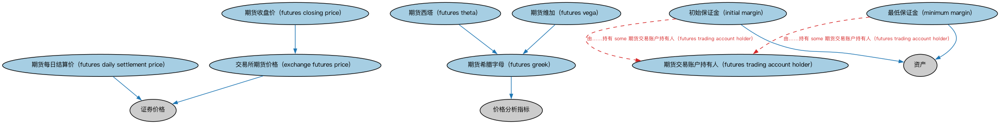

# 期货时序本体（Futures Temporal Ontology）结构与公理说明

本文档对应 `FuturesTemporal.rdf` / `FuturesTemporal.ttl`，说明该本体的类、继承关系、属性和公理约定。结构图见 `FuturesTemporal-structure.png`（`FuturesTemporal-structure.svg` 为可缩放版本）。

## 1. 本体概述

定义期货合约行情（结算价、持仓量、成交量）的时间序列数据。

**在体系中的位置**：MD 衍生品时序模块的两个本体之一。

**上下游关系**：上游依赖 DER 期货与远期本体；下游服务期货行情分析、保证金计算建模。

**与相近概念的差别**：期货行情特有的字段是持仓量（open interest，未平仓合约数），这是股票、期权行情没有的维度。

## 2. 类（Class）

| 类（Class） | 定义（Definition） |
|---|---|
| 交易所期货价格（exchange futures price） | 交易所确定的期货价格。 |
| 期货收盘价（futures closing price） | 期货在交易时段结束时的价格。 |
| 期货每日结算价（futures daily settlement price） | 期货每日的结算价格。 |
| 期货希腊字母（futures greek） | 表示期货价格对其价值所依赖的标的参数变化之敏感度的量。 |
| 期货西塔（futures theta） | 期货价值对到期时间单位变化之变化率的度量。 |
| 期货交易账户持有人（futures trading account holder） | 在衍生品交易所开立期货交易账户的参与方；开户时存入的款项称为保证金。 |
| 期货维加（futures vega） | 期货价值对波动率假设单位变化之变化率的度量。 |
| 初始保证金（initial margin） | 作为诚信押金存入、以保证期货合同将得到履行的货币或证券。 |
| 最低保证金（minimum margin） | 账户在需要补充之前可降至的最低金额。 |

### 2.1 继承关系（Inheritance）

- 交易所期货价格（exchange futures price） ⊑ 证券价格
- 期货收盘价（futures closing price） ⊑ 交易所期货价格（exchange futures price）
- 期货每日结算价（futures daily settlement price） ⊑ 证券价格
- 期货希腊字母（futures greek） ⊑ 价格分析指标
- 期货西塔（futures theta） ⊑ 期货希腊字母（futures greek）
- 期货维加（futures vega） ⊑ 期货希腊字母（futures greek）
- 初始保证金（initial margin） ⊑ 资产
- 最低保证金（minimum margin） ⊑ 资产

## 5. 公理约定（Axioms）

- 初始保证金（initial margin）：具有截止日 some 显式日期
- 初始保证金（initial margin）：由……持有 some 期货交易账户持有人（futures trading account holder）
- 最低保证金（minimum margin）：具有截止日 some 显式日期
- 最低保证金（minimum margin）：由……持有 some 期货交易账户持有人（futures trading account holder）

## 6. 依赖（owl:imports，7 个）

本本体通过 `owl:imports` 引入以下本体，各项的中文名称与简介如下：

| 导入本体 | 中文名称 | 简介 |
|---|---|---|
| `FBC/FinancialInstruments/InstrumentPricing.rdf` | 工具定价本体（Instrument Pricing Ontology） | 定义金融工具的价格、报价与估值概念。 |
| `FND/DatesAndTimes/FinancialDates.rdf` | 金融日期本体（Financial Dates Ontology） | 定义金融语境下的日期与期间概念：结算日、付息日、到期日、日计数基准等。 |
| `FND/OwnershipAndControl/Ownership.rdf` | 所有权本体（Ownership Ontology） | 定义「拥有」关系：所有者、被拥有资产及所有权份额。 |
| `FND/Relations/Relations.rdf` | 关系本体（Relations Ontology） | FIBO 最底层的基础本体，定义参考（reference）、分类（classify）等通用关系与抽象概念，全库普遍依赖。 |
| `FND/Utilities/AnnotationVocabulary.rdf` | FIBO 标注词汇表（FIBO Annotation Vocabulary） | 定义 FIBO 专用的标注属性（如释义来源、成熟度等级），用于本体自身的元数据标注。 |
| `https://www.omg.org/spec/Commons/AnnotationVocabulary/` | OMG 通用标注词汇表（OMG Commons Annotation Vocabulary） | OMG 通用本体库（Commons）中的标注词汇表，提供概念映射等标注属性，FIBO 用它标注术语与外部标准的对应关系。 |
| `https://www.omg.org/spec/Commons/DatesAndTimes/` | OMG 通用日期与时间本体（OMG Commons Dates and Times） | Commons 库中的日期时间本体，定义日期、期间、时间点等通用时间概念。 |

## 7. 文件

- 官方 RDF/XML：`FuturesTemporal.rdf`
- 中文 Turtle：`FuturesTemporal.ttl`
- 结构图：`FuturesTemporal-structure.png` / `FuturesTemporal-structure.svg`