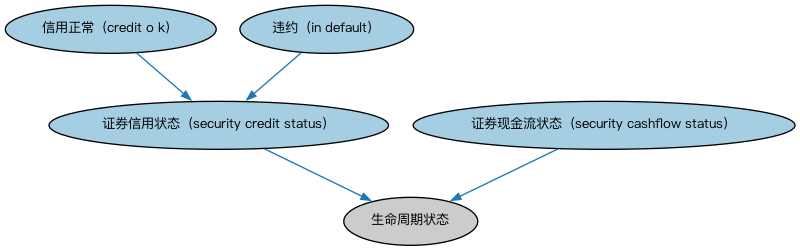

# 证券信用状态时序本体（Security Credit Statuses Ontology）结构与公理说明

本文档对应 `SecurityCreditStatuses.rdf` / `SecurityCreditStatuses.ttl`，说明该本体的类、继承关系、属性和公理约定。结构图见 `SecurityCreditStatuses-structure.png`（`SecurityCreditStatuses-structure.svg` 为可缩放版本）。

## 1. 本体概述

定义证券信用状态（如评级变化、违约状态）随时间变化的表示。

**在体系中的位置**：MD 时序核心模块的两个本体之一，与交易状态时序平行。

**上下游关系**：上游依赖 SEC 证券、FBC 信用评级与信用事件本体；下游服务信用监测与风险分析。

**与相近概念的差别**：信用状态≠信用评级——评级是机构给出的等级意见，信用状态是综合的信用处境（含违约事实）；与信用事件的差别——事件是时点发生，状态是期间持续。

## 2. 类（Class）

| 类（Class） | 定义（Definition） |
|---|---|
| 信用正常（credit o k） | 未违约。 |
| 违约（in default） | 发行人未能支付其合同义务所要求的款项。 |
| 证券现金流状态（security cashflow status） | 证券应付给持有人的现金流的状态。 |
| 证券信用状态（security credit status） | 证券在信用方面的状态。 |

### 2.1 继承关系（Inheritance）

- 信用正常（credit o k） ⊑ 证券信用状态（security credit status）
- 违约（in default） ⊑ 证券信用状态（security credit status）
- 证券现金流状态（security cashflow status） ⊑ 生命周期状态
- 证券信用状态（security credit status） ⊑ 生命周期状态

## 4. 数据属性（Datatype Property）

| 属性（Property） | 中文（English） | 定义（Definition） |
|---|---|---|
| fibo-md-temx-crs:acceleratedPrincipalPaymentsExpected | 预期加速本金偿付（accelerated principal payments expected） | 是否预期加速偿付本金。 |
| fibo-md-temx-crs:interestPaymentsExpected | 预期付息（interest payments expected） | 是否预期支付利息。 |
| fibo-md-temx-crs:principalPaymentsExpected | 预期本金偿付（principal payments expected） | 是否预期偿付本金。 |

## 5. 公理约定（Axioms）

- 证券现金流状态（security cashflow status） 与 证券信用状态（security credit status） 互斥（disjointWith）
- 证券信用状态（security credit status）：适用于 some 证券

## 6. 依赖（owl:imports，5 个）

本本体通过 `owl:imports` 引入以下本体，各项的中文名称与简介如下：

| 导入本体 | 中文名称 | 简介 |
|---|---|---|
| `FBC/FinancialInstruments/FinancialInstruments.rdf` | 金融工具本体（Financial Instruments Ontology） | FIBO 核心本体之一，定义金融工具（financial instrument）的通用概念：可交易、代表某种权利义务的合同工具，是证券、衍生品等具体工具的共同基础。 |
| `FND/Arrangements/Lifecycles.rdf` | 生命周期本体（Lifecycles Ontology） | 定义生命周期、生命周期阶段与状态转移，用于描述合同、金融工具、机构从创设到终止的演化过程。 |
| `FND/Utilities/AnnotationVocabulary.rdf` | FIBO 标注词汇表（FIBO Annotation Vocabulary） | 定义 FIBO 专用的标注属性（如释义来源、成熟度等级），用于本体自身的元数据标注。 |
| `https://www.omg.org/spec/Commons/AnnotationVocabulary/` | OMG 通用标注词汇表（OMG Commons Annotation Vocabulary） | OMG 通用本体库（Commons）中的标注词汇表，提供概念映射等标注属性，FIBO 用它标注术语与外部标准的对应关系。 |
| `https://www.omg.org/spec/Commons/ContextualDesignators/` | OMG 通用语境指称本体（OMG Commons Contextual Designators） | Commons 库中的语境指称本体，定义「在某个语境下指代某物的名称/符号」，是地址、账户号码等语境相关标识的基础。 |

## 7. 文件

- 官方 RDF/XML：`SecurityCreditStatuses.rdf`
- 中文 Turtle：`SecurityCreditStatuses.ttl`
- 结构图：`SecurityCreditStatuses-structure.png` / `SecurityCreditStatuses-structure.svg`