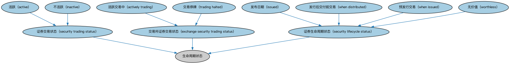

# 证券交易状态时序本体（Security Trading Statuses Ontology）结构与公理说明

本文档对应 `SecurityTradingStatuses.rdf` / `SecurityTradingStatuses.ttl`，说明该本体的类、继承关系、属性和公理约定。结构图见 `SecurityTradingStatuses-structure.png`（`SecurityTradingStatuses-structure.svg` 为可缩放版本）。

## 1. 本体概述

定义证券交易状态（正常交易、停牌、暂停、恢复）随时间变化的表示。

**在体系中的位置**：MD（市场数据）域时序核心模块的两个本体之一，是「证券状态的时间序列」框架。

**上下游关系**：上游依赖 SEC 证券与 FND 日期本体；下游为行情监控、合规检查提供状态轨迹。

**与相近概念的差别**：交易状态≠信用状态——前者是市场交易层面（能否买卖），后者是信用层面（是否违约）；与静态状态字段的差别——本本体强调状态随时间的变化轨迹。

## 2. 类（Class）

| 类（Class） | 定义（Definition） |
|---|---|
| 活跃（active） | 证券处于活跃交易状态。 |
| 活跃交易中（actively trading） | 证券正在交易所或交易设施上活跃交易。 |
| 交易所证券交易状态（exchange security trading status） | 上市证券在给定交易所的交易状态。 |
| 不活跃（inactive） | 证券处于不活跃状态。 |
| 发布日期（issued） | The security has been issued into the secondary market. |
| 证券生命周期状态（security lifecycle status） | 证券在其生命周期内所处的状态。 |
| 证券交易状态（security trading status） | 证券在是否可交易方面的状态，以及与交易相关的特殊事项。 |
| 交易停牌（trading halted） | 证券交易被暂停。 |
| 发行后交付前交易（when distributed） | 指证券在发行日之后、证书交付之前进行交易的状态。 |
| 预发行交易（when issued） | 证券在其预定发行日之前进行的交易（灰市交易）。 |
| 无价值（worthless） | 监管机构公告该证券已变得毫无价值。 |

### 2.1 继承关系（Inheritance）

- 活跃（active） ⊑ 证券交易状态（security trading status）
- 活跃交易中（actively trading） ⊑ 交易所证券交易状态（exchange security trading status）
- 交易所证券交易状态（exchange security trading status） ⊑ 生命周期状态
- 不活跃（inactive） ⊑ 证券交易状态（security trading status）
- 发布日期（issued） ⊑ 证券生命周期状态（security lifecycle status）
- 证券生命周期状态（security lifecycle status） ⊑ 生命周期状态
- 证券交易状态（security trading status） ⊑ 生命周期状态
- 交易停牌（trading halted） ⊑ 交易所证券交易状态（exchange security trading status）
- 发行后交付前交易（when distributed） ⊑ 证券生命周期状态（security lifecycle status）
- 预发行交易（when issued） ⊑ 证券生命周期状态（security lifecycle status）
- 无价值（worthless） ⊑ 证券生命周期状态（security lifecycle status）

## 5. 公理约定（Axioms）

- 活跃（active） 与 不活跃（inactive） 互斥（disjointWith）
- 活跃交易中（actively trading） 与 交易停牌（trading halted） 互斥（disjointWith）
- 交易所证券交易状态（exchange security trading status）：分类 some 挂牌
- 证券生命周期状态（security lifecycle status）：分类 some 证券
- 证券交易状态（security trading status）：分类 some 证券

## 6. 依赖（owl:imports，6 个）

本本体通过 `owl:imports` 引入以下本体，各项的中文名称与简介如下：

| 导入本体 | 中文名称 | 简介 |
|---|---|---|
| `FBC/FinancialInstruments/FinancialInstruments.rdf` | 金融工具本体（Financial Instruments Ontology） | FIBO 核心本体之一，定义金融工具（financial instrument）的通用概念：可交易、代表某种权利义务的合同工具，是证券、衍生品等具体工具的共同基础。 |
| `FND/Arrangements/Lifecycles.rdf` | 生命周期本体（Lifecycles Ontology） | 定义生命周期、生命周期阶段与状态转移，用于描述合同、金融工具、机构从创设到终止的演化过程。 |
| `FND/Utilities/AnnotationVocabulary.rdf` | FIBO 标注词汇表（FIBO Annotation Vocabulary） | 定义 FIBO 专用的标注属性（如释义来源、成熟度等级），用于本体自身的元数据标注。 |
| `SEC/Securities/SecuritiesListings.rdf` | 证券上市本体（Securities Listings Ontology） | 定义证券在交易所上市（listing）及其上市状态。 |
| `https://www.omg.org/spec/Commons/AnnotationVocabulary/` | OMG 通用标注词汇表（OMG Commons Annotation Vocabulary） | OMG 通用本体库（Commons）中的标注词汇表，提供概念映射等标注属性，FIBO 用它标注术语与外部标准的对应关系。 |
| `https://www.omg.org/spec/Commons/Classifiers/` | OMG 通用分类器本体（OMG Commons Classifiers） | OMG 通用本体库（Commons）中的分类器本体，定义分类方案、类别与归类关系的通用概念，FIBO 的分类建模建立在其上。 |

## 7. 文件

- 官方 RDF/XML：`SecurityTradingStatuses.rdf`
- 中文 Turtle：`SecurityTradingStatuses.ttl`
- 结构图：`SecurityTradingStatuses-structure.png` / `SecurityTradingStatuses-structure.svg`