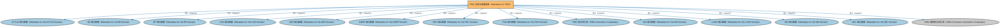

# FIBO 全库元数据清单（Metadata for FIBO）说明

本文档对应 `MetadataFIBO.rdf` / `MetadataFIBO.ttl`。

## 1. 本文件是什么

FIBO 的最高层清单文件：声明整个 FIBO 由 12 个域（BE、FBC、FND、SEC、DER、LOAN、IND、BP、CAE、MD、EXMP、ACTUS）构成，并携带全库的版本、版权与许可信息，是发布管理意义上的「总目录」。

从机制上说，这是一个元数据清单（metadata manifest）文件：它本身不定义任何类或属性，而是通过 `dct:hasPart` 声明一个域或模块由哪些本体构成，并携带版本 IRI、版权、许可与成熟度等发布管理信息。它回答的问题是「这个域/模块包含什么、当前是什么版本」，供发布工具和文档系统按模块组织内容；它的 `owl:imports` 只引入标注词汇表，不是用来加载业务本体的入口（加载入口是 `All*` 与 `About*` 聚合文件）。

## 2. 声明的构成（dct:hasPart，12 个）

| 构成项 | 中文名称 | 简介 |
|---|---|---|
| `ACTUS/MetadataACTUS.rdf` | ACTUS 域元数据（Metadata for the ACTUS Domain） | 声明 ACTUS 域的构成（合约条款、条款映射、受控词汇三个本体）及版本信息。ACTUS 域把算法合约类型统一标准接入 FIBO。 |
| `BE/MetadataBE.rdf` | BE 域元数据（Metadata for the BE Domain） | 声明商业实体（BE）域由 8 个模块构成：功能实体、政府实体、法律实体、所有权与控制权、合伙、私人有限公司、独资经营、信托。目录下另有公司（Corporations）模块的清单文件，但未被本清单列入构成，属于上游预留模块。 |
| `BP/MetadataBP.rdf` | BP 域元数据（Metadata for the BP Domain） | 声明业务流程（Business Process，BP）域由两个模块构成：金融语境与流程、证券发行。 |
| `CAE/MetadataCAE.rdf` | CAE 域元数据（Metadata for the CAE Domain） | 声明企业行动事件（CAE）域由企业事件（Corporate Events）一个模块构成，及版本信息。 |
| `DER/MetadataDER.rdf` | DER 域元数据（Metadata for the DER Domain） | 声明衍生品（DER）域由四个模块构成：衍生品合约、利率衍生品、信用衍生品、证券类衍生品。 |
| `EXMP/MetadataEXMP.rdf` | EXMP 域元数据（Metadata for the EXMP Domain） | 声明示例（Examples，EXMP）域由两个模块构成：法律实体示例、证券示例。该域内容仅用于演示与测试，不属于生产模型。 |
| `FBC/MetadataFBC.rdf` | FBC 域元数据（Metadata for the FBC Domain） | 声明金融商业与贸易（FBC）域由四个模块构成：债务与权益、金融工具、功能实体、产品与服务。 |
| `FND/MetadataFND.rdf` | FND 域元数据（Metadata for the FND Domain） | 声明基础（Foundations，FND）域由 15 个模块构成：会计、代理人与人员、协议、安排、日期与时间、目标、法律、组织、所有权与控制、参与方、地点、产品与服务、关系、交易扩展、工具。 |
| `IND/MetadataIND.rdf` | IND 域元数据（Metadata for the IND Domain） | 声明指标与指数（IND）域由五个模块构成：指标、经济指标、利率、外汇、市场指数。 |
| `LOAN/MetadataLOAN.rdf` | LOAN 域元数据（Metadata for the LOAN Domain） | 声明贷款（LOAN）域由三个模块构成：贷款通用、具体贷款、房地产贷款。 |
| `MD/MetadataMD.rdf` | MD 域元数据（Metadata for the MD Domain） | 声明市场数据（Market Data，MD）域由四个模块构成：时序核心、债务时序、衍生品时序、集合投资工具时序。 |
| `SEC/MetadataSEC.rdf` | SEC 域元数据（Metadata for the SEC Domain） | 声明证券（SEC）域由四个模块构成：证券、债务、权益、基金。 |

## 3. 标注依赖（owl:imports，14 个）

以下导入仅用于支撑元数据标注本身（如成熟度等级、概念映射），不属于业务内容：

| 导入本体 | 中文名称 | 简介 |
|---|---|---|
| `ACTUS/MetadataACTUS.rdf` | ACTUS 域元数据（Metadata for the ACTUS Domain） | 声明 ACTUS 域的构成（合约条款、条款映射、受控词汇三个本体）及版本信息。ACTUS 域把算法合约类型统一标准接入 FIBO。 |
| `BE/MetadataBE.rdf` | BE 域元数据（Metadata for the BE Domain） | 声明商业实体（BE）域由 8 个模块构成：功能实体、政府实体、法律实体、所有权与控制权、合伙、私人有限公司、独资经营、信托。目录下另有公司（Corporations）模块的清单文件，但未被本清单列入构成，属于上游预留模块。 |
| `BP/MetadataBP.rdf` | BP 域元数据（Metadata for the BP Domain） | 声明业务流程（Business Process，BP）域由两个模块构成：金融语境与流程、证券发行。 |
| `CAE/MetadataCAE.rdf` | CAE 域元数据（Metadata for the CAE Domain） | 声明企业行动事件（CAE）域由企业事件（Corporate Events）一个模块构成，及版本信息。 |
| `DER/MetadataDER.rdf` | DER 域元数据（Metadata for the DER Domain） | 声明衍生品（DER）域由四个模块构成：衍生品合约、利率衍生品、信用衍生品、证券类衍生品。 |
| `EXMP/MetadataEXMP.rdf` | EXMP 域元数据（Metadata for the EXMP Domain） | 声明示例（Examples，EXMP）域由两个模块构成：法律实体示例、证券示例。该域内容仅用于演示与测试，不属于生产模型。 |
| `FBC/MetadataFBC.rdf` | FBC 域元数据（Metadata for the FBC Domain） | 声明金融商业与贸易（FBC）域由四个模块构成：债务与权益、金融工具、功能实体、产品与服务。 |
| `FND/MetadataFND.rdf` | FND 域元数据（Metadata for the FND Domain） | 声明基础（Foundations，FND）域由 15 个模块构成：会计、代理人与人员、协议、安排、日期与时间、目标、法律、组织、所有权与控制、参与方、地点、产品与服务、关系、交易扩展、工具。 |
| `FND/Utilities/AnnotationVocabulary.rdf` | FIBO 标注词汇表（FIBO Annotation Vocabulary） | 定义 FIBO 专用的标注属性（如释义来源、成熟度等级），用于本体自身的元数据标注。 |
| `IND/MetadataIND.rdf` | IND 域元数据（Metadata for the IND Domain） | 声明指标与指数（IND）域由五个模块构成：指标、经济指标、利率、外汇、市场指数。 |
| `LOAN/MetadataLOAN.rdf` | LOAN 域元数据（Metadata for the LOAN Domain） | 声明贷款（LOAN）域由三个模块构成：贷款通用、具体贷款、房地产贷款。 |
| `MD/MetadataMD.rdf` | MD 域元数据（Metadata for the MD Domain） | 声明市场数据（Market Data，MD）域由四个模块构成：时序核心、债务时序、衍生品时序、集合投资工具时序。 |
| `SEC/MetadataSEC.rdf` | SEC 域元数据（Metadata for the SEC Domain） | 声明证券（SEC）域由四个模块构成：证券、债务、权益、基金。 |
| `https://www.omg.org/spec/Commons/AnnotationVocabulary/` | OMG 通用标注词汇表（OMG Commons Annotation Vocabulary） | OMG 通用本体库（Commons）中的标注词汇表，提供概念映射等标注属性，FIBO 用它标注术语与外部标准的对应关系。 |

## 4. 文件

- 官方 RDF/XML：`MetadataFIBO.rdf`
- 中文 Turtle：`MetadataFIBO.ttl`
- 结构图：`MetadataFIBO-structure.png` / `MetadataFIBO-structure.svg`